# 吴恩达《构建AI浏览器智能体｜Building AI Browser Agents》中英字幕 - P2：2.intro-to-web-agents.zh_en - GPT中英字幕课程资源 - BV1pg5BzcEEr

In this lesson， we'll jump right into what webs are and how they can be used to automate tasks online。

 like purchasing an item on any commercial website。

 We will also discuss common challenges such as reliability issues。

 compounding errors and agents getting stuck loops。 Let's go。First， let's see a real world example。

Imagine you want to purchase books online， but don't have time to search and check out。In this demo。

 we have asked for our patient to order two books， the radical candor， and the Qar problem。

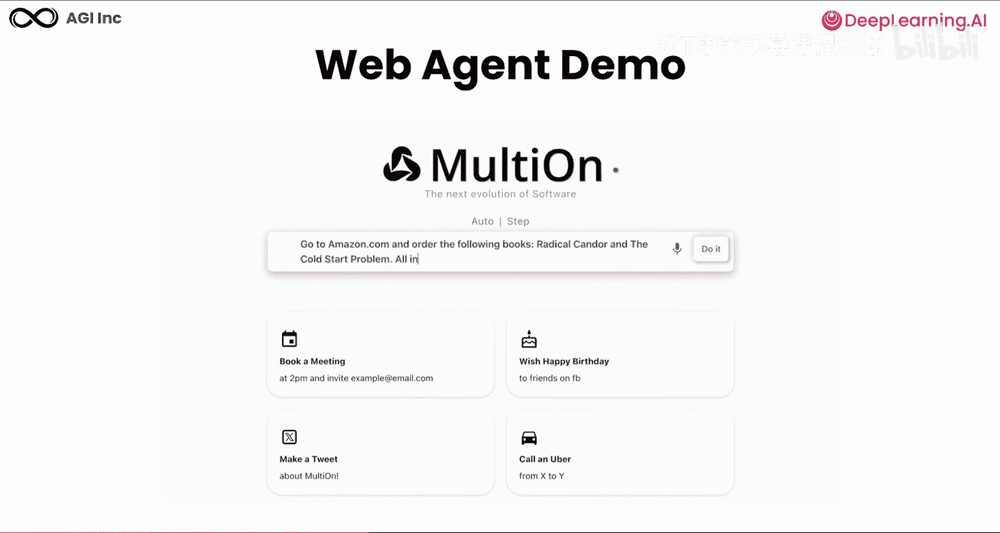

And add them to our cart and on Amazonon。

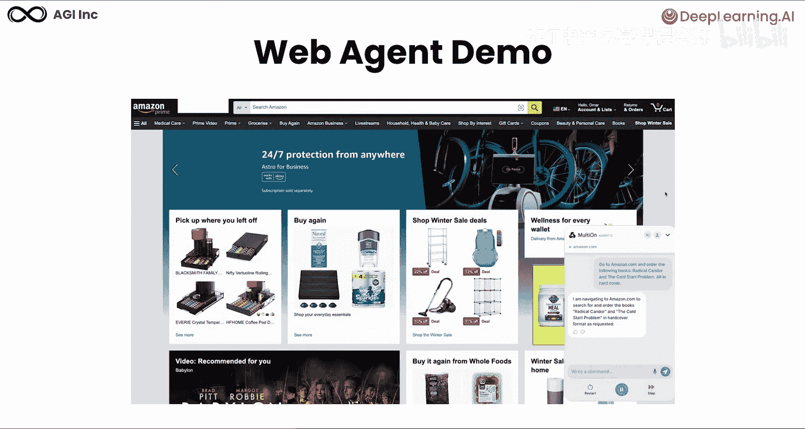

Here we notice how the agent is navigating to Amazon， just like a human world。

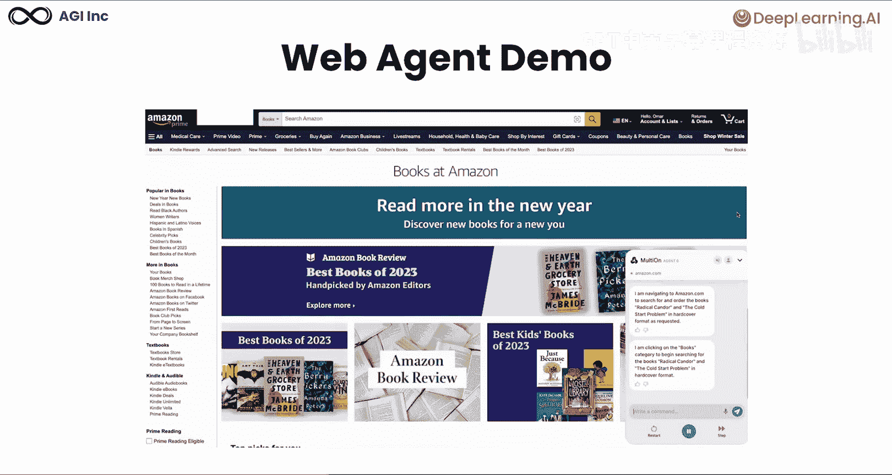

It's intelligently searching for the first book。Once it finds a books。It proceeds to add to the cart。

Next， it goes and starts searching for the second book。

And then also proceeds and like add it to your account。

And here we see the agent exactly understands where to click and how to navigate the websites。

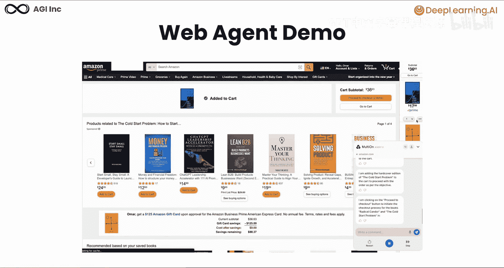

Finally， the agent can go and place the order。As you can see。

 the agent successfully found both books and added them to the count without any human intervention。

This is just one example of what vibration can do。Imagine all the possibilities this agents could automate tasks across virtually any website on the internet。

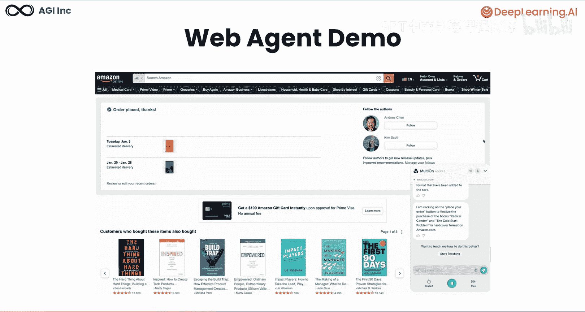

A Web agent is an autonomous software program that performs on a task automatically on your behalf。

These intelligent agents are being created for various purposes。

 such as automating reparative online tasks。Gathing Teang from me sources。

Or monitoring websites for changes or updates。Vabs can power contrast applications in our daily digital act。

This range from enhancing on in search that goes beyond simple law queries。

Ecommerce assistance for finding products and completing purchases。Social media management。

 including monitoring and not automated posting。Data analysis across multiple platforms。

Customer support automation。Travel booking and planning。

As well as specialized applications in finance， healthcare and many other industries。

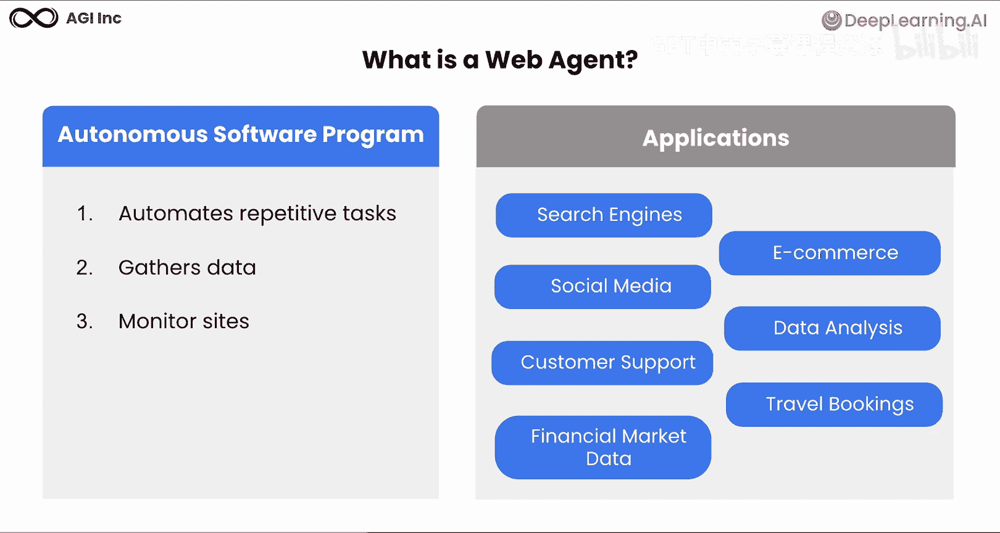

Now let's see the key components for building web agents。Here we explore the architecture。

On how these agents work。A well designed web agent consists of five essential modules。

The user interface module， which allows people to communicate with the agent， easy match language。

The control module。Which acts as the brain of the system and handles reasoning and decision making for actions。

The third is a knowledge base with the agent tools and modern data， rules and information needed。

To come tasks。The fourth is the communication module。Net manages interactionss with websites。

 APIs and others and systems。And finally， the data processing module。

 which analyze processes and transforms data before returning the results。Within these modules。

Several specialized components work together。First。

 we have parss that can systematically extract website data and interpret STMO。Second。

 action models that do decision making and predict actions to take third。

Executors that execute specific actions on the website， such as clicks， Fofil， etc ce。

Here's how the entire process flows。 First， a human provides a request to the agent。

 The agent understands the user's request。 It personals its approach based on the context。

The action model takes a web representation。Of the website。

And determines what actions to take on the web page。Next。

 the model predicts what is the optimal action in the setting。

 This action is then executed on the website。 The cycle repeats until the task is complete。

 Let's see an example。

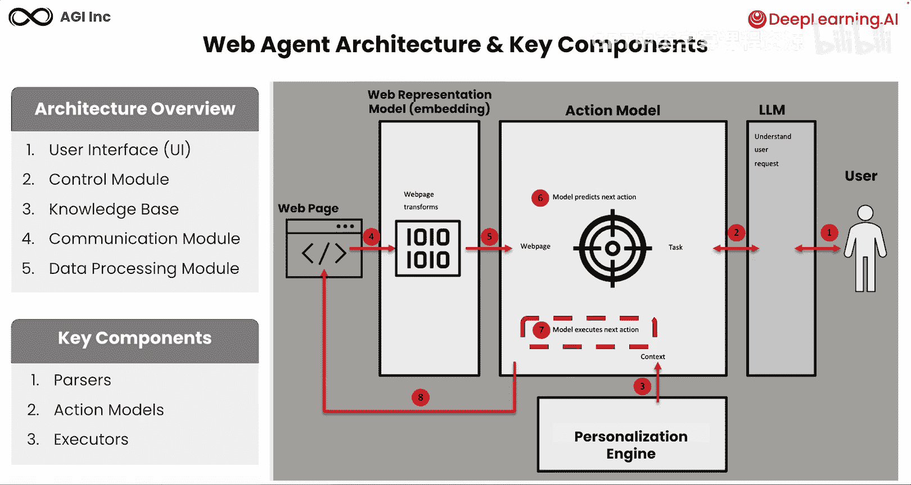

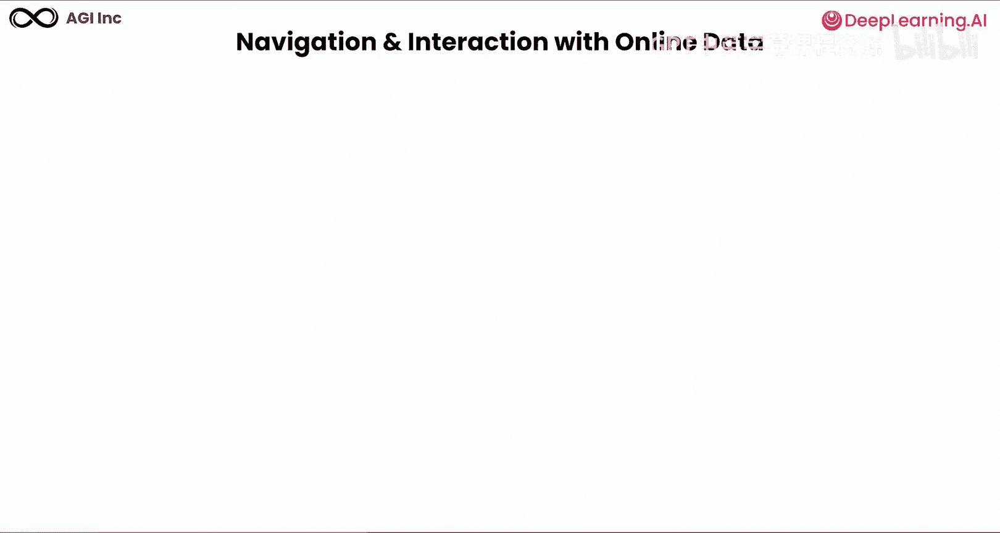

Here is a screenshot of keep learning AI websites first page you are going to build an agent that processes both visual formation。

Ie screenshots。As well as structural information。That is the HTML Dom representation or the website that can navigate to find courses on deep learning AI and do a website interactions。

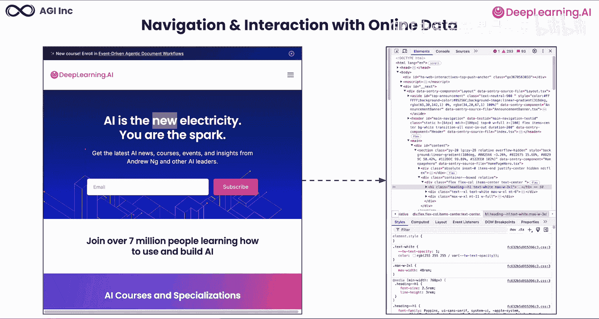

Now we explore how agents can process the dormory structure to understand page elements。

Viittants can interact with virtually any HTMLtMl element on our web page。

 this can range from length。To text areas， for entry information， check boxes forming selections。

Heioer for choosing options。D on many for acting fromless。

Butudtons for submitting forms or digging actions， as well as reset form fields。

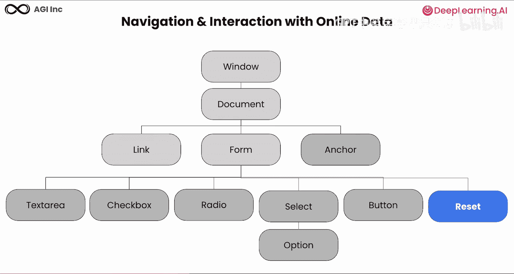

To understand the limitations of existing frameworks。

 let's examine the key steps and even follows first planning。Deta mining what actions to take。

 second reasoning。Making decisions based on the available information third。Environmental actions。

Exuding the plan actions。Funly explanations。That is culminating to the user what was done and why。

There are many issues that occur during this reasoning phase。

 If an agent cannot form a reasonable plan， it may make incorrect decisions。

This is why improving reasoning is a critical focus in our later lessons。

Let's see the main limitations of existing autonomous agent frameworks。Firstt。

Reabity and trust challenges。Ensuring autoous systems can be trust。

With mechanisms for human over rightss。Second。Decision making errors。

 where there is compounding mistakes and trade offs between exploitation and exploitation。

And finally planned divergence and looping， whether there are risks of repeatputive  cycles or diverging plants during agent execution。

First， it's very hard to establish reliability interest with current auto systems。

 They are stochastic， and things can go wrong。When it comes to decision making errors。

Agents suffer from compounding mistakes。 That is a cascadet of errors that can grow over time。

 Early errors can snowball into larger problems as they influence subsequent decisions。

Lack of self correction means agents can identify and fix their own mistakes。

This can lead to catastrophic failures as errors accumulate and magnify。

Limited context agents may miss critical information when making decisions。Without complete context。

Cices become increasingly flawed。England isn't reasoning。

Decisions based on incorrect or incompological processes leads to imperable behavior and unreliable outcomes。

Bs problems which might present in training data can be amplified in Asian decisions over time。

 this creates increasingly swed or unfair results。Together。

 these issues significantly undermine the decision making capabilities of autonomous agents。

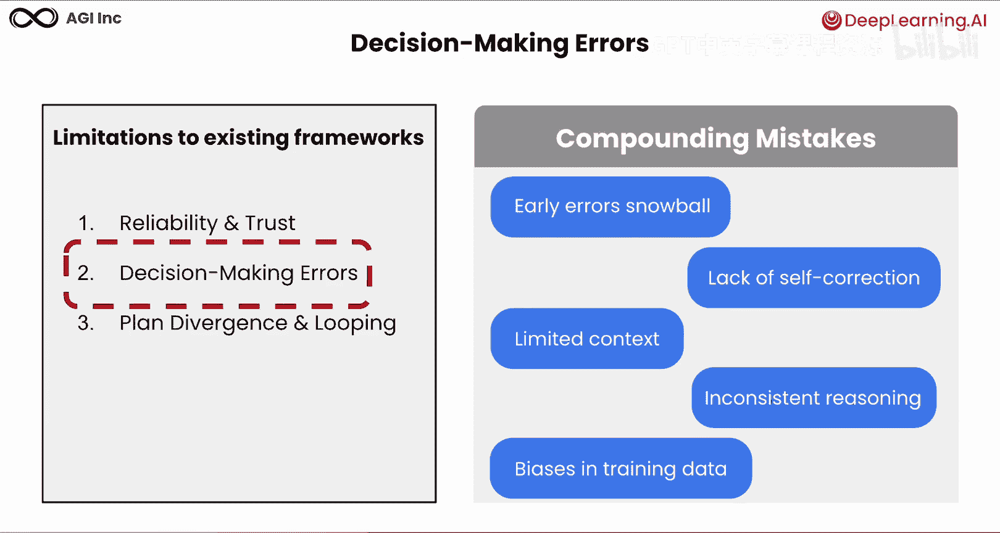

Vi agentsgians constantly face a critical discerning charge；

 should they exploit what they already know， or should they exploit new possibilities。

This treat also fundamentalnaly shape how agents navigatecate websites。In the exploitation strategy。

 agents focus on maximizing rewards。 They follow a single path deeply before considering alternatives。

 Theyve explored the children elements in the boundary trade and use recursion to navigate deeper and do the promising paths。

The advantages of exploitation are that it allows maximizing the current rewards by leveraging known。

 successful strategies。 It allows efficient use of resources on paths with known proven values。

 It gives more predictableictable performance in familiar environments。

It also has a lot of disadvantages where it can potentially miss alternate paths。

 The agents can become lockedgged into the current strategy。

 They might be unable to adapt if the chosen path is so optimal。Now。

 we examine the alternative approach， exploration， and exploration agents use a breadth force search strategy。

The agent tries new unted parts to discover potentially better rewards and strategies。

Rather than going deep， it goes and explores all possible directions。As shown in the diagram。

 the agent examines all child elements at each level before starts growing deeper。

When a promising path is bomb， the agent continues exploration。

If the pilot is lead to the desired state， theian backt， and it can try alternatives。

This skirts a broader search pattern across the whole website' structure。

It has the advantages that can unlock new opportunities。

Help discovering high rewards or better paths that were not previously known。

It can prevent stagnation， it reduce a risk of being stuck in some optimal strategies。

And it enables adaptation to changing environment or requirements。

It also has a couple of disadvantages， such as it might have more immediate cost。

Exploration may yield image rewards and could even lead to reverse outcomes。

It can lead to the risk of faster time， pursuing unknown path can result in inefficient user of resources and time。

And also increasing complexity in decision making processes。

The critical challenge for Web agents is determining Venex row versus Ventex point。

Choosing incorrectly between the strategies is a common source of decision making errors。

 the ideal approach often involves balancing both strategies。Adaductively， based on the context。Nao。

We examine a critical challenge， facing optimizationisations。

When is stray away from their intended path。Among the limitations in current frameworks。

 we will now focus on planned divergence and looping behaviors。

Planned divergence happens when an agent wears of course in this diagram。

 you can see the ideal path as a straight line， but the actual path divs significantly。

 like asking assistant system to summarize a topic， but receiving undd information instead。

Even advanced A agents like the over to serve correct when they make mistakes。

Once an agent aviiateates or gets stuck， recovery becomes extremely difficult due to three k factors。

 First， agents typically have limited dumb knowledge that train on general information。

 but they struggle with specialized tasks。Second， unexpected changes in an environment in confusion。

 causing it to repeat inect actions rather thanduct。Finally。

 insufficient can grid academic make it difficult for agents to navigate unfamar situations and recognize when they background。

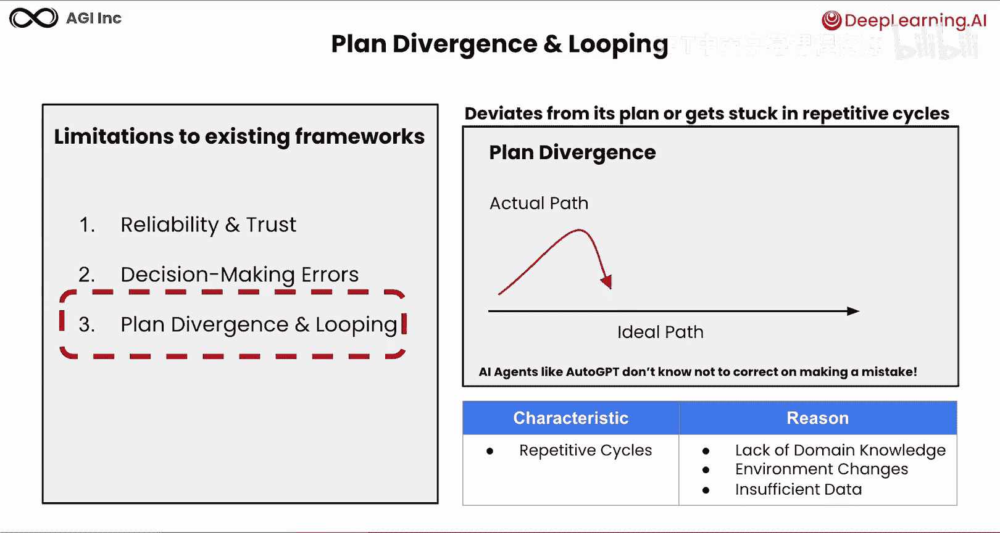

In this lesson， we explore what agents are， What are the key components in building them and their main issues In the next lessons。

 you will learn how to address these fundamental challenges。

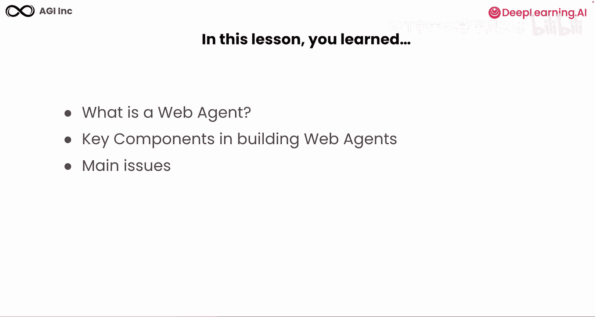