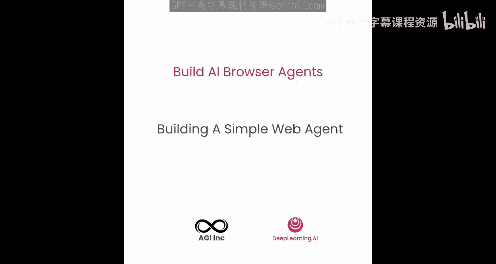
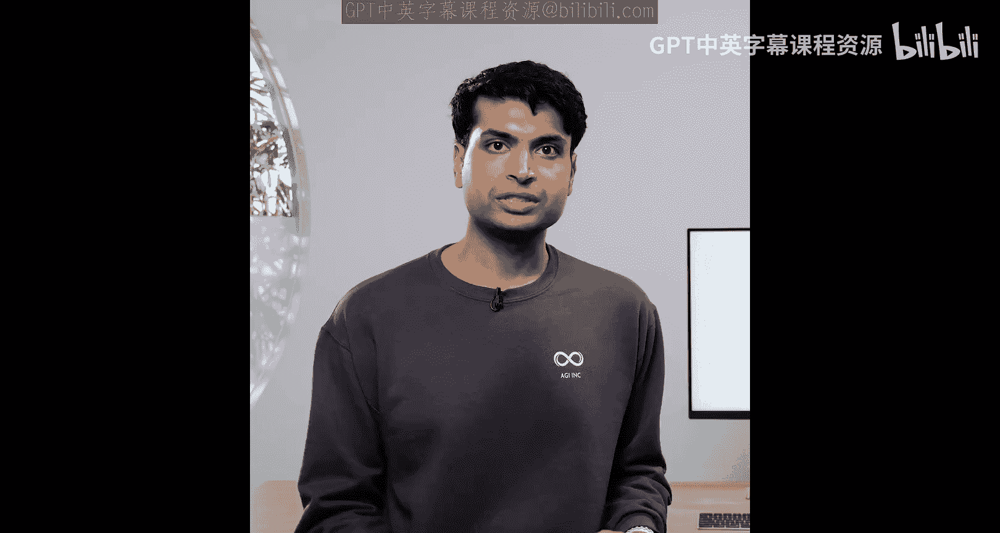
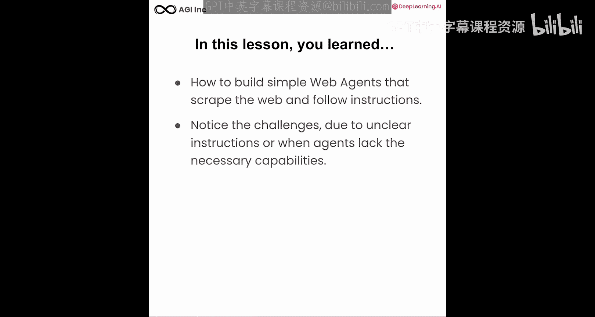
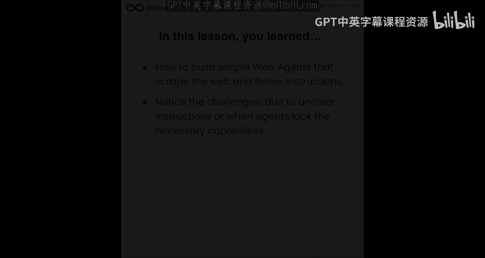

# 吴恩达《构建AI浏览器智能体｜Building AI Browser Agents》中英字幕 - P3：3.building-a-simple-web-agent.zh_en - GPT中英字幕课程资源 - BV1pg5BzcEEr

In this lesson， you will build a simple byent that is capable of scraping the web and providing the results as a structured output based on natural language instructions。

 All right， let's dive into the code。😊。

So in this lesson we are going to be building a simple web agent here we are calling it a learning recommender agent here we start with navigating to the deep learning A website and we ask the agent to scrap the courses。

 list the specific course on a specific topic and then read the details and learning objectives of that course now let's go to the lab。

So we are going to start with importing our libraries。In this lesson we are going to be using pandas。

 playwright I syncnc， Open AI， Pepplan， image library to display our screenshot data and same for hyperthon。

 and then we are going to be using our helper functions。

Then we start with initializing our Open Air client with the API key and we also make sure our juvennal can run asynchronously Im going to run this and then we already have the key set up for you in the deep learning Air platform we are going to start with creating a simple web scraping agent so here we have described our webcrapper agent。

 where we areaginizing it， we also initializing our browser that we are scraping our WebtMl content。

We also allow you to take screenshots and converting it into a screenshot buffer to better display and finally we allow you to close your browser。

Then we initialize our Webaging client， well start with creating our structured data format。

Here we start with describing our deep learning AI course。

 which has this title description who the presenter is， is image URL and the course you order。

Here you create multiple Rii air courses。So we will start with creating our open air client heavier describing our model which is Tputy 4 minii with a traffic version which is highly fine tune towards returning a cr response。

So， we are describing our system prompt which describes the role of the agent here we are asking it to act like a v scraping agent and its task is to follow the relevant information and convert it from STMl to JO。

And here we allow it to give your own instructions and its objective is to return the title description presenter image URL course URL of all of the courses in depending Af site and basically instructed only give JSO and not the format that we don't want then you give your ST content to the agent and you also describe the response format you want your structured output to be here you return your structured response in the webcraper this is where everything comes together you first get your HTML content that we take our screenshot。

And finally， you give it to your LLM to process and return a structured response。

And as a way to do it properly， we also cross our scraper。Now let's work on our first example。

 so we first start with our target URL this is where webage will start at and we also define a base URL that we need for displaying our final course URL。

Then let's give it our instruction， so in the instruction is a simple instruction where we ask it to get all the courses and we get the result and screenshot from the web Sc we run this。

So the agents start extracting the estimate content， taking screenshot。

 and finally it is processing the results to get our script data。This might take some time。

 but we will speed up in post。 And finally， we have our structure response。Here。

 using the visualize function， you will visualize your results。

 The details of this is in the helper file。And here is our output。

 as you can see it has scrapd all the courses that are in deep learningning A website and it starts with longter energy memory with Landrf is description who the presenter is the image well and finally the course you are that you can directly navigate to same with Lama In。

 windsurf， course from deep learningning AI arise， and many more and you can also visual the screenshot of the page that the web Scr agent got all these courses from。

Now let's work on a second example， what you can do is you can read the description and have the LM understand what the course is about and only retrieve the course that you are interested in。

You can ask the agent to read all the description about a course。

 and the description can be even entitled some of the course summary。

 even like who the presenter is and some overall details that are not visible here。And that way。

 LLM has information that is not visible to you， but it has an inherent understanding of what the course is about。

Now we will give a instruction that follows it reading our description about the course and only giving three courses that are about the subject and we make sure that it does not give any other course in output here the subject we are choosing is retrieval augment generation drag and now let's process our results。

Now that we have generated a structure response， we can use the visualized function again to see our structure response visualization。

Here， now the courses that our agent is returning is about Ra。

 so you can see it' is able to find the solution of drag。

 course description and their tags and labels。Now， let's see some of the challenges that we have in our Web agents。

Here， if we give it like a bit more complex example。

 we're supposed to even get the summary of the top course and provide what learnings from it given the subject。

Let's see what it can return。Now， we will use our visualized function again to visualize the reserves what our agent returned。

And here we see that it didn't follow our instructions correctly。

 The instructions was give us the summary and learnings that we get from it。

 but since the agent was not able to follow our instructions correctly。

 it returned all the courses that are available in the website Now you might be able to improve the agent in terms of having it go deeper in the course。

 open the course， get the learnings or description summary or the teachings and have the agent then able to output data as a structure result but then youre overfitting towards the data but rather the use case that we want from our agents it needs to understand our tasks really well and generalize on our learnings in this lesson we learn how to build simple web agents that are capable of scrapping the web and follow our instructions we also notice the challenges where sometimes the instructions can be unclear or agents just don't have the capability of following that and then they give us our wrong output。

Which shows the challenges in their next lesson will go over how can we overcome some of these challenges that we are seeing in our current pageav。

