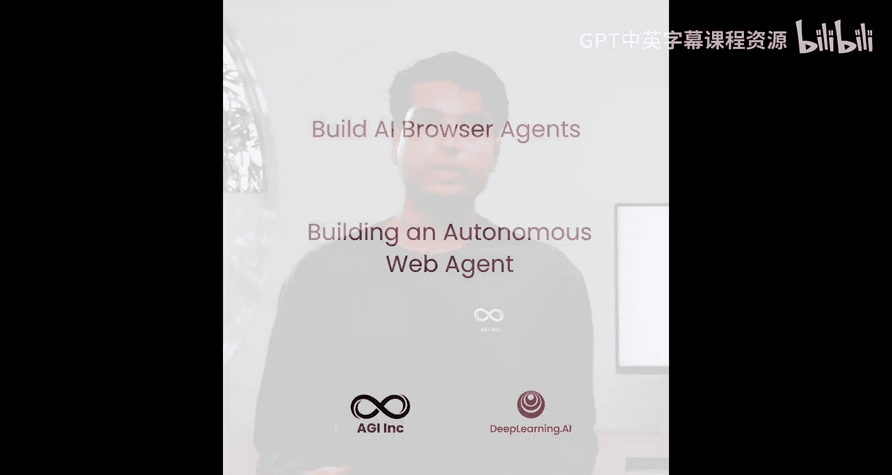
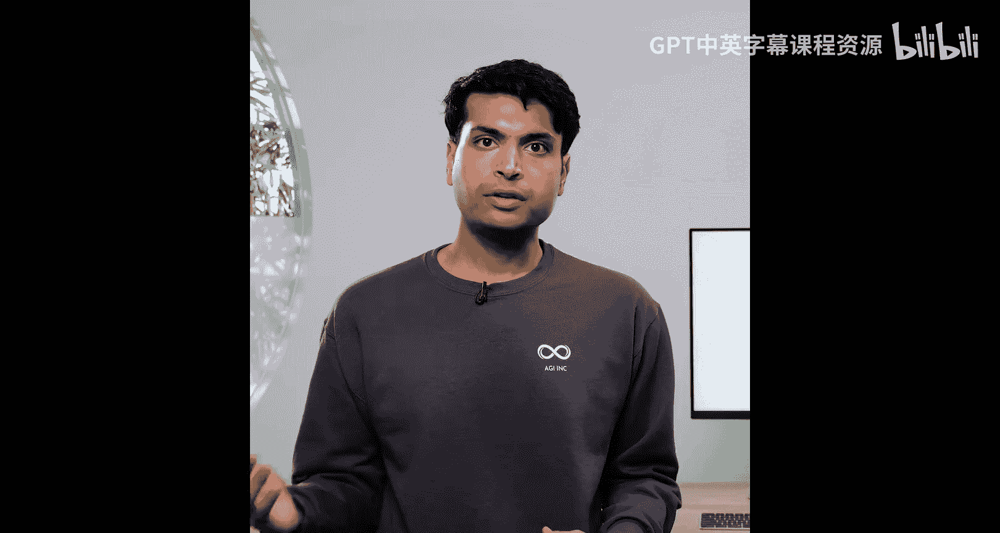
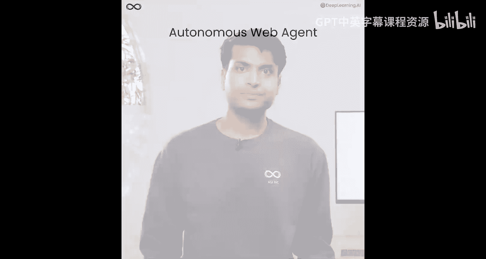
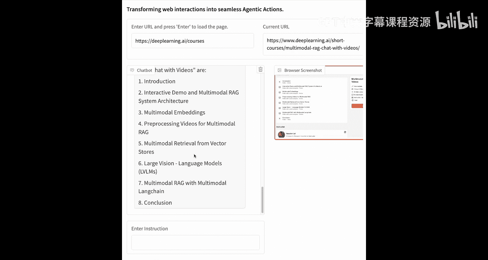
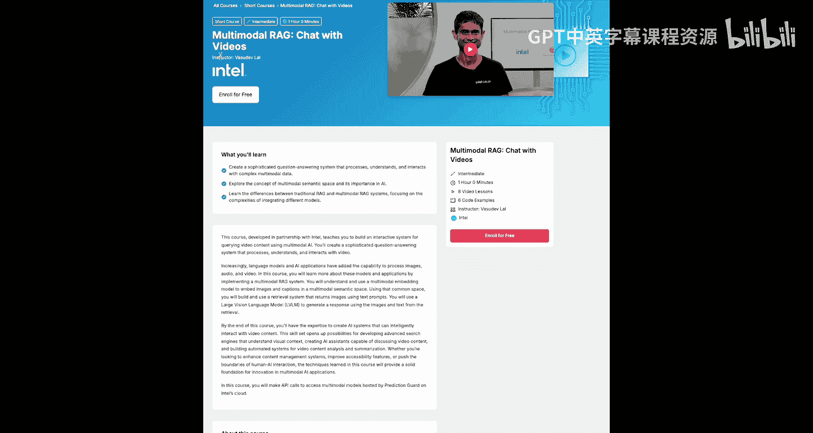
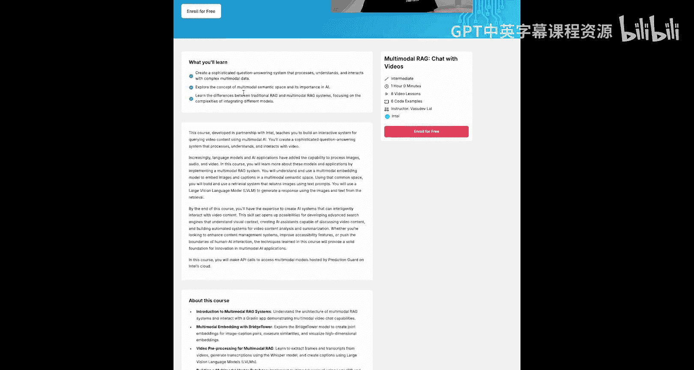
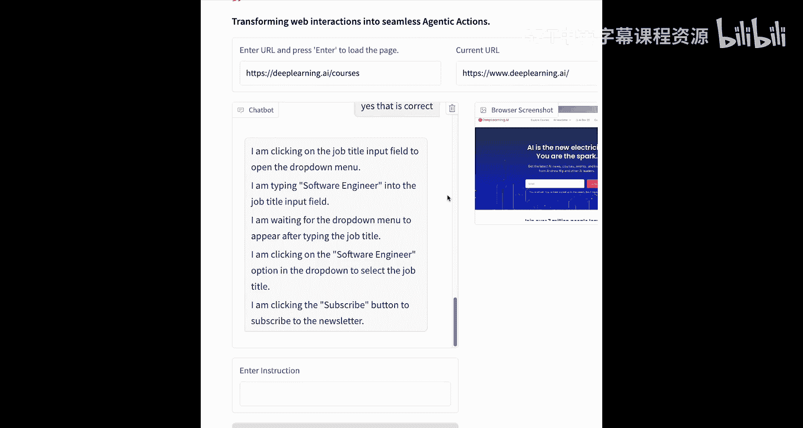

# 吴恩达《构建AI浏览器智能体｜Building AI Browser Agents》中英字幕 - P4：4.building-an-autonomous-web-agent.zh_en - GPT中英字幕课程资源 - BV1pg5BzcEEr

In this lesson， you will build an autonomous web agent that can execute multiple tasks simultaneously。

 You will prompt the agent to perform tasks such as navigating， taking actions。

 summarizing the web pages， even filling up a form and signing up for a new setup。 All right。

 let's start coding。😊。

Now we will make that news case much more complex and see how can the agent work fully anonymousnoly。

 the agent will open a course page， get a summary of learning outcomes and even subscribe for the newsletter。

In the lab， you will learn how to create autonomous web agents；

 you will use multion web agent in this lab。Now we start by importing our multi on client。

And weve prepared some functions in details for you to make the lab much easier to visualettes。

 so we allow you to visit a session， see a multi on demo， have a session manager， imtutube。

 and also see displayed stephas。Here we start by initializing our Maltion agent。

 we load the Maltion API key from the UTs， now we create a multiion client here we are creating a simplified client for our multiion APIpis。

First， we initial slice the multi on client with the API key。

Here we use the already theater instance for Mer class。Then we create a new session for Age。

 which starts at URL that we provide and we also allow it to include screenshots that we also allow you to close all open sessions。

And we allow you to also navigate to a particular URL。

Now we allow you to execute a task in the current agent session。

Here you can give it a specific task that you want the agent to follow and here the task executes in a single step。

 but you can allow it to continuously run in a multiple steps some of the instructions that were given to our agent is first to not asked questions to the user。

It has all the necessary information in the page and it should try to complete the task in best of its abilities and finally we can describe the task and also ask you to return our screenshot。

Now we initialize our multion client that we created， let's start with our first example。

 we give it an instruction to get list of all the courses here we start by creating our session。

We ask you to execute task based on each step and we define each step as a particular action that the agent can take and it can be either click。

 type， summ， scroll or deieving the information right now we limit it to a certain number of max steps and that you are define is 10。

And you can visualize the session using the visual session function。

And then execute the task following the instruction that we have given it。

A new session has been created。 We continue to see how many steps have been executed。

Not let's run it。So this might take some time but well split it up in post now we have our results so we can see the step0 it created a session then the first step that it takes is scrolled on the page to load more content Similarlyly it keeps scrolling down until it will reach the end of the page while following multiple steps。

No。😔，You will see the final response we will use our V assessment function again。

And this is the final response that the agent gives us here it is able to find all the courses that are part of deep learningning Air website in full details。

You can see it does not follow a particular structure because it is a more of a conversational assistant where it follows the answer as a more of a conversation。

 but if we give it instruction， give a structure output like a DSSO or markdown。

 it would have followed their results。You can see it is like the fun screenshot where it stopped and started giving us all the course listing。

Now you will create your own browser UI here， you use your initialized Meron client as part of our session manager for which we have already provided you the implementation in the U folder we'll ask it to follow certain instructions like Fund the course on a subject and open it summarize the course get detailed course lessons and finally we start with a more complex example to go to the deep learning AI homepage。

 subscribe to the batch newsletter news of particular name email choose any other required field and then give it a guidelines to make sure that it selects the proper dropdown values and once it sees the subscribe button it clicks it Now let's describe our variables like course subject email and name here we have given it some of our subject as rack we find the name as the gog and our email infol the A company now we will create our own Meron。

Brower UI and also see what results and page it is interacting on now our multiam browser Ui is fully loaded and you can see it started on deep air courses we will start with our first example asking it to find the rack course and open it you can see it entered the rack course in the search bar and waiting for the search results to load and here is trying to scroll and find the course that it wants to open and examine its content scroll more to see which course it wants to open for the rack ask a question on it seeing multiple courses on rack but it wants us to give it a specific title and as you can see in the browser UI we see a course on multimodal rack and I will ask it to open that。

As you can see， it is able to interact with the browser and open the course on multimodal track Now as the next instruction will will ask you to summarize it。

Here， it has given us。😔，The summary of the course and conclude the summary。

You can ask it to give it a more detailed code lessons。

Here it improves the format and gives us what are the different topics that the lesson covers go to the course website and see indeed it is did get the concepts right so you can see this is the multimodlar rack chat with video Vaov La。

Let's see course as an outline。And you can see it has eight lessons and six chd examples。

 and our agent was able to find the course lessons outlined in a structured oroc。

This displays the capability of autonomous AI agents。Let's do something even more exciting。

 we will ask the agent to go to the deep learningning Air home page。

 subscribe to that batchsh news Use the name， theygog info at the or company。

 choose the other required field like country as United States and job title as software engineer and we give it a guideline to make sure that proper Do values are selected by typing and clicking on it and finally once it sees the subscriber and it clicks it。

Navviigating to the deep learningning A home page， this might be small to see。

 but it is able to enter thegg as a name and also the email。

It might have reached the maximum number steps， but we will ask you to continue。

Now its select country as United States。到。So it missed one particular step and will ask it to also select the job title。

So the agent seems to be asking more questions just to make sure that it follows the correct guidelines and I can mentioned yes that is correct。

And you can see now it's entering the proper job title trying to select it from the drop down menu and it has finally selected it。

And it click on subscribe button to subscribe to the newsletter。

So in this lesson you learn how to create autonomous web agents。

 how you can give it simple instructions and if we follow them。

 and you can also follow a much more structured response without us manually describing it as code。

And then you also see how it can interact with the browser。

 but you also see there are some challenges where it might forget some steps or it might need more clarification or guidelines to follow。

 but agents are able to follow these steps fully autonomously in a multiple step manner。

Now I encourage you to interact with this amazing browser youI and if you are not subscribed to the deep Planning AI Bsh newsletter。

 try it and see how it goes。

