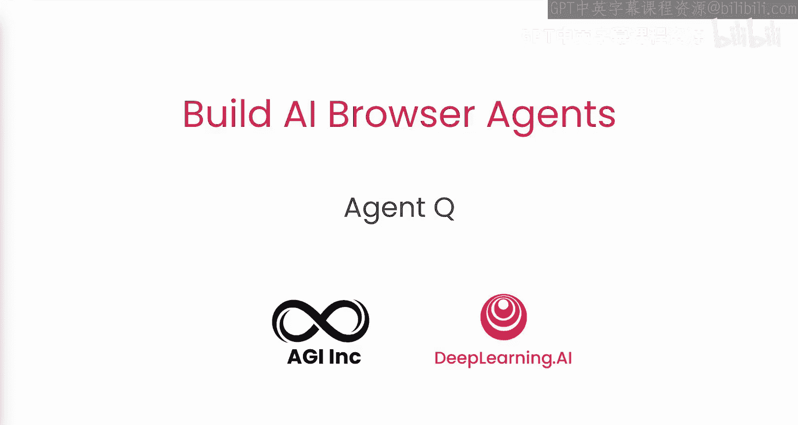
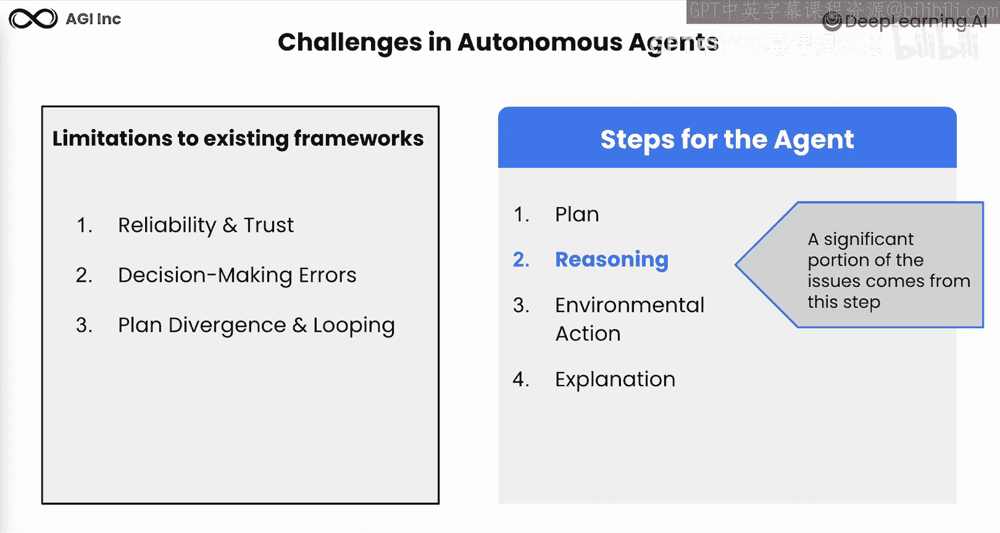
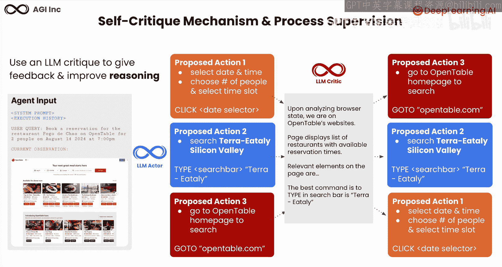
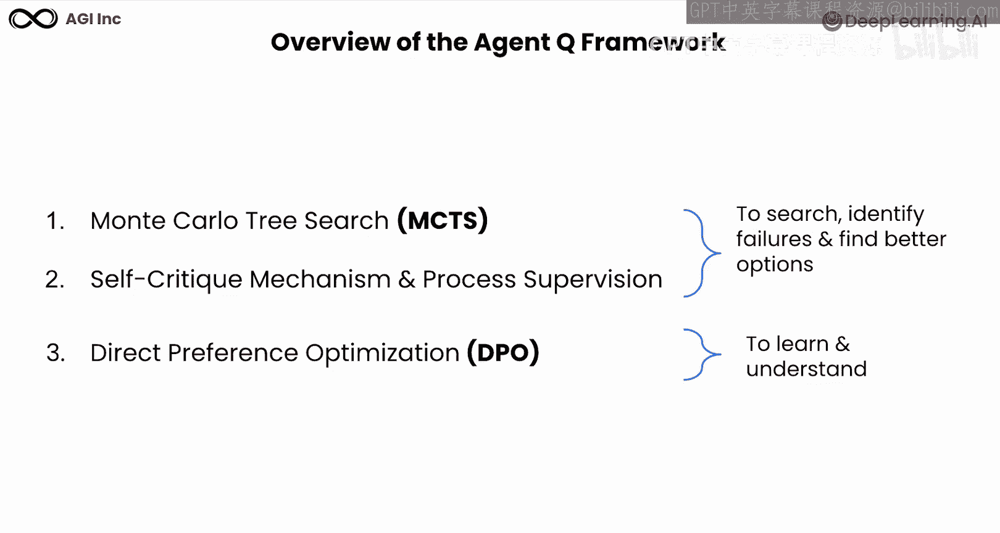
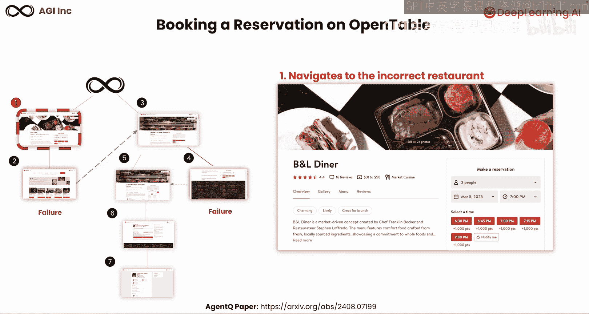
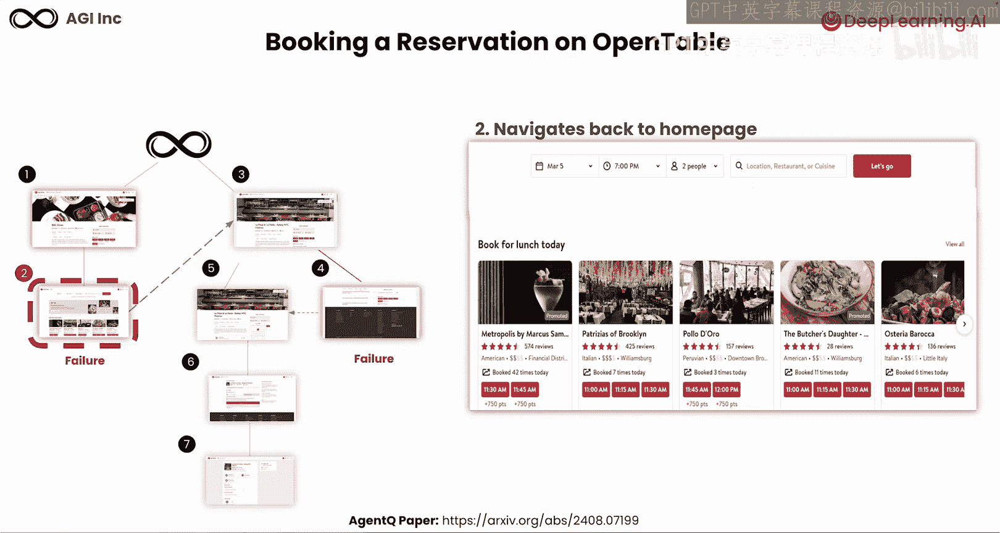
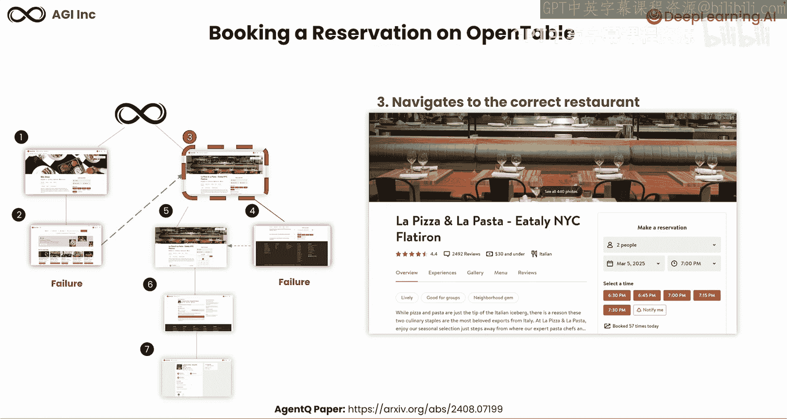
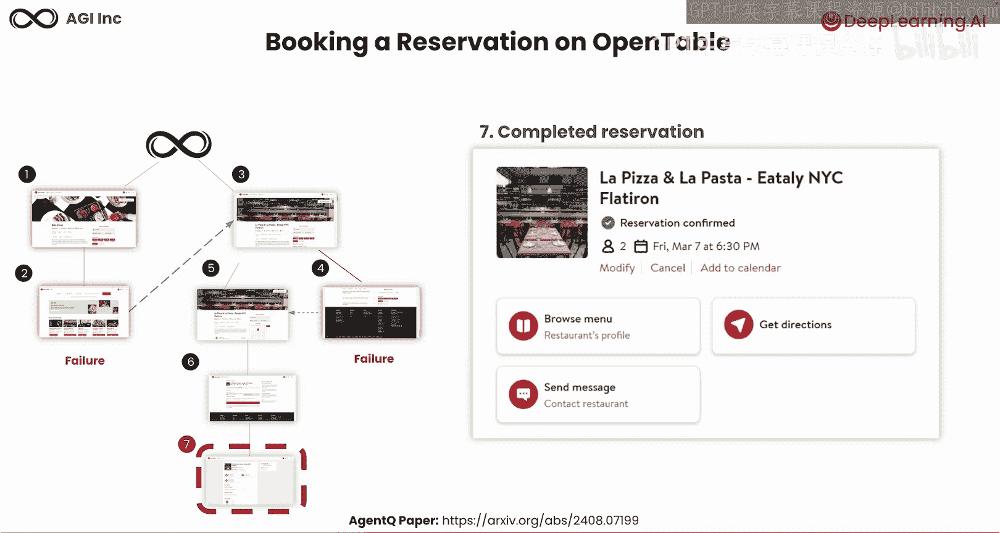
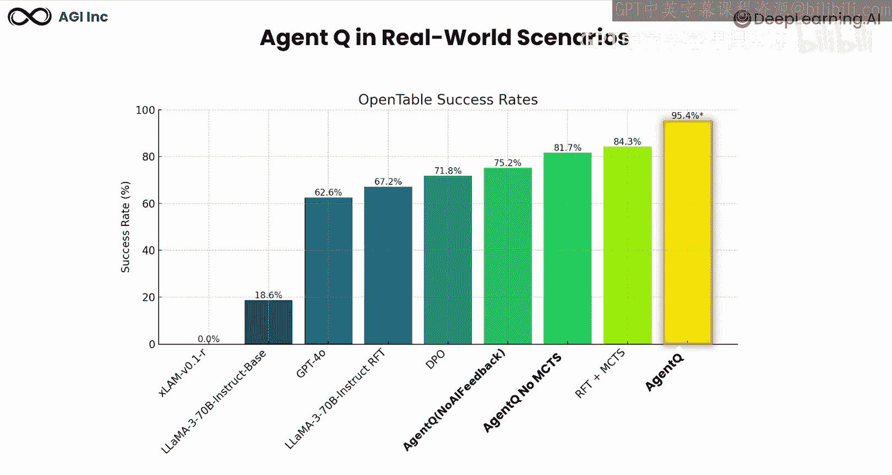

# 吴恩达《构建AI浏览器智能体｜Building AI Browser Agents》中英字幕 - P5：5.agent-q.zh_en - GPT中英字幕课程资源 - BV1pg5BzcEEr

In this lesson， we will explore agent Q a framework designed to teach AI agents how to self correct through various techniques used by AI researchers will dive into the key methods for improving agent performance。

 We also provide a comprehensive overview of the agent Q framework and examine how it effectively addresses common AI agent challenges that's st。

Remember， from lesson 1。The existing frameworks have various limitations， first， liability interest。

 second。This is making errors， third， planned diveence and looping。

There are four steps for agent execution。Planning， reasoning。

 where significant issues for agent execution come from the reasoning part。

 and this is what we are going to address in this lesson。

Now let's learn about 8 K。Which is a state of art algorithm that addresses these issues and improve reasoning in webages。

Agent can combine the following methodologies to teach agents to self correct， monitor research。

 efficiently explore search spaces， self creating mechanisms for continuous improvement。

 where agents receive your time feedback and direct preference optimization DP。

Which is the reinforcement learning algorithm that improves based on the current experience。

Even learn how these methods work together to create a powerful framework for autonomous agent at reasonreasoning called Agent Ki our research team has published this finding cinema paper online that can be found on archive in our next lab you will explore some of these concepts。

😊，Now， as staff1 in understanding it Q， we will learn about how Monc research or MCTS works。

MCTS is a search methodologyorology for backtracking and exploring。

And it allows decisions where we planned several steps ahead。In MCTs， we started the root mode。

Which is our current situation。From here， the algorithm will follow what it thinks is the best part based on what it knows so far。

Using an exploitation strategy， the algorithm continues on the tree。😊。

Selecting what seems to be the most promising until it is a node where further expression is needed。

At this point， that is an expensive tree by adding a new possibility。

And explores this uncharted treachery。Once we reach the end node which is as far as we can go。

 the algorithm predicts an expected future reward of containing on this path as a mod estimate。

Think of this as playing out a quick what scenario to see how good this choice might be。

After the future reward estimate， MCTS updates all the notes it has visited on the way。

This called back propagation。Essentially regarding their algorithm， hey。

 this part lack to this results or bit your knowledge accordingly。😊。

The magical MCTS is the data process toeach many rights with the it they you get smarter。

 focusing more on the promising parts and less on their。

 just like how you might get better at just by thinking to different moves and their consequences。

We can understand step 2 of K。Self critictic mechanisms and process supervision。

This is an approach that is an ampritic to give feedback and improve reason capabilities of the aret。

When an user are something like booking a restaurant reservation。

 the AI receives a request along with any context or history from previous interactions。

The actual part of the app was the several possible actions it can take it must selecting a date and time first or selecting as must or going to the Opentableable homepage to start from there。

😊，This is for the Crtic comesson。Think of it this as the Act software advisor through C Ana Lis what the current browser is showing what the user actually asked for。

What information is the most relevant right now。Based on the analysis the critic can determine which actions make the most sense。

It provides detail feedback on each option。In our Western book example is of randomly trying actions and they creating much just a better sequence。

First， go to the Opentableable homepage。Then search for the restaurant name and finally select the date time。

The rankinging of action solves the AM better choices in order to how you might mentally consider different approaches before deciding on the best way to solve a problem。

For step 3 for Asian key。We understand reinforcement learning from human feedbacked or RLF。

Which is a method that allows air systems to learn to make better decisions by incorporating human judgments about what works best。

It's like training a health assistant through ongoing feedback and guidance Now we understand how all this comes together in a durable example of booking a restaurant reservation on Opentable when the agent runs through the monteical research and selfcr process。

 it creates what we call preference data。These are comparisons between different outcomes from the Se user query and tell us which outcome is better in this case outcome 1 is preferred over outcome 2。

This preference data is crucial for improving a system and building what we call a rewardt model。😊。

The reward model labels different actions of the rewards。

 leaving a score of plus 1 to good behaviors and minus1 to the less useful ones。😊。

This rewards help fund in the air agent to make better decisions。

The system then generates sample outputs and feeds them back to the reward models for evaluation。

This creates a continuous learning loop， the air tries something， gets feedback， learns from it。

 and it improves。😊，The cycle is the sense of reinforcement learning。

 just like how we humans learn from experience and feedback over time。

If you want to learn more about our lecture Cha， the deep learning course is available in the link below。

Now we understand step 3 of agentQ， Direct preference optimization or DPO。

 a faster approach to reinforcement learning from human feedback。

DPO streamlines how ALLs from preferences by directly updating the model without creating a separate model。

It refines the AI's decision making through direct feedback loops。

 essentially creating a shortcut in the learning process instead of building an im reward model。

 DPO takes preference data and directly fines the AI model itself。

This powerful approach complements our early techniques， Moncol research， explorers possibilities。

Self critic evaluates options。 You can read more about DPO in the research shape referenced at the bottom of this slide。

This approach significantly speeds up learning while maintaining or even improving response quality to repeat the agent Q framework comprises of three methods。

 First， Moncollo research， a method first structured exploration in search second。

Self critic Mag and process supervision。Incorporate any feedback of better decision making。

Also part of the search process。These two methods combine to search， identify failures。

 and find better options。Direct preference optimization。Is a reinforcement learning algorithm。

That optimizes based on what the agent has seen before。

These three metteorologies address the major challenges of our。

I identified before。Here， let's look at an example on booking the reservation on Open table first。

 the agent incorrectly navigates to the wrong restaurant。Then agent in Q identifies a failure。

And never gets back to the home page。 it then corrects to go to the right restaurant。

Then it accidentally selects the correct date in which case it can be covered by opening the ditch lecture and then going to the seat selection with a correct date and finally completing the reservation。

😊。

We test your agent Q in your scenarios in booking on Opentable。

Where we benchmark agent queue his other methods， well find that GP 40 is only able to reach a success rate of 62。

6% in terms of successful open table reservations。Agent Q without intent including any AI feedback reaches an accuracy of 75。

2%。Similarly， Asian Q without any including NCDS。Reaches an accuracy of 81。7%。

 our final agent algorithm， including all the three mat thrtloies we have discussed so far。

 is able to reach an amazing score of 95。4% in this scenarios。To recap。

 we learn Agent Q and its main three elements， MCps， self critictic and DPO。In the next lesson。

 you're going to explore MCTS and agent Q in action。

Rightect， see there。