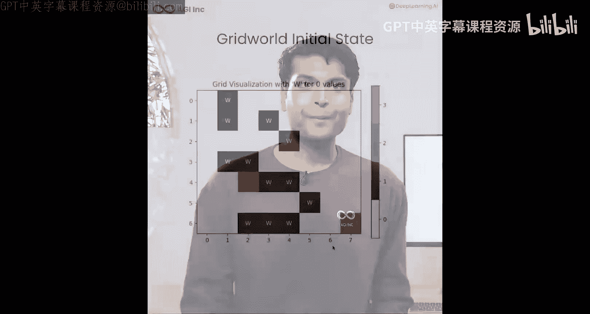
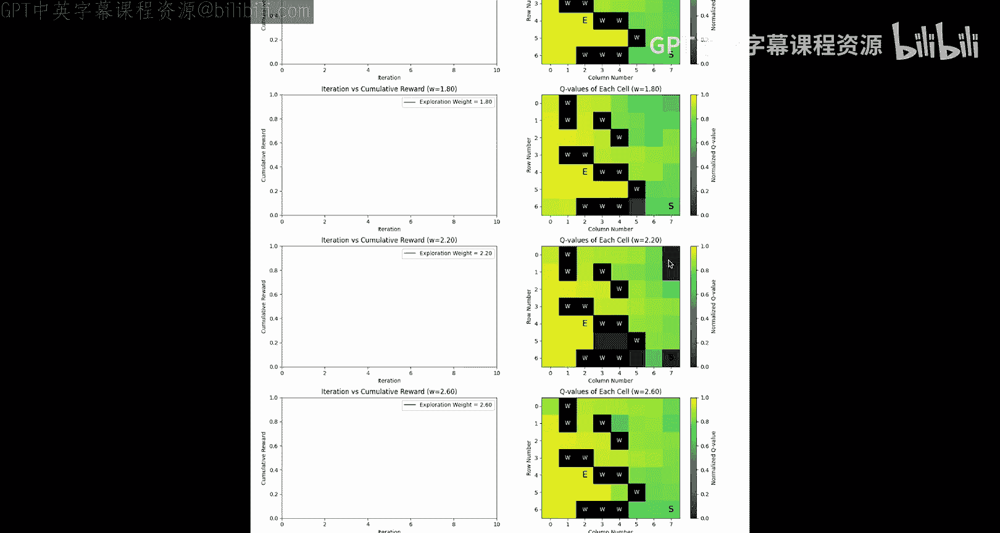
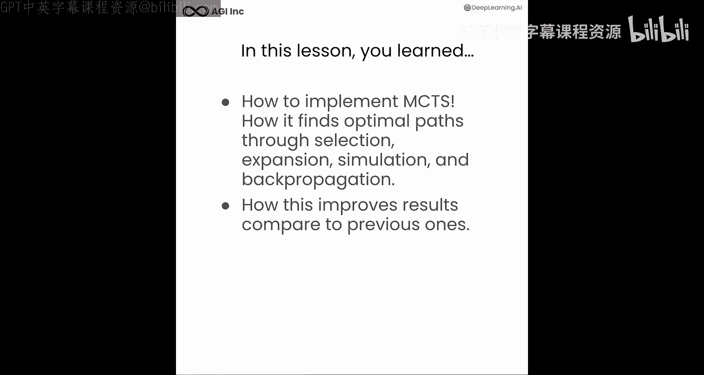

# 吴恩达《构建AI浏览器智能体｜Building AI Browser Agents》中英字幕 - P6：6.deep-dive-into-agentq-and-mcts.zh_en - GPT中英字幕课程资源 - BV1pg5BzcEEr

In this lesson， you will deep dive into Monte Carlo tree search。

 a powerful algorithm for finding optim solutions and complex design spaces。

We will then explore Amias approach in Age Q framework to create autonomous browser agents capable of completing webs。

Alright， let's code。

In this lab we are going to go over how we can implement MCTS over the grid word and in this example you can see we have our starting state which is green at cell 76 and our end state in the red color which is at2 comma 4。

😊，These marks are starting in end states， and what marked with W are our walls or obstacles。

And in this example， we want to traverse the grid to reach from start state to end state where you can traverse through the white nodes。

 the agent can only travel north south east and west and now we will go over the different examples of exploring how weights can affect the speed of convergence to the optimal path the funnel Q value and the expir patternton across the grid。

Once we implement MCCTS in the Grwill example， we will take this to our agent Q example where we run MCTS with our browser agent。

😊，Let's not go， and have fun。Let's start with the lab first we start by importing unnecessary packages。

Here we have already created one gridwall example where we have an NCS grid wrapper and a Dps algorithm to add labels to our grid。

Lets start with our MCTS example for grid world， so we must start by creating our initial grid state and here the0 represents our possible parts that we can take to traverse the grid burns our obstacles two is our starting position and three is our end state the final state that we want to reach here we first start by constructing our grid adding our colors defining our boundaries。

And we plot our graph。Lets see our initial map， so in the map have our starting position which is green as cell 76 and state which is red at cell 24 and are obstacles which are marked by W。

 classifying them as walls。The goal is to reach from the starting position to the end state by taking the shortest path possible and there we will use MCTS to find the most optimal and the shortest route that we can get。

Now we are going to run MCTS on a great example。One thing we do is we compare how different weights can affect our MCTS results and exploration。

We have low weight of 1 and a high weight of 3。0， and we have five explorations。

And overall we run around 1 thousand iterations for MCTS this MCTS grid wrapper is provided to you in your YouTube you can see the implementation here this allows us to trigger MCTS over gridward to see and collect our optimal routes。

Now once our MCCTS has been triggered， here you can use Compare exploration weight thus is provided in MCCTS animation。

 thus part of our U folder， this allows you to visualize our MCCTS results。

Here we can see in the heat map of our end states for different explorations and you can see different results for this particular weight for 1。

8 we see it starts at our initial state and reaches the end state where you can see much more darker colors whereas you see a much more brighter yellow。

 this signifies its following a path path this path is less optimal so the Q value is lower。

 signifying dark green， whereas here end state the Q value is higher。

 signifying that this is the best state to reach。And as you can see in this element this signifies the lowest Q value that means the agent we are always avoiding this particular state and similarly for this rollout。

 we avoid going through these parts which are really not optimal for the agent to follow and similarly for the algorithm to avoid this weights this signifies that this are really less optimal path with the lowest  Q value Now for more exciting results let's see something co。

😊。

Here you can see what the best path are algorithm is fo。 and for the first example。

 it is able to reach the most optimal state and the end and converses closer to 0。8 in value。

 Initially， the model is exploring a much larger path。

 but then is able to converge into a shortest path possible。😊，Lest make it much more complex。

 you can add much more obstacles。 You can make it even bigger。

 so you can visualize how well entered here performs with different weights and different rollouts and how quickly it convers into the shortest path。

However， please leave a path for our agent to follow from start to the end。

Now once we finish with our MCTS， lets see MCCTS in our browser example with our agent queue so in the agent queue we represent the world model in a browser state。

 the states are represented by the DOm URL and the abstract the actions executions are clicking typing navigation and it is able to do state transitions in the browser MCTS entire process follows first initialization of the world model search configurations and then we run our MCTS algorithm to generate Q reward values for TPO which is direct preference optimization。

Now， let's see this in our lap。AC clone is available for you to use to visualize a tree we can use this functions plot tree and DFS browserser node to visualize our proper tree representation for MCTS tree。

So these are different states on worry URLs， messages。

 actions and responses that were captured during the MC process。

 these are all nodes and these are all Q values then this represents our objectives reward mentioning which states are terminal and the completed task and we run DFS to fully air and collect all those labeled data。

Now， let's visualize our tree。So now we can see a pretty complex tree representation for our MCCDS tree now lets zoom out to properly visualize the whole tree and what pass it took。

As you can see it started at good accomplish for the initial state and it assign a Q value。

 then it bended on the first node， then realized it is not the most optimal path， it abandoned it。

 then the second node same the third node is a more optimal path that is selected and you can see because of the Q value。

And is much higher than the rest of the Q values and from what we can see node 4 has the highest Q value and is also the n state。

 so this is where it stopped after evaluating all the possible row routes onulate in this node it further created three more paths that it can follow and started with node 4 node 5 and node 6 then it further explores all the paths following those nodes and then it back from back to node 4 and assigns it the highest Q value and determines its the terminal state where it reached the goal and also the shortered route possible to achieve a goal from this possible path it continued to node 4 and it didnt exploded further because this is the terminal state where it is already on the course page which is building evaluating advanced rack there was one of the possible objective。

Then in the other notes you can see it instead navigated community deep learning that AI and further path it navigated to sort courses in the community。

And even more exciting， this page is about drag， but it is not a course。

 it's more a community discussion on the course。And you can see once it sees that it more of a discussion。

 it abandons these path。And same with our others possible path。

 which is again on the community page it for the explicit town finds the course or discussion on rack in this case building multimodal rack search and same with trying to find knowledge graph for rack and again here it decided it needs to navigate back and backproagate to its initial state because it determined this is the wrong page and same you can see here。

 once its continued down this line it see this is a multimodal search but not the proper state that it needs to be same it ceases a discussion。

And here it even sees an  error that allows you to think it can continue further and is atistic Following this route。

 the agent sees that Np 4 is the shortest route and the best possible state to see the course listing for our rack course in this lesson you learn about how to implement MCTS and also see how MCTS can behave in a browser environment and find us the shortest and most optimal path possible and see how it can actually improve our reserve compared to previous results。

