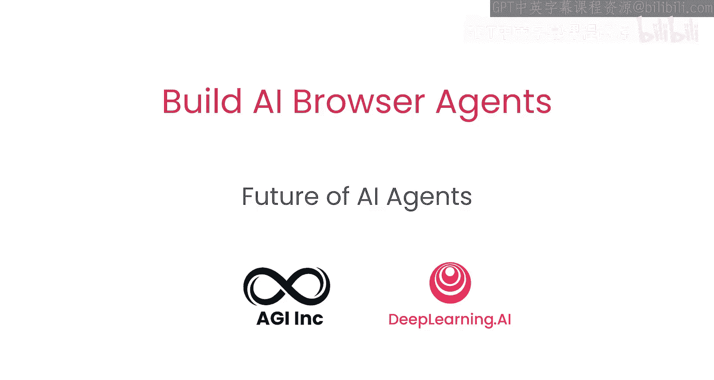
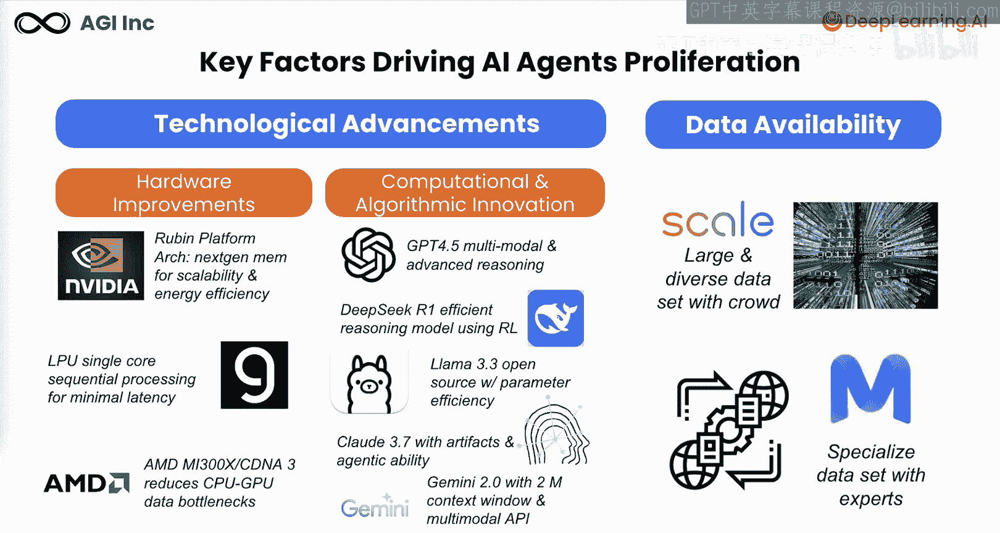
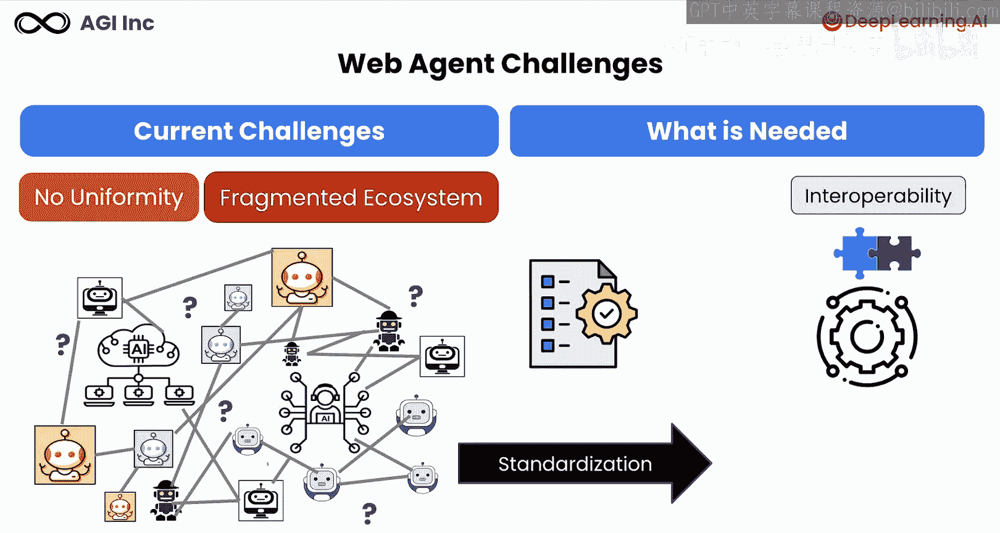
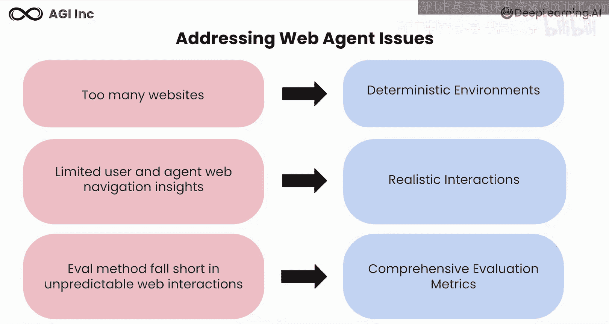
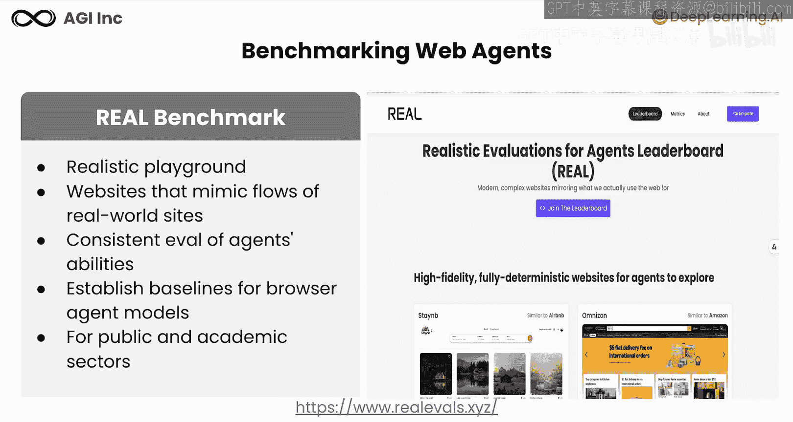
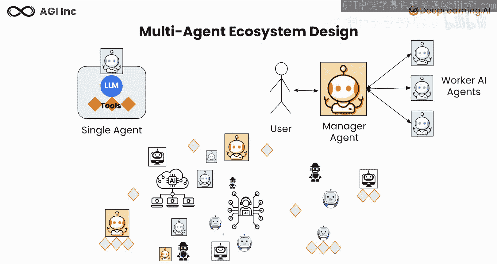
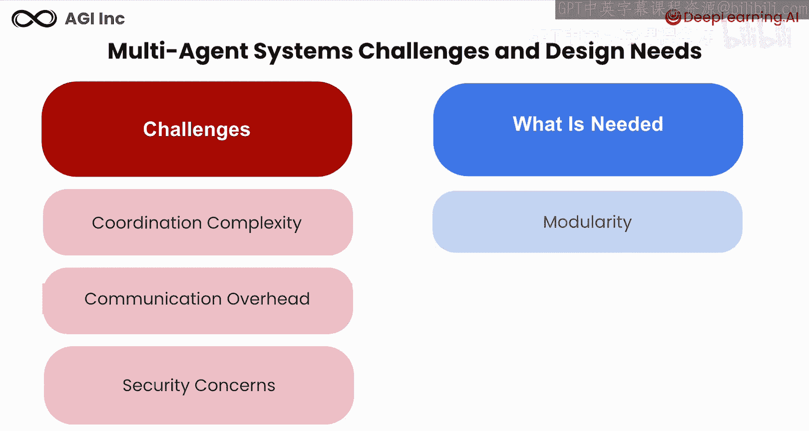
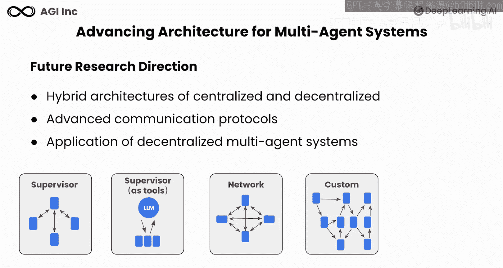
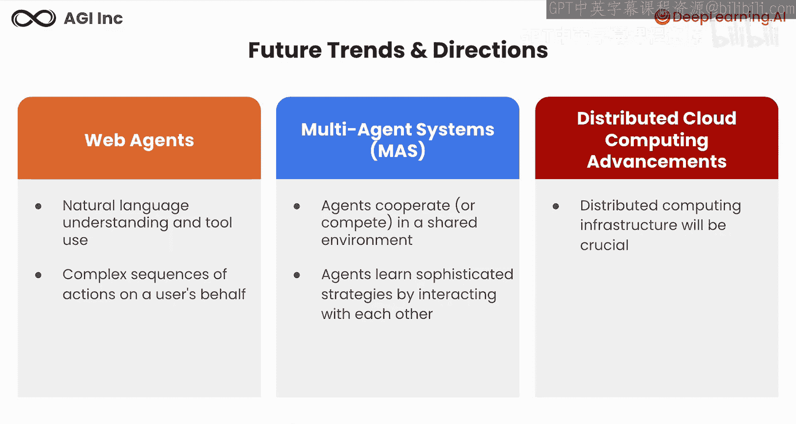

# 吴恩达《构建AI浏览器智能体｜Building AI Browser Agents》中英字幕 - P7：7.future-of-ai-agents.zh_en - GPT中英字幕课程资源 - BV1pg5BzcEEr

In this lesson， we will discuss the key factors driving AI agents and their evolution in the field you will learn about the current limitations and will explore possible future directions for where AI agent technology is headed and how these developments might shape the AI landscape。

Let's learn about the key factors driving A is in proliferation。

The first is technological advancements， specialized hardware improvementss such as GPs and is computing allow large models and more complex agents to run pet time frames。

 Second， computational and algorithmic innovation provides a foundation for agents capable of planning and acting autonomously。

With a variety of different new advancements and elementss。Another factor is data availability。

 when now we have large average sets that enable agents to be able to learn complex patterns for decision making。

Through open data initiatives and large scale data platforms。

V agentss have the great challenges。At first， they superior from a lack of uniformity。

There's like diverses， frameworks and implementations。

 but there's no ways to make them work together。And there is a fragment ecosystem where again there is a lot of things going on in the current ecosystem。

 but interoperability is really hard What is needed is some sort of standardization for allowing interopoperativeerability。

 scalability and collaboration。😊。

As air agents become increasingly adept at navigating the pub。

It's crucial to assess the performance environment that mirror durable conditions。

Traditionalally evolution methods often fall short in applicating the dynamic in an unbreaktable nature of actual abstract interactions。

We are seeing too many websites and need deter environments to ensure consistent conditions for each evaluation。

Eliminating variability that could affect performance assessments。

Limited insight into user behavior and Asian performance in web navigation can be corrected by realistic interactions that amulator challenges。

 including loading errors， hittency and disruptorive powers to test the agent's residence and adaptability。

Finally， evil methods fall short in unpredictable interactions and need comprehensive evolution metrics。

But just both the final outcomes of the intersection and their ability to navigate complex web scenarios effectively。

To address these challenges， we are building a new benchmark。

 the realistic evaluations for agents Readboard real。

The real benchmark addresses previous challenges by providing a deterministic， heuristic playground。

That models reveal avoid browser experiences。 This setup allows for consists in the evaluation of your agents。

 abilities to perform tasks such as information retrieval and transaction operations and establishes a baseline for browser agent models。

 This collective approach aims to establish robust baselines and leader boards。

For state of art agents， benefiting both the public and academic as。

I encourage you to engage with the project by providing feedback。

 sharing insights and contributing to the refinement of evaluation scenarios。😊，By collaborating。

 we can enhance the evaluation frameworks for A agents。

 ensuring that they are well equipped to handle the complexities of your world web navigation tasks。

So far， he have discussed a single air agent now。As a user。

 you can have a miittan system with a manager agent that oversees multiple specialized work agents。

However， with everyone creating their own agents， this can lead to an chaotic ecosystem。

Let's explore the challenges and cons form systems。First what is the coordination complexity。

 that is ensuring coherent behavior among autonoous agents。

Which can be challenging without a centralized oversight。 Second， communication overhead。

These central assistance may require more complex commission protocols to facilitate effect collaboration。

And third， security constants。Maintaining system integrity and preventing malicious behavior and an open decentralized environment necessitates robust theory measures。

 What is needed is modularity。

Specialization。And control。Here are some future research actions that is first。

 exploring hybrid architectures that combine centralized and decentized elements to leverage advantages of both approaches。

 advanced communication protocols that are more effective and allow for better coordination。

And third， investigating the applicants of decent Klymoittan systems in different domains such as collaborative robotortaics。

 sensing and simulations。Here are some multit architectures that need further exploration。

Such as using a supervisor。Using an L what we're calling having like a network based architecture。

Having custom mitan workflows and having hierarchy。

Now we take a look at the future trends and directions。By page。

 advancing capities with better national language understanding and use。

Where deep learning will enable frustrations to perform complex sequence of patients online。

Such as booking appointments， researching and summarizing information， coordinating across websites。

 all honor user's behalf。Mdiding systems coerate in a shared environment。

And learn sophisticated strategies by interacting each other finally。

 advances in distributed cloud computing。Will support the other advancements and lead to building more scalable systems that can be deployed in the real world。

In this lesson， we explored some of the challenges in the current ecosystem and the future trends on how this can be standardized and improved for large deployments。

