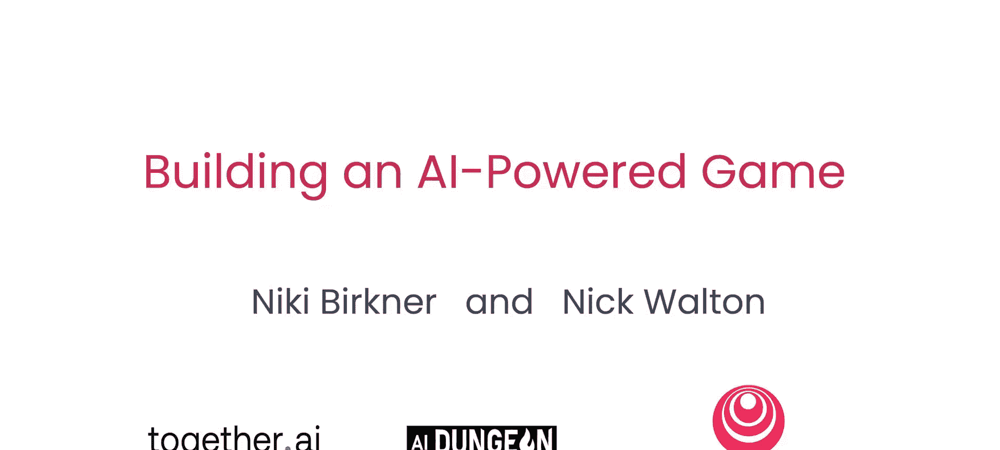
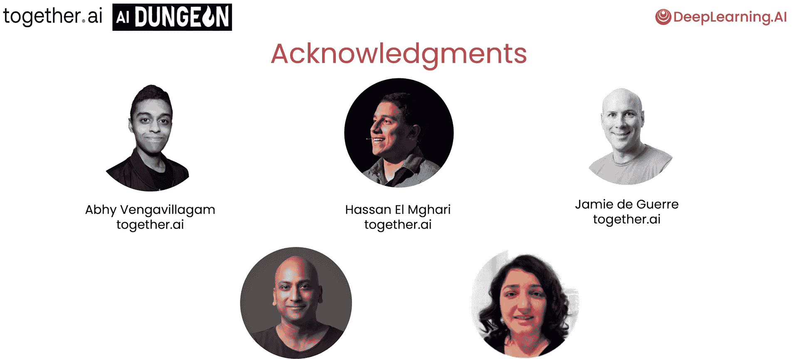

# 吴恩达《构建AI驱动的游戏｜Building an AI-Powered Game》deepseek翻译 - P1：1.intro.zh_en - GPT中英字幕课程资源 - BV1EkB4YCEHk

Welcome to this show courseBuilding an AI powered game built in partnership with Together AI and AI Dunngeon In this course。

 you'll learn how to build an AI powered tech based game， including creating a world。

 setting up coal mechanics and preparing it for productionization。At the end。

 you have a playable game that you can share with your friends I'm delighted to introduce our instructors。

 Nikki Burrkner， who is senior product manager at Togetherge AI， as was Nick Walton。

 whos CEO and cofounder of Latitude which created AI Dungeon。😊。

Nki has played a pivotal role in scaling to get AI。

 leaving the product development of their serverless and dedicated inference API and frontron end。

 And Nick built the original AI Dunngeon at a hackathon and now focuses on developing new types of game experiences that are only possible with AI。

 Nick and Nikki worked together to help AI Dunngeon continually improve the AI experience for players using to get AI's service。

 Thanks， Andrew。😊，I'm thrilled to be here and share my experiences in building games with AI Thanks Andrew。

I'm excited to dive into this course with all of you。In this course。

 you learn to build a game from scratch using OMs and optimize the performance of the model while keeping costs low making a will guide you through the building blocks of AI game developments including safety systems using lama'll start by using hierarchical content generation to create an entire world based on your prompt instructions。

 This includes developing kingdoms， towns and characters that make your game experience feel alive Next you'll learn to build an interactive AI application by creating an AI roleplay game and integrating the world you've created into a fun game experience Finally you will learn how to implement complex mechanics by using AI to parse text data into structured JsonN output This will allow you to build an inventory detection system and other mechanics that track and leverage structured game state In addition。

 you will learn to enforce content safety and compliance for AI game content generation based on specified policies You'll also build your own custom policies for your game using Lamagar。

WithThese techniques， you'll be able to build more creative and innovative AI applications。

 starting with your game。 Many people have worked to create this course。

 I'd like to thank Abbi Vanga Vigam， Hasan El Megari。😊，Jamie theger。

And Vi Paul Vt Prakash from Together AI and AI Dunngeon。

 as was Dila Ezeine from Deep learningning AI， who' have all contributed to the course The first lesson will be about world creation where you will use prompt engineering and hierarchical generation to create game worlds Are you ready Yep。

 that sounds great。 Let's go to the next video to get started。😊。

