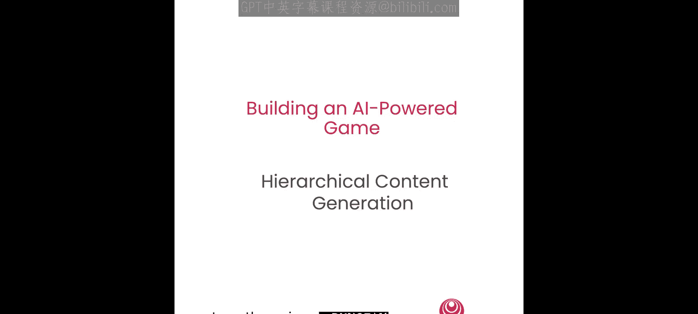
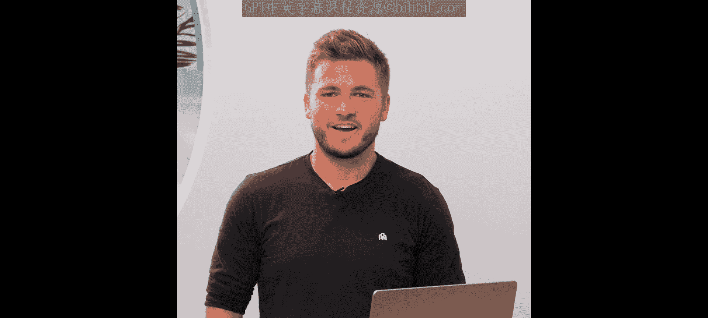
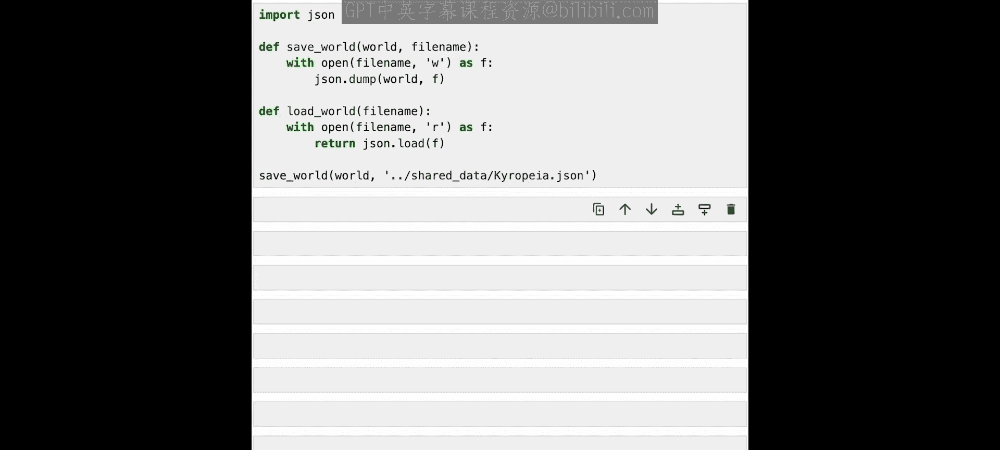

# 吴恩达《构建AI驱动的游戏｜Building an AI-Powered Game》deepseek翻译 - P2：2.L1 Hierarchical Content Generation.zh_en - GPT中英字幕课程资源 - BV1EkB4YCEHk

In this lesson， you'll start by using hierarchical content generation to create an entire world based on your prompt instructions。

 You'll decide the type of world you want to create， then hierarchically generate kingdoms。

 towns and characters， creating a holistic world that all fits together。 Allright， let's dive in。😊。

Herarchical generation is a method that lets you leverage AI to create large amounts of content with highconl and consistency。

 So you start with generating a high overview of the type of content you'll create。

 And then you get progressively more specific and granular as you go and you do in a way that when you generate the lower levels。

 it knows about what happens in the high levels。 So level 1 feeds into level 2。

 which feeds into level 3， etc。 For example， if you want to create a textbook。

 you might start with a description of what the book is about。

 Then you might generate chapter titles， then headings， subheadings。

 and then the paragraphs of all the text of your textbook。 And by the end。

 have a cohesive textbook that goes at a high level and detailed level an entire topic。

 you might do the same for screenplay or business plans。😊，In our case。

 we are going to do it for a fantasy world。 So we're going to start with generating a description of a world then。

Kingdoms， towns， and you can do locations and characters in those towns as well。 And by doing that。

 you're able to create a set of content that is all cohesively together。

 and you're able to give simple directions at the high level on what world you want。

 on what book you want。 and then you end up with a fully fleshed out set of content that you can use for whatever you want。

😊，So why would we use hierarchical content generation， It lets you do a couple really cool things。

 So one， it lets you create a huge amount of content with a small amount of input。

 instead of telling the AI everything you want in the world。 you can just say， hey。

 I want a world that looks like this。 Now， create all the elements in it following that instruction。

 you can also shape that direction with a human in the loop。 So for example。

 you might create the world。 And then you might say， oh， I like this kingdom。

 I don't like that theme。 Okay， now that I've told you what kingdoms I like。

 let's go generate the next set。 You can do the same with a textbook and say， yes， this chapter。

 know that chapter。 And finally， it lets you have high consistency with large amounts of content。

 So lets you create content that's very consistent with each other and all fits together in a very compelling way。

😊，It also lets you have more holistic content and have a more holistic perspective。

 So one thing you can also do to improve that is to include previously generated content on the same level when you're generating to make it more holistic。

 So for example， if you just say let's generate 10 towns in this kingdom。 And when we generate town2。

 we don't know about town 1， it might be that it generates a town2 that's kind of similar to town 1 And so you have a lot of things that look kind of the same。

 look kind of repetitive， you can improve that a lot by feeding in what you generated before on that level。

 so that it knows what's come before and so can do something different。 So， for example。

 if if it generates 10 towns and it knows all the towns it's generated before。 And it can say， okay。

 we already did a town that looks like this。 Now let's do one that's a little different。

 And maybe it's a bigger town or maybe it has a different flavor or different feeling And so that's one thing that can help with having more holistic generation of content is feeding in what's generated on one level to all the other。

😊，Elements on that same level。 All right， let's dive into the code。Okay。

 first thing we're going to do is we are going to create the world。 And to do that。

 we need to give instructions to the AI on how we want to do that。

 So we're going to give first some general instructions as it generates on what kind of outputs we want。

 So this is standard prompt programming for AI。 So here we're just gonna give some instructions on what it's doing and some basic details on what kind of language we want it to do and how long we want it to be。

 So then we will give a more specific prompt for generating a world。😊。

So now we can give it instructions on the specific type of world we wanted to generate。

 So let's say we want to continue that concept of a world with massive beasts。

 so we can give it instructions to say create a creative description for a fantasy world with interesting concept around cities built on the backs of massive beasts and then we'll also tell it the specific form of the output we wanted to give so that we can parse it later。

 So having it generate a world name and a world description and we'll start it off so that it knows what to do next。

 So now we'll use the together AI API to generate this world， so we'll import the library。

 we'll create the client and now we will generate the output now we will call the API and generate this world。

😊，Now let's parse this output and see what we got。So now we have a world named Caropia。

 where it's a realm where ancient gargantuan creatures known as the Colossi roam the land。

 their massive bodies serving as the foundation for sprawling metropoliards。

 So now we have a world that the AI has generated for us。 If we wanted to。

 we could edit that a little bit。 We could generate some more options。

 You can give your own instructions on what kind of world you want to create。

 So maybe you want to create a water world or a sci-fi world or whatever you're excited about you can give those instructions and create the world and then go forward from that。

 So we're going to go forward with this world and we're gonna to move on to the next part。

 So we are just going to parse this output so that we can use it later in creating the Json structure of this world。

😊，Now let's move on to generate a kingdom， so we're going to use the same instructions for how to write。

 but we're going to add new ones for how to generate a kingdom。

So here we are going to tell it to create three kingdoms for a world that we're going to feed in。

 We might tell it to describe important leaders， cultures or history of the kingdom。

 and we'll give the structure of the output that we want。

 You'll notice here we're generating all the kingdoms at once。

 and that lets us have the holistic content generation where it can say， all right。

 Kingdom 1 looks like this。 Let's do a different one for Kingdom 2。

 And let's do something even different from that for three。

 So they all have this interesting mix of properties together。😊，And now， just like before。

 we can run it with the system prompt being the instructions on generating in general。

 and then the user prompt being specific instructions for generating a kingdom。

So let's grab the output from the content。So now we are going to parse the output into a set of kingdoms。

 so we're going to set up dictionary for the kingdoms， we're going to grab the output。

 and then for each kingdom we're going to parse out the name and description so that we can grab those and create a kingdom object that has the name description and the world that it's in and fill out that dictionary。

We can then add that to a world as the kingdoms that are in this world and print what we have。

 So let's see what we generated。So we have these three kingdoms that we've created in this world。

 and we can see this one is a kingdom built on a Colloossus named Lysandra with a reclusive and spiritual people that aretd to the whispers of that specific Colloossus。

 So we've got this kind of unique kingdom that is based in this world。😊。

So now we'll go ahead and do the same thing for towns as well， it'll be very similar to kingdoms。

 we'll create a town prompt， we'll given an output of instructions and we'll feed in not just the world but we'll also feed in the kingdoms this time。

 and then we'll generate the towns。Now let's to find a function that will take the world。

 take the kingdom， and we'll be able to create towns for that kingdom。

 So we'll use the prompt that we just created to know what we should tell the AI to generate。

 We will grab the output of the town。And then for each town we'll do the same thing and we'll parse the name。

 the description， and we'll create a town object that we can then add to our kingdom。

Now let's run it and create towns for our kingdoms。

So you can see we're creating several towns for each of the kingdoms that we've generated。

 You could change that number， you could create more。 you could create less。

 You could modify how those instructions work and what kinds of towns you want to create And you can see at the end。

 we're just printing one of these towns。 But there's a description for each of these。

 So here we have Are's peak， which is a town on the crest of Lysandra's Great Horn overlooking the vast expanse of the Western plains。

 So you can see it's in line with the kingdom that's created centered on this kind of like spiritual power of this massive beast they're built on。

Finally we will generate some characters for this world。

 so in gaming we call these NPCs and these will live in the towns and kingdoms that we just generated。

 so similar to before， we'll create a prompt that will say how we'd like the AI to generate these characters。

 maybe their appearance and profession， as well as some deeper things about them。

 and now we'll feed in all the higher levels of the world。

 the kingdom and the town to generate the character。

And now we'll create a similar function to generate these NPCs based on the world， kingdom and town。

So here we create the generation， we call the AI model with the prompt and generate a character。

 and similarly we parse out their name description and we set the name description world。

 Kingdom and town for this NPC and add it to our world。

And now let's create the NPCs for at least one of our kingdoms in the interest of time。

 we won't do it for all of them， but you could go through and generate as many as NPCs as you want for all the towns and kingdoms of your world。

So now we first create characters for the town of Luminaria。

 and we'll see it creates three characters， Kaeren， Aaron Vex， and Lirian Flynn。And then for Ethes。

 we might have Kan Darkhaven， Allra Moonwsper and Thrin Blackfi。 And then finally for last town。

 Terra Verde。 you have Kan Darkhaven。 again， Lerian Flynn and Er in the wild。

 So you can see here that we have a bit of an issue where some of the names are actually the same。

 So you've got the same character here and the same character here。

 One of the reasons that happens is because the AI is generating characters for one location and doesn't know about the characters in previous locations。

 It has a chance of using the same names over again。 So there are a couple ways we could fix this。

 One way is we could feed in all the previous character names that are generated and say。

 don't use any of these names。 Another thing we could do is because we generated with a temperature of0。

 which is the default。 We can go back and we can change the temperature to be at one。

 So we have more variation in what's generated。 So let's run that and see what happens。😊。

So you can see here we have all different names this time。

 There are some similarities between some first names or last names that are shared。

 but every name is somewhat different。So now let's just see the description of one of these characters that we've generated。

So here we have a character who is a skilled archaeologist with a passion for uncovering the secrets of the world's past。

 We have some description of what she looks like with curly brown hair and green eyes and some of what she's excited about she is driven to uncover the truth about the classi and their role in the world。

 and she lost her family during the great devastation。

 a tragic event in the history of the world that has left her with this burning desire to understand why that happened and and what's going on in the world。

 So you have this character who's not just a name and you know， some basic things。

 but has some real backstory and motivation and can lead to an interesting story in the game。😊。

Finally， we will save this world so that we can use it in future lessons and you can play in it as you create your game。

So that's how we would create a world。 If you want to change how you create the world。

 maybe you want a different type of world， maybe even want different things you're generating， right。

 you might not generate a kingdom。 you might generate a planet or factions。

 the principles of hierarchical generation still apply and let you create a world that is narratively consistent and that the AI can flesh out based on your instructions。

 So now that we've created our world， let's move on to the next lesson。

