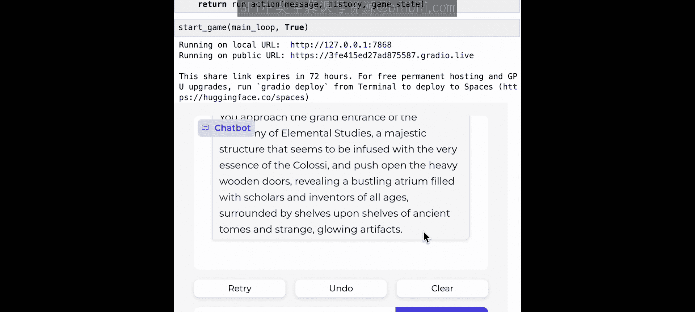

# 吴恩达《构建AI驱动的游戏｜Building an AI-Powered Game》deepseek翻译 - P3：3.L2 Interactive AI Applications Building a Simple AI Role Playing Game (RPG - GPT中英字幕课程资源 - BV1EkB4YCEHk

In this lesson， you will use radio and the world you created to build your first version of your game。

 You'll define the core gameplay loop and how the AI responds to actions。

 structuring the context to include details from your world。 By the end。

 you have an AI game that you can play。 Allright， let's get to it。😊。

So first， we'll import radio， which is a library that lets you really easily build UI tools that were great for testing and prototyping AI applications。

 So first， we'll define a function that we can use to start the game。 So we'll take in main loop。

 which is a function that will run the game and we'll create a chat interface with radio。

 So we'll pass in the main loop。 We'll set some parameters like how the chat bot get started。

 the placeholder， some text box， a title and some other pieces that will define what the UI for the game looks like using radio。

 Next， we'll define a simple test loop that we can plug in and just test and make sure that our UI is working。

 So for now， we're not plugging in the actual game logic。

 We're just gonna return entered action when someone does an action in the game。

 So let's test this out。😊，Great， so here we can see the game and we can test it and type start game to begin。

So now we see it return the response， entered actions start game that the main loop had defined。

 So now we've got the basic UI of our game working。

 So now we can create the actual game loop and build the playable version of the game。

So the first thing we need is a start to the adventure， so just like we generated the world。

 we're going to use an AI model to generate the initial story start of your game。

So we're going to import the together API， and we're also going to load the world that we generated before。

 the world， the kingdom， the town and the character。

 so that we can use that in generating the start for the game。So first。

 we'll create a prompt that we can use to generate the start。

So we'll define a few instructions on how we want the AI to write here we're going to do it in second person and in present tense。

 So you are Jack， for example， and we're going to ask it to first describe the character and their backstory and then describe where they start and what they see around them so that it provides a jumping off point for the player and then we'll feed in the world info as well。

 So the world Kingdom town and character。So here we'll call the AI model and we'll pass these two things in。

 we'll pass in the system prompt and we'll also pass in the world info。

 and then we'll ask it to generate the start for the game。Let's see what it generated。

 and then we can add that to our world。So here we see that it created this start where you are Eln Storringer。

 a 25 year old inventor with a passion for harnessing the power of the classi。

 So it describes a standing the town of Luminaria surrounded by crystal formations and the Academy of Elemental Stud。

 all of which are things that were generated as part of our creation of the world。

 so it describe some of what we're wearing and the items we have and the weight of our past。

 and now we have a start for the adventure of what the player might do。😊，Now。

 we'll define the core action loop of the game。 So this is what will determine when the player does an action。

 What happens next。 So let's start by defining what happens when the player just starts the game for the first time。

 So when the player starts the game， we want to return this start text that we just generated。 Now。

 let's define what happens when the AI is responding to individual player actions。 So first。

 let's define a system prompt that will give some instructions。

 So here we tell it' it's a game master and what kind of way it should write next， just like before。

 let's define the world info。 So what things do we want to feed in to the AI。

 So it knows what world we are in。😊，So we feed in the world， the kingdom， the town and the character。

 Finally， we're going to set up the messages that are going to get fed in。

 So here we need to feed in both the system messages and the world info messages。

But we also need to add in messages for all the history of what actions have happened already in the game。

 So that's going to come partially from the history that we see gets fed into this function。

 So if we add these down here。 Now we have for every action in the history。

 we're going to add an assistant message that says what the AI had generated before and a user message。

 Finally， we're going to add one more message for the most recent action that the player took。

And now we can generate the model output and return the result。

So now we have the core action loop for the game Now let's set up the game state and the main loop so that we can plug that into the start game function that we made earlier。

 so we'll define the game state based on the world that we have。

So we have all the locations and the character and the start。

 and let's create this main loop that we can pass in to the start game function。

Now we're ready to play the game。So first， we can type start game and get the start of the adventure。

So here we see your Elwin Storringer， a 25 roadedvent with a passion for harnessing the power of the classi。

 So we have the start that we generated。 So now we can do the really cool thing and actually interact with the AI and explore this world。

 So let's take an action。 Let's just look around and see what happens。😊。

So now the AI is generating the action of what happens next。 So we take an action。

 We look around and the AI returns。 you gaze around at the breathtaking scenery of Luminaria。

 taking in the vibrant glow of the crystal formation that lined the street and buildings cast the kaleidoscope of colors across the town so we could take another action。

 and we could say， go to the academy and。😊，Apply to join so we can learn the secrets that our character really wants to learn。

 So it says you approach the grand entrance of the Academy of Elal Studies。

 a majestic structure that seems to be afuseed with the very essence of the classi and push open the heavy wooden doors。

 or reveal a bustling atrium filled with scholars and inventors of all ages surrounded by shelves upon shelves of ancient tos and strangego artifacts。

 So we now have a game that is grounded in a world that we created right。

 We can see that infusesd in everything that we do And now we can take actions and the AI will respond with what happens next in this infinite。

 continuing adventure。 So now we have our first version of our game。 You can play around with it。

 You can change the instructions， maybe change the way the AI writes in the next lessons will add more elements and make the game more fun and more complex and add new systems to it。

😊。

