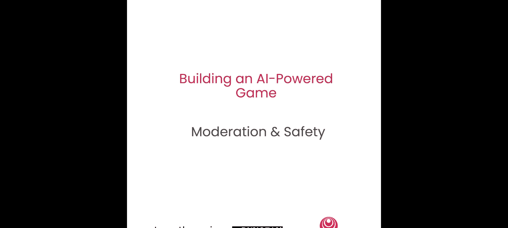
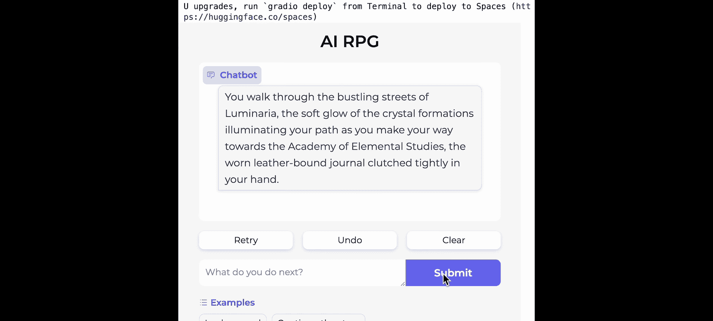

# 吴恩达《构建AI驱动的游戏｜Building an AI-Powered Game》deepseek翻译 - P4：4.L3 Moderation & Safety of AI Games with Llama Guard.zh_en - GPT中英字幕课程资源 - BV1EkB4YCEHk

In this lesson， you will learn how to use together AI's API to ensure that the content generated in AI games adheres to safety and compliance policies we will begin by utilizing the default content moderation policies of Lamagar 28B Afterwards。

 you will have the opportunity to create and implement your own custom policies Allright， let's go。

So first， let's talk about safety and security safetyfe in general means you're ensuring a positive customer experience by preventing any exposure to PII like personal identifiable information or any type of toxic or harmful content or inappropriate material that a user may not want to get exposed to security on the other hand is more around defending against any threats related to large language models or any attacks such as prompt leakages or data poisoning prompt leakages are basically when things get exposed from a model that shouldn't be necessarily。

 and data poisoning is when data is poisoned with inappropriate material。

 and in this lesson we're basically going to focus on the safety aspect。

So why safety safety basically ensures that users feel safe while playing and exploring this is especially important because any user who's playing a game wants to feel control and comfort and they want to know that they can define what level of maturity the game can be This is especially important for gen AI because this content is created by the AI and not the developer or you so you have a little bit less control and what is going to be generated。

 but with these guardrails you can actually define some level of control that makes users and yourself as the creator of the game feel safe。

So let's talk a little bit about context dependence of safety safety can be not only user dependent as we previously talked where a user can have control over what level of maturity they want in their game but it can also be context dependent So a good example of that is a chatbot for a doctor might need to only give general medical advice but it shouldn't be allowed to prescribe any drugs。

 but on the other hand， a chatbot for a financial firm should not be really giving medical advice and an example that's more relevant to us when you're playing a game it is pretty normal to have bandits demand to give them all your money and that might be perfectly appropriate。

 but if you're using a support chatbot and the support chatbot demands you to give them all of your money that wouldn't necessarily be appropriate So how do you make these dynamic guardrails before answering that question I wanted to walk you through two different types of safety user input safety and model safety user input safety is the prompt that the user。

Is basically providing and we are creating guardrails around that prompt and then model safety is once that prompt is passed through the LLM and the LLM provides a response we are basically creating guardrails to what the LM can respond one of the ways in which you can use Lamaguardd is out of the box meta the creator of Lama guard has already defined policies that you can use and you can basically use Lama guard in two ways in the together API one of them is as a standalone classifier so you can use Lama guard 28B as your main model and it will also have these guardrails built in the second way that you can use it in the together API is by using it as a filter to save guard responses from any of the 100 plus models we have available so you could use a Lama 38B model as your main model but also use Lamaguard to do the filtering of bat responses。

One of the great features about Lamagar is that it lets you define custom categories to define what is safe。

 depending on the context。 For example， in AI dungeon。

 users are allowed to choose between the following categories。 save。

 moderate and mature on the background， these settings are basically mapped to custom lamaguard policies and this is part of what we're gonna to teach you in this lesson。

 which is how to implement the three policies related to the categories above into your game。

 Okay so let's jump right into the code。 First， we are going to import all necessary modules and our API key。

 additional， we will now want to import the helper functions and retrieve the current game state that we created in the game Additionally。

 we also want to import the get game state function。

 which is the helper function that we created in the last notebook and it's basically pulling the game state。

 including character descriptions and other relevant information So I'm just going print。

It's the character description。We're getting Elyn， who is a 25 year old inventor from Elridas capital City。

 etca， etc。 So now let's write code that ensures that the character description which is the input adheres with safety guidelines before we use it in the game。

 so we'll use the client chatcomps。 create from together API with the Lamaguard 28B model。

And so we're using it as a standable and classifier and we're printing the prompt safety check and this will tell us whether the character description is safe or not in this case it's safe and as you can see and read from the character description。

 there's nothing in there that seems compromising so it seems like it's working the way we're intending it to。

Okay， so now I'm going to walk you through how to build your own custom policy to be clear。

 these are not AI Dunngeons policies。 We are creating policy specific for this course as examples。

 One of the best features of Lamagar is being able to specify your own policies So let's develop a custom content policy for your game will be defining rules that are specific to your game's context and ensure that all content adheres to those rules。

 Let's set a content policy that is safe for everyone to begin。We will write down the content policy。

 you can see that for the safe content policy， we are restricting violence and hate， sexual content。

 self harmm， profanity， and regulated or control substances so any input or output that relates to one of these categories will be blocked。

We'll now add the text that you want to be checking as well as the build a prompt with some of the embedded values。

So this prompt is basically first saying check if there is onsafe content and user messages in conversations according to our safety policy with the below categories。

 and then we're embedding the safe content policy that we just defined right here。

And then we're adding the text that you should be checking。

 and we're asking the AI to provide their safety assessment in the above conversation。

 and they should include whether it's safe or unsafe。

 as well as a comma separated list of the violated categories。

So I'll just print this prompt to show you how it looks。

And the next step here would be to use the client chat completions create API with Mema Guard 28B to check whether the text。

 which was killed at troll adheres to our safe content policy。

The response is that it's unsafe and that it's violating the content policy section 1。

 which is violence and hate。 So moving on。Let's establish a moderate content policy。

 so something that say it's designed to be safe for teenagers。

 and this will enforce safety guidelines moderately and allow a little bit more freedom in terms of what's restricted。

So this is a content policy where it's now a little shorter。

 it's just restricting for violence and hate and sexual content and self harm。

We will add the text that we want to check， it will be the same one， kill the troll。

 and we will build the prompt again with the embedded values this time I'm not going to print it because we already know what it looks like and by running this prompt again through the chat completions create API。

Using the Lamagar 28B model， you'll see that， oh， this is also unsafe。

Kill the troll is clearly violence and hate， so it's marking it as unsafe。

Now let's set a mature policy。 This policy will be significantly less restrictive than the two policies we just went through the Sa and moderate。

 It is basically just restricting for sexual content。

 We will add the text that you want to check whichll be the same one。

 kill the troll and we will build the prompt again with the embedded values。

And now let's see what the model is going to tell us。

R our policy through Lamagar again and confirm that it meets our safety standards。And boom。

 it tells us this is safe。Why， because violence and hate was not part of the mature Comp policy。

So now to bring it all together， let's move on to create some helper functions。

 These functions will basically determine whether a prompt is safe and well integrate these checks into the game where we've already built to ensure that all interactions in your game are secure and appropriate。

 So let's define a function called is safe。That takes in message is a parameter。

And let's bring the prompt that we had generated previously。

That has the embedded content policy we're going to use a save content policy in this situation。

 we will then try to get the response in this same function using client completions。

 create in calling in metma Lama guard 2 a B as the model and the prompt is defined as the prompt above and in this same function。

 we're also going to output the result。Wwhich is response choicesices text and what we're going to return we're basically going to extract the text and strip any extraneous white space。

 that's what this resultta strip is doing and it's going to return true if the response is safe or false if the response is not。

Finally， let's run this in our game using our previously established helper functions and test it out。

 so I'm just taking the helper functions that we created in the previous notebook of get Game state and start game and run action and we are using the main loop。

 which takes in message and history and basically if it's not safe。

 we're returning in the game in ballot action or if it's safe， we are actually returning the result。

So we now have the game created from radio and to see how it all comes together。

 I'm going to run our phrase killll the troll。And as expected， because this is the safe policy。

 it's throwing invalid action， whereas if I say， tell me what the character does next。

It will give me a response because it's safe that input that I'm providing。

 So its says you walk through the bustling streets of Luminarria。

 the soft glow of crystal formations， illuminating your path。So overall in this lesson。

 we've taught you how to integrate safe guardras into your game applications。

