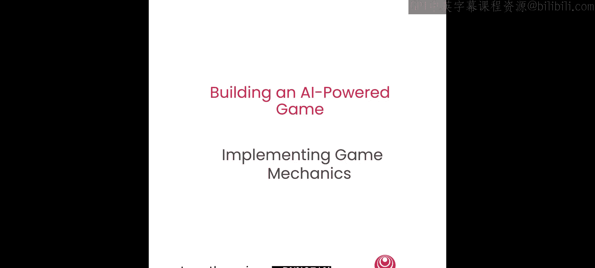
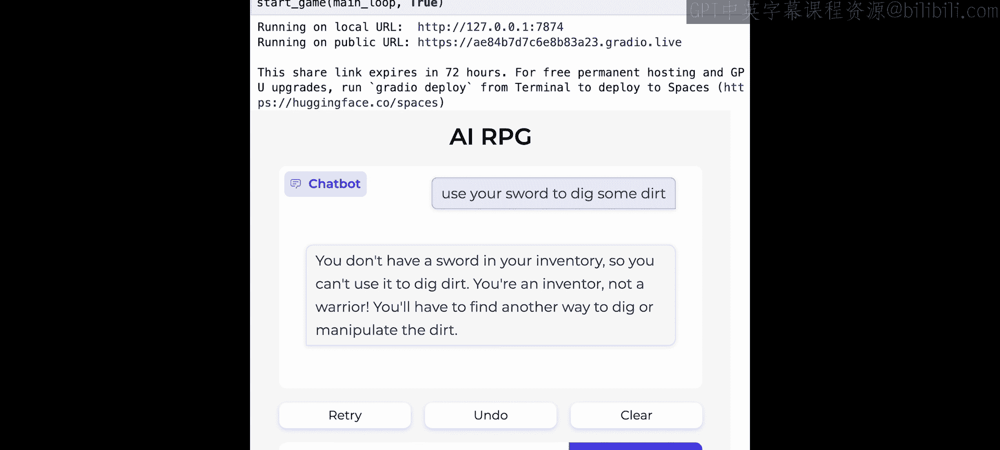

# 吴恩达《构建AI驱动的游戏｜Building an AI-Powered Game》deepseek翻译 - P5：5.L4 JSON Game Mechanics.zh_en - GPT中英字幕课程资源 - BV1EkB4YCEHk

In this lesson， we'll cover how to implement complex mechanics by using AI to parse text data into structured JON output。

 This will enable you to build game mechanics that track and leverage structured game state。

 We'll show you how to do this by building an inventory tracking system for your game。 Allright。

 let's get to it。😊。

So why is state important for a game or other AI applications。

 So there are a couple things that state enables us to do that can be really powerful。 One。

 it lets us improve memory。 So if we have an inventory tracking system。

 we can always know exactly what's in your inventory。

 whereas if we rely on the context in the AI to kind of remember。

 it is often much less accurate at remembering those elements。

 It's just like if a human dungeon master writes down on a piece of paper。 know。

 the player has these items that's gonna be a lot easier for them to remember that than trying to。

 think back over the last several hours of play and you know。

 have a running memory of what items you have。 Another cool thing about state for a game is it lets you give clear progression。

 It's really cool to be able to be like， I got a new item or I got a new scale or I made progress in some really clear。

 tangible way。 Another thing that state allows you to do is have better constraints。 So for example。

 with inventory systems。 If you have the。😊，Lear understanding of what's in your inventory。

 It lets you say to the AI hey， don't let the player use items or try to use items they don't have in their inventory。

 So now there's a constraint。 And that constraint means that it's kind of fun to build and progress and be like I can't use。

 you know a sword right now， But if I go buy one from the merchant now have a sword and I can use it in my actions。

 and it gives a clear sense of progression for the player。

 And so all this lets you implement interesting mechanics。 We've talked about items。

 but you could implement all kinds of mechanics， including quest systems and character tracking and locations and all kinds of interesting things。

 And finally， state lets you create more interesting Ui experiences。

 So if I'm not tracking inventory， I can't show you a list of all your items you have and maybe create images for them or other interesting things。

 both a state， you can do all kinds of interesting things that interact with the UI to create a much better experience。

😊，So how do we track state， there's really a back and forth。

That is really interesting that you can do with AI games that enables all this to work。

 So you start with story。 So just as we've done， you use the AI to generate a story。

 Then you can use AI to update the state based on the story。 You can generate Json。

 you can parse that。 and then you can update your state。 And finally。

 you can then have state feedback story。 So you can have the story know what's in the state so that it's all in sync and aligned with each other。

 So you get this back and forth between story and state that keeps your game in sync and working well and consistent for the player experience。

 So some examples of that。 So in store， you might have the history of your adventure。

 You might have memories。 you might have world lore like we generate。 And then in state。

 you might have things like the specific quests you're on It might be your inventory。

 It might be stats。 It might be。😊，Los， it might be characters。

 and you can have those go back and forth with each other in a way that makes everything cohesive and flow well。

 All right， let's dive into the code and create our first mechanic system using Json outputs。😊。

So first， we're going to create an inventory detector that will detect based on the story what changes to the inventory we should create。

 So for this， we need to first create a system prompt with a set of instructions。 So first。

 we create a set of AI instructions for the I to know how to update your inventory。

 So we say your AI game assistant， your job is to detect changes to a player's inventory。

 based on the most recent story in game state So we give it instructions on when it should add to the inventory。

 when it should remove things from an inventory and what kind of output it should give as well as some additional clarifications on when not to make updates for giving or taking an item。

 The way I generally do this when I'm creating AI systems myself is I'll create a basic set of instructions to start with and I'll just iterate really quickly。

 And if I see it do something wrong。😊，Look at the prompt and I'll say。

 okay why did it do something wrong， Is there a way I could have made more clear instructions。

 Can I add a line that will make it a bit clear for the AI。

 It's kind of like being empathetic to a human and being like okay what did I do wrong did I not give them good enough instructions and you can just iterate and do that until it is working pretty well and then that's the prompt I usually end up with So that's how you would go through the process of creating this kind of prompt and finally we'll tell the AI how to respond in valid Json So if no items were changed we'll return this to make it clear that it should still return valid Json otherwise sometimes it will comment and say there was no valid changes which we don't want it to do because then that'll break later when we try and parse that into JSON and finally we'll want to return a structured JSsonN output that we can parse programmatically So here we tell it the response must be invalid JsonN and we。

Give it the exact structure we want。 So we say you're gonna give a Json object with a key of item updates。

 and that's gonna be a list。 And that list is gonna to have objects that say the name of the item。

 as well as the change amount。 And that might be plus one if you pick an item up。

 it might be -1 if you put an item down， etc。 And you could have multiple inventory changes all in one。

 So for example， if you sell an item for5 gold， It might be one of that item and plus5 gold。

 So now we have the AI instructions for how the AI is going to perform this task。

 So now that we have our prompt， we can go through and create a function for detecting changes to our inventory。

😊，As before， we'll first import the together API。Then we'll define this function。

 So this detect inventory changes function takes in the game state and the most recent story output。

 and we grab the inventory from the game state。 and then we construct the messages。

 So we're going pass in this AI system prompt that we just made。

 We're going to pass in the current inventory， converting it into a string So the AI can see that。

 We're gonna to pass in the most recent story output and finally。

 we're going tell it to generate inventory updates。

 We'll run it through the together chat and get the Lama 370b model to generate an output。

 and then we will parse that into Json so that we have a structured object that then we can iterate over。

 So run that。😊，And now let's test this。 So we've got a helper that can pull our game state。

And let's add an inventory to this game state。 So let's say you start off with a cloth， pants。

 cloth shirt and some gold。 Now， let's try detecting changes to this game state。

 So let's say the most recent story output is you buy a sword from the merchant for5 gold。

 So let's see what the result of that is going to be。

So we can see it generated JSON output where it said sword， change amount plus 1 and gold。

 change amount 5， so correctly recognize that if you're going to make a purchase from the merchant。

 you're going to lose five gold， but you're going to gain a sword。

So now let's create the next function， which is going to take that output and is going to update our game state based on that。

 And we're also going to create a message so the player knows the changes that are happening to their state。

So here we have an update inventory function that's going to take in the inventory and the item updates that we just generated。

 and we're also going to create an update message that we can add to and show to the player。

 So for each item update， we're going to grab the name and change them out。So it's above zero。

 but not in the inventory。 we'll add that item to the inventory。

 Otherwise we'll just increase the amount。 We will add to the message how much the inventory has changed。

 and then if it's negative， we'll remove it from the inventory and if it's below  zero。

 we'll just delete it from the inventory so that it's not in there anymore。

Now we're going to do the other part。 so remember we talked about story feeding to the state。

 so we just created that where we have an AI function that can take the story and update the state。

 Now we're going to modify our story generation function to actually take in the state into account as well。

 So we're going to go back and recreate that run action function that we did earlier。

 and this time we're going to feed in the inventory and give it some new instructions。😊。

So just as before， we're going to say if it's a start game。

 we're going to return the start and we're going to have a system prompt。

 but we're going to add a new line here。 So notice we've added this line。

 don't let the player use items they don't have in their inventory。 Now。

 let's add in the world info from before and will include all the elements we had before。

 as well as their inventory。 So now the story generator knows not just about the world Kingdomtown and character。

 but also the inventory of the character。And we can do everything that we did before。

And create the messages and run the output。So now let's put this all together and integrate it into the game。

 So we'll import a helper functions and we'll define the inventory starting for this character。

 So this character made we'll say they start with some cloth clothes and then it mentions them having goggles in a leather bound journal。

 So we'll add that to the inventory as well。 And then we'll create the new main loop for the game and integrate these item functions。

 So we'll take in the message in history like before we'll run the output to get the next story。

 We'll check if it's safe and then we'll detect the changes to the inventory and update the inventory。

 getting an update message that we can add to the output so the player knows how their inventory changed。

 Let's try it out。😊，So we can start the game， just like before。And let's test out the new system。

 So first， maybe we can try pick up a small rock。An Sir what happened。

So here it says you bend down to pick up a small， smooth rock from the ground。

 feeling it's cool ref texture your hand。 So it correctly generated a new item that we can add to our inventory。

 So now we have a small， smooth rock。😊，Let's try getting rid of an item。

 let's maybe throw our goggles onto the ground and see what happens。

You toss your goggles under the ground where they land with a soft thud。

 The lens is glinting in the light of the crystal formations。

 And so now we see we've lost our goggles。 So let's try checking our inventory。

 check and see what's in my inventory。😊，So because the AI knows what's in your inventory。

 it should be able to correctly answer that question and tell you what's in your inventory。

 so we can see it says you have the following items in your inventory， cloth pants， cloth shirt。

 a leather bound journal，5 gold and a small smooth rock so we can see it correctly knows that you have a rock now but that you no longer have goggles so let's test one final thing and let's see if it will prevent us from using an item we don't have。

Use your sword to dig some dirt。And let's see what happens。

So it says you don't have a sword in your inventory so you can't use it to dig dirt。

 You're an inventor， not a warrior。 You'll have to find another way to dig or manipulate the dirt。

 So we can see we successfully were able to add constraints in the game based on your inventory。

 So now it knows what you have， it can keep that consistent and you can even create barriers。

 So now I have an incentive because if I want to be able to use a sword， I can go find a merchant。

 maybe I can buy one for five gold or maybe I can go on a quest and earn one。

 And so now our game is more interesting because we have mechanics that are creating a more interesting experience。

 So this is just one example of a mechanical system that you can create for your game using JSsonN outputs。

 You could imagine adding other systems that you are interested in adding。

 maybe you want to create a quest system， maybe you want to track companions that you found on your adventures maybe you want to be able to build up a kingdom and capture towns or whatever it is。

 you can use Json structure to build these systems into your game。😊，Create cool， complex experiences。

