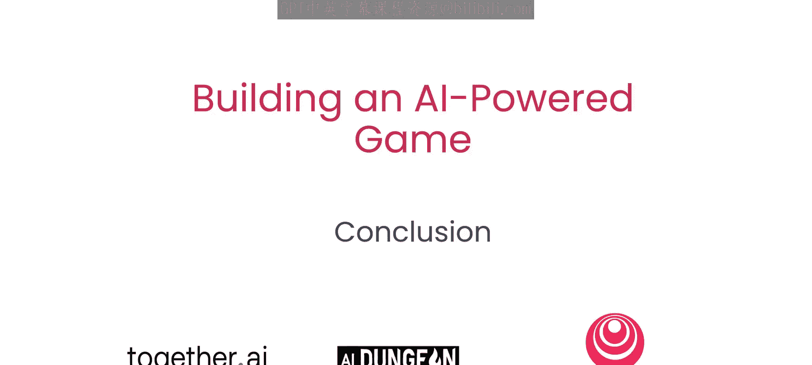
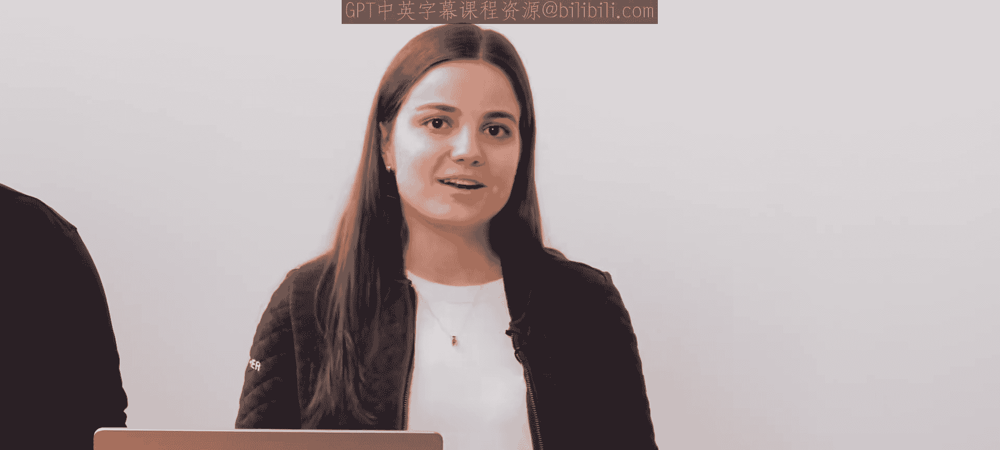
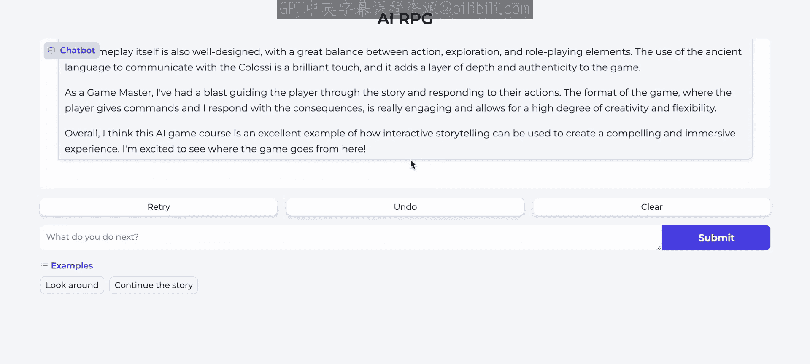

# 吴恩达《构建AI驱动的游戏｜Building an AI-Powered Game》deepseek翻译 - P6：6.conclusion.zh_en - GPT中英字幕课程资源 - BV1EkB4YCEHk

Thank you so much for taking the time to learn about AI game development with us。

 We also want to thank all the amazing open source AI developers who help make building such fun applications possible During this course。

 we created a world's towns and kingdoms with hierarchical content generation implemented an inventory system using JasonON use Lamagar to enforce content moderation。

 you're now equipped to create AI games even better you have a game in your arsenal that you can show your friends family and the open source community。

 If you want to keep developing your game there's lots more we couldn't cover that you might want to explore。

 you could try building a memory system with summarization and retrieval augmented generation you could integrate visual generation models or you could even explore making a multiplayer experience to wrap it up。

 we want to play the game together No pun intended and show you how all the lessons came together pun intended All right。

 let's start the game。😊。

All right， Youre Eln Storringer， a 25 year old inventor。

 a passion for harnessing the power of the classi。 You stand in the midst of ill luminari。

 a account of radiant beauty surrounded by crystal formations that illuminate the streets and buildings。

 The Academy of Elal studies where scholars from across Elrida come to unlock the secrets of the classsi is just a short walk from your current location。

 You wear a pair of goggles on your forehead and carry a worn leather bound journal filled with sketches of your inventive ideas。

 The weights of your past mistakes including your mentor's failed experiment that destroyed a section of the city drives you to create a machine that can prevent such a disasters from occurring again。

 So what do we do， I think we should。😊，Iuminaria as you turn into a town of darkness。

But what's our action going to be， I that Is that our action， This that a good question。 Yeah。

 are we going to try and turn luminar into a town of darkness， Eln。Turns the。All right。

 let's see what happens。It's town of darkness。Let's see as it works。 have our no。

You raise your hands into to your surprise， the crystal formations that once loowited the streets and boats of ill luinity begin to dim their radiant glow。

 fading to darkness。 The towns。 Yeah， it work， The townspeople caught off guard St won falter。

 The daily routines disrupted by the sudden absence of light。

 The absence the Academy of Elal studies once a beacon of knowledge。

 now looms is dark and foreboding presence。 It's a windows like empty eyess staring back at you。

 Now what will you do， Nick， okay。😊，嗯。Climb to the top of。

Is Luminia the creature or the this is the place the time to the top of the creature and command it。

2。😔，Turn in the south。Down into the deep。Antarctic。Let's see what happens。

You begin to climb the massive shoulder of archaea。 The ancient Collosus。

 These names are hard using the intricate network of stairs and walkways that crisscross its body as you ascend the wind grows stronger。

 whipping your hair into a frenzy。 The air grows colder， carrying the scent of ice and snow。 Finally。

 you reach the top of the shoulder where you stand at the edge of a vast windset plateau。

 You raise your arms and in a voice that carries across landscape。

 you come hand archaea to turn south and to march towards the frozen waists of the deepened heartctic。

 We should do。😊，Start using our inventory。 Start using inventory。

 So maybe we right start collecting journal。 I there something in our journal that can。guuide us。

Maybe。Maybe we can speak。 Maybe we can ask questions to Araa with with language in our journal。

 We have the the language of the beasts。Comune with the commune with the colossi。There you go。

You open your worn leather bound journal， flipping through the pages to find the notes on the ancient language of the classi。

 passed down through generations of Elriin scholars。

 you clear your throat and a voice that echoes across the plateau。

 you speak the words of the ancient tongue， asking Achaeavacaea， why do you hesitate？Korbahahiko。

 of course。This is an interesting language。 Yeah， this is， this is we see what AaS says。 Yeah。

 let's see what AKS says， okay。Arcaea's massive body shutters， and a low rumble builds in its chest。

 growing to a thunderous voice that shakes the air。 Lira saw Eldiro Noor Queen Lira， well。

 Eldiro Elrida's fate bow to the land I am。 I wonder what the language is like。😊。

It sounds like is archcaea， they're bound， are they trapped， or do we need to free them？Free archaa。

From their bond。Get her out or get it out， I don't know， yeah， we don't know her。

You raise your hands and surge of elementary and elemental energy bursts forth。

 resonating with the ancient magic that binds Arcade to the land and the will of Queen Lira。

 The air shimmers with powers You speak the words of release。 Okay be free。😊，Can we ask。

 what is Carvatha。Yeah， we could ask what that means。She grew in English。I'm just curious。

Let's see what the AI says。As the game master， I can reveal that Corvata Shaur is an ancient phrase in the language of the Colosi。

 which roughly translates to earth， obey or land， heed in English。 It's a phrase used by the Alris。

How do you say thats Drs to communicate with the closeosi， and in this context。

 Elwn used it to command Arkaia to obey his will and break free from its bond？

Let's ask Aaa what they desire。Askcaea what they desire themselves。That's a good question。Yeah。

 we're all about free will for our colossi。We've been building our cities on their backs for too long。

He turned Arcaa and now freed from its bond and asked a Hubble tone。 Ara shoe core。

 what is it that you desire， Great one。But what is it？Ask her care。

Or maybe like wait for AKS response， Wait for RKS。Response， I like that。Lets see what they say。

 Archcaea's massive body relaxes。 It muscles un tensing as it regards you with a curious expression and in a voice that rumbles like thunder。

 it responds shicai， freedom to Rome to wonder， to feel the pulses of the land beneath my feet。 man。

 that's the best laable thing。 A massive land beast has ever said to me。 or even like。😊。

A human can relate to who doesn't want the freedom to Rome to wander and to feel the pulse of the land beneath my feet。

 Yeah， I actually barefoot runs sometimes。 so I can， I can really relate with that。 Sometimes I just。

 you need to feel the pulse。 You got to feel the land beneath your feet。 Yeah， okay， I love it。😊。

Let's ask。Where it would around。No。I have a good question after your lot。Let's see what it says。

Where would you roam great one， What lands call you now that you are free。

 Arcades gaze drift northward。 Its eyes gleam with a deep longing and responses。 Callor spine。

 the dragon teeth， the ancient mountains， where the Earth's pole is strongest。😊。

So now I'm going to ask， what do you think about this AI game course we created？We'll see。Wow。

 this is about to be a good one。I think it's fantastic。 I agree。😊。

The world of Caroppeia and the kingdom of Elrida and the town of Luminaria are also richly detailed and immersive。

 The gameplay itself is also so well designed with a balance between action。

 exploration and roleplay elements。 As a game master。

 I've had a blast guiding the player through the story and responding to their actions。

 The format of the game where the player gives commands。

 And I respond to the consequences is really engaging。😊。

Overall I think this AI Game coursese is an excellent example of how interactive storytelling can be used to create a compelling and immersive experience。

 I'm excited to see where the game goes from here and what AI developers do next Speaking of that。

 we're so grateful for you joining us on this journey and we're thrilled to see what you do next。

Yeah。