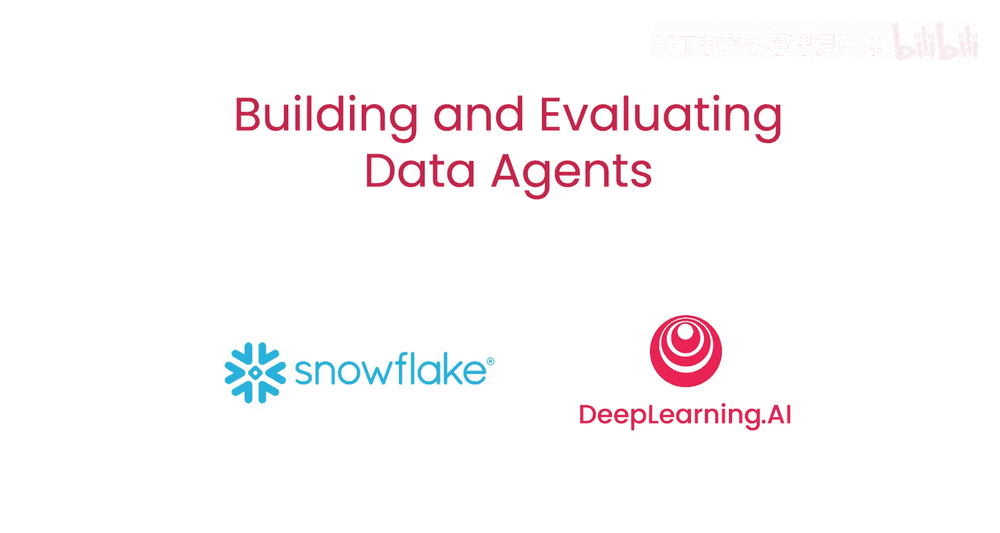
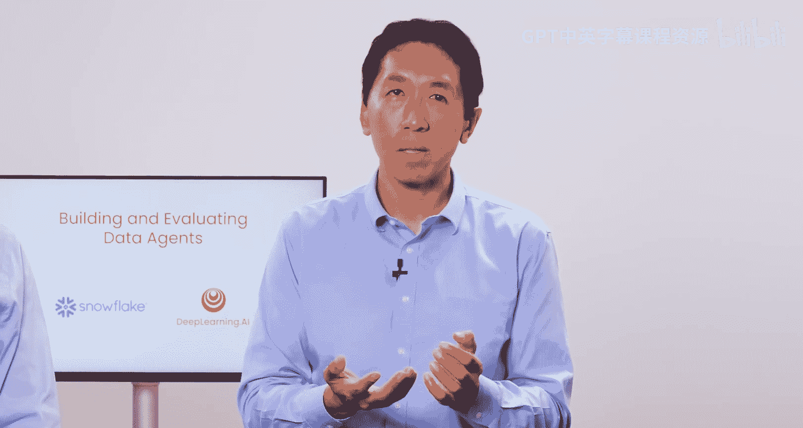
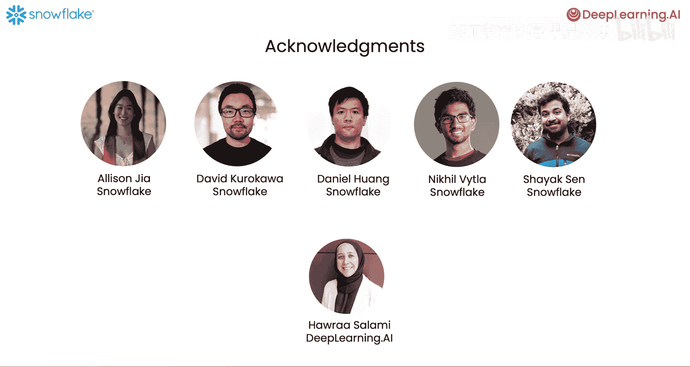

# 吴恩达《构建与评估数据代理｜Building and Evaluating Data Agents snowflake》中英字幕 - P1：1.building-and-evaluating-data-agents.zh_en - GPT中英字幕课程资源 - BV1VfntzuEM6

Welcome toBuilding and Evalu data Age built in partnership with Sflake。😊，In this course。

 you implement a data agent that can perform web searches and connect to data sources。

 circle collect data， analyze it， and visualize results and provide insights。Even more importantly。

 you apply offline evaluations or offline evals to improve and iterate on your agent' design。

 as well as real time， also called inline evals that the agent can use just strategy even while it's running I'm delighted to instructed to this course are AnUpin Gta who is AI research lead as well as Josh Reni who is developer advocate at Snowflake Anuppa was formerly a professor at Kane Mel University and founder of AI observability startup Truera that was acquired by Snowflake。

 Josh also previously worked at Truera and continues to build and maintain true lens。

 which is an open source library for Asian tracing and evaluation。😊，Thanks， Andrew。

 we are excited to work with you on this course。 Building Evals is a really important skill for building agent workloads。

 This course will show you some important best practices。 In fact。

 I learned quite a bit from underpl's last short cause of us。

 And I think you learn a lot from this one as well。 And specifically。

 you start by assessing your agent's answer quality。

 So you use an error message out to measure the end to end performance of the agent and you value that the final answer is relevant to the user's query。

 as well as whether the data retrieve for the analysis is relevant to the user's query。 And finally。

 if the final answer grounded in the list of all the retrieved data。😊。

You can use these offline evaluation metrics to improve your agent's logic or update its prompts or maybe try out different Er models Additionally。

 you also use El misG to evaluate the process by which the agent use arrive at that final answer。

This technique can also interestingly， be used not offline。

 but instead of run time to give feedback to the agent even as is running to help the agent adjusts data retrieval and analysis strategy。

 You'll implement your agent using a multi agent workflow that consists of a planner。

 a plan executor， and specialized agents such as web and data researchers。

 a data visualizer and response synthess。😊，The planner takes the user query and generates a plan。

 and the plan executor directs the plan's execution and determines which specialized agent should proceed based on the plan。

Each agent shares the output of its execution step and the plan executor。Through the agent state。

 after each retrieval step， the plan executor reflects on the plan and decides whether to update it。

 You will evaluate both the quality of retrievals and the quality of the plan。

Was the plan aligned with the user's request。Were the agents's actions aligned with the plan and executed efficiently and logically。

 you will then improve this agent by adjusting its prompts and implementing in line or run time evaluations。

 The in line evaluations will provide the plan executor with real time scores for contacts relevance immediately after any retrieval step。

This will inform the planned executor。Whether the retrieval stamp lacks contact relevance and if so。

 the plan executor will ask the planner to adjust。After you implement these improvements to the agent's design。

 you will compare the offline evaluation metrics。And both offline and real time evaluations rely on tracing the agent that you will also learn about in this course。

Many people have worked to create the schools。 I'd like to thank from Snowowflake， Elson Jia。

 David Kkawa， Daniel Huang， Nikhil Vivia and Shaak Sen from Deep Bla AI Harra Salami also contributed to the course。

 In the next video， you learn about the three dimensions of evaluation for an agent is Go plan and action or G。

 Let's go on to the next video。😊。

