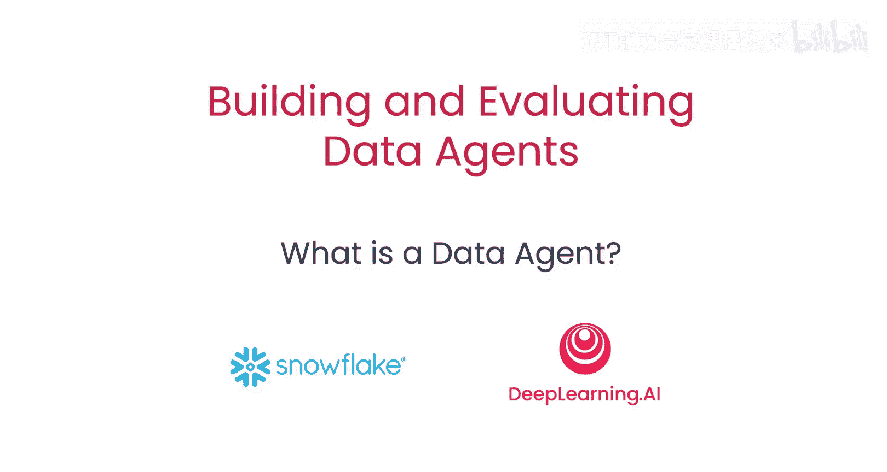
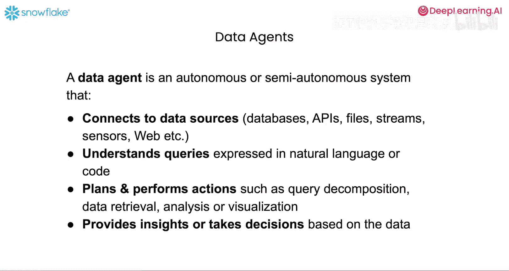
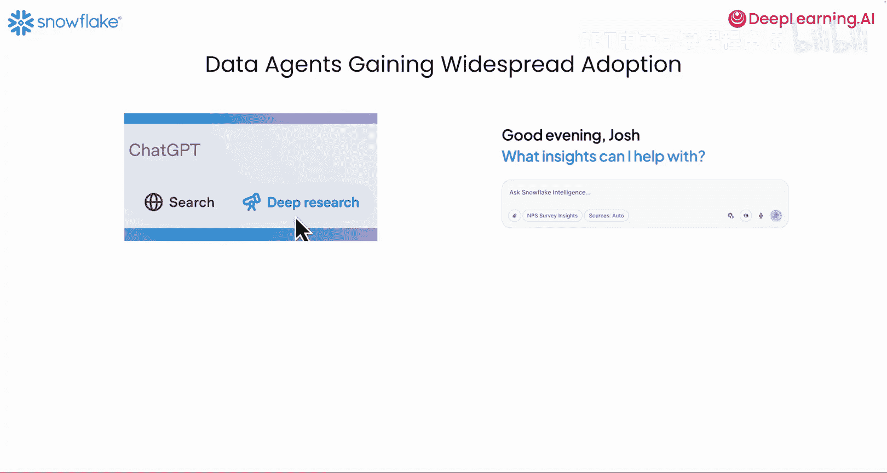
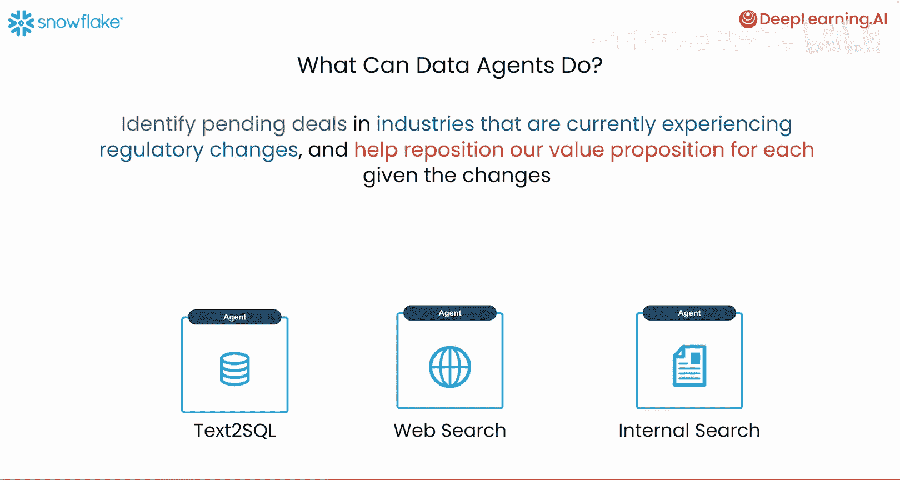
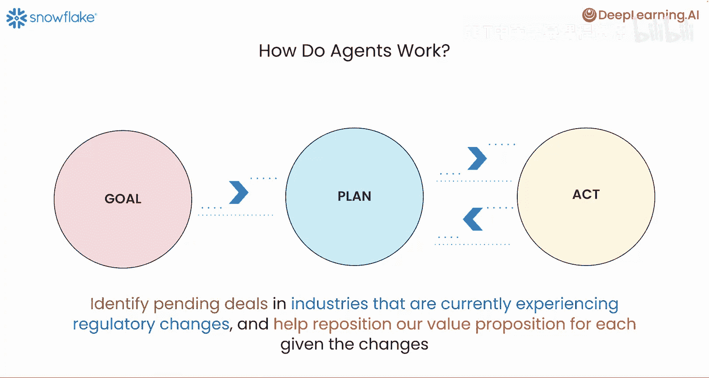
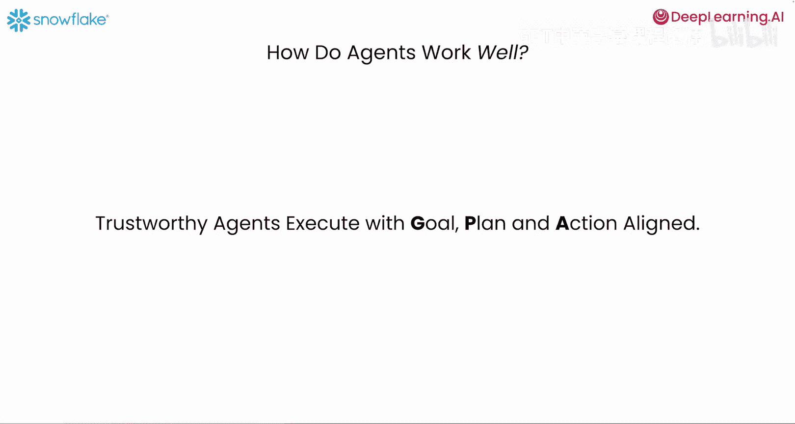
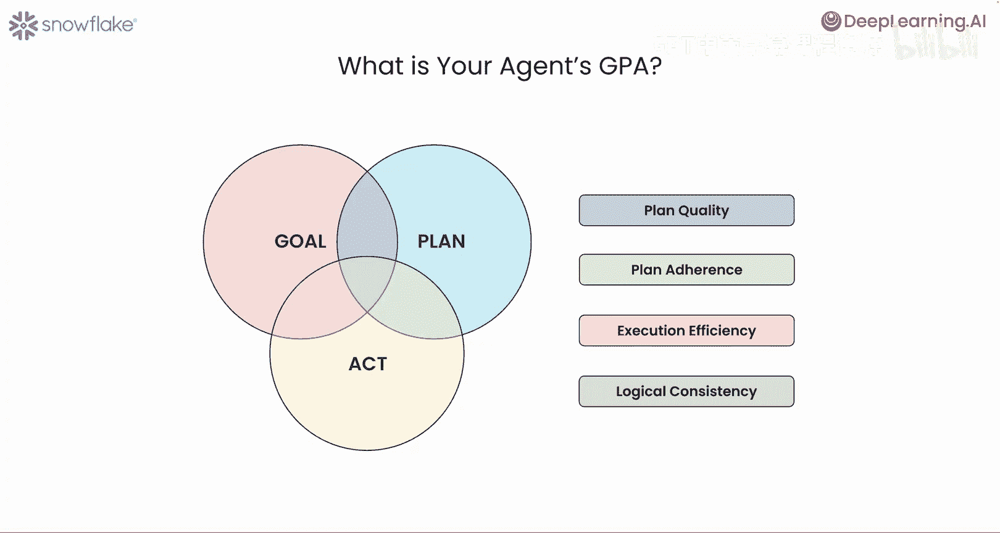
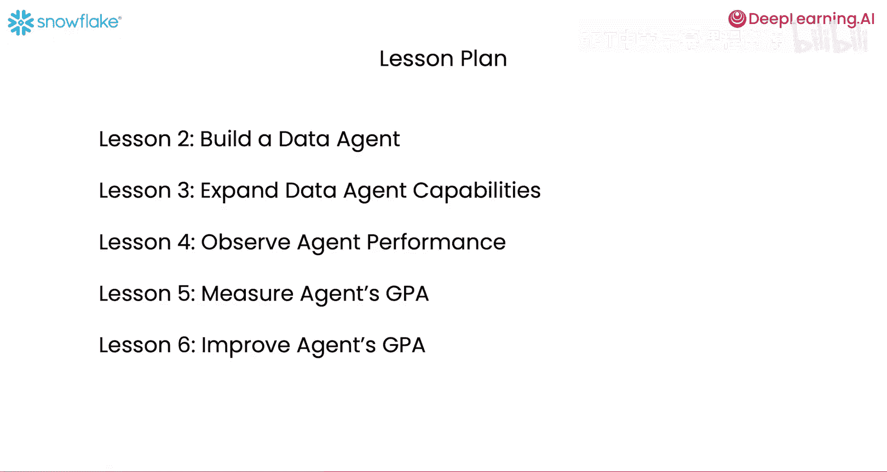

# 吴恩达《构建与评估数据代理｜Building and Evaluating Data Agents snowflake》中英字幕 - P2：2.what-is-a-data-agent.zh_en - GPT中英字幕课程资源 - BV1VfntzuEM6

In this lesson， you will learn what data agents are， how they work。

 and when they are considered trustworthy。Let's dive in。

Let's begin with a definition of what a data agent is。

 A data agent is an autonomous or semi autonomous system powered by large language models that connects to data sources。

 These could be databases， APIs， files， streams， sensors， web APIs， et ceter。

 It understands queries expressed in natural language or code。

Lands and perform actions such as query decomposition， data retrieval， analysis or visualization。

 and finally it provides insights or takes decisions based on this data， for example。

 it could send out an email with a report that summarizes the results of its work。

Data agents are starting to gain widespread adoption， For example。

 many of you might be quite familiar with Chad GPT Deep research system。

 according to our abstraction of what a data agent as deep research would be considered a data agent it only makes use of data that's available on the web and its internal parameterized knowledge to answer open-ended questions on various topics。

 in many enterprise settings， it's useful to rely not just on web data。

 but in addition on data that is available internally。

 either in the form of structured data in database tables or unstructured data which could be in documents and other multimal formats。

 Snowflake intelligence is one example of a data agent that covers this broader class of data sources。

 Let's now look at a very concrete example。

To understand the scope of work for a data agent here's a very simple example where a data agent is being asked to identify regulatory changes in the financial services industry and then agent could in this case find general trends in regulatory changes by examining data that is available on the web so such an agent could be a web search agent that performs this task Now let's make the query a little more detailed Now we are asking our data agent to identify pending deals in industries that are currently experiencing regulatory changes notice that there are two parts to this question first identifying pending deals which is highlighted here in green requires access to internal proprietary data which could be in tables inside of an enterprise and a subagent。

Could examine or answer this part of the question by making use of an agent that can take natural language text and translate it into SQL。

 run it over the database and retrieve this information the second part of the query which is highlighted here in blue is very similar to the first query that we had on the previous slide it's looking at asking for information about industries that are currently experiencing regulatory changes so in this context the overall toplevel agent once it collects these pending deals by making use of the text to SQL subagent can then make use of the Web search subagent to figure out which of these deals are in industries that are currently experiencing regulatory changes and then synthesize a response that combines the results of calls to these two subagents so now you can see the data agent is starting to respond to more sophisticated。

queries that require making use of more than one data source Finally。

 let's augment that query some more the first part up till here is the same as the query we had on the previous slide but now we are also asking the data agent to help reposition our value proposition for each in the context of these deals given the regulatory changes so that final part of the query once we have gotten the response from the agent that addresses these first two parts the topleve agent can make use of another subag that does internal search over documents available within the enterprise to read the meeting notes associated with these deals and then synthesize a value proposition for each of these pending deals which takes into account the regulatory changes in the corresponding industry so we are finally at this point where。

The data agent makes use of three different subagents to answer a fairly complex query that addresses all elements of this task Now let me give you a toplel overview of how the data agent work in order to accomplish a goals such as answering the kind of query we had on the previous slide agents will have associated goals that they are trying to accomplish in the case of data agents it could be responding to a query like the one on the previous slide it then creates a plan to accomplish its goal and then executes a set of actions that are prescribed by the plan to achieve various sub goalss in the path of achieving the full goal and here there can be iteration between planning an action where depending on the results of the actions the agent might update its plan and then execute some more actions and continue on this iterative process。

It is satisfied that the goal is reached well so if we return back to our running example and this is also the example that we will look at in some detail in subsequent lessons。

 the goal is to answer this question， the planning step involves decomposing this complex query into three queries one on identifying pending deals which involves calling the text to SQL subagent one on understanding which of these pending deals are in what industries and what kind of regulatory changes are being experienced in those industries which makes use of the web search agent and finally making use of the internal search agent to help reposition the value proposition for each。

 given the changes so this is the form of planning the first step of planning involves the query decomposition then the execution or action steps involve calling out to the text to SQL agent。

search agent and the internal search agent in that order to finally get to a point where all the information is available for the agent to synthesize a good response that achieve its goals Let's now get into what it means for agents to work well given this structure that have've just shared about how agents work involving this combination of setting goals。

 planning and action to achieve those goals。 trustworth the agents execute with goals。

 plans and actions aligned In other words， we want agents to have high GP or goal plan and action alignment。

 Let me elaborate on that a little bit more how do we measure an agentss GPA The first step is to set goals for the agent in our setting with the data agents。

 these goals will often refer to the quality of the final response such as is it relevant。

Is it grounded in retrieve results as well as sub goalsals that the agent might be expected to achieve along the way in terms of retrieving relevant results to answer the final query once we have the goals specified the next steps involve ensuring a good amount of alignment between goals and plans。

 plans and actions and actions and goals and we have a collection of evaluations that make a use of LLM judges to check the agent's GPA The first evaluation is called plan quality plan quality sits at the interface of goal and plan and it checks whether the agent's plan is a good plan for achieving its goals the plan need not be static it might evolve over time as new information becomes available to the agent but the replanning steps also need to be well justified given the information and observations that。

The agent has access to next up is plan adherence which sits at the interface of planning and actions plan adherence checks whether the agent's actions are in conformance with or adhering to its plan In other words is the agent actually acting in the way that it has planned to act deviations from the plan can be indicative of failure modes as well which are helpful for the developer to be aware of and address as the developer is building data agents the third evaluation also implemented with an LLM judge is execution efficiency execution efficiency sits at the interface between goal and action so it's in this portion of the Venn diagram and it checks whether the execution path that the agent took the sequence of actions that it executed was that the most efficient path for achieving the goal it can help identify。

Rundancies in the agent's planning process， which are sources for improvement as we go through an iterative process for developing data agents。

 Finally， logical consistency sits at the intersection of all three of our GPA pillars。

 and it checks for inconsistencies between the plan and the goal， for example。

 is the plan incorporating or suggesting steps that are inconsistent with achieving the goal our sub goalss。

 as well as inconsistencies between planning and replanning steps are between planning and action steps all of which our sources of incorrectness and opportunities for improvement of the data agent with that brief introduction let me lay out the lesson plan for the rest of the course in lesson two。

 we will build a data agent that makes use of a web search subag as a building plan。

In lesson3， we will expand that data agent with capabilities for text toSQL as well as internal unstructured data search。

 so the combination of lesson2 and lesson 3 we help you build up in a notebook a full agent that can answer the kinds of example queries that we saw earlier in this lesson and you will be introduced to the different steps that are involved in building such an agent from scratch。

 we will make use of the Laro open source framework for the purpose of building these agents。

 the general concepts however carry over to other frameworks for building agents as well in lesson4。

 we will add support for tracing for instrumentation and tracing of the data agent。

 as well as set up the evaluation for the goals associated with this agent for。

Purpose we will make use of true lens， which is an open source library for tracing an evaluation of agents and LLM apps in general you will see specifically how we can make use of open telemetry compatible tracing as well as specific kinds of goals that can be specified well for data agents within true lens in lesson5 we will expand the evaluation to measure the agents's GPA this is where we will add evaluations for plan quality plan adherence logical consistency and execution efficiency to the previously created evaluation metrics from lesson 4 in lesson5 we will also show how agents can fail what kinds of failure modes these evaluations catch and this will provide a basis for developers to introduce improve。

Move to the agent which will be the topic of lesson 6。

 where we will look at specific mechanisms that are informed by the evaluations in lesson5 to improve the agent's GPA Finally。

 we will summarize and conclude the course with some key takeaways。

