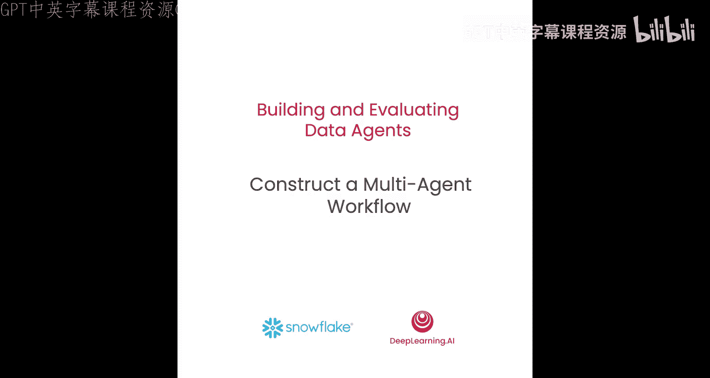
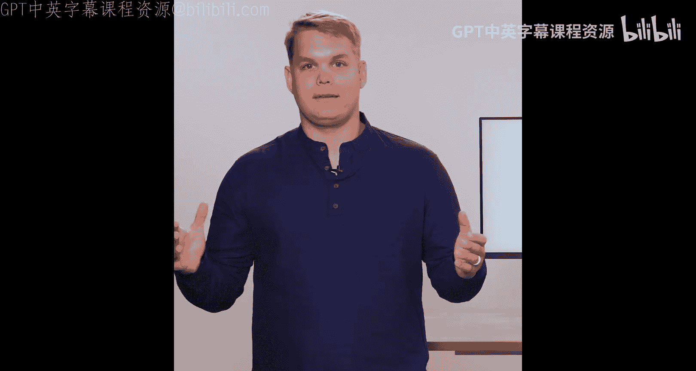
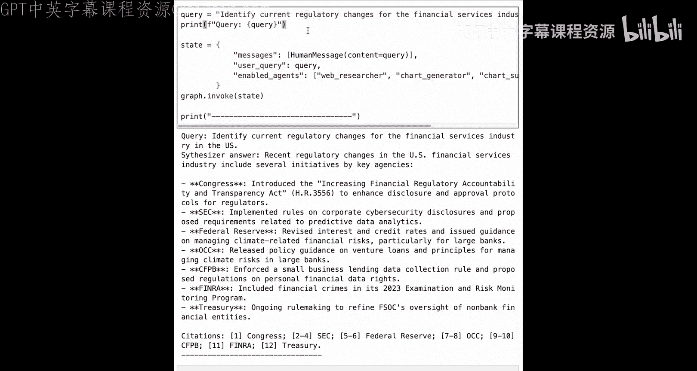

# 吴恩达《构建与评估数据代理｜Building and Evaluating Data Agents snowflake》中英字幕 - P3：3.construct-a-multi-agent-workflow.zh_en - GPT中英字幕课程资源 - BV1VfntzuEM6

In this lesson， you'll implement your data agent as a multi agentent workflow using Lagra。

The data agent will be able to conduct web research to answer users's query and then visualize the findings or synthesize the summary of the results。

 All right， let's go have some fun。 In this lesson。

 the data agent will build will be hierarchical and nature。

 will start with the planner that will take the user's query and break it down into sub goalss。

 ready for the agent to take action on。 then will pass to the executor to execute on each step using the subagent to accomplish each step in the plan。

 The subagents in this example will have access to the web researcher， the chart generator。

 the chart sumr and the synthesizer let's walk through an example of what a flow here might look like。

 And any flow， the planner will take the user query and break it down into its sub goalss。

 First do X， then do Y based on the user's query。 Then itll pass to the executor to take actions against that plan based on the goal。

 Then the executor will pass off to different agents to accomplish each of these steps。 For example。

 it could。😊。

Pass off to the web researcher to gather and retrieve data to help answer the question。

 Then after executing the web researcher， we'll go back to the executor to choose the next action。

 according to the plan。 In this example， we might then go to the chart generatorer to build a chart based off of the data gathered from the web researcher。

 We might summarize from that chart to provide a textual answer for the user and then pass that back to the user at the end。

 In some cases， the data agent might also choose to do a replan。

 Let's take a look at that flow as well。 Just like before will start with the planner where the planner will write its initial plan based on the user's query。

 Then again， it'll pass the executor to choose which agents it should use to accomplish the goals in the plan。

 We can use the web researcher to accomplish the first step in the plan。

 Pass back to the executor The executor might notice that it's got an additional information from the web researcher that indicates it should replan。

 In this case， the planner can adjust the plan it needs to accomplish the goal from here。

 Our new plan。be then provided back to the executor。

 which may go back to the web researcher again for a different set of information needed to accomplish the user's goal Then we can proceed just as we did before back to the executor which will then pass to the chart generatorer。

 which will then pass to the chart sumr and pass our textual response back to the user Now let's take a look at how to build this agent in action。

Now we've landed in the notebook ready to build our agent。

 The first thing we'll do is load our environment。 This will give us access to all of the keys we need to call LLms web search and other services that we need later on。

 then we'll go about initializing the agent state。 The agent state is what give the agent memory here we'll initialize a custom state class that subclasss Lagraft's message state by subclassing message state we automatically get a message key that'll keep track of the conversation history between the different agents。

 In addition to these messages will also include the user query。

 a set of enabled agents that the planner and orchestrator will have access to。

 willll also store the current step in the flow， along with the agent query which is the exact query that a particular subagent will use and we'll store the last reason why that subagent was chosen by the executor。

 Last we' store some information to keep track of any replans to make sure we don't replan too many times。

 Next well create our planner。 We can start by examining。

Pros for the planner so we can really understand how the planner will operate。To access the prompts。

 you can go to prompt pi in your lesson folder。 These prompts are provided to you and will help us plan and orchestrate our agents and call different agents as we use them to find the planning prompt we'll scroll down。

To the method called plan prompt。And we can read exactly the prompt that we're providing to the planner。

 We tell it that it's the planner in a multiagent system。

 It's told to break the user's request into numbered steps and decompose that query into subqueries。

 These subqueries should be the smallest possible sub so that each subqueries An with a single data source。

 will' give it an example as well， For example， if we asked。

 what were the key action items in the last quarter。

 and what was a recent news story for each of them will give an example that it can break the big query into smaller steps。

 It can first fetch the key action items in the last quarter。

 It could then fetch recent news stories for each of them。

 Then we'll provide it the list of agents that it can call and incorporate into its plan and we provide the final format that we expect the plan to be in。

 The final format of the plan will be a Json with enumerated steps where each step includes a name of an agent along with the description of the action that that agent should take。

 The last important piece here is replanning。If we are in a replan。

 then we'll ask the plan to provide a reason that the replan is needed。

 and we'll also give it some guidance to really focus on unblocking the workflow rather than finding the perfect path and to prefer simpler。

 more achievable alternatives over really complex rewrites of the plan。

 Let's go back to the notebook to build this prompt into our planning node。

 As we go about building our planner， we'll first import the plan prompt that we just covered in the prompt pi。

 then we'll import some things from Langgra and Lachain will use to build our agents such as command Hu message and chat Openi to call LLm for our planner will' use the reasoning Lm in particular。

 we'll use03 and we'll ask it using the model keyword arguments to respond in the raw format of a Json Now we can build our planning node。

So our planner node will take in the state and then respond by routing to the executor to take action on that plan。

 The first thing we'll do here is we'll call our reasoning model with our planning prompt。

 This planning prompt will be filled in by the state with the user's query and then we'll receive an LM reply right here that will contain our plan will validate that the plan is the Json that we expect。

Right here。 And then you'll store as the current plan from the L M reply Well validate the Json and extract the plan using Lmreply do content right here。

 Then we can store as the current plan and set the replan flag to false in case we're in a replan。

 In every node we' return a command with two key pieces。

 The first is update update will update the plan messages containing the message history between the subagents。

 We'll continue to retain the user query will'll retain the current step in the plan along with the last reason we'll continue with the same list of enabled agents。

 and we'll also keep a replan flag。 When we write update into the command。

 This is updating the state。 So you'll notice a lot of the same keys in the state that we had when we defined it to start with。

 You'll see the plan， the messages， the user's query and more that we all started with in our initial state and we're just updating it here。

 The second piece in the command。Is the Go to， the go2 tells us what subagent should be called next。

 and because we're in the planner， we'll move from the planner to the executor indicated here in the Go to。

Now， we'll create the executor。 We can best understand the executor。

 just like the planner by first looking at its prompt。 Let's take a look at the prompt now。

We're turning back to prompt stop Pi， we could find the executor prompt right below the plan prompt。

 We'll just scroll down。Into the executor prompt， the first thing we tell the agent is that it's an executor in a multiag system with the following agents and will extract the list of agents from the enabled agents list in our state。

 will then provide it a series of tasks。 First， it needs to decide if the current plan needs a revision。

 it needs to decide which agent to run next。 and why and that it needs to write the exact question that the chosen agent should answer。

 This is the sub question that we've been talking about。

 We'll also give it some guidelines on how to handle replans and we' tell it to respond in valid Json。

 including the keys such as replan go to the reason and the query。

 Then we'll give it some guidance to prioritize forward progress。

 We'll tell it how to choose the go to in this step will ask if the agent has made reasonable progress。

 and if so， it can move to the next steps agent and then otherwise。

 it should execute the current steps assigned agent。

 then we'll give it instructions on how to build the query。

We'll tellll it to write a clear standalone instruction for the chosen agent。

 That standalone question should be written in plain English and answerable by the agent。 Last。

 we'll tell it the context it has to make these decisions。 We'll give it the user query。

 the current step index and current plan step will' tell it if it's just replanned and we'll give it the message history。

 Then it's ready to make its decision。 Let's go back to the executor in the notebook so we can see how we use this prompt in action。

So the first thing we'll do as we create the executor is we'll import the executor prompt that we just defined in prompt Pi。

 and then we'll also import the n type from Lgraf。 Now I'll set the number of max replans for my agent。

 I chose a maximum replans of three so that the agent doesn't get carried away in its replaning。

 Then we can start to define our executor node。 Our executor node is going to take in the state which contains all of the information that we just talked about。

 and it's going to return a command that routes to the next subagent。

 This could be the Web researcher charge generator synthesizer or even the planner。

 Then we'll extract the plan and the step from this state。

 The first thing we'll do here is we'll then build our executor prompt just like we did in the planning node and we'll call the reason LM with this executionecutor prompt。

 Once we've received the response will extract the execution in the content and then we'll parse it to get out the replan the go to the reason and the query。

 once we've done。That we can update the state with this information If we've chosen to replan。

 we need to account for that here here， we'll retrieve the replan attempts from the state。

 if we've done some replaning， we need to account for that here。

 we'll get the replan attempts from the state and we'll set the step replans and then we'll decide if we have replan。

 we'll make sure that we haven't exceeded the number of max allowable replans。

 we'll iterate the replans by adding one to step replans and we'll update the state again right here。

 If we are doing a replan and the step replans is below the max number of replans。

 we'll return command and go to the planner with these updates， then otherwise。

 we'll go to the synthesizer or the next plan agent。 Last， if we're not replaning。

 we'll activate the next plan agent by getting the agent from the current step。

 we'll set the updates， current step， add one， and then we'll set the re plan flag equal to false and we'll return the command with any of the updates we've made to the state。

And the chosen agent in the go to。 Weve must one piece is that if we have just replaned。

 we need to run the planned agent once before we consider。 Let's add that now。

So how we'll determine this is we'll look at the state and get the replayplan flag。

 If the replan flag is true， then we'll discover the planned agent and get that agent and we'll run that planned agent by routing in the go to。

 We'll also iterate the current step and set the replayplan flag to false in this case。

Now that we've created the planner and the executor， we can go about creating our subagents。

 These subagents will be used by the executor should take actions against the plan and reach the user' goal。

 The first subag will define is the web researcher。

 This is going to do the bulk of our data tasks getting information from the Web readyy to generate charts and synthesize and respond to the user with an answer。

 Let's take a look at how we create that web researcher to start building our web search agent。

 we're going to use a react agent from La graph。 A La graph react agent will use a tool along with an LM to accomplish its task。

 This will be the basis of our subagent here。 The tool well use for the Web search agent is Tly will import Tvily search from La chain Tvili。

 and then we'll define our Tavli tool。 and we'll pass in a max results to5。

 This is the number of results we'll get from the openwe to see what this does in the tool call alone。

 we can invoke the tool call directly just like so。 Here。 We'll ask what JP more。

Current stock price and return the results in the results， we can see a list of URLs。

 titles and the content， along with some other information for each result。

 This is what the react agent will use to answer the question。

 This would be a lot of information to pass back to our master multiagent system。

 So by using a react agent， we get to actually provide only the information that the agent system needs to answer the sub question provided to that subagent。

 Now let's build our react agent using this tool。To build our react agent here we'll import the agent system prompt from the helper module and set the LLM to G 40。

 then we'll create the Web search agent by calling create Re agent。

 passing in our chosen LLM and tool， the Tvili tool and then providing a prompt in this prompt。

 we tell it that it's the researcher and that it can only perform research using the provided search tool Tvili tool。

 when it's found all of the needed information It should end its output and not take further actions。

 executing the cell will initialize our Web search agent and then we can try it out。Now。

 we can execute our Web search subag with the same query we did before and ask JP。

 Morgan's current market cap by using a web search agent armed with the tool rather than the tool alone。

 We can provide only the needed information back to our agent system。 Now， we get a nice。

 clean answer containing exactly what JP Morgan's current market cap is without any extra information that we don't need。

 The last thing we'll do when we define our web search agent is to wrap it in a link graph node。

 This allows us to build it into a graph。The web search node will take in the state just like every node。

 and itll also route to the executor that way， the executor can choose the next action in the plan after the web search node。

 then we'll retrieve the agent query from the state。

 This is the exact sub question that's being passed to the Web search agent then will invoke our web search agent just like we did before using this message key and passing in the agent query。

 Last， we'll wrap this response and a human message。

 This is the type that will allow us to wrap this response in a human message type from link chain and we'll go back to the executor using the command along with updating the state here we return command containing an update to the state and the next action agent to take in the update to the state will update the messages which tracks our conversation history between our different subag with the result from our Web search agent The resulting messages from the Web search agent get appended onto the。

History in the message is key in our state。 Now we've created our web search agent Next。

 we'll go to the chart node。 All right， we just finished creating our web search agent。

 This is going to do our data tasks for this agent system。 Now we can create our charting agent。

 the next subagent in our architecture。Our chart agent， just like the Web search agent。

 will be a react style agent。 This means we're binding the Lm to a tool。 but in this case。

 rather than a web search tool， we'll use a Python repple tool。

 This is going allow the L M to execute Python。 particularly it's going to allow the LM to execute Python in order to generate a chart will give it the prompt that it's tasked with generating charts and working with the researcher colleague。

 We tell it to print the chart first and to save it to our current working directory and then to tell the chart summarr exactly where the path is and some notes summarizing the main insights。

 We'll also wrap this agent in a La graph node。 This agent， again。

 is going to take in the state tracking all of the same information in the agent's memory。

 and it's going to route into the chart sumr。 The first thing will do。

 is we' invoke the chart agent using the state， and then we take out the content and wrap it in a human message。

 These messages are going to be passed into the state and appended。

To our conversation history tracked between the subagent， as we mentioned in the type hint。

 we'll also go to the chart sumr using the command Following from the chart generation agent will create our chart summary agent。

 The chart summary agent will take the image。 The chart itself and provide a nice textual response back to the user。

 similar to the last subag will also create a react agent here。 But this time。

 we won't use any tools We'll also provide a prompt that tells it to generate image captions and its task with generating a standalone concise summary of the provided chart saved at a local path。

 Then we can wrap our react agent in a chart summary node。

 The chart summary node is going to invoke our react agent and then pass to the end。

The last sub agentent we need to create is that the synthesizer agent this helps with the case that the agent is not tasked with generating a chart and instead just needs to respond with a textual response。

The next agent will create his search synthesizer agent。

 This synthesizer agent is going to directly invoke our LM with a provided prompt so that we can take in the entire information that the agent has already gathered and provide a response back to the user。

 will' first start by extracting the relevant messages from the conversation history by sorting through the messages and pulling out any from the Web searcher。

 the charge generatorer or the chart sumr for our synthesizer will again use G 40 as our LM and then we can create our synthesizer note Our synthesizer node is going to gather the informative messages that it needs for the final synthesis。

 We'll do that by extracting the message history from the state。

 and then finding any messages from the important agents。 The Web researcher， the charge generator。

 the charge sumr。 noticeice that this doesn't include the planner or the executor。

 Then we'll fetch the user question from the state as well。 That way。

 the synthesizer is armed with the exact user query needs to answer once we。information。

 then we can create our synthesis instructions。 This is the exact prompt we'll pass to the L M to tell it how to answer the question。

 This is very stylistic。 We tell it to perform any lightweight comparisons or in required but not to invent any facts not supported by the content。

 We'll tell it to provide a concise response that fully answers the question and to start with a direct answer and including any citations if it needs。

 and to keep the output crisp。 Now that we have our relevant messages。

 the user question and the synthesis instructions， we can build our prompt containinging each of these key pieces of information。

 our summary prompt is going to be a human message with the content of the user question followed by the synthesis instructions And then last followed up with the content from all of the relevant message in that conversation history that the we've been tracking in the state once we build our prompt will invoke our L M with this prompt exactly。

 when we receive the LM reply will extract out the content。 and then we。

Print the synthesizer answer just so we can see it and we'll finish off by routing to the end and updating the state with the final answer and our last set of messages。

 Now that we've created each subagent in our graph， we can start to build the agent graph。

 Let's remind ourselves of the architecture we've been building。

 So now we've created all of the nodes we need to finally build out this workflow。

 We started with the planner， and then the executor。

 and then we built out each of the subagents needed to accomplish goals according to the plan。

 we created the Web researcher， the chart generator， the chart sumr and the synthesizer。

 Now we can build the graph。To do that， we're going to import state graph from L graph。

 and we're going to instantiate it with our custom state。

 Then we'll add each of the nodes to our workflow that we've been creating in this lesson。 Last。

 we'll add a single edge from the start to the planner so that we always start with a plan。 Now。

 we can compile our workflow into the variable named graph to verify that we've created the graph we attend We can draw a mermaid chart from this graph using a provided link chain utility。

This gives us exactly the architecture we intended。 It looks a lot like the slide we saw before。

 doesn't it。 Now that we've created our graph， we're ready to go and ready to start using our agent。

So the first question we'll ask the agent is to chart the current market capitalization of the top five banks in the US。

 We expect this to rely on web search to capture the current market cap of these banks and then go to the chart node to generate a chart and then last the chart sumr provide a textual companion response。

 will invoke the graph with the state， including the user query will start off our messages history with that user query right at the beginning and then will also provide a list of enabled agents。

 these enabled agents are slotted into the planning prompt so that the planner only writes a plan with the available agents and the executor prompt so that the executor only chooses agents available and ready to use。

So our agent has responded with an answer。 It's provided us a nice chart with the top five market caps of US banks with JP。

 Morgan in the lead。 The chart sumizer， however， did not do as good of a job。

 It just provided us with the chart path but didn't as actually give us the textual response we're looking for。

 In other cases， the L M will actually give the full textual response。

 And you might see that in your notebook。 But either way。

 we'll observe exactly how well this agent is doing when we get into evaluations later。

 Let's try a second query。 In this query， we asked to identify regulatory changes for the financial services industry in the US。

 compared to the last example where we were looking to generate a chart and the chart sumr here。

 we're taking the synthesizer route。 We're looking to only respond with the text response。

 Just like before， we're going to invoke the graph with our user query and initialize messages with that query。

 and then the list of enabled agents that we have to work with。 Let's wait for the agent。

To return our results for us。 So our agent has responded with a nice。

 detailed answer to answer our question。 It gives us key details about regulatory changes in Congress。

 The Se， the Federal Reserve and more。 And it even provides the citations about where it got this information from。

 in the next lesson we'll go on to expand our agent's capabilities and allow it to reason over internal data as well。

 using textassQL and document search。 These will be additional subagent provided into our system so that we can reason and answer even harder questions and provide more value to our end user。

 Let's get to the next one。

