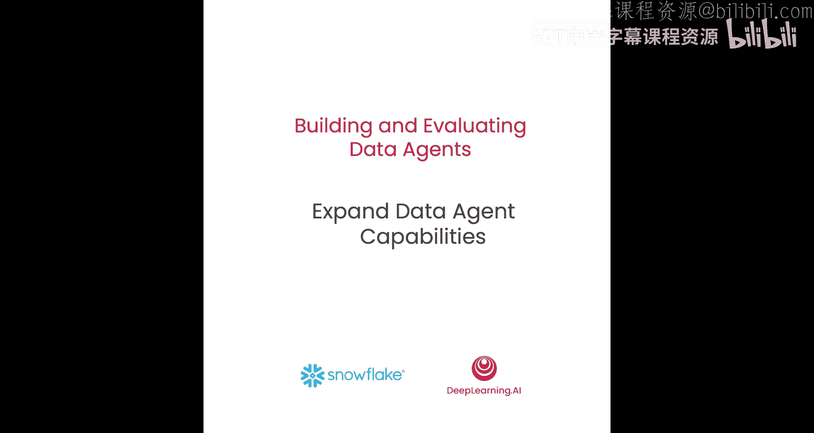
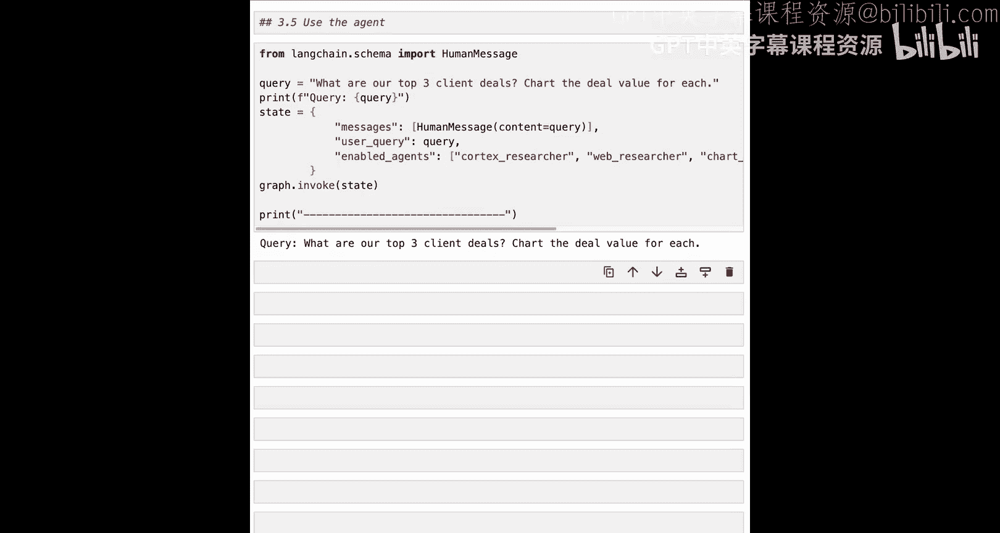
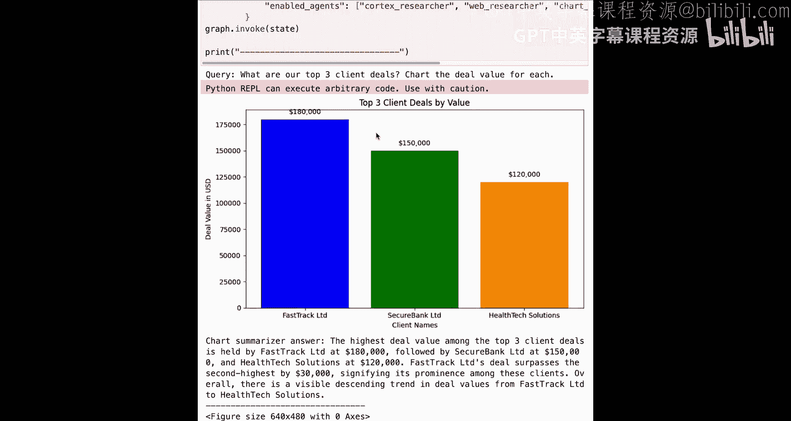
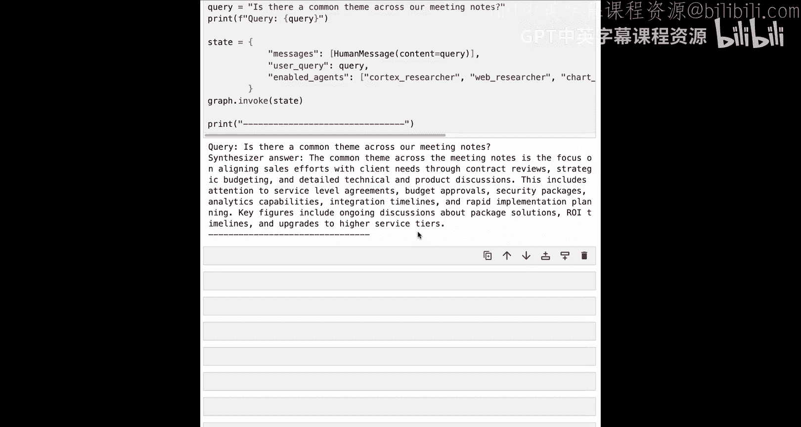

# 吴恩达《构建与评估数据代理｜Building and Evaluating Data Agents snowflake》中英字幕 - P4：4.expand-data-agent-capabilities.zh_en - GPT中英字幕课程资源 - BV1VfntzuEM6

Let's now add an additional subag to the multi agent workflow。

 The new agent will search for context from enterprise structured and unstructured data so that we can answer users' queries。

 The data is stored in snowflake and ready for you to use。 All right， let's go。

In the last lesson， we built a data agent architecture that looked like this。

 We had a planner and an executor。 Our web researcher gathered data。

 and then we responded to the user with charge generator charge sumr and synthesizer in this lesson。

 or an expand our data agent's capabilities to retrieve data。

 Well do this by adding the cortex researcher agent。

 The cortex researcher agent is going to access snowflake to retrieve unstructured data using a document search tool and to retrieve structured data using text as SQL。

 This agent will be provided with two tools different than any of the agents we've created already by adding this agent to our architecture。

 we can now reason across all of our data。 we can ask deep complex questions that require combining information across internal and external data sources。

 Now let's get building Now we're in the notebook。 just like in previous lessons will start by loading the environment。

 These environment variables still contain access to call Lms and do web search but we can also connect a snow。

flake to retrieve data from there as well in Snowflake。

 we've preloaded for you data in databases so we can understand what structuresha data looks like and retrieval for that type of data along with documents so we can understand how to retrieve unstructuresha data and we've also created a search service that sits on top of that unstructure data Let's take a closer look at that now。

The query， the data will import our snowpar session。

 This is our connection to Snowflake using the credentials we just talked about。

 Once we've imported the snowpar session， we can use it and execute SQL directly against it。

 We'll start by using a specified warehouse that's already been created for you called the sales intelligence warehouse。

 You can think about this as the compute that Snowflake uses to execute queries。

 Then we'll do a second query and select from the sales metrics table， the top five rows。

 Importantly， we'll add this dot collect so that we actually execute the SQL。

 When we execute the SQL， we actually see the details of all of the information。

 we can get from this table。 We see things like deal Id customer names， the deal values， dates。

 if we've won the deal or not， and even information like the sales rep and the product line associated with the deal。

 This is the structured data that our data agent will have access to。

 So we just look at the structured data。 Now， let's take a look at the unstructured data。

 The unstructured data we have。Here is meeting notes。

 Our meeting notes are going to be stored in a table as well。

 so we can query again with our snowpar session。 They're stored in the sales Con table in the same schema as the sales metrics。

Now， we can take a look at an example set of meeting notes。 In this example。

 we can see that the meeting with Techcorp was a discovery call。

 There was a detailed discussion around integration， timeline and complexity。

 They asked a lot of technical questions and also mentioned a Q2 budget allocation。 Overall。

 the summary says that it was a positive engagement with clear next steps。

 This an example of the meeting notes well have available to us to help answer questions with our data agent。

Now that we've taken a look at our data。 we can create our cortex agent。

 We'll start by importing some libraries that we need。

 We'll import the session from Snowpar along with the route from Snownflake。

 We'll use these to connect our different tools that are already prebuilt for us in snowflake。

 will also import some of the same things from lane chain and lane graph。

 and then we also import this agent run request from Sflake Cortex。

 This is actually how we're going to run our agent that accesses our tools and retrieve unstructured and structured data from Snowflake。

 Now， I've mentioned the tools。 Let's actually discuss what these look like。

 So the first tool that cortex agent has access to is cortex analyst。

 Cortex analyst is a text as SQL。 where it takes in the user's query and then writes SQL to answer that question。

 This cortex analyst service relies on a semantic model or what the data actually means。

 What if the columns themselves mean in the tables and what do the values mean。

 Are there any comments in。That are commonly used by people querying this data。

 All of that information will be included in semantic model file。

 We've created this for you and loaded into Snowflake。

 We'll just specify exactly the location of the file right here。

 The second tool that our agent will have access to is the search service。

 This is a prebuilt retriever sitting in snowflake on top of those meeting notes that unchard data that we just looked at。

 This is a hybrid retriever that uses both semantic search and keyword search along with reranking to return relevant chunks from those documents。

 just like the semantic model file we've already created this in snowflake for you and will simply point to it here。

 it lives in sales intelligence database。 the data schema and the name of the service is the sales conversation search。

 So now that we've defined these key resources to use our tools we can start to initialize and create our cortex agent。

 our cortex agent is going to take a single argument。

 The query that will define in a pyantic based model。 then。Create our cortex agents tool class。

 we'll provide a name of the tool， We'll provide a description that it should answer questions using sales conversations and metrics。

 and we'll give it the scheme of the arguments， which is the space model that we just created。

 We'll initialize our cortex agents tool with the snowpar session We'll create a route on top of that session。

 and then we'll access the cortex agent service that lives inside of that route。

Now that we've provided the necessary connection to snowflake for our Cortex agents tool。

 we can start to build our request In our agent run request。

 This is all of the information to make a call to cortex agents。

 Quatzless agents is a stateless service that accesses data tools tools like the tools we just created for search and Tas EQL。

 will first provide the model that we want this agent to use will tell it to use cloud 35 onnet and we' also provide a list of tools。

 Analy and search then we' give each of these tools。

 the tool resources they need to execute and operate。 Analyt1 will get our semantic model file。

 This is how the TexilesQL actually understands what the data means。

 Then the search tool will get the name of the cortex search service and will provide a number of max results that we wanted to return。

 The last thing is we provide a set of messages to the agent here。

 that set of messages will just be a single message with our user query Once we've built a request。

 we can define。And a helper to consume the stream。 So now that we' built the request。

 we can create the run method。 The run method is going to take in the query and start to execute and return results from our agent。

 The first step in the run method is to build the request。

 This is calling the function we just created。 and then we'll use the agent service and actually run using the request we just built。

The agent service is going to return as room of events， and this stream will contain SQL。

 yet to be executed。 if we need to access structure data， and if we're accessing unstructured data。

 it will return a response along with some citations to consume the stream。

 We need to get all of this data out。 Let's write a quick helper。

 That's going to allow us to do that。And we'll place this consumed stream right above the run method。

Consume stream will accept the stream and then respond with text SQL in citations like I said before。

 for unstructured， VsTta will return only the text。

 which is the response and then the citations and for structured data， we'll get the text。

 which will be a rewritten query along with the SQL yet to be executed。

 Now that we've defined that helper， we can actually go about executing our SQL once we've run the agent service。

 we'll then consume the stream using the method we just created。

 Then if we do get SQL in the case that we need to access structured data。

 we want to execute that SQL to do this， we'll first use the warehouse sales intelligence warehouse just like we did when we are exploring the data and then we'll use the session and execute SQL that was generated from the agent service。

To initialize this tool， we'll just instantiate it with our snowpar session。

We're going to create a react agent around this tool， just like we did in the prior lesson。

Our react agent here is going to again use G 40 and we' bind it to our tool Cortexagenttool do run。

 Then we'll give it a final prompt。 We'll tell it it's the researcher and it's going to perform research using our cortex researcher tool once it's found the necessary information。

 it's going to end its output and not attempt to take further actions。Let's try this agent out here。

 we're gonna try a question that access the structured data。

 So we'll ask what are our top three client deals In the background。

 This agent is going to rewrite the query into something that's really answerable and translatable to SQL。

 Then it's executing that SQL to return us the results。 Now。

 we can see the top three client deals based on our structure data。

 Let's try an unstructured example。 So here we'll invoke the cortex agent again。

 But we'll ask what is the next step in the sales process for health tech。

 This requires information from those unstructured meeting notes。

 Here we get a detailed dancer telling us the three next steps in the sales process。

 to conduct an extensive technical deep dive， provide documentation and schedule follow up This is awesome。

 Now that we've created our sub agent。 We just need to wrap a link graph node around it That way。

 it's ready to add to our graph。😊，To do this， we'll extract the agent query from the state。

 and then we'll invoke our cortex agent using that agent query。 We'll add it to our message history。

 and then we'll go to the executor once we're done using the command。

 This is similar to like we did in the Web search where we go back to the executor。

 Now that we've created our additional cortex agents research node We're ready to add it to the graph。

 We defined all the other nodes in the helper method so we can reuse them and they're defined just as we did before。

 Then we'll instantiate our state graph just like we did before and add all of the same nodes with this additional node included。

 The cortex researcher。 That's the only change we're making to the cell。 again。

 to confirm that weve built the architecture we intended。 We can draw the mermaid graph。

 and we can see that the cortex researcher is now included in our graph architecture。

 Now that we've created the graph。 Let's try it out。 So the first question will' ask。

 We expect to use structure data。 We'll ask what are the top three client deals。

 We'll also ask it to chart the deal value for each。 We expect this。😊。

Use the structured data retrieval tool in Cortex agents。

 And then we also expect it to use the chart generation and chart summary notes as well。

 So it looks like we've received a response from our agent。

 Our agent generated the chart displaying nicely the top three client deals with fast track in the lead followed by securebank and then health text solutions It also provided us a tax response where it described exactly what's happening in the data and in the chart。

 Now， let's try some harder queries。 This second question as a little bit tougher。

 We first ask to identify our pending deals。 We research if they may be experiencing any regulatory changes and then using the meeting notes for each customer will ask and provide a value proposition given those regulatory changes。

 This is a lot like the example that on pump showed right in the beginning of the course。

In this example， we asked a tough question that required access to structure data about the deals。

 Web data， about any regulatory changes happening in the industries that these companies operate in。

 along with meeting note access to understand our value proposition in each of these deals here。

 we can receive the response from the agent to this question。

 The agent was unsuccessful and actually reasoning about this complicated request。

 It provided some information about how it might go about Acing the task。

 couldn't actually provide the key details that we need In the next lesson。

 we'll be able to learn more about what actually went wrong here。

Here's the third example that I already ran Here。 We asked for a common theme across our different meeting notes。

 is required access to the unstructured data， And the synthesizer was able to provide us a theme that the meeting notes focused on aligning sales efforts with client needs in the next lesson you'll use tracing to really understand exactly what happens under the hood when the agent is executing。

 You'll also start to use your first evaluations， or you can measure the goal completion of the agent using answer relevance。

 context relevance and grabedness。 I'll see in the next lesson。

