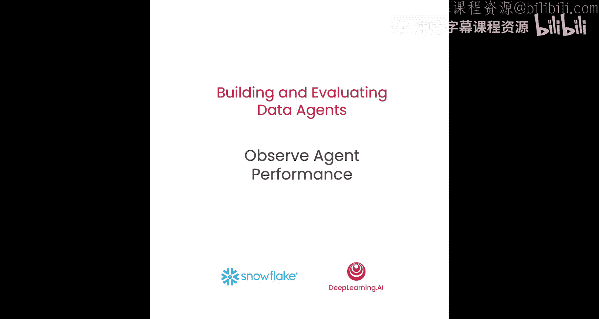
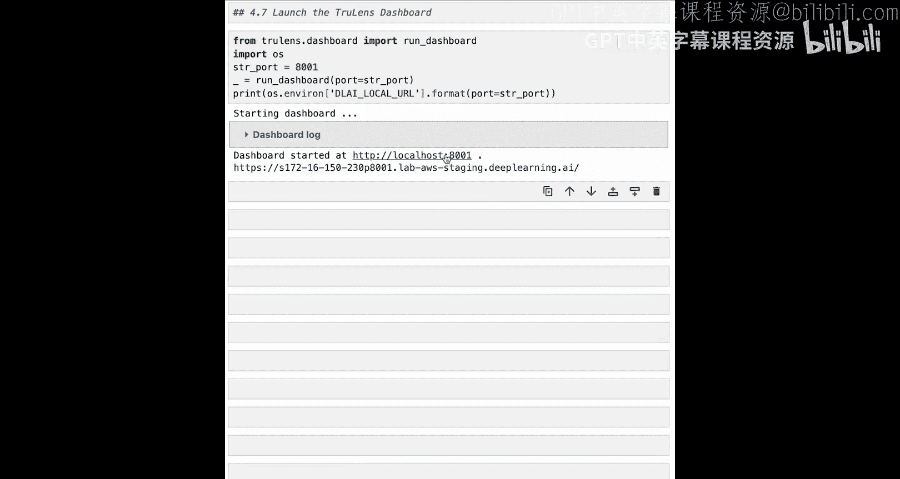
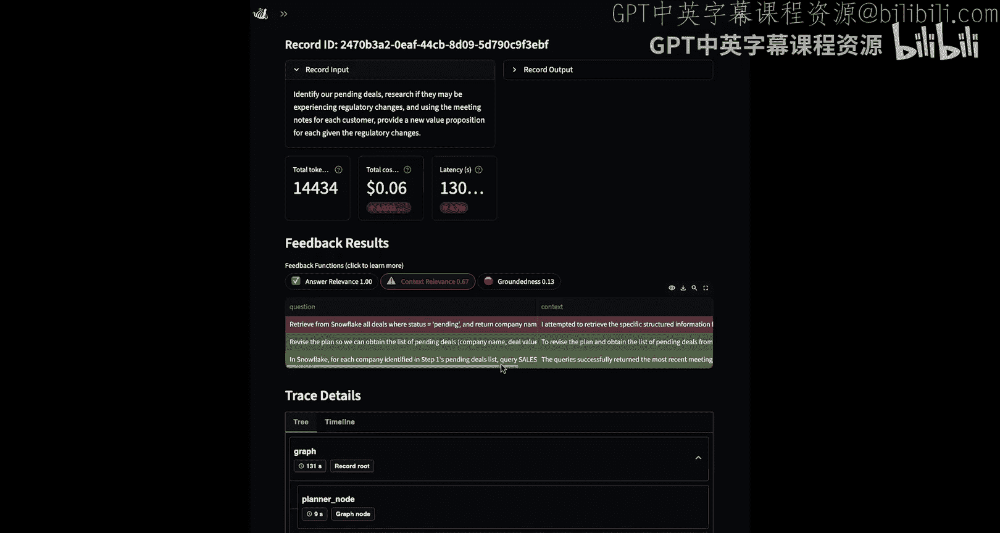
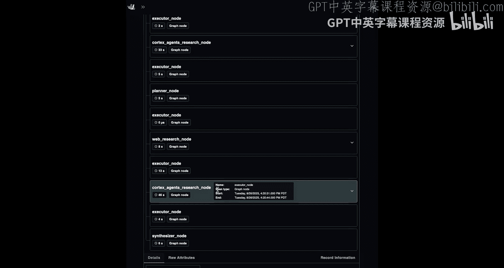
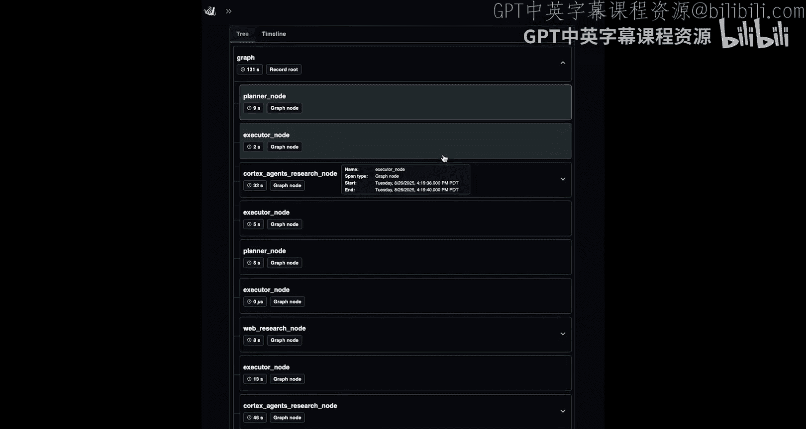
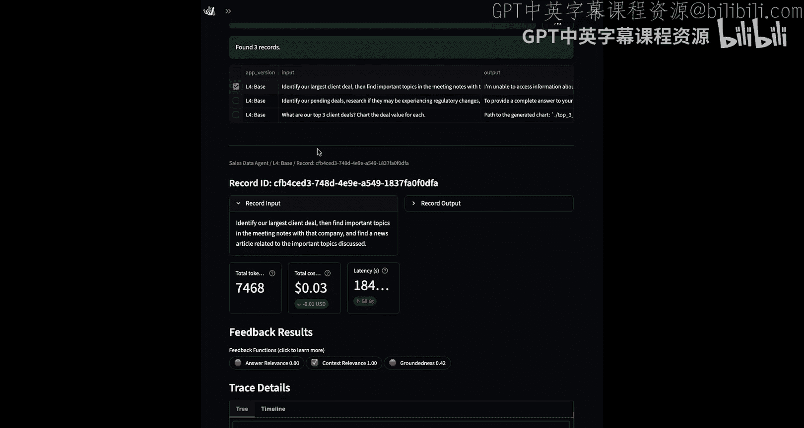

# 吴恩达《构建与评估数据代理｜Building and Evaluating Data Agents snowflake》中英字幕 - P5：5.observe-agent-performance.zh_en - GPT中英字幕课程资源 - BV1VfntzuEM6

You've got your agent ready to go。 Let's trace the steps it takes to accomplish its goal and evaluate whether it's responding to the user's query accurately。

For that， you will use three metrics， contact relevance and relevance and groundedness so we can assess goal completion。

 Let's get coding。

Let me introduce to you the concept of the ragg triad。

 while the rag triad was first introduced for raggs。

 it actually applies very nicely to data agents because we still have the same retrieval or research steps along with synthesis to accomplish the core goals of the data agent。

 The Rag triad works。 by first assessing the relevance of any retrieved context。

 Then we assess to see if the response is supported by that context。 And then last。

 we'll check to see if the response is relevant to the user's query。 Now。

 let's see how these can be applied for data agents。 When we look at our data agent architecture。

 we can clearly see in the yellow boxes where the context is coming from。

 We have context retrieved from the cortex researcher along with the web researcher。

 These are the context we need to use to judge the response。

 We need to make sure that the LM response or the synthesis is fully grounded by these contexts retrieved in the research steps in the second metric answer relevance。

 We're still checking to see if the response is relevant to the query。

This is comparing the user's query that goes into the data agent to the final response completed and pass back to the user Last is context relevance Here we're measuring each agent's query。

 These are the subqueries sent to individual agents along with the retrieved context from each subagent will measure the context relevance of each agent's research individually and then take an aggregate across all of our different researchers to compute these evaluations。

 we need to gather key information from the trace。 The trace is how we track each step that the agent takes to accomplish the user's query and the agent's goal。

 Here's an example of what a trace looks like In this example。

 the trace starts with a research node does some charting and some additional research in particular for data agents。

 we want to pay careful attention to the retrieval steps These contain the key data that will use to evaluate the ragg triad。

 including metrics like roundedness and context relevance。

Here we'll use tracing built on open telemetry。 Open telemetry is a language agnostic distributedbut tracing system that allows us to capture each step that the agent takes in accomplishing its goal。

 These steps are also known as spans， which our units of work that the agent is taking These spans includes steps like planning routing retrieval tool use in generation。

 and we're gonna to pay particular attention to these retrieval span types。

 because those hold the key data we need to run evaluations such as context relevance and groundedness that will focus on in this lesson。

 Now， let's get into the notebook so we can start to define these metrics。

 The first thing we'll do in the notebook is import our environment。 Like before。

 this contains the key credentials to connect a snowflake。

 along with keys for calling Lms and doing web search and new in this notebook will also turn on true lens O tracing with this environment variable right here。

 Now， we can start to define our metrics。 The metrics will use here， rely on LM as judge the LM。

We'll use for this judging task is GB40 to call this LM judge we'll use Tru lens in particular。

 we'll use the open AI provider from Tru lens Now we can define Greds。

To start to define our first feedback function， we'll first import the feedback class。

 the feedback class is what we use to construct our feedback function or our evaluator。

 Then we'll import the selector。 The selector is how we pay attention to particular spans from our trace。

 This includes things like the retrieved context and the query text。

 The grounded dysfunction excepts two key inputs。 The final answer。

 an output of the agent along with the retrieved context from any research steps。

 The retrieved context are going to be the first input identified through this on statement。

 And then the final answer is going to be identified through on output。

 through on and on output is how we pass in this key data from the spans into the feedback function。

Later in the notebook， we'll explore how to actually add tracing to your agent。

 This is how we'll connect the metrics to the tracing。 For now。

 we'll start by defining the feedback functions。 Now that we've defined groundedness。

 we can move on to answer relevance。 answer relevance measures the relevance of the final answer produced by the data agent compared to the original user's query。

 will define it again， using the same LM judge and specify the feedback function with relevance using chain of thought reasons。

 This means that the L M judge will reason on the way to producing its score。

 The two inputs to answer relevance are the query and the final answer or the output。 These are。

 again specified using on input and on output。 The last metric will define is context relevance。

 context relevance will accept two inputs to compute the relevance of each context junk。

 The first is the query text here， that'll be the individual sub questions sent to each individual agent。

 And then the second input is the retrieved contexts。

The research results produced by each subagent Once we've constructed this feedback we'll also choose to aggregate it。

 This means that we'll take the average across each context relevance metric compute it across the different research steps Now that we've defined our metrics we can create our true lens session so we can start logging traces and evaluations from true lens we' import true session which will hold our connection to our logging database will also import default Db connector。

 which is how we'll specify to connect to a specific database here we connect to a SQL light file located in the module the database will store our traces and evaluation as we're running our agent The last thing we'll do is actually create our logging session by instantiating true session and resetting our database to clear any old traces or evaluations from prior runs Now we can start to add tracing to our agent using true lenss well automatically track and log information about the entire agent。

Trace everything from planning to the executor to tool calling we'll also add additional custom instrumentation so we can specifically annotate information from the retrieval steps that we care about and we'll insert and input into our evaluators to do this we'll import a lot of familiar methods from previous lessons。

 including the cortex agent the state and various types from La graph and typing the new thing we'll add here is importing the instrument decorator from true lens This is how we'll add custom instrumentation Once we've done this we'll copy over the same cortex agent's research node we've already created and we'll get ready to add instrumentation to it。

Tad instrumentation will simply add an at instrument decorator on top of this method。

 so we'll create a new line right above and then add in our instrumentation。

The first thing we'll do is set the span type to retrieval。

 This is saying that the cortex agent's research node is performing a retrieval task and adding that span type annotates that span with the type retrieval。

 Then we'll specify exactly which attributes we care about。 So as a reminder。

 the key things we need from the research nodes are the query text or the sub question exactly going to that subagent and the retrieve context or the research results produced by the agent。

 we can access these by using the functions return Except。

 as well as any arguments or keyword arguments Ret represents the return of the function here。

 and As represents the input of the function。 In this case， state。

 let's first talk about the query text。 We'll get the query text by looking at the first argument argument of index 0 to the function here。

 that's the state。 Then we'll get the agent query， which is a key in the state。

 So to put that together。tting the query text to the agent's query in the state at the time that this research node is used Then we can talk about the retrieve context。

 The retrieve context pulls that from the return of the function here we want to focus on the messages in particular the last message when this research node is called and we want to extract from that the content so to put that together we're assigning the retrieved context span attribute into the last message produced by the research node and we're looking at the content from that by using this instrumentation we'll have all of the data we need to start evaluating our agent。

For the web search node， well want to apply an identical process。

 We'll take our existing node and add instrumentation by adding the instrument decorator on top of it。

 We'll set the same span type as we did before。 Retrieval and set exactly the same span attributes with queryt and retrieve context。

 Now that we've added additional instrumentation to our research nodes。

 We can rebuild the graph with this added instrumentation。 Now we can rebuild our graph。

 We'll again import state graph along with the start from La graph will'll import each of the nodes that we created in previous lessons from helper。

 We'll additionally add our new web research node and cortex agent' research node that we just recreated with new instrumentation。

 Now that we've ret our graph。 We can register the agent with true lens to do that。

 we'll use a La graph specific wrapper from true lens called true graph。

 True graph provides automatic instrumentation for La graphs node and task Apis so we can capture the input and output of each of the nodes。

Built into our graph the name of each of these nodes。 in this way。

 we can understand the entire trace of the agent， even without that additional instrumentation we added before。

 what the additional instrumentation gets us is that now we have key labels on exactly which steps or retrieval steps and we also process the data coming in and out of those nodes to specifically extract the agent query that was coming in and the retrieved text that was coming out。

 without that additional manipulation this information would be buried inside a complex data structure that would be a lot harder to evaluate。

 Now， let's register our agent In addition to adding the instrumentation registering the agent also lets us track key metadata like the application name and application version This allows us to differentiate different versions or application so we can compare performance when we make changes。

 will also specify the list of evaluations that we want to associate with this agent here we'll use the rag triad that we defined。

Earlier in the notebook now， we can start to use our agent again， but this time。

 we'll be recording its every action here， we'll enter three successive queries where we can start to interrogate the agent and use its new skills will also be measuring its performance through tracing and evaluation。

In this first question， we again ask， what are our top three client deals and ask it to chart the result。

 Then in the second question， we look to identify our pending deals and research the regulatory changes and consider a new value proposition for each。

 And then in the last query， we're going to ask it to identify our largest client deal。

 find important topics related from the meeting notes and then find news articles for each will submit all three queries to our agent and wait for it to respond。

 The first agent has already responded。 It gave us a nice chart telling us the top three client deals by value and chart form。

 However， the chart sumr again， failed to respond with a nice textual answer。 Now。

 our second agent has responded。 It successfully identified a number of companies and researched about their value propositions。

 and what the meeting notes were focused on。 But as far as I can tell。

 it failed to actually filter this down to the pending deals only。

 When we explore the truance dashboard will be able to understand more specifically exactly what。

Wrong with that query。Now， the agent has responded with an answer to the third query。

 The agent was unable to access information about the largest client deal because it had issues accessing snowflake specifically。

 Now， let's get to the dashboard so we can diagnose exactly what's going wrong with these different queries。

 to launch the dashboard we'll import run dashboard from truelens。

 We'll also specify a specific port for this to run on and we'll run run dashboard to start the dashboard。

 The dashboard we'll read the traces and evaluation data that we've been writing to the database during this notebook will be able to explore the traces and see how they connect to evaluations and really understand on a deep level exactly what's going wrong and identify different failure modes with the agent。

 So once we've run run dashboard here， we'll see two links。

 please click on the second one as that is running specifically on the deep learning environment。

 If you are running locally you could use this local host Instead。

 Now that we've opened the true lens dashboard， we can inspect。

Our agent performance to expand our field of view， we can minimize this left pane by choosing this double arrow in the top left in the leader board。

 We can see the aggregations of our different evaluation metrics by application version here。

 we're starting with just one application version。 The version we set in the notebook L4 base。

 We see our application or our agent has a low answer relevance score along with a low ground inness score。

 Let's click on the version itself to explore more to do that。

 We'll select the check box next to the version we want to examine and then choose examine records。

 Now we can see each query that was submitted to this particular version of the agent。

 Let's examine each query。 So here when we asked what the top three client deals were and to chart the value for each。

 We see an output of the chart but it didn't actually summarize the chart。

 we can examine the evaluation metrics to see programmatically how the LM judge identified failure modes。

With this agent looking at answer relevance， we see that answer relevance scored 0。

 The response was not at all relevant to the user query because it didn't provide that textual answer。

 And we can see that in the L M judge explanation here as well。

 We can also examine the other metrics like context relevance and see that none of the research that was done by the agent return the relevant results needed to answer the query。

 Now， let's take a look at a second execution。Here， rather than focusing on the long output。

 let's look at the evaluation scores to start this time here， we see a high answer relevant score。

 While the response was relevant， it wasn't actually grounded in the research results。

 We see that issue with our low ground under score。 A lot of the statements that the L M is making。

 We're not actually supported by the research results。

 And instead were inferences that the Lm was making。

 and the reason for this is because some of the context retrieved by the research steps were not relevant。

 While we're here， let's also look at the details of the trace。

 So we can actually understand the different steps that the agent took。

 as we scroll down to the trace。 The trace will start all the way expanded。

 so we can minimize to get a clearer view by clicking on the carrots in this tree。

Once we've done that， we can clearly see the path that the agent took。

 The agent started with the planner and then moved to the executor and then used the cortex agent's research note。

 Then it did a replan here。 did a second web research， a second cortex agent research。

 And then last move to the synthesizer。 If we wanted to explore further。

 we could actually examine the inputs and outputs of the nodes by clicking on the note itself and scrolling down。

You can also check the details for what happened in the third query as well。

 You might see different numbers for your evaluation metrics， depending on the agent's performance。

 if the agent chooses to act in a different way when you run your agent in the next lesson。

 I'll hand back to Anaum， where he'll add goal， plan。

 action alignment evaluations to further understand exactly what went wrong with our agent。

