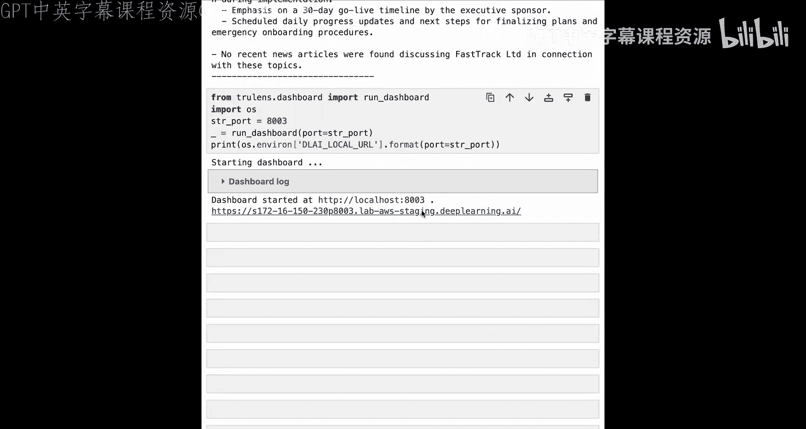
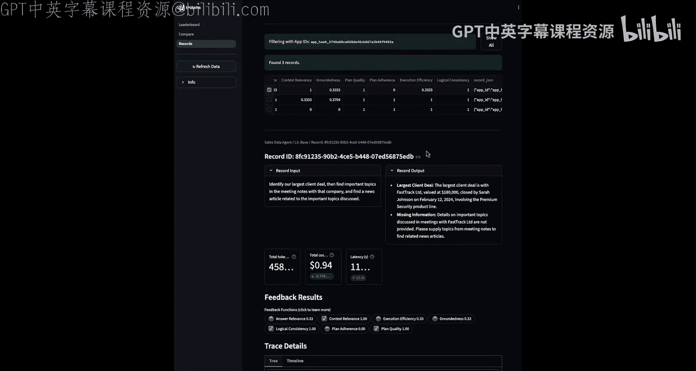
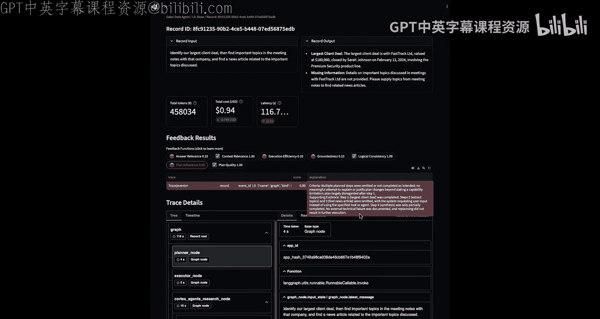
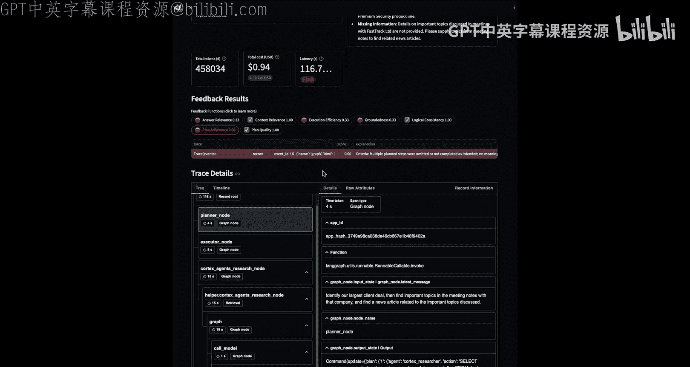
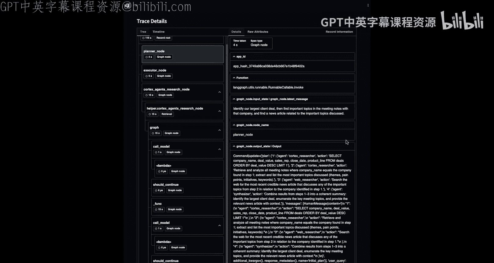
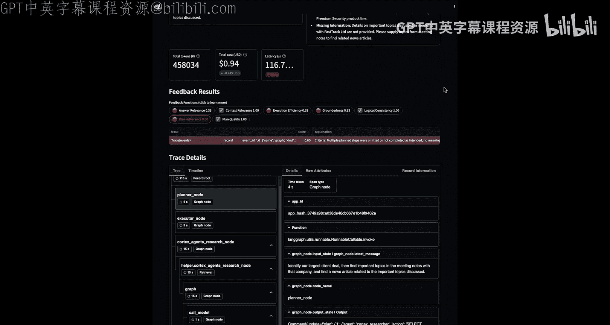

# 吴恩达《构建与评估数据代理｜Building and Evaluating Data Agents snowflake》中英字幕 - P6：6.measure-agent-gpa.zh_en - GPT中英字幕课程资源 - BV1VfntzuEM6

Youll now learn how to evaluate whether your agent's GP goal plan and actions are all aligned。

 Let's get started。 Let's quickly recap from the introduction。

 how to measure your agent's GP or goal plan action alignment。

 You'll recall that that will make use of four evaluations that we will get into in this lesson。

 First， we have plan quality， which sits at the intersection of goal and plan and measures how well the plan achieves the goal。

 Next， we have plan adherence， which measures how well the actions that the agent executed aligns with a plan that it had created。

 Ex efficiency sits at the intersection between goal and action and measures whether the execution trace is an efficient one。

 That is that it's an optimal path for achieving the agent's goal。 and finally， logical consistency。

Sits at the intersection of all three of goal plan and action looks for inconsistencies between plans。

 planning steps or between planning steps and action steps within action steps as well Now let's get into the notebook and see how we can augment the data agent and evaluation steps from lesson4 with support to measure the agent's GPA。

As a first step we will load up the environment in the next step we set the GPA Eval provider model to be the open AI GP4。

1 model and one reason for that is that GP4。1 as support for long contexts and the execution traces that will be fed as input in computing our GPAval do require that because the traces can be quite long now that we have the environment set up as well as we have picked a model provider we will go over each of the four Es to compute an agent's GPA one by one for eachval I will also show you a simple example to illustrate the kinds of failure modes the agent can fall into and how these es can catch these failure modes later in the lecture I will run the evaluations for the full data agent and we will see how well it does。

With respect to these evaluations， let me begin with the first evaluation。

 which is plan quality to get going， we will set a specific user query。

 which in this case is which sales leads should be prioritized this week and what specific action item should we take for each as well as a plan that an agent could have come up with to achieve this goal or answer this query。

 and these are the four steps in this plan。 It involves pulling all the sales leads from the past 12 months from the CRM that's step1。

 step 2 is for the largest  twenty0 leads compile any notes call logs and related tasks from the CRM step 3 is to summarize each leads current stage in the pipeline and finally to present the summary and recommendation in a single table Now。

 let's define the plan quality feedback function， give it the name plan quality we will set the eval model provider to。

Makeake use of the G 4。1 model and by specifying that we want the plan quality with chain of thought reasons。

 we are setting it up so that in addition to a score it also gives a reason for why it came up with that score for plan quality and finally we will provide as input to this plan quality evaluator or LLM judge the full trace the full execution trace to examine so that it can come up with its evaluation Now let's run the evaluation。

 the plan quality evaluation with the example goal and plan that I had set up earlier over here the output of this will be a score between  zero and1 where zero means a particularly poor plan and one would be a perfect plan and the reason is the rationale or chain of thought reason for why the plan quality。

IJu came up with that score， let's run it now and see what it comes back with。

So the LLM judge came up with a score of 0。66 twots。 It's about 66% of the way towards an ideal plan。

 and you can see two things。 One is the criteria that the judge used to grade the plan quality and secondly。

 down here you can see the supporting evidence or the chain of thought reason for why it gave the plan with respect to the goal or query the specific score。

 the criteria for evaluation is that the plan should be generally well structured that it addresses the query with clear steps and includes justifications for most actions。

 however， it lacks explicit rationale for selecting the largest20 leads and does not detail the method for prioritization or generating specific action items So no replanning is present so you can see that。

The explanation highlights where the gaps are in this plan， what it's doing well。

 as well as where the gaps are in this plan。 And then it goes on to provide supporting evidence which spells this out much more clearly in a way that's aligned with the steps of the plan。

 So， for example， it says that step 1 establishes the data set clearly that step 2 prioritizes large leads。

 but does not justify the number or metric， where it had come up with 20， for example。

 step 3 summarizes pipeline stages， supporting prioritization， So that's being done well。

 Step 4 provides actionable output。 However， the plan omits explicit prioritization criteria and recommendation methodology and no replanning occurs。

 So in this way， the plan quality judge is showcasing areas where the plan has done well and where it exhibits weaknesses and opportunities for improvement。

 I will。That when we run the full data agent the plan and the execution trace will be under the control of the agent not created by us so we will not be able to directly edit the plan to address these kinds of weaknesses however。

 we will see in the next lesson systematic ways of addressing these kinds of weaknesses in planning through the use of updated prompts and inline evaluations If I were to summarize some of the weaknesses in this plan I would say that there are three areas where the plan could have done better One is the selection criteria was vague it said pull all sales leads from the past 12 months which lacks urgency constraints tied to the goal second the prioritization approach was weak the largest 20 ignores the lead score stage urgency or upcoming deadlines were。

Missing actionability related challenges as well where no instructions to create specific next actions or owners were laid out and finally the output was not specific a single table without required fields that were tied to the goal these are the kinds of issues that we have seen and and now we want to construct a better plan thatll close these gaps and here is a proposal where we keep the user query the same but now if you look at the various steps of the plan we are trying to close the known weaknesses that were surfaced by the previous round of evaluation for example here in step1。

 we are talking about a next action date within 14 days as a criteria for pulling leads with open opportunities from the CRM we are filtering to leads with the deal value that's greater than 10k or has a high lead score meaning that these deals are important。

Either from a revenue standpoint being sufficiently high or the probability of conversion is high。

 we are going to be sorting by the deal stage urgency。

 for example by close date approaching at risk of going cold。

 potential revenue impact getting more specific to close that particular kind of gap and finally for each of the prioritized leads。

 we are now in this plan， specifying that we'll retrieve the latest interaction notes。

 key decision maker info and current blockers， identifying overview of missing action items。

 propose specific high impact next steps such as scheduling a product demo sending a proposal revision。

 escalating to the sales manager and finally we group these recommendations into this week's priority list with owner assignments and deadlines。

 present results in a table with columns such as lead name。

 value stage urgency score next action new date and owner presenting the results in a much more。

Orized an actionable manner Now let's rerun the evaluation with this better plan and see what we get in terms of the quality of this improved plan Now the evaluation comes back with a score of one and the explanation here is essentially saying that the plan is well structured。

 it's optimal， it directly addresses the user's query and then all the steps are clear and logically ordered and so forth。

 I will leave it to you to read this in greater detail but the key takeaway here is that number one plan quality evaluation can be very helpful in identifying areas where a plan generated by an agent is good and has strengths and areas where it has gaps and could improve and this information can then be leveraged to help the agent plan better and achieve better。

Outes Now that we have finished the section on plan quality。

 let's look at evaluations for plan adherence So we are on the second evaluation metric for our agent's GP plan adherence to remind you is going to check how well the actions executed by the agent adheres to our follows or conforms with its articulated plan for this purpose illustrative purpose I will consider a simple sequence of actions that an agent could have executed and here are six steps where it pulled all open opportunities from the CRM but without applying an next action date filter it applied the deal value filter only let's skip the L score filter it sorted leads solely by deep value so in based on the revenue impact notice that the good plan was asking it to also consider other factors such as urgency。

The deal or potential to close or for the deal to grow old Step 4 looks at retrieve latest notes and contact names。

 let's skippped blockers step 5 listed the CRM's existing next action field without review or update and finally step6 output a table with lead name value stage and next action so you can see that I have set up this sequence of agent actions intentionally to have some gaps that you or I can look at eyeball and tell that it's not an ideal sequence of actions given the good plan that we just looked at in the previous section So next I'm going to define the plan adherence function and then run it on this sequence of agent actions along with the good plan from the previous section the plan adherence function its structure very much follows the structure of plan quality the GP valve。

er is again set to run plan adherence with producing chain of thought reasons so that we don't just provide a score but also give a reason for why that score and as input to this evaluation function or LLM judge we are providing the full trace so the plan adherence function is looking at the full trace and checking how well the actions of the agent on the trace correspond to or adhere to the plans that are also on that trace so we have the function definition in hand now let's run it with our running example and as before it's set up to output a score as well as provide a reason and we will now run and examine the results of the evaluation and surprise surprise it comes back with a score of zero this should not be particularly unexpected given that I had intentionally planted a bunch of adheres。

ssues in the execution trace we can check here if those were caught so you can see a summary of the issues under this criteria and then more detailed description of the issues in the supporting evidence section that's actually look at the supporting evidence section first step1 the judge caught that the agent did not filter by the next action date or was missing the next action date as required it pulled all open opportunities instead so this absence of filtering which was there in step1 here in the trace was detected this was an example of failure of adherence with the plan which if I scroll up to the plan you can see that the plan was saying not that you pulled all open opportunities but only the ones that have an next action date within the next 14 days or no next action assigned this filtering criteria was missed by the actions and that's why in this。

There is a violation。 you can yourself go step by step over the other steps and youll see other missing pieces in a number of these steps。

 which the Elm judge was able to catch and highlight the criteria section if we return to it now summarizes the higher level issues。

 multiple plan steps were omitted， sometimes they were performed out of order or replaced with unplanned actions。

 no meaningful attempt was made to explain， justify our document plan changes or new actions。

 the plan was largely ignored or disregarded in execution or steps were not completed as intended。

 if replanning was necessary， the revised plan was not followed so this is a pretty significant and consistent deviation of the agent's actions from its plans it might as well not have come up with the plan because it decided to ignore almost everything that was in it and so。

Coectly gets a very low grade a score of0 It's not going to do so well on its GPA Now let's look at a better set of agent actions that adhere more closely to the plan and for which we expect the grading from the plan adherence judge to give us a higher number so you'll see that if you look through these steps there are additional details that are added in which were not available in the previous sequence of agent actions for example。

 in step1 when the agent pulled all the leads with open opportunities it also only focused on the ones that are have an next action date within 14 days or known X action assigned similarly this grouping of recommendations into this week's priority list now let's set up the plan and along with this sequence of actions and run the LLM judge feedback function for plan here。

Given the better plan from before and the sequence of agent actions。

And the judge comes back with a score， a perfect score of one。

 And if you go in and look at the details of the criteria and the supporting evidence。

 youll notice that all plan steps are well accounted for their are no os or reordering So a number of those failure modes which were flagged by the judge for the previous sequence of actions all are addressed with this sequence of actions。

 Remember， we are ill the power of our plan quality and plan adherence， judges。

 the GP wells in general through this process of looking for alignment between goals and plans and actions in practice the you。

 the developer will not be directly editing either the plan of the sequence of actions。 you will be。

 however， updating the agents either through its promptms or through other techniques that we will discuss in the next lesson to address these。

failure modesGreat， so now let's look at another sequence of actions and we will now use that as an illustrative example to introduce the concept of execution efficiency execution efficiency if you remember is capturing how well the sequence of actions in the trace how efficiently does it achieve the goal and in particular it'll flag actions that are redundant or unnecessary steps in the execution trace that introduce inefencies and could have been avoided if the agent had land better and acted in conformance with a better more optimal plan Let's go back to the notebook and look at an execution trace to illustrate this evaluation metric the execution trace is similar to the ones that we have seen before in structure。

 the only point of difference is that we are also summarizing。Results such as from step1。

 the number of retrieve leads were 96， then in step 2 you applied the filter。

 yielding 54 leads and so forth。 Now let's define the execution efficiency feedback function。

 it has a very similar structure to plan quality and plan adherence as before we are asking the LLM judge to output the chain of thought reasons in addition to the score and it's given the full trace as input in order to grade it for execution efficiency。

 let's go ahead and run this evaluation function on the action sequence that we just saw and see how well it does。

It gets a score of 66% it's about two- thirdds of the way to an ideal score and if you look at the criteria and the supporting evidence it's pointing out that there were some redundant retrievals that was duplicate work where the agent reapplied the same filter a couple of times step6 exported to both XLSX and CSV formats the only one was needed other steps were logical but there were a couple of these redundant steps that the LLM judge was able to figure out and identify so this is the kind of information you will find an LLM judge for execution efficiency highlighting on traces which don't represent an efficient execution path Finally the fourth evaluation will consist of logical consistency and logical consistency looks for contradictions during an agent's execution it could surface logical flaws。

Its reasoning， it could surface inconsistent planning steps where an agent might make an assertion at one point and then contradict itself later on without justifying the reason for the change or it could even highlight ungroundunded assumptions where the agent might be making an assumption based on its parametric knowledge but not one that is traceable back to retrieved pieces of information。

 let's look at a sequence of actions， another sequence of agent actions and see how it does when we run an evaluation for logical consistency on it。

 let's now define the logical consistency feedback function。

 the structure of this function is exactly the same as the one for the previous functions。

 we are requiring it with the chain of thought reasons and the only input to it is the full execution trace now that we have defined this function let's run it on the previously defined sequence of action。

Yes。And it comes back with a score of 33%。 So it has identified some inconsistencies in the execution trace。

 For example， between step 1 and step 2， there are contradictory lead guns。

 One step says the number of leads is 96。 Another step says that it's her in 13 without an explanation in step 3。

 theres a ranking logic for minimal engagement that's used that's not fully justified。

 Step 4 has a DVD decision maker with active next steps which are not explained5 and six are fine。

 but you can see a number of these inconsistencies that the LLM judge for logical consistency has flagged。

 These are all opportunities for improvement for the agent but as it currently stands these forms of inconsistencies can impact the accuracy and correctness of the final response from the agent with that。

 we are wrapping up the section introducing。The four evaluations that are helpful for grading an agent's GPA now that we have introduced the concept of GPA Vals。

 the four LLM judges for plan quality plan adherence execution efficiency and logical consistency using some simple running examples let's go back to running the same set of evaluations over the data agent that we created in lesson4 let's set up a true length session for logging the execution traces and evaluation results into this database this is a step that you have seen before Next let's build the graph I with the agent this is again identical to what you have seen in the previous lesson。

Next we will register the agent with Tru lens， this step is also very similar to what you did in lesson 4。

 the only additions are that in addition to the rag triad of goal completionvals。

 we have now added these four evaluations to measure the agent's GPA。

And now we are ready to run and record the agent's execution and the associated evaluations on a set of queries。

 let's begin with the first query。Where we are asking。

 what are our top three client deals chart the deal value for each。

 This should be a relatively simple query for the agent that should primarily make use of the text to SQL capabilities。

So the data agent has come back with the response。 Let me quickly run through a couple more examples of queries。

 and then we will spend time on the true lens dashboard to understand the tracing and evaluation pieces for these queries。

 the second queries on identifying or pending deals research if they may be experiencing regulatory changes and using the meeting notes for each customer to provide a new value proposition for each given the regulatory changes。

 So this query， if you recall， is similar to what we saw right in the introduction and in the previous lesson and this is the third query and we now run the agent and the evaluations on this query as well。

 now we have the results from all the queries and we can look at them on the true lens dashboard。

Let's run this ch code snip it to set up the Tru lens dashboard and then this link will now take us to the Tru lens dashboard let's now examine the results of our evaluation using the true lens leader board over here you can see the results of the evaluations for the data agent that we ran through in this lesson the goal completion events related to the raggriad have some room here for improvement context relevance and groundedness for example are not that high and if we look at the GPA valve。

 plan quality generally good so is logical consistency but plan adherence and execution efficiency show room for improvement on this screen the numbers that you're seeing for these metrics represents the average across the three queries that we ran from our notebook we can click on the Ex record。

Stab to look at the record level view where we can examine in greater detail for each query what evaluations we got so you can see here each row here in this table represents a query which is the input the output response as well as the results of the evaluation on all of these metrics let's pick one example query for which the GPA evolve are doing white well so if I scroll to that section it looks like for a query this second query the GPA valves are doing well let's select this and now down here we can examine this in greater detail this was the question where we ask the data agent to identify pending deals research if they may be experiencing regulatory changes and use meeting notes for each customer to provide a new value proposition for each given the regulatory changes and down here。

You can see the output of this process where the final output looks。

 identifies these five deals and then for each it identifies for the first one there's no specific regulatory changes for the second one it's affected by shifts in trade policies and so on we can scroll down here to look at the feedback results and in particular we can see that the GPA valves are quite strong for this particular query plan adherence plan quality logical consistency and execution efficiency are all perfectly graded context relevance and groundedness on the other hand are not that high indicating that there is still room for improvement in the retrieval steps that this agent went through let's look at another row where the GPA valves are not as high the first row falls into this category while it does well on plan quality and logical consistency。

The agent does not adhere well to the plan， and the execution efficiency is also quite poor。

 so I can select that row and look at it in some more detail。 So here you can see the query。

 This was about identifying the largest client deal and some additional qualifiers around it。

 and this is what the output looks like。 Let's look at the plan adherence evaluation results。

 You can see that the score here is0。 and the explanation provides a detailed summary of why the score is so low。

 It mentions that multiple plan stamps。 steps were omitted are not completed as intended。

 no meaningful attempt was made to explain or justify。

 plan changes beyond stating a capability limitation and that the plan largely was disregarded after step 1。

 then it goes on to show more specific supporting evidence。

 If you want to manually check the work of the LLM judge， you can。

Click on the planner node and look at the details of the plan that it had come up with and here you can see the various steps are laid out step number one。

 step number two and so forth and then you can look at the execution trace and check how closely the execution actions follow this plan so this particular trace suggests that there is room for improvement for how this agent is adhering to its plan there's also room for improvement in the completion properties and the completion goals related to answer relevance in particular as well as groundedness with that let me wrap up lesson5 and in the next lesson we will see systematic techniques to improve the agent's GPA thatll address these shortcomings that we are observing in its execution。

