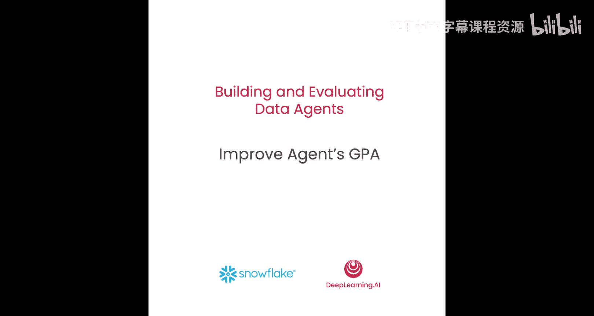
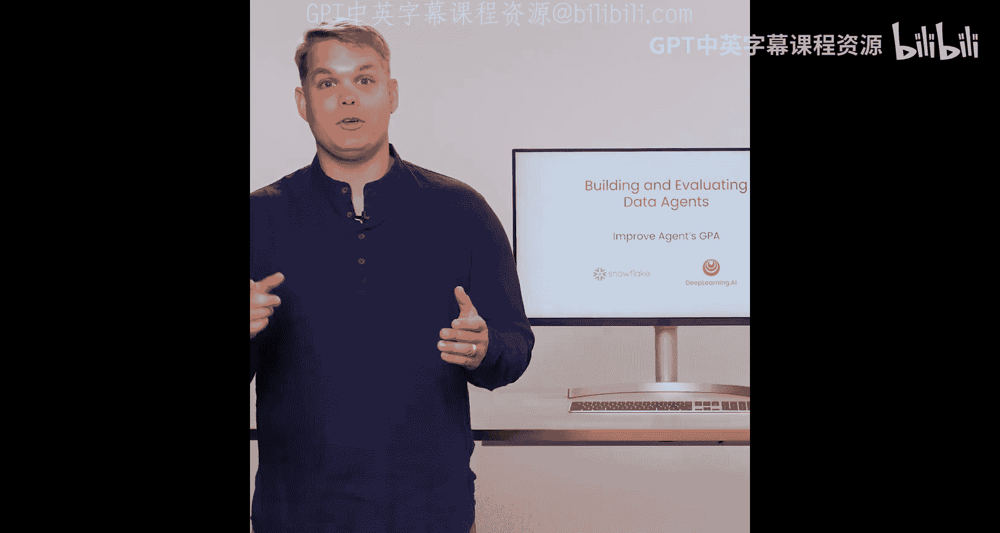
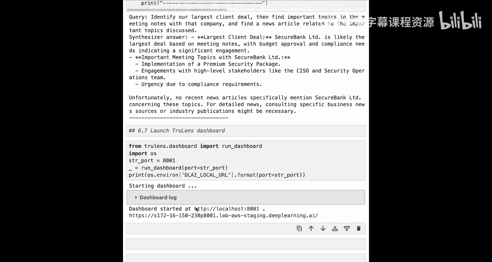
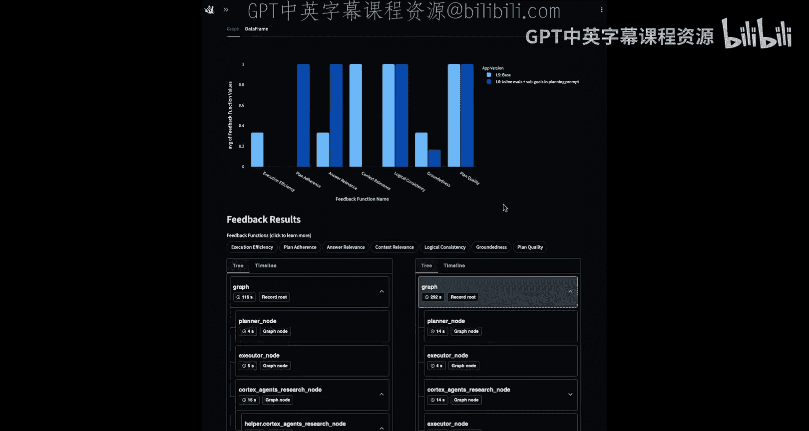
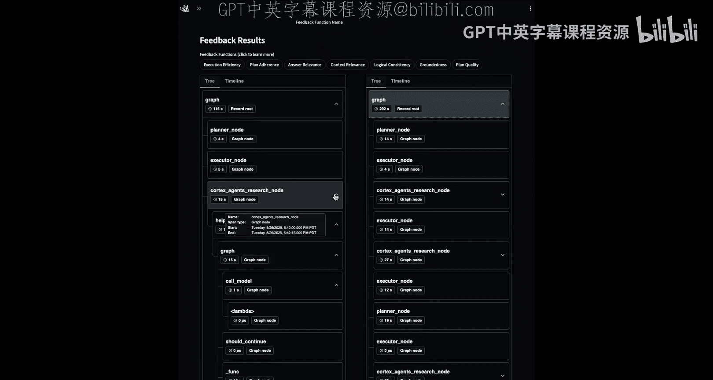
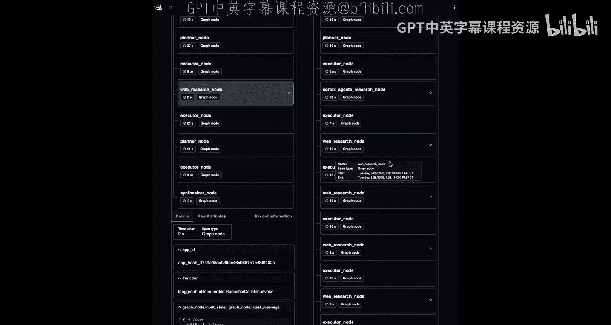
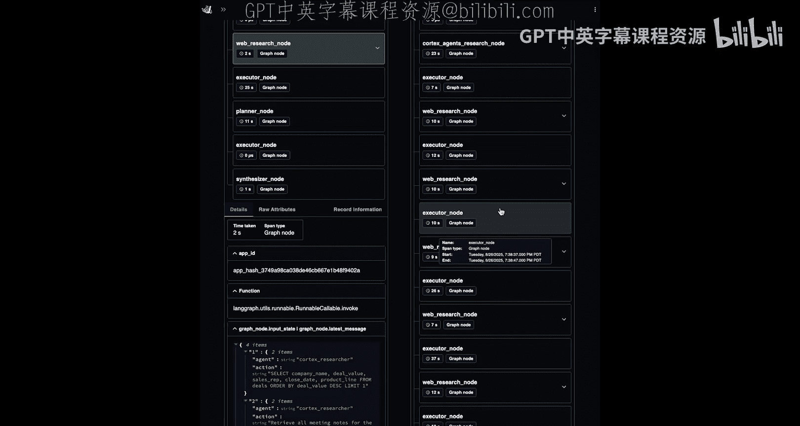
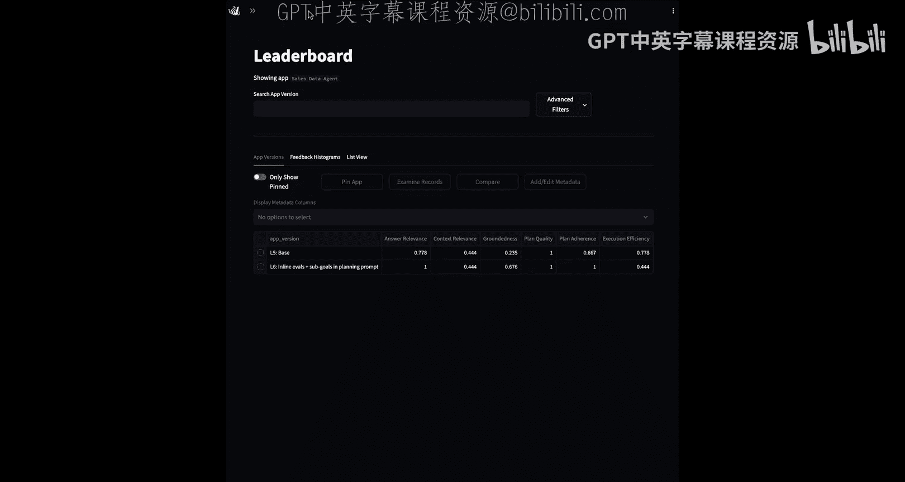

# 吴恩达《构建与评估数据代理｜Building and Evaluating Data Agents snowflake》中英字幕 - P7：7.improve-agent-gpa.zh_en - GPT中英字幕课程资源 - BV1VfntzuEM6

You've discovered your agent's GP is low。Let's see if you can get its grades up。

 So now that Apo walked us through how to identify clear failure modes in our data agent performance。

 let's consider some common ways to improve our agent's CP。

 One common way to improve your agent's performance is by adjusting prompts。 For example。

 you can consider adjusting the planning prompt to include explicit sub goalsals with pre and postcond so that the agent's plan is very explicit on what it needs to accomplish at each step。

 Another way to improve an agent's goal plan action alignment is through inline evaluation inline evaluation provides realtime feedback so that the agent can actually understand how well its' performing。

 For example， when it does a research step。 The agent executor can be provided with an evaluation score and explanation to see if the research is missing key details before it can move on。

 The agent can then use that information to better choose its next action。 you might also choose。

To improve your agent's performance by doing things like tuning the retriever or trying different models。

 Last， you should always validate your improvements through offline evaluations。

 Now that we've walked through the general process for improving your agent's GP。

 let's get back into the notebook so we can apply this in action。

 In the last lesson onpa walked us through exactly how the agent was performing and identify a key failure node。

 lack of plan adherence。 The agent was not adhering to the plan。

 meaning that its actions did not follow what the planner had laid out。

 Let's walk through in this notebook how we can take targeted changes to improve the agent's GP。

 The first thing we'll do in the notebook is to import the environment and turn on true lens tracing。

 just like we've done before。 Then we'll make our first targeted change inline evaluations。

 As we get set up to add inline evaluations。 We're going to import the cortex agent。

 the state and our context relevance feedback from helper。

 And that these are all things we've set up previously。 will' also import。Some things from true lens。

 such as the instrumentation， along with some typing from Lagra。

 The new thing that we're going to import here is we're going to import the inline evaluation decorator from true lens Here we're using a La graphft specific decorator because the inline evaluation will interact with the La graph state。

 but the concept here is general。 We can think about inline evaluations as a way to evaluate a step or action of the agent and provide feedback into the agent's memory so that the agent can improve its next action and replan when necessary。

 T add inline evaluation。 We can simply decorate a previously instrumented node here will start with the cortex agent's research node。

 This is the same node that we've already created， just copied again here along with the same instrumentation。

 Now we'll add a simple decorator on top。 our inline evaluation decorator will accept the feedback function or evaluator that we want to run against the research node。

 This evaluation will execute directly after the。Research node is executed。

 it'll run against the span attributes specified in the feedback function definition then once the evaluation is run。

 the results including a score and explanation will be added back to the agent' state so that the agent can use it this will happen by updating the messages in the state now that we've added inline evaluation to the Cortex agent's research node we want to do the same for the web search node。

The process here is exactly the same。 We're taking an already instrumented web research note and simply adding this inline evaluation decorator to it。

The second targeted change we want to make here is we want to update the planning prompt。

 specifically， we want to instruct the planning LM to add explicit preconditions。

 postconditions and goal descriptions to each step in the agent's plan。

 adding this explicit detail helps the executor to understand the goal of each step。

 which improves both tool calling and agent decisions to make this change we're going to patch the plan prompt we'll do that by inserting this additional precondition postcondition and goal。

 and we place it in the prompt content。 So what we're doing here。

 is that we're expanding the output template given to the planning LM。 we're adding。

 in addition to the name of the agent and the action for each step。

 we'll ask the planning LM to include an explicit precondition postcondition and description of the goal。

 Then this template will be filled in and populated at runtime when the planning notice run。

 Now that we've made our two。Targeted changes let's rebuild the graph with our added inline evals and update to the plan。

We'll rebuild the graph just as we have before， using the recreated web researcher and cortex researcher and then pulling the other nodes from the helper。

 then we'll connect back to our logging database。So the database we're connecting to here already has our results from the prior lesson。

 so what we're going to do here is once we've run our agent with our new version。

 we're going to be able to compare directly the results from this new version of the agent to the old version。

 then we can use that to validate if these target improvements really worked。To do that。

 I next need to register the new version of the agent。

I'll do that by using the same application name， but iterating on the application version。

 so now in app version， I have a new version name where I descriptively say exactly which changes I'm making in this version。

 This will allow me to better remember exactly which changes I made when I compare。

Now that I've registered my new version， I can retest my agent。

 These are the same queries you've seen before， so I'll just copy all three and run。

 and then we can check out the results when they're done。

So now our agent has finished running the three queries。

 We can quickly take a look here by looking at the cell output。

But to really understand the agent performance， we'll want to open the Tru Ly dashboard。

 Let's do that now。We'll run the dashboard exactly as we have before and to open it。

 You'll click on this second link for deep learning AI。 Now。

 we've opened up the true lens leader board。 We'll click on the top left so we can see a larger window。

 The leader board allows us to compare the aggregate metrics across our different versions of the agent here。

 we can see that answer relevance improved Contact relevance stayed the same groundedis improved by a good amount and plan adherence improved while we saw smaller decreases in execution efficiency and logical consistency from here。

 we can compare directly。 these versions so we can look at the records side by side and see exactly what changed。

 We'll do that by selecting the check box next to each agent version and then choosing compare。 Now。

 the comparison view It's going to show us the base version on the left and the improved version on the right。

 Now we'll choose apply。

We can again see the aggregate comparison in the bar chart here。

 but it gets most interesting when we look at the same record across different versions of the agent。

 When we look at the shared record stats， these are sorted by the largest difference between the different versions。

 Let's click on the one with the largest difference。 Then when we scroll down。

 we can see the two traces side by side to directly compare exactly what's changing between the two different agent traces。

To more easily compare again， well minimize some of the hierarchical nodes。 comparing the two traces。

 we can see a longer trace on the right here on the right。

 we have additional both web research and cortex agent's research calls。

 and these are providing additional research and filling in gaps identified by the inline evaluation。

 and also comparing against the agent's sub goalsals now listed in the plan。

 In addition to comparing the trace directly， we can also compare the evaluation metrics。

 Let's take a look a plan adheres。 So on the left， our plan adheres scored really low。

 This is the base version of the agent where we see a score of0 for plan adheres here in this base version of the agent a number of steps were omitted from the original agents plan in the improved version on the right。

 we see a score of one for plan adheres。 and we can open up the explanation。

 And what we see here is that each step in the plan was executed and completed。

 particularly each step in the replan。 and any D。

Were explicitly justified in the external data access limitations。

 No steps were skipped or ignored and all deviations were justified。

 says the plan as closely followed as possible by understanding both how the agents performing by looking at the trace and comparing evaluations we can easily observe differences in agent performance as we iterate and make changes。

 So one reason we see this difference in comparing the traces is that our inline evaluations added in the improved version of the agent on the right are helping steer the agent to a successful goal completion here we're making a tradeoff were sacrificing some execution efficiency for higher goal completion。

 we're directly making the choice to do additional research based on the evaluations and we can even see the evaluations happening directly in our trace by expanding the research node in practice。

 we've seen exactly the kind of techniques that we've discovered in this course around evaluation tracing and careful iteration。

Can help make agents more reliable。 Thank you so much for taking this course and well done。

