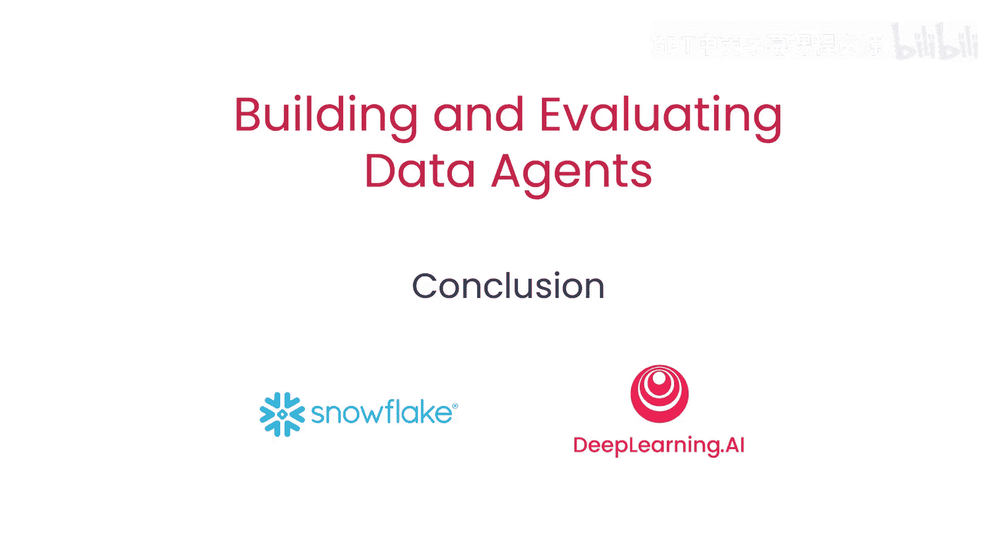

# 吴恩达《构建与评估数据代理｜Building and Evaluating Data Agents snowflake》中英字幕 - P8：8.conclusion.zh_en - GPT中英字幕课程资源 - BV1VfntzuEM6

Congratulations on completing this course。You have designed and evaluated a data agent that creates a plan。

 executes it， and adjusts it based on the agent's state updates。

You evaluated the agent's goal using the rag triad。And most importantly。

 you measured and improved the agent's GPA。Gal， plan and action alignment。Well done。

 I can't wait to see what you'll build next。