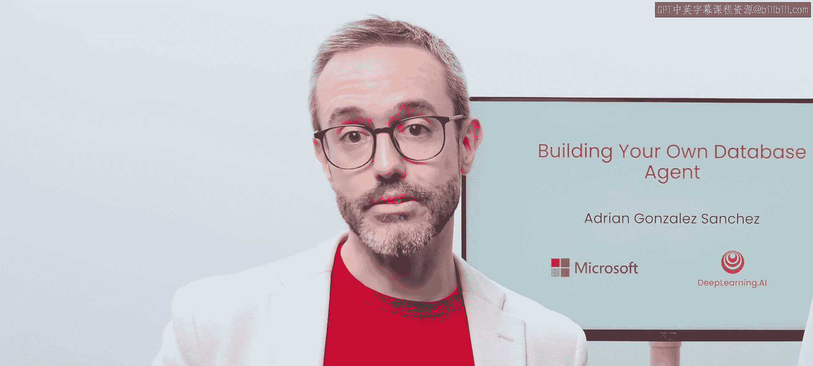
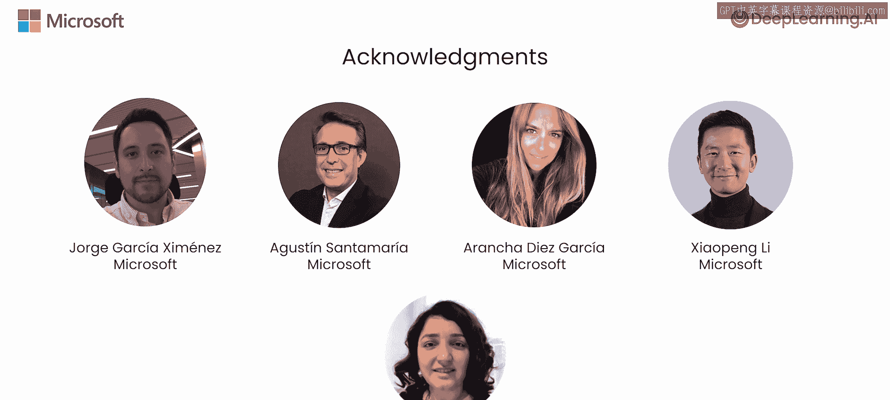

# 吴恩达《构建你自己的数据库智能体｜Building Your Own Database Agent》中英字幕 - P1：1.intro.zh - GPT中英字幕课程资源 - BV1RD421M7xK

Welcome to Build your own database Age builtt in partnership with Microsoft。

In this course you learn how LOMs can interact with structured data like tablet data or SQL databases This is very useful when you're building a system to answer questions using data sources with tables of data rather than needing to find maybe an analyst to translate the question to a SQL database query you see how a database agents can automatically input the question and generate a sequence of actions that is function calls to retrieve the relevant data specifically in this course。

 you learn how to build your own AI agent to interact with tableau data and SQL databases along the way you learn about some of the key building blocks for agents and we be using the Lcha agents framework I'm delighted the instructor for this course is Ad Gonzalez Sanchez。

He is a data and AI specialist at Microsoft， teaches at the university level and is also author of the Azure Open AI O'reily Book。

Thanks， Andrew。I'm very excited to be here in this course you'll learn how to deploy LLMs to build your AI agent。

 implement RAG with tabular data， develop your own database agent。Build a function calling system。

 integrate Azure Open A Asistance API。And you will go through this concept using the Azure Open AI service and La。

 although we'll be using a database agents as a running example。

 these components are useful for building any other agents as well。

 so database agents are an exciting breakthrough for how we analyze data is letting people interact with complex datas without needing to learn query languages like SQL so that you can have an LM perform requests to a database for you regardless of the database provider。

 data model or type language。

Using an LM as an abstraction layer on top of the database is one of the new frontiers for data democratization within many companies。

 and perhaps you could bring this to fruition for your company or applications you're working on I mean。

 how exciting is that Further I see agents as a rapidly growing category within Gene of AI and you also learn about key components for agents and best practices for assembling these components into a broader system Many people have worked to create this course from the Microsoft side。

 I'd like to thank Joge Garciaez Augustine Santa Maria Arra Diaz Garciier and Xiaoping Li from Deep learningingda AI Di Eadin had also contributed to this course In the first lesson you will to start building your first AI agent with the ASzure Open service。

So let's go on to the next video to get started。