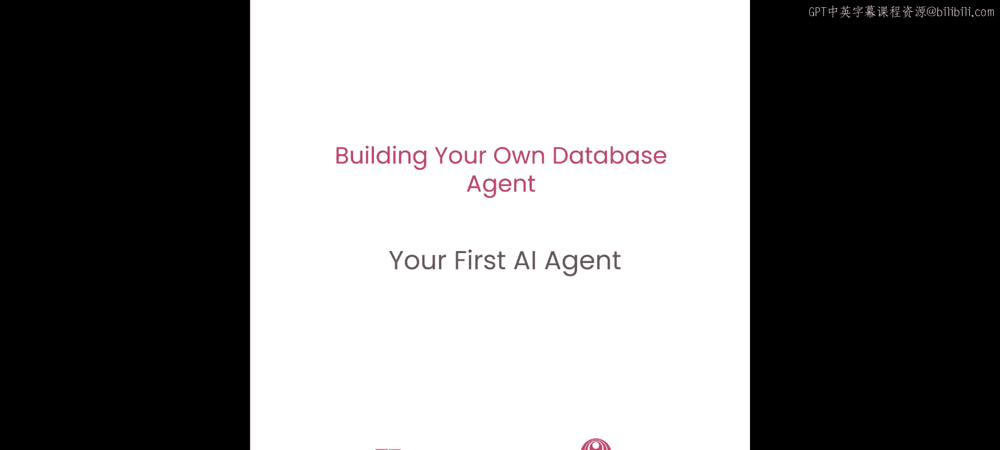
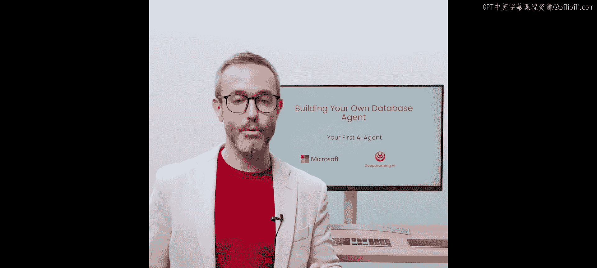
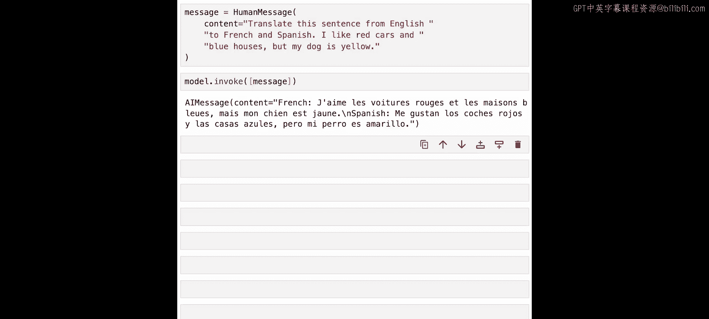

# 吴恩达《构建你自己的数据库智能体｜Building Your Own Database Agent》中英字幕 - P2：2.Lesson 1 Your First AI Agent.zh - GPT中英字幕课程资源 - BV1RD421M7xK

In this lesson， youll learn the different levels of knowledge customization available with Azure Open AI。

You will mostly focus on grounding techniques， RaG， to start building your first AI agent。

By the end of the lesson， you will deploy your Azure Open AI service instance and test the API。

You will also deploy an orchestration engine and La chain to enable these scenarios。

All right， best diven。The first lesson will be building the first AI agent so imagine you are starting with these technologies you want to apply ASzU Open AI La etc。

 just need to know how to deploy them how to prepare them in order to build your first AI agent before we dive in let's quickly cover some background to set the context for discourse this will be brief don't worry we get to code in soon Gene AI particularly in the 20s refers to the ability of artificial intelligence to create new text images。

 videos and other types of content。This is achieved through interactions with the JI system using natural language prompts。

 this capability is impressive。😊，While it's not entirely new。

 there are many emerging technologies in this field that you should be aware of you will be working with cutting edge technologies including inview new models that are still in development。

 Therefore we are relying on the official documentation from different providers Additionally。

 remember that GenefiI builds on the foundations of machine learning and deep learning These are powerful technologies but our main focus here will be Genefi In my opinion。

 the key differentiators of GenI are remarkable。 If I had to explain what GenI is I will highlight the concept of foundation models。

Why， because a foundation model can perform multiple task with a single setupap。

 This means that when you are building your AI agent。

 you can connect it to a database process documentation or create various applications all with the same model This simplicity is a significant advantage for companies as deploying one model to handle different tasks is incredibly efficient Additionally。

 foundation models can handle various， data formats， including text， images。

 videos and audio This versatility is ideal for multimodal applications。

 and another crucial aspect is the ability to use natural language as developers， we just code。

 but for most of the people interacting with system using natural language is much more intuitive whether in English。

 Spanish or any other language people can now communicate with this system naturally By the end of this course。

 you will be building a database agent This is exciting because it means that user can interact with the application in。

😊，On language instead of using SQl queries this opens up these solutions to a broader audience including technical and business users these are essential features to keep in mind for this lesson and for any other gene applications you will create Now let's discuss how to customize the lenss and by customization I mean integrating your additional knowledge into an LLM imagine your company has databases P data lake or private information how can you combine this data to enhance the knowledge of the model like a GT4 for example Well we have two options。

First one is retrieval of generations this method leverage and orchestration tool to connect the model with your data sources such as databases without a need for the training for instance Azure orIGPT4 can be used to query your database directly without changing the model itself this approach is more efficient and practical and it avoids the overhead associated with model training the second one is function in a model this process involves retraining the model and specific datas followed by redeploying the updated model。

While this allows for customization， it is resource intensive and less commonly adopted to the complexity and the operational cost。

 the primary advantage of rack is its flexibility。 future model updates or replacement can be seamlessly integrated into existing setup using the same connection mechanisms to access your data。

 This approach will be implemented in this course。 Consider how it streamline the integration of new models and optimize the use of your existing data infrastructure。

We will begin by setting up the environment within sari packages such as pandas。

If you are running this locally， you need to install the required packages by using the requirements TXT file。

 which contains all the dependencies for this course。

You can find this file in the current director of this lesson and detailed typed instructions will be provided on the Lesons notebook。

Next， you'll need to set up the actual resources like Azure Open PI。

Starting first by providing the information needed to configure your Azure Open AI environment。

 you have worked with Open AI A before this will be familiar。There are some differences。

 but you will grasp it quickly。Here are the variables you will need。

 the API endpoint and the API key。This employ is a prereated cloud resource that will give you access to the Azure Open AIGPT model。

This provided API key and endpoint here are for teaching purposes only。

Your notebook environment using the deep learning do AI platform are set up with the needed keys Now let's think about the next step let me just add you the information here and well run it see that we are running like very small piece of code and in this case what we are saying is okay we're importing from Lacha schema。

 something that we call the human message and then from La we're importing the Azure chat Open AI which means this is interesting no because we'll be using the role of human message which is a kind of prompt you will be sending into the system so we need the La orchestration system to recognize that that you are sending a message and then we need to establish something to connect from La to Azure Open AI which is slightly different to open AI so here what we are saying is okay we have the information about the Azure Open AI we have the API version。

That I believe at this point is the latest stable version no preview this will change obviously and you can try different versions。

 you can just change the date， just go to the reference of the different APA versions and then you have the deployment and the endpoint again this is because my configuration includes endpoint that is called Adrian Sua and the deployment I call this test address for this single purpose but usually you will put a deployment name that is more specific to what you are creating So up to now we have the general environment we have added the endpoint we have preparing the connection willland chain three steps very simple direct to the point now what's next remember I have told you about the human message part here you can see it human message and is for the system to recognize that you are sending a message as' a human so let's try something like this we're creating a message and inside this message we have the。

And the content is translate this sentence from English to French and Spanish because you know why not I like red card and blue houses but my dog is yellow so I'm just testing this because it's any no sentence but also is interesting to see how the system may answer remember we have just created the instance we haven't sent a message yet but you have it there in order to send it is very simple we'll put here is model invoke the invoke function is the one that is working now remember model is related to this model that we have created that this an azure chat open kind of object let's see what happened。

😊，Okay so we are starting to see things。 Check this We have talk about the human message here we are getting the AI message When you think about the interaction with these models we have different kind of roles the human the agent。

 the administrator in this case we are focusing on the human and AI interaction we have sent a human message we get the AI message and say the content is you ask me in French and Spanish French I can tell you I speak French I can tell you that this works and even better in Spanish because I speak Spanish Cami Perroio perfect So we have the full content here this is working we have tell the system translate this sentence to French and Spanish is giving me but the two languages take some minutes review the code play with it change you prompt experiment a little bit so congratulations you have finished。

😊，one。

