# 吴恩达《构建你自己的数据库智能体｜Building Your Own Database Agent》中英字幕 - P3：3.Lesson 2 Interacting with a CSV Data.zh - GPT中英字幕课程资源 - BV1RD421M7xK

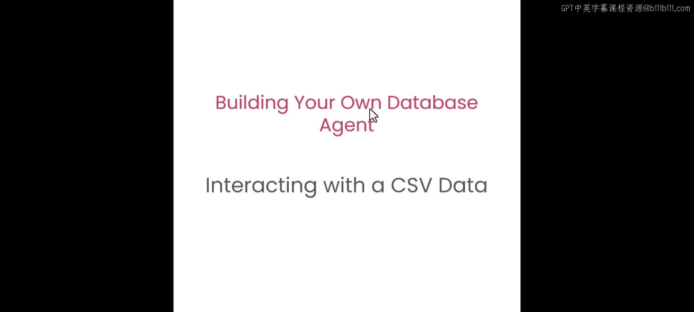

In this lesson， you will load tabular data from a CSV file and perform natural language queries via Azure Open AI to quickly extract information By the end of this lesson。

 you will be able to reduce this agent to analyze your own CSV files。 Allright， let's start coding。

After completing lesson1， you can see that we are taking a step by step approach by following these instructions with a small snippet code that you will implement one by one Now in this second lesson we'll expand the scope of our activities with the final goal of creating your database agent。

 we cannot implement everything all at once。Previously。

 you connected to AS Europe Open AI and implemented a basic La agent。

Now well add a new component since we are building a database agent。

 we need to think about how to connect to data。In Python， for example。

 you can load a data from a CSV file and then interact with that data by asking questions。

 This is similar to a database agent， but we haven't connected to an actual database yet in this lesson well interact with CSV datasets that you can find online or use your own CSV file Now before we dive into the details let's go over some basic concepts I want you to understand the considerations and options available when building a database agent imagine you are working at your company and they ask how can we build a database agent to connect to our database Many companies want to explore the databases with using SQl because not everyone is familiar with it as a software developer engineer you will need to decide on a good approach we have our baseline model G4 and its powerful metapro capabilities。

Which work very well linguistically to handle SQL tasks。

 you could customize the model using fineunion a method some companies are experimenting with。

Fin tuning a model for a specific SQL task can create ballable intellectual property。

 but it might be too complex for the purpose of dis course。Instead。

 we will use the retrievalaled generation pattern using the database or dataset as a source。

We'll focus on using a CSV file as our data source。

We'll use a line chain agent to connect to that CSB file。

This method is straightforward and will be our starting point。

 The next lesson will apply the same approach to a SQl database。

 If your SQl database has an API interface， you can use Ra to connect to it。

 We won't cover this here but keep in mind for future projects。

 Another option is aszure OpenI function column which allows you to create a specific functions to perform tasks based on your descriptions。

 This is very useful for SQl task。 and it likes you execute SQl queries in the backend without exposing them directly clean your code。

 Additionally， these assistance API。A feature in Azure Open AI and Open AI APIs。

It adds stateful management， providing short term memory and context to discussion。

 we will use function calling and the code interpreter feature。

 which Ill explain you later in this lesson we focus on using the CSB file but in this course we'll explore all these options step by step。

Let's move on to the notebook， Let's now proceed as we did in lesson one。

For each lesson we prepare the environment。Remember your Jupiter notebook on the Deep learning do AI platform has all the needs set up ready for you。

 we'll repeat some of what we did in the previous lesson such as importing SI libraries。

 setting up the Azure Open AI for La and defining the endpoints and versions。Now。

 for the interesting part， interacting with a CSV data set。And remember。

 you can use your own dataset。For example， you can download a CSV file from an openend data portal and place it in your project folder。

 or you can connect remotely to a dataset， you can find some instruction in the notebook how to remotely access the data we are using here for simplicity the data is available in your lesson and their data as all estates。

 history CSV This data contains COVID-19 statistics for various estates in the United States of America for 2020 and 2021。

Let's proceed with this setup and explore the data Basically we are importing or we are creating like all information related to Lacha created to pandas data frame so you can actually connect not only to the a Open AI that we have done before but also to the data frame now the important thing is that we are creating what we call an agent in La and not any agent we are creating a pandas data frame agent basically we are saying we be using the LLM the model that we have created before remember we have the result information you have the data frame that contains already the representation of that CSB file and then how do we perform any action on this we put the prompt so you see the invoke function is the same we have used before pretty simple but here well put how many rows are there so let's keep in mind the bigger picture if you are interacting with the CSB file in context of data science AI or data analysis。

usuallys you start with exploratory data analysis right you ask questions to the data。

 what's the the maximum the minimum， what's the average how many rows。

 how many antivalues that's the kind of things that we perform with tools like pandas profiling right here I want you just to ask questions to the data any questions that you would like to ask to data set to understand the statistical dimensions but also a natural data so let's start with this one just to see how this works so I have execute this part for the data frame so look at the traces it's very interesting just to see this interaction like entering new agent executor change is doing an observation。

😊，Checking the information adding a thought I know now the final answer and the final answer is there are 20780 rows so finished chain is the trays you need to to check for any interaction with agent and here what we have is the input remember the question that we asked before and the output there are x number of rows simple as that so this is the initial test we have created something very basic is just asking for the rows。

 the number of rows but obviously when we are interacting with these models we do something a bit more let's say complete so let me give you an example I'll just get this。

😊，I'll show you let's create something that we call the prefix and the suffix so basically in the prefix we are saying like okay first set of panda displays show all the columns so you get the column names they answer the question okay and then on the sufffiix we are explaining the logic of how we interact with the model we are saying okay before giving the finance try another matter Ref on the answer citra Ctra this you can customize the magic of this is that you could prepare different kind of prefi suffix depending on how you want the model to interact and depending on the kind of application that are different contain different text this is just text is pure linguistics you just want the model to understand things if I do here I a execute this we have a reallyload this so let me。

😊，To another question now remember， we have the prefix， the suffix and question。😊，And I'll do。

Something more complex like how many patients were hospitalized during July 2020 in Texas nationwide as the total of all the statess。

 so we can execute that and we have three pieces of text the pre six on the question now before we have sent an instruction that was very direct it was just this instruction but now we are building something more complex but following the same procedure we are just in bulk and we are putting the three together so the model will get the instruction that the message then the confirmation of how we want it to behave right do you need some time you need some time just pose。

Check the detail， you can add whatever you feel to the suffix， this is just a illuative example。

 so let me run it we don't forget to run it。😊，And again， we are having the same kind of performance。

We are entering the agent Executor chain that's cool。The agent is thinking， hey。

I need to filter data frame for the month of July 2020 and then some add all the information for hospitalized increase so look I have go to import pandas I need to import pandas or I can continue the agent is doing all these kind of things so basically even if you see a lot of information is saying okay were looking for the date because remember is July 2020 so for the data we have we are checking the date it has to be in July 2020 we need to find the information related to Texas。

 youll get all the information and you start to see like some details and you need to take some time okay to analyze the information but the important thing here is that the thought is that it seems that there are no hospitalization reporting Texas July 2020 according to this information and and the traces we can see that is zero for Texas but we had a total for the rest of the states as 6th。

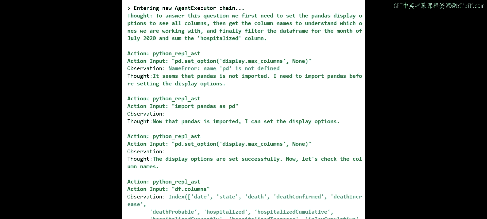

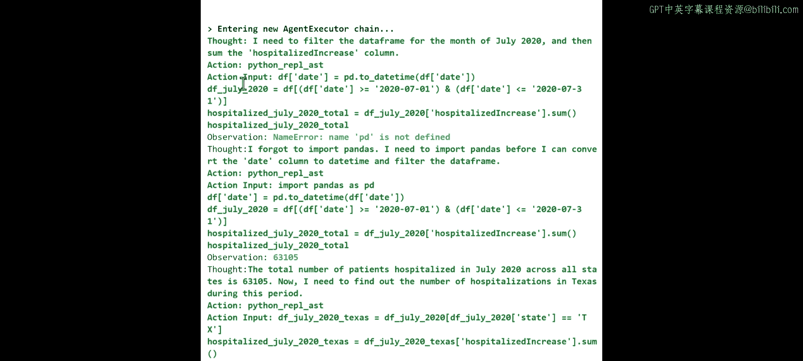

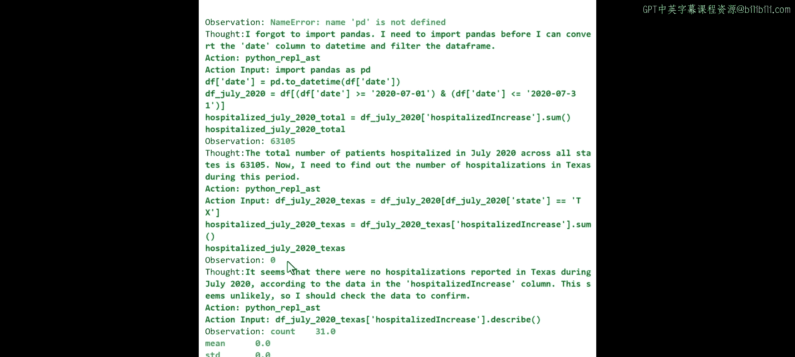

why well from an datata analysis point of view you could ask a question were we tracking the results that part of the year in Texas for example。

 or any other state and maybe that's the that's why we don't have any record but I can tell you from the CV file this is the correct information so basically if we go to the final part that is the interesting one because it contains all information we are confirming that there were no hospitalizations track on the CV file obviously there were some hospitalization I assume but in July 2020 this seems unusual but have to go with data given so look at the agent is already thinking or analyzing a little bit the context I'm giving you some information and its saying okay for Texas is0 but then the total 63000 citra Ctra and then you have the explanation because remember down the top。

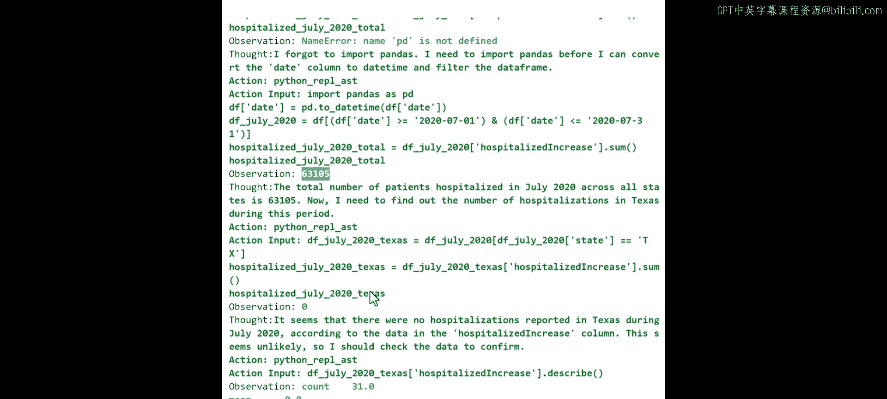

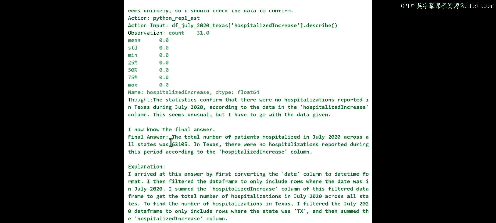

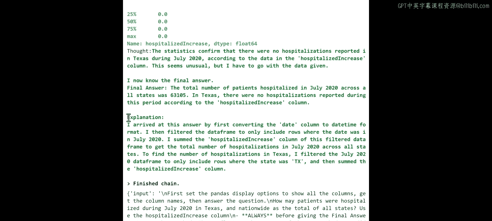

We have asked for some reasoning， we have asked for some explanations。

 so here we are getting explanation saying okay I arise to this answer by converting the data so it's explaining the logic of the query we have for so that's wonderful again take your time to explore these sts because it has a lot of information but it's pretty good and now。

😊。

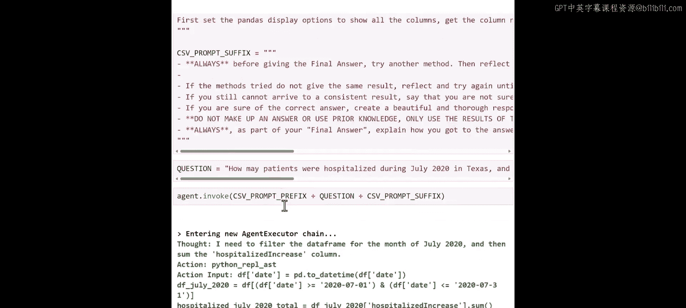

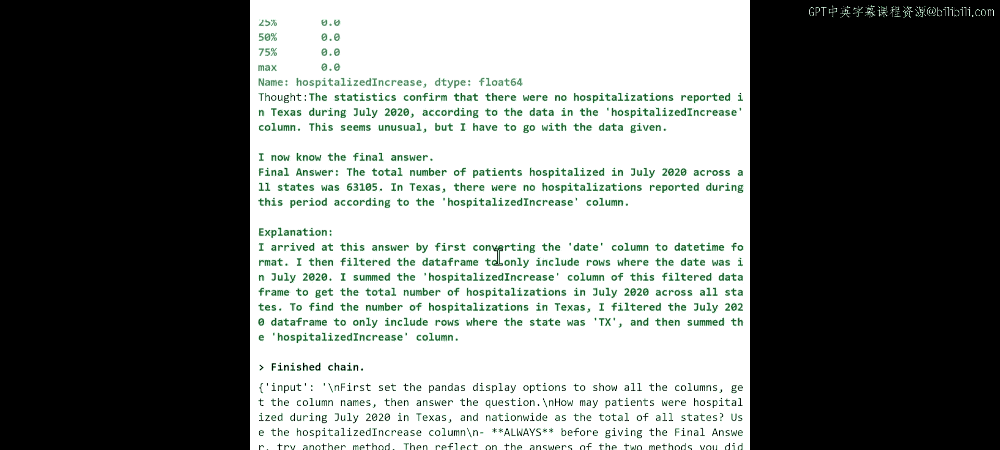

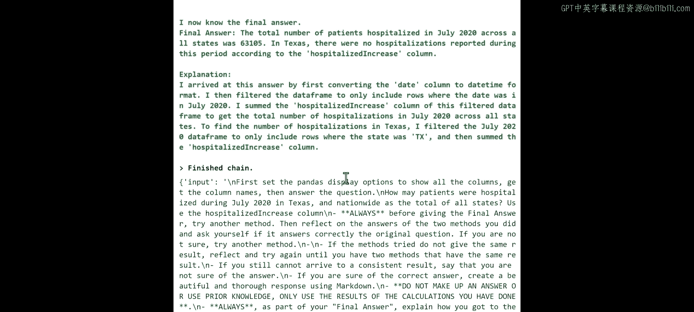

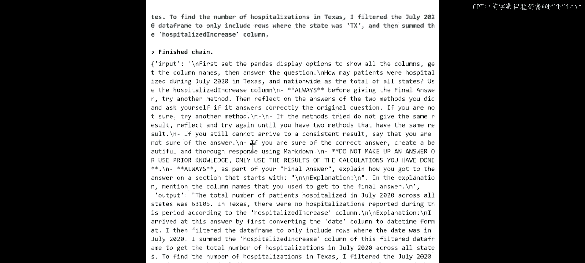

you see the JO answer， basically you have all the same information。

 you have everything here and you can use it。It gave me。

Intererability pretty cool like you get all the information you need based on instructionss you give you can try one more time with different prefis。

 suffix questions obviously you can prefer the questions I suggest you change and you put New York or California or Alabama and you start to see different results depending on the state and you could change also the date and that's pretty cool so that's pretty much what we want to do and then we can move to lesson3 see you in a bit。

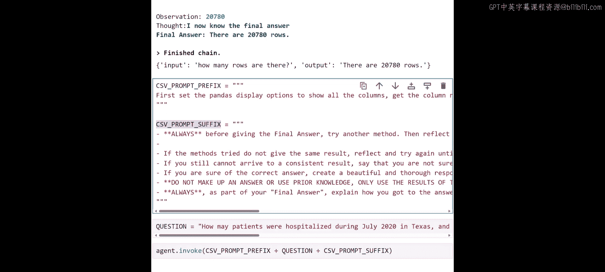

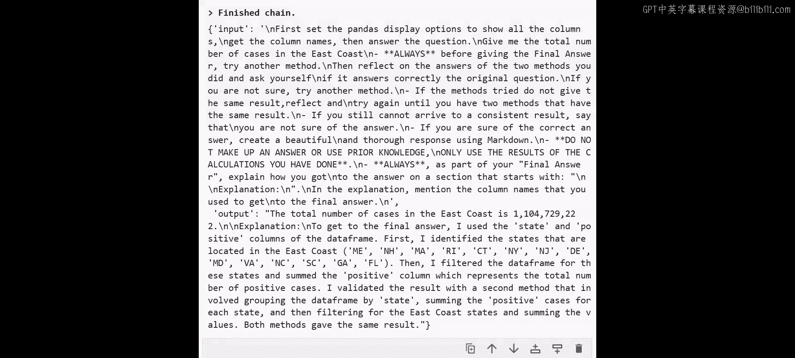