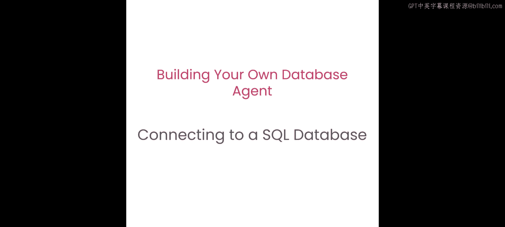
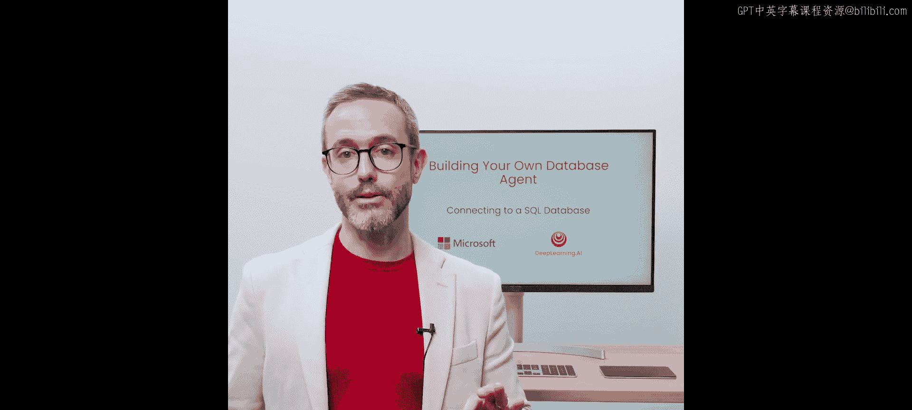
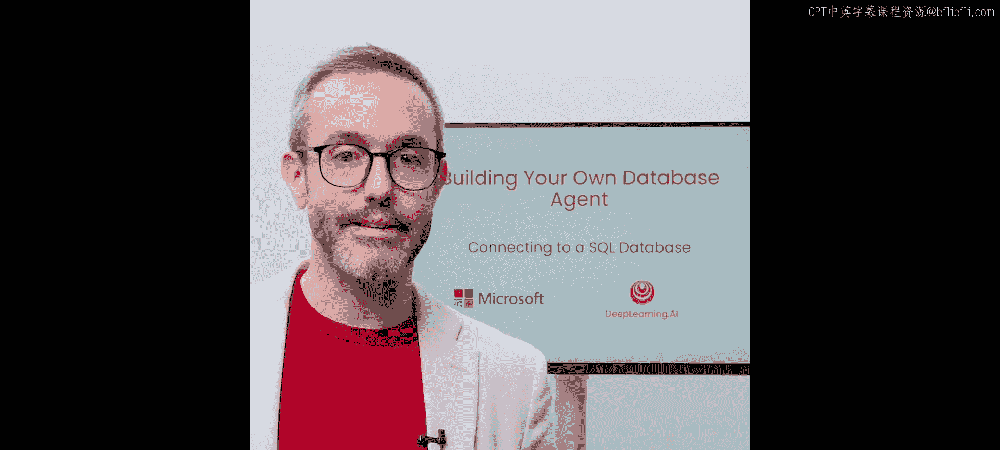
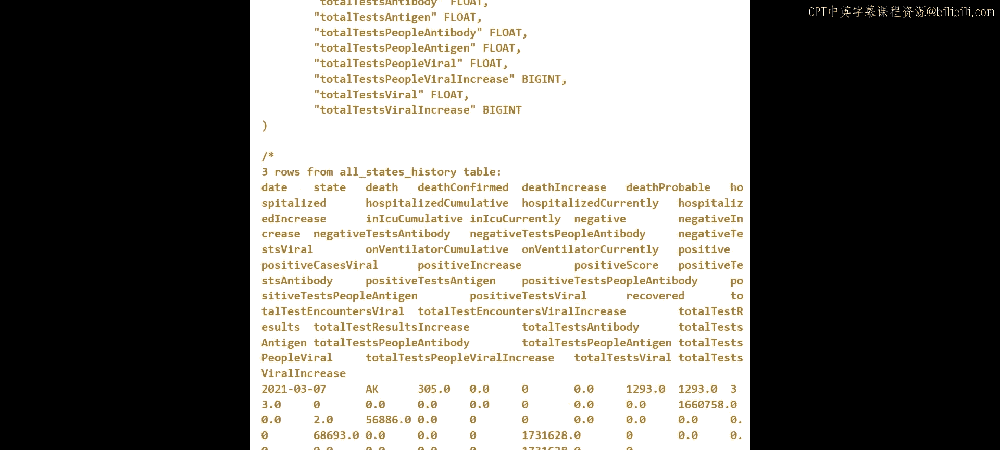
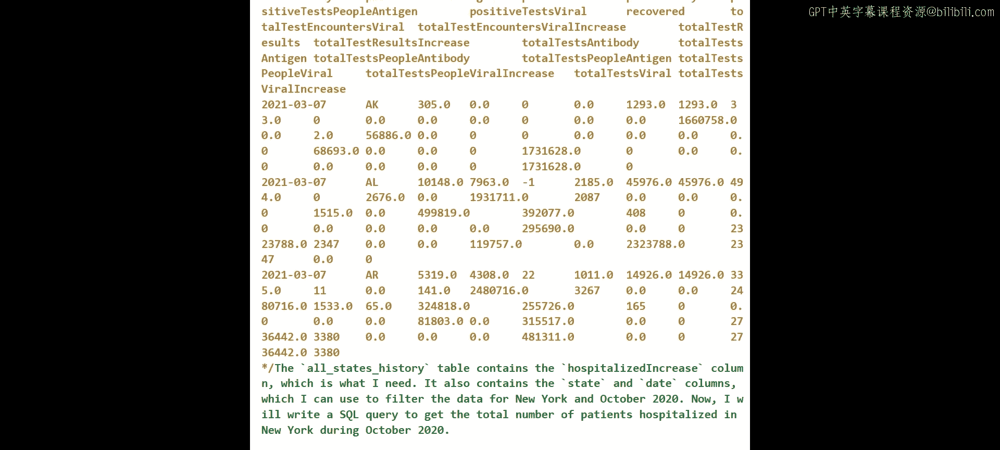
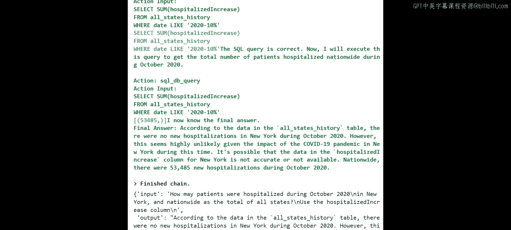
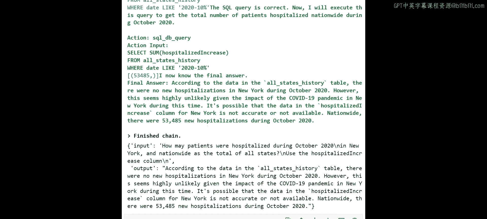
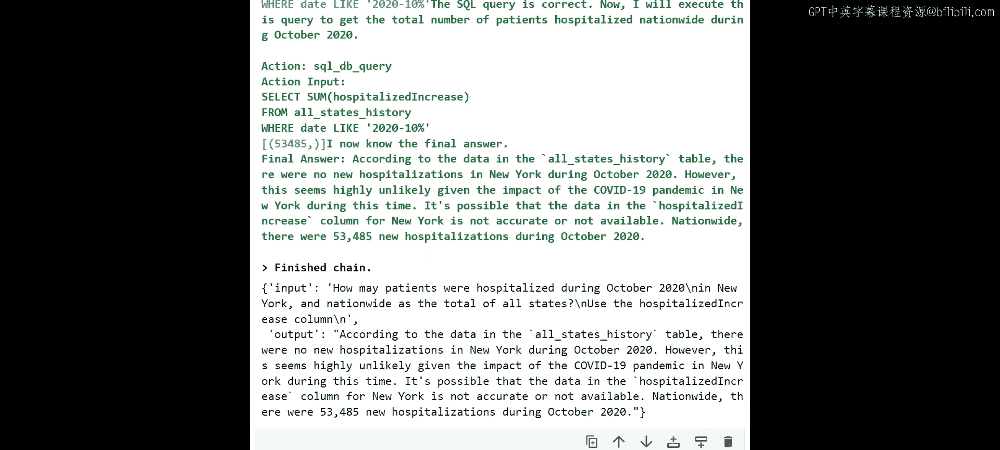

# 吴恩达《构建你自己的数据库智能体｜Building Your Own Database Agent》中英字幕 - P4：4.Lesson 3 Connecting to a SQL Database.zh - GPT中英字幕课程资源 - BV1RD421M7xK

This is a natural evolution from the previous lesson。

You can implement La agents to connect to a provided SQL database。

 which is one of the scenarios that you can leverage into your professional activities。

This lesson is all about SQL databases。You will leverage a SQL light database and perform the rock pattern against it The result will be a database agent in which Geneative AI will help you translate natural language to SQL code Let's have some fun。

We are back for lesson  three。You have successfully deployed your instances of Azure Open AI andChain and connected to a CSB file。

What's next if our goal is to connect to a database and interact with this information？

Exactly we'll now create an agent to connect directly to an SQL database instead of a CSV file This may sound complex but I'll guide you through it a step by step first let's check the illustrative architecture for connecting to an SQL database in building our AI agent will re on the baseline GBT4 model from A Open AI and use the RA system Lachain will orchestrate the knowledge helping to find information and explain each step in obtaining it。

Just like in lesson  two， you will see traces with detailed information。

 which is powerful and useful， so we will keep this approach。This time we'll use SQL database。

 which is a local instance of an open source relational database。

You will find all the necessary information in the notebook。And of course。

 we accesses everything using APIs。Although we are using notebooks for this course in a real world application。

 you could integrate the results into a web app， mobile application， or any other platform。

 the process remains the same。Replacing the CSV file with the SQL database。

You could combine different data sources such as images， data lakes， and databases。

The RA mechanism will efficiently locate information from the upper piecess。

Let's head to our notebook and get started。We are launching our environment again。

 and this time we are incorporating a SQL database。

The main difference is that we now need to communicate with the SQL database。

So you will see that this is the primary change compared to before。

 while the rest remains very similar。We will start by recovering the CSB data we used earlier。

The idea is to load the CSB file into SQL database and then communicate with the database。

If you already have your information in an SQL database， you wouldnt need to load that CV file。

 this step is just for the lesson。First simplicity。

 the data is available in your lesson directory and your data as all estates history CSV。

We'll create a SQL alcheme engine to facilitate communication with the SQL database and we'll use pandas to handle the data frames。

 let's get started with connecting to our SQL database and loading the data。Basically。

 what we are saying is。We have a folder， a local folder called DB and there you have this test DB file this is basically the SQLite database file that youll use right it is basically the template that you need to use you can put it there and then you had your local instance of that SQL database is everything you need you can record it from the website SQLite they have examples you can create your own but this is good enough for what we want to do。

And now we are creating the engine to connect to the database and this is interesting part we be creating the engine we'll be recovering the CSv file that will beyond on your data folder then we are creating the data frame Df data frame with pandas we are reading the CSv file and this is the key part here。

 The delta compared to the second lesson we are getting the data frame and we are using the twosQl function and basically what we're saying is yes we are getting the all states history we are getting the engine that we have mentioned already SsQl engine if exist。

 imagine it's not the first time you are doing it the second time we'll just replace it's no incremental we are just replacing So that's good let's run it Let's see how this works good basically it' telling you there are so many records and we have load them into the SQL database as simple as that let's go to the details over what will be。

😊，About a protein SqL engine。 So this will be our first SQL agent will evolve This kind of agent will replace pieces later on the next lessons。

 but this is the first time you will be interacting truly with the SQL database。

 I hope you are excited。 I'm very excited。 Let's see。

 I'll be copying some information that I have created that you will have available on your notebook don't worry because a lot of information。

 I'll put it here。 let me show you。 So look at this。😊，You have the prefix this before？

We are creating something called like a SQL agent prefix we are explaining what we want to do you are an agent deciding to interact with SQL database so you are giving some context。

 additional context before it was a CB file now we are saying hey you're connecting to SQL and you will be running SQL queries and you will be doing this and that you can change this but this is a good initial template that you can leverage and then you have the format instructions So you have the format on how you want the engine to answer like with an action the input the observation。

 the thought the final answer you have seen that before or the explanation So what you are giving here is an example for the model to understand what you are expecting as a user the kind of answer you want the format。

 the information you want to get and then the trace of the SQL query this is powerful we be able to communicate with SQL database will do it with natural language but still we get information about the query this could be good。

learning cases within your company like people wanting to not only use the data but also to learn about how to perform SQL queries so that's good let's just put here now let's put the second part of these which is very similar to the sequence of steps we have followed before so basically what you have here is the same we are creating the LLM the Azure chat Openia instance with the endpoint with everything we have again the database the toolkit for the database so we can actually combine the LLM and the database and then we have again the question remember we can have any kind of question here and put in something different how many patients were specialized during October 2020 in New York and Nationalwide as the total of the states and here we are creating the agent executor SQL。

basicallysically that agent and La agent with specific format that I is expecting to have the prefix that we have sent the formal instructions that we have sent。

 Of course we need to know which LLM we are using which is openI azure Open AI this version with that end point then the toolkit that we are using which is SQL database toolkit and we' be retrieving information the top K you can customize these kind of parameters will execute this and see what happened like basically you execute this there is no trace because we haven't send any message or prompt to system yet this is the next step So imagine even if I don't tell you what kind of function you need to send a pro to a system remember from lesson1 and2 exactly I know you' are thinking about this is the invogue function that we put here So basically we have the agent executeecutor SQL this is different compared to the previous lesson and then。

Book and then we send the question， so let's execute this， see how that goes。

Remember before we had a similar trace， we were talking about an agent executor for the CSB file now we are talking about SQL。

 this will take some time， just enjoy the magic of a La agent performing all this operations on your behalf。

😊。

You'll get a。Pickload of information here， all the traces。

 you can take your time for sure to analyze what is same。

 but basically this is the part that will start to be interesting because explaining the results remember that here the query is different we were talking about October 2020 for New York and I believe we are saying or hospitalized so we have all the information the engine is finding where to find information which columns which values you can see already the select the from the like the where all the queries that you need to perform but that now are automatic with this agent so let's see the answer。

Remember the finished chain is the clean version right of the question and the answer。

 the prone and and the output， the completion so basically here you have how many patients were hospitalized and then on the output in October 2020 there were no new hospitalpiizations in York and there were like 53 newsspecizations nationwide again for whatever reason you can get one an value depending on the state just go you want to explore before the CCD file and confirm that the engine is providing you with a good answer I can confirm this is the good answer because I have checked the information before so this is good will continue with lesson 4。

I hope you are enjoying， I'm enjoying a lot。

