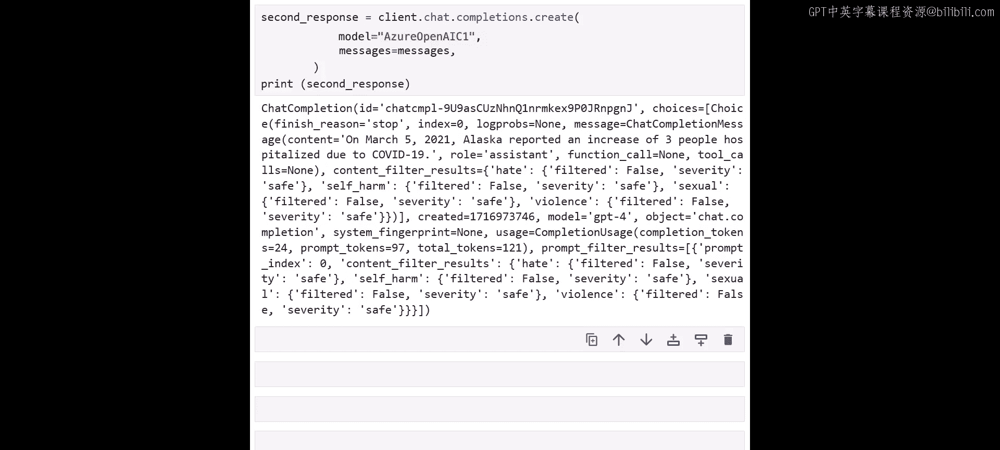

# 吴恩达《构建你自己的数据库智能体｜Building Your Own Database Agent》中英字幕 - P5：5.Lesson 4 Azure OpenAI Function Calling Feature.zh - GPT中英字幕课程资源 - BV1RD421M7xK

As a developer， you want to understand and adopt all potential grounding methods。

Function calling will enable you to improve the design of your SQL agent。

In this lesson you have the opportunity to work with Azure Open AI's function calling feature compared to the previous one。

 the idea is to leverage the pre functions to send the queries to databases without the need to expose the SQL queries into the translation process okay。

 let's get to it。We have already explored several interesting aspects in the previous lessons。

We have used La to connect to CSB files and to SQL databases with SQLL Now what's next？

One of the new capabilities of the Azure OpenA models is the function calling feature。

You might wonder why we need this if our agent is already working great and fetching the information correctly。

😊，What's the additional value that these functionality bring The main point of using function calling is to provide our system or agent with a specific instructions for finding information from any specific topic These includes suggesting the type of queries to productitize and to get the search results and format that you need this approach adds a level of deteristic behavior to the agent allowing you to control the process more precisely。

 Unlike the previous line agent approach， function calling capsulate queries within functions providing more structure and predictability you might wonder why we need these if aware agent is already working great and fetching the information correctly。

Let's see how this works。You have all the information in the notebook and willll reduce the previous setup。

 Here is what you need。 As before we are using our Azure Open AI endpoint with the key and a preview version of this version includes the function calling features well use in this and the next lesson。

 Now let's move to the second step depending on your background。

 you may know how to create functions in Python。I'll show you how to create a simple test function in this case you will ask a question regarding the weather in different cities。

 then the code includes the instructions to check if they are available， suitable prefi functions。

So let's continue with our development to get you to create a second database agent so basically what we are saying is that well be defining a message from the user is like the human message that we have before basically a message that we are sending that is containing what's the weather like in San calling your kind Las Vegas and then we tell the system that is this getcurren weather function and how to use it and whats the kind of behavior right of the function and what's the required information that we need is the location so we are teaching the system how to use the function having more pieces here we are saying is that we have the same way we have the message we have the response and the response is based on the chat completion interaction。

 the model and the message is what we have here and the message is depending on the notion of the tools。

😊，The tools is just to explain to the chat completion engine that we are using these tools and they will rely on existing functions so we are saying this is interaction。

 these are the tools you can use perfect right now we are playing with a function for the weather but after that will be applying this to our database and again you have all the content。

 the notebook but you can modify tab you can change the prompts say as before you can just do this but now this part is important now because we are saying okay the response message will be a base on the message that we have before and well the response that we have before that contains the message。

 the model the tools the Ctra and then we are saying tool calls if we call this tool basically we need to say hey you are using this kind of functions for whatever purpose you should know that they are available functions here they get current weather and this is related to the one that we have created here before right so you are telling this。

Then you could use this in this example because it's the first one you have only one function。

 but the reality is that systems can have like a I don't know 10 20 different functions with different behaviors。

 different results and you will guide the system to choose one or the other depending on the on the prompt that you will get so let's see what the result of these。

Interaction is。That we are calling the function， okay。

So basically here we are getting information and。I understand that here is difficult to read。

 but you can check it from the actual notebook， Basically we are saying okay we are looking for information from San Francisco from New York from the other city and basically this information we are getting and we are using the get current weather so this is good because we are understanding that the system based on the prompt that we said before which is let me get to get the current weather in different locations we be performing different costs here。

 so you may think okay we have already the result but we are looking for we are reinction with function。

 but no this process follows a two step kind of a scenario。

 the first one is what we just did which is just telling the system what we have available and testing the system based on the prompt that we have sent as we were asking for the information from three different locations we have called the function。

Three different times the same function because we have only one for different locations so at this point the system knows that you have to use this function and that you will use it three times and then based on this information what we will do is to say hey now go and actually retrieve the answer we are looking for So we are creating a second response kind of parameter we are saying okay based on the information we have based on the messages that are explaining what we have to do and the model that we have an actual open AI let' us create a chat compression So you are building。

The request， the final request based on the instructions that the system learned from the proper functions to be used so basically now we are getting a chat completion kind of answer we are saying okay we get information we have the finished reason which is a stop we say that we could be stop because the request is complete or we could have content safety kind of filter if theres something bad you have more information here about this kind of content filters for yeah for hate for violence and we are calling three times and we are getting the current weather in San Francisco is 50 degrees this was an in example let's go now with the database remember we are doing that on lesson threes basically here we are recording the information from the C3 file we are putting that and data frame and we have all our information so this is good we have reload again the information。

Of the CS file into a SQL light kind of instance we have it here。

 Good what are we doing now Well we'll be creating same as we create before a function for the weather that is not useful for this purpose create here is a couple of functions are related to the content that we have on the database right so we can educate the agent。

 but basically we have get hospitalized increase for a state and specific date。

 very similar to what we did before but now we are adding some structure some parameters we can add here the state we can add the specific date these are the expected kind of parameters and we are saying okay for that kind of request is your natural language request is talking about getting hospitalizations then we'll need to teach the system to go to a right to this kind of of function and this function will play or we run the query the SQL query by using。

These kind of parameters。 So we are becoming more deterministic。

 we are controlling the output of the system， which in an implementation product what we are looking for to be more precise and more aligned with what we are expecting。

 So basically here we are saying that we are reading the SQl we are connected to SQL。

 we are sending the query。 we are performing the query and then we are returning the result。

 The second one is for positive cases。 why we are bringing a second function。

 So you see that we actually have several functions on this kind of for implementations。

 the previous example with whether was one function here we are adding two and here we are talking about positive cases for specific state date。

 the dynamic is very similar。 you can post here and take a look and check the details by basically we are saying we have two cases hospitalized and positive。

 So we have the function So let me just try to see that this is working perfect。

 So this is working that means that。All the previous steps are there we are saying that in Alaska and for this specific date we have three hospitalized people but again there is no magic on this and just calling the the function directly we are not using natural language nice this is where we will be starting to define how to use this so well follow the same kind of procedure well create the user message I'll put it here look very familiar to what we have before so basically and now well go more into detail than before we are saying like if we have something that is related to how many hospitalized people we had in Alaska in 2021 whatever day a month we should follow this pattern so this is once again giving an example to the system so the agent understands that when you are getting some question that is similar to these hospitalize or when you are saying like get positive cases right。

One retrieve you will be following this function and not the other one right so we are just teaching the system to leverage the function that we have previously created well add the response1 in this case the response what we are saying is we are leveraging the model we are leveraging the messages use a message with a question about hospitalized people in specific location we'll use the tools that we have defined so hey for one other purpose you have these functions available and that's so。

😊，Now let's go into the first part of the two with step process that we mentioned。

 this one is to say， hey， if we get a call。If we are using these tools because we are recognizing the intent of the user from the natural language request。

 well need to consider that the available functions in this case is get positive cases from the state on date and get a hospitalized increase and then the system should figure it out okay this is not like calling one of the others just asking the question and the agent will work internally to decide one or the other and again we'll have the same kind of of a specification here we have the functional command that are the state and the date we'll prepare everything to work let me play here。

几。😊，So if you remember from the previous one， what we are doing here is to realize。

The necessary functions that we need to call to find the results for what for the system to answer was again to this message and this message is about hospitalizations in Alaska in the 5th March 2021 we are able to send the request and the system will choose the function and prepare the arguments but once again this doesn't mean that we have already the answer to that query。

 here is just the internal thought of the system， same as the blockchain agents were explaining their thought and the thought process right here in order to get the answer we use the second response so you see the check completion the answer basically to over prompt。

Is containing an answer that says on March。The5。In 2021 there were three additional specificizations to COID and 19 reported in Alaska and we are seeing that the reason is stop so there is no filter。

 we don't have any of the filters activated， they are all false remember the filters for content safety I'll give you some seconds review everything review the answer system and you can even try you can even try with a different message and see the results instead of Alaska can be a Arizonaa can be text as can be another date or you could try obviously with something that is related to a second function which is the positive cases just take your time and we will go to the last lesson and enjoy and create the last piece of our wonderful database agent。

