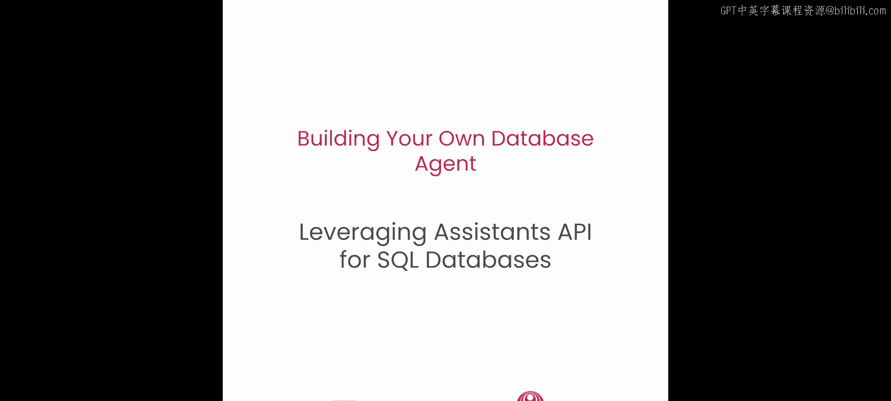
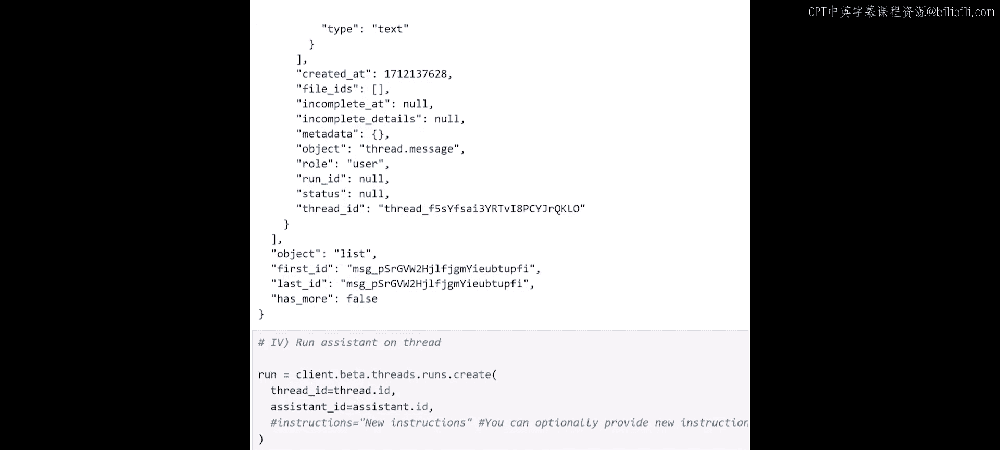

# 吴恩达《构建你自己的数据库智能体｜Building Your Own Database Agent》中英字幕 - P6：6.Lesson 5 Leveraging Assistants API for SQL Databases.zh - GPT中英字幕课程资源 - BV1RD421M7xK

As a developer， you want to leverage the latest model features and the As API is one of them concreterely this API is the stateful evolution of the previous one。

 facilitating the creation of your new AI agents。

This will add deep to your very own unique AI toolkit and knowledge this lesson will give you the opportunity to work with a new assistance API and test it with both function calling and the interpreter features it completes the variety of implementation patterns that will help you connect to SQL databases and create your own database agents。

Okay， let's go down innova。In lesson5， we'll focus on the final power of this course and explore additional capabilities we have deployed our instances of Azure Open A and LinkChain。

Created agents for CSB and SQL。And switch it to using the function calling feature of Azure OpenI in lessonson 4。

We saw that function calling works well， allowing the system to leverage multiple functions Now let's take a look at another functionality of Azure Open AI。

 the As API previouslyly we used GT4 with chat completions。

The assistance API is different because it maintains the context of the discussion dynamically and like check completions。

 which are stateless， the assistance API is stateful。

 meaning that it keeps track of the conversation this is useful for scenarios like e-merce where maintaining context across interactions is important。

Withining the Asistance API， we can also use function calling similar to what we did in Re 4。

Additionally， we'll explore the code interpreter feature。

The code interpreter feature allows the assistance API to handle Python code， it can run code iterly。

 modify it until the execution succeed。Wwhichch is very useful for complex tasks the code interpreter feature is like an environment within your current environment。

 enabling the agent to modify its own code to find solutions This lesson will help you explore the stateful capabilities of the assistance API and the code interpreter for dynamic and complex interactions Let's head to our last notebook and get started this time will keep it debrive by combining previous configurations。

We will execute everything together， we are recording the endpoint。

 loading the CSV data and importing it into the SQL database， similar to what we have done before。

We will start by importing the helper function that contains some variables and functions used in lesson4。

This is mainly to bring the tools SQL and the functions for hospitalization and positive cases defined in lesson 4 What we are having here is the key the endpoint and the version of the API in this case because we are using all the new functionalities we are taking the latest one and with these what we are saying is okay we have client which is the ASz OpenI object and we are creating an assistant an API assistant and we are giving instruction which is an assistant anding questions about for COVID data set we are talking about the model and we are explaining the tools are available for this assistant to play with which are these tools that we have created before based on the functions that we define and then。

And this is the second step already because this is just a few lines of code we have created assistant then we created the thread and this will create like the let's say the trace of the discussion so we can correlate like we can connect the different messages and a user machine discussion and the answer that we're getting is okay we have an identify for that thread that will be unique has been created at this and this metadata and this object is thread which once again is specific to the assistance API Now what do we do your assistant you have a discussion I'll be adding a message and this message will be from the user right from the user perspective the content will be how many specizations the way in Alaska for this and this and this very similar question to what we did before but different way to implement it we are identify the thread you see we have the identification here。

😊，I part of this discussion is a message within the thread this message is for an with a value how many which the content how many specizations we have here we have printed the message you want to see it in a proper way and you can see the same but we can see it like a JOM kind of damp and you can see all the information but basically the same right we are saying that is assistant that we have identification we have this value。

 it's a text question cirus C some metadata so that's good let's run the system on the thread right we have already that preparation we have told the system that we have some messages and some discussion going on let's run the system this is like the way to set up your assistance API。

With the four steps that we have mentioned all the same。

 depending on the kind of functions and the stuff that you have on the kind of questions。

 that's fine。 And now we'll replicate what we did in lesson 4 for the function calling So basically we be using function calling but this time we'll use it with the assistance API and after that we'll use a code interpreter but let's focus first on the function calling if we use the function calling the dynamics is very similar to what we did before。

 we have already function we are explaining this case that is a thread that we are running something on ongoing discussion because we launched it before。

 This is the run that we had before rate to the system and to the thread and then once again the same we are saying we have this available functions with is a specific format this arguments we need this kind of parameters very similar to lesson4 right and then we are running。

D on the thread。An assistant and with the tools that we have So let's run these that you see for the test question that we have before because we pass it before like how many specization we had in Alaska is running the message on the discussion on the systems and is getting that answer is getting the answer that is saying there were threeizations for Alaska on this specific date you could print the Json damp you want to have like a better format of this Now the part that is a net new is the use of the code interpreter remember this code interpreter is like a samplebox within this kind of samplebook that you're using is a code samplebook available and open AI and a Open AI that will allow the assistant to run in an intelligent way the code for complex task even allowing it to find the way to make it work if the code is not good will iterate and find the way to make。

And once again this is incremental this is on top of the things we have done before we have already the assistance we are creating basically assistance with our model test artery。

 which is the same one and here you have tools。😊，We are saying the type is code interpreter So yes。

 we are using assistant API， but then we are using specific kind of tool。

 which is a code interpreter Okay it's good and we are using our question hospitalizations in Alaska in 2021 so we'll run the threat for the discussion same as before but the incorporating the tools rightcorporating the code interpreter that related assistant and assistant to the run what we are saying is if we are still working on this if we are still iterrating the assistant is still working as has in being complete cancel expire fail we'll be running this discussion on the thread So you see the ran youd see the threats the Cittra Citra which is everything related to our assistant we can。

Printed you want JO done with the result of the messages parameter。

 which is basically saying okay for this assistant ID on this thread discussion basically we are getting that on March 2021 there were like so many people hospitalizing Alaska to co it to 19 so again very similar we are getting the answer in this case what we are doing is to add the code interpreter but the format on the answer is very similar just take some seconds just analyze it is something that you don't understand it is some specific parameter that you understand。

 you can just copy it， check it on the official documentation of AS OpenI and now let's conclude the class。

