# 吴恩达《构建使用抱脸的机器学习应用｜Building ML Apps with Hugging Face LLMs to Diffusion Modeling》 - P1：Building Machine Learning Apps with Hugging Face- LLMs to Diffusion Modeling.zh - GPT中英字幕课程资源 - BV1Ax4y1U7va

Hi， everyone， and welcome to building machine learning apps with Huging face L L M's to diffusion modeling。

 My name is Greg Lockchnain， and I'm the director of product at Fourth B。

 We appreciate you taking the time to join us for this event。

 We're glad to see you tuning in from all over the world， If it's late for you。

 Thanks so much for staying up late with us。😊，During our event today。

 you'll learn all about hugging face from their famous transformers and diffusers。

 libraries to how you can leverage their entire stack of ML models， libraries。

 and tools to solve your most important AI problems。You'll also learn how to build shareable。

 generative AI applications without worrying about any deployment infrastructure。

We're going to get right into it today。 If you hear anything during our event that prompts a question you'd like to ask。

 please follow the slido link in the description box on the YouTube page。 If you're just listening。

 please go ahead， check out the slido link and upvote your favorite questions that are there to make sure we get those answered at the end of our session。

 We'll do our best to answer all of the most unvo questions。Without further ado。

 it's my pleasure to welcome our speaker today to the stage。

 Jeff Boier builds products at Huging Face。The leading open source M L platform， previously。

 Jeff was a co founder of Supflix， which was acquired by GoPro。

 where he then served as director of product management， product marketing。

 business development and corporate development。 Jeff， welcome。 off to you， my friend。😊。

Thank you so much Greg and thank you so much to the Deep learning AI team for setting this up yeah today I'd love to tell you about how to build apps with deep learning with transformers with diffusers from large language models to the latest stable diffusion。

😊，So let me let me get into it， I'm going to share。My screen with you one second All right。

 there it is。The way I want to go about it today is in four main parts， the first one。

 so we're talking about building ML apps and I thought it'd be useful to sort of walk you through the evolution of ML appss to where it is today in a second part I want to tell you a little bit about hiking face specifically looking at the latest things that we shipped in the world of large language models and diffusion models and generative AI。

Then I want to show you how you can use the Hyened F hubub to build machine learning apps without worrying about infrastructure。

 and then because telling you about it is only half of the story。

 I want to show you some live demos of how this actually works。All right。And before I get started。

 of course， if they are any questions， ask them in the chat。

 we'll respond to them at the end of this session， if there are questions that are not answered。

 you can always send them over to me， I'm at Jeff@hugingface。go。All right。

 well let's get started with the first part， a quick history of machine learning ops and how did we get where we are today and I'm going to roll back the tape quite quite a bit 10 years ago。

😊，When Mark andreesen famously say that software is eating the world， what enabled that prediction。

 which came true is highlevel abstractions and accessible toolings that led developers collaborate around code and build code reliably and robustly and what happened just a few years later is that deep learning started to work the recurrent neural networks and convolutional neural networks were sort of resurrected from the De pulled out of the lab and put into production for real use cases at companies and that prompted Jensen Huang。

 the CEO and founder of NviDdia to say that now deep learning is eating software。

And so what enabled that deep learning not only to work。

 but to get into production at companies is the combination of this alignment of stars， stars。

 these are planets， but stick with me， so it was enabled by these new architectures。

 neural networks I mentioned colutional recurrent neural networks。

 and the availability of large data sets and new kind of available compute through GPUs。

 and tools that were very much expert tools， Ptorch Tensorflow to build deep learning networks。

And so that enable this first cycle of deep learning and in terms of ML Ops like what would a typical project look like looked like something a little bit like this where a lot of tedious work has to be done in order to collect data and prep it and clean it and label it and massage it to build a model that then needs to be evaluated and this whole process would typically take up to a year at companies and that really slow down the adoption。

 and then the other thing is that so both of this whole process to solve one use case。

 build one feature and then once you want to tweak that feature or create a new one。

 you're going have to start the whole thing all over again。

And the consequence is that in terms of the adoption and the business impact of deep learning。

 it really limited how it was being used by companies。

 so venture bit reported that 87% of that science projects never make it into production with only 25% of companies reporting adoption of deep learning like that has been a limiting factor。

But something happened five years ago， and I think the most significant thing that happens in deep learning of late is the advent of transfer learning and what transfer learning is is the ability to take a huge model that's been trained on a gigantic corporate data using massive amounts of compute。

 sometimes millions of dollars of compute to create these large pre-trained models that can then be easily efficiently adapted downstream to a task。

 a use case domain。And that's what transfer learning is and transfer learning enabled the 2。

0 cycle of deep learning and once again we had planets that were aligned from the Transer architecture enabled by Trans learning and new types of hardware that was designed from the ground up for machine learning and most importantly new developer friendly tools to take these models to work。

And that's deep learning 2。0 and the resulting trend is that now transformers are eating deep learning。

 meaning that transformers are becoming the default architecture to build machine learning for whatever problem you are looking at in fact。

 the state of AI reported that transformers are emerging as a general purpose architecture for machine learning and replacing sort of traditional ways of doing machine learning。

So in this new world of transfer learning， what does a typical machine learning project look like？

Well the first thing， it's actually a two maybe three step process and the first step is to identify the machine learning task that is going to match your problem and there are machine learning tasks for any kind of modality whether it's text or images or speech so for instance large language models deal with text we can apply them to many different tasks for images we can of course generate images with stable diffusion but we can also classify images we can detect objects separate background etc on speech we can transcribe the speech we can generate speech we can identify speakers etc so pick the machine learning task that corresponds to your problem and then the next step is when you've identify your task you want to go find a pre-trained model that does a pretty good job at solving your problem and that's what transfer learning。

Enables like you can start from those pretrain models you don't need to build。

 you don't need to do this whole cycle of labeling data， building features， cleaning things up。

You can start from a pretrained model and to do that。

 it's only really two lines of code to download and test the model on your own data。And finally。

 if you need to， you can improve the performance of that pretrain model pretty easily efficiently by fine tuning that model on top of your data。

 and that's typically the process that hugging face users go through when they build machine learning apps。

 new machine learning features。All right。So that was the first part that was a quick history of the evolution of machine learning apps to sort of set up how you can go about building machine learning apps with with HiF now I wanted to tell you a little bit about Hi face and focus on maybe things that you didn't know I assume that some of you most of you have probably heard about Higing face。

 maybe you've used a transformers's library but I wanted to tell you some some of the things that you may not know that we very recently shipped。

So the first thing， our mission， our mission is to democratize good machine learning and we do this through open source。

 everything that we do is open source that means open source implementation of code that means publicly accessible model weights that means publicly accessible data sets so you know how a model has been trained。

And that means a generally open scientific process that enables the community to contribute。

 and that's the second point， which is everything that we do at Hy phaseace is community driven。

And the third thing is that we want to have an approach which is considering ethics at the beginning of every project。

 so that's why everything we do is build from ethics first principles。

And speaking of ethics first principles， so that's number two， something you may not know。

 but we are building a whole suite of tools for the community to never can say that word operationalize ethics in AI and if you go to huggingface。

co， you can find our ethics and society page that curates all the different tools that we have built and made available the events that we participate in to educate the community to do things like measuring bias in a data set。

 to do things like improving using best practices to release models。And on this point。

 we are also operationalizing ethics in AI by publishing ethical guidelines at the beginning of a project。

 so for instance， for the Diffffusers Library， we published a couple weeks ago。

 I think ethical guidelines for the library so everything is out in the open and we can discuss it with the community。

Number three， HigingFase is one of the top developers in the world for open source and when I made this slide a week ago。

 HiingF was the 38th organization on GitHub in terms of number of stars today I checked yesterday we're at 35 so it's growing very quickly and as I said you probably know the Transformers Library you may know the diffusers library。

But there is a whole universe， a whole ecosystem of tools for you to build with machine learning from data assets sets and tokens from the ground up to acceleration for training with the A library。

 with the optimum library and more。Fourth thing so I told you about transformers and transformers is the fastest growing open source project for machine learning of all time。

 but what is maybe less known is that diffusers， the library that makes available all these generative AI models is actually growing faster in his first six months than transformers did。

 so it's really really exciting to see the community the community drive this adoption。Number five。

 there are over 150，000 free and publicly accessible models I talked about how the first and second step are to pick the task and find the right model we have over 150。

000 of them covering every single task you can think of and many libraries。Number six。

 actually what is maybe less known is that most of the models that we host are private models that you don't see it。

 we have actually over 300，000 models hosted on the hub and that's because when you go to create a model so you create a more repository。

 you can choose for it to be either public shared with the community or private to collaborate with your team。

 which is a really great option for data sciences teams。Number7。

There are over a million model downloads happening every single day on HigingF all of our stats are public you can check them out in that space and yeah it's been amazing to see the increase of usage of the hub as more of you use it to build machine learning apps number eight that one's funny to me because maybe it means that I'm not doing a very good job but most people do not know how Hiface makes money and so I get the question a lot so how does Higing F make money we sell compute services on top the hub you'll see some of them today and we offer expert support to companies to be successful with machine learning with our models and libraries。

Number nine， I'm going to talk about this a little more in the talk in demo。

 but for developers who who don't have a PhD in deep learning it' really easy to get started with all this and the abstraction that we built to easily get started for developers is tasks I say the first thing was to select which task you can do that very easily by just going to Hi andphaase。

co/ tasks and selecting the one that fits your problem。Number 10。

So I talked about how important it is to our mission of democratizing good machine learning to do everything open sourced it's been a trend in recent months for models to be less and less released in the open which hampers the scientific community to contribute to the field so it is important for us to build in the open reproduction of those state of the art closed models and something that we're investing a lot in so here I have two projects featured one is big code in partnership with service now through which we are building code generation models and their data sets everything in the open and build ethically like you can opt out you can ask for your code to be opted out from the model the training also featuring our fllamingo replication progress Flamingo is a model from。

Deepline that is pioneer in multimod models， multimod， the same way that GPT4 is multimod。

So some very cool project that I invite you to follow number 11 a lot of people know about Bloom。

 Bloom is a large language model， the largest open source multilingual model with 176 billion parameters that came out of an open collaboration called big science which hikingface initiated。

 we had over 1 thousand00 scientists leading scientists from the field participate work together in I think 80 working groups to have a fully open process from the get go and eventually release those models and data assets。

What is less known is that we actually built and big science released an instruction tuned version of Bloom and that model is Bloom Z。

 it's the lesser known cousin of Bloom but it's probably the more useful cousin of Bloom and I'm excited to demo it to you。

Number 12， many people， most people know about stable diffusion by now。

 which is sort of the open source replication of Dli， Dli2 byt AI， runway ML and conVse。

 but few people know about controlNe and controlNe is super super cool。

 it's a way to guide the image generation by providing a guide via an image and the human pose。

 et cetera， also excited to show that to you later。Number 13。

 so we talk about all these generative AI models， many people do not know that we have an app for that and it's on the Mac App store if you have one of those M1 or M2 capable Mac you can use them to generate all those images from your prompts in an app with your computer actually generating the images so really cool check it out。

Number 14， if you're interested into everything that I just talked about stable diffusion models。

 how to create fine tuneune models， we have a free diffusion course that's available on GitHub so you can learn everything in order to create your own create your own models that generate images or audio。

And last one， number 15， we just released JavaScripts client for HiFace。

 which enables now developers to use Hi F models， directly in the browser without having to build backend backend apps in Python etc ceter。

 everything works in JavaScript， you can call model。

 you can interact with the hub and its repositories and surf predictions right from the browser。

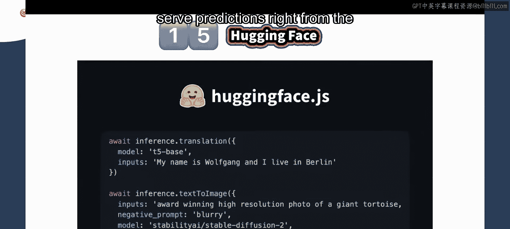

All right。So those's where like 15 latest and greatest things from Hi and face。

Now I want to talk to you about how you can apply all these things to build machine learning apps using HiF and using the Hi F H so you don't have to worry about infrastructure。

So what can you do with the Higg and phase hub？The first thing that you can do the first thing that you want to do is to explore to find that model to fit your needs this is what the model hub looks like as I told you there are over 150。

000 models available here。

This screenshot is a little bit old six months old。So I need to catch up with that。

 but the important thing is that you can very easily filter through this jungle of models。

 we surface the most popular based on how much they're being downloaded and liked。

 but you have access to very easy to use filters to narrow down to the tasks you want to use the library you're using the language you're targeting。

 etc。

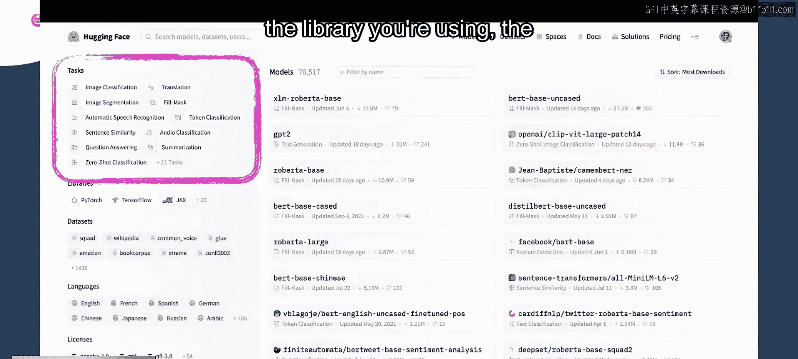

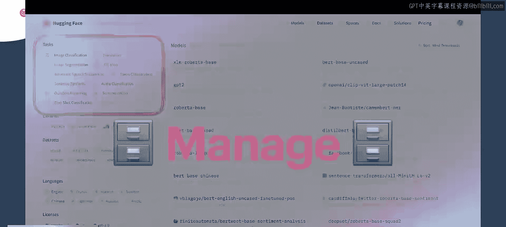

So that's explored the second thing you can do with the Huging F hub is to manage your own models okay。

 so you found a model and now you want to manage your own everything on hugging face from models to data sets to spaces are under the hood GiHub repos and that is so that you can have complete robust version control and know everything that's within a model and know everything all the changes that happens。

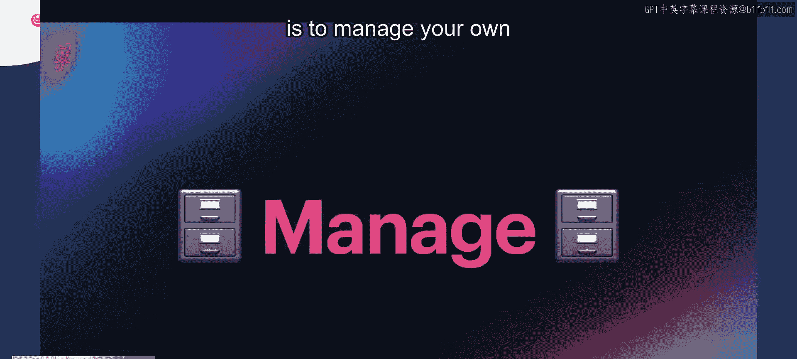

So looking at this model page what you see is the model card right so this is Ws largege from open AI then back when it was open and so the model card gives you all the information that you need to know about the model how it was built。

 what data was trained on， what are the possible limitations risk biases inherentnt to the model etc on the right hand side you have a very easy way to interact with the model to understand how it works。

 what could be its limitations， the best ways to just use it and we have those easy no code widget experiences is to support like any kind of machine learning task that is supported by by hiking phase。

Now if you go to the files tab， that's where you can see the contents of the repository。

 every single file with the complete history for all of these files。

 you can see which contributor did what changed and when they did something you can have access to the pull request and see exactly what was changed so full transparency around the models。

 whether they're public so with the community or whether they're private privates with your team every single ones of these changes has a unique commits associated so you can build apps that enforce a version control。

For each of those models， we have easy options for you to use them。

 use them with our open source in transformers， or use them in our experience to deploy them to inference using inference endpoints。

 I'll show that later on or on SageMaker， for instance。

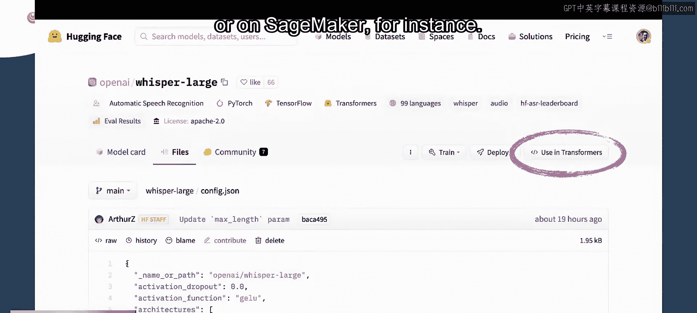

All right， so now you know how you can explore the model hub。

 you know how you can manage your own models the next thing that you want to do is collaborate and that's super super important for us at Hiface so that's what the relatively new community tab is all about so here we're looking at stable diffusion Wpoint4 if you go to the community tab you will be able to see not only all the discussions that have happened around the model but also to make and review pool requests so if you want to say ask the model author to edit the model card to ask a question about the license to make a change to add a new file to the repitory you can do so using pull requests again everything is transparent you see exactly what's happening if you're familiar with GiHub you will be familiar with pull requests and。

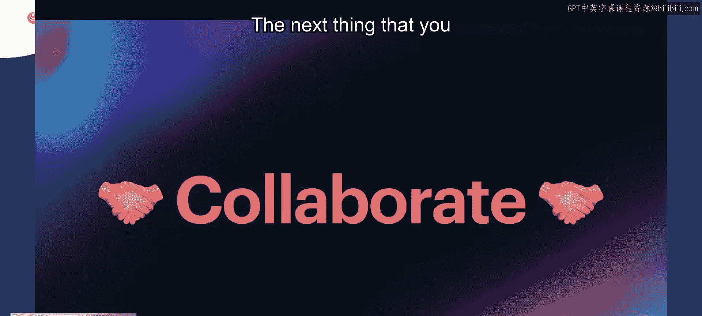

Quions？And here are discussions， which is a great way to interact with model authors on Hi face。

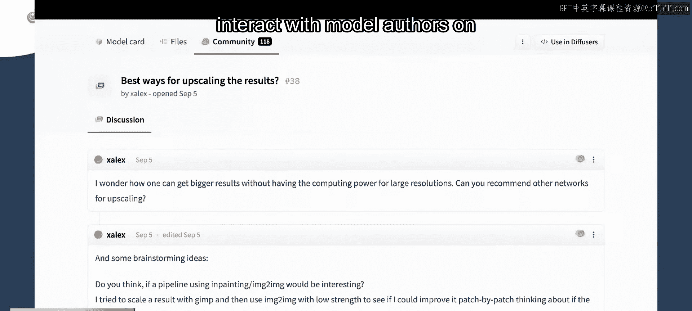

All right， so now you know how to explore the hub， how to manage your own models。

 how to collaborate around models， the next step is how to use these things and remember I had this three step process where the first one was to select which task corresponds to your problem。

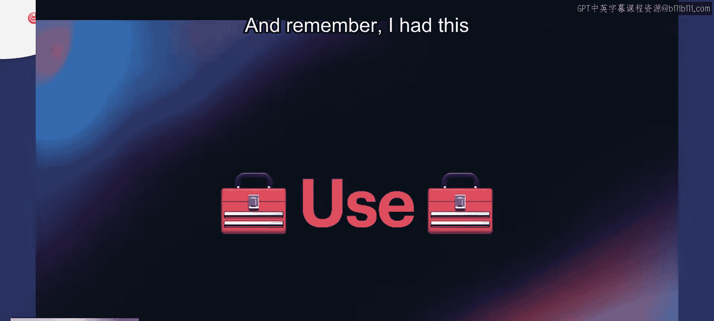

So speaking about the tasks experience， we have tasks for any kind of modality of machine learning。

 of course natural language processing that's where we started。

 but also computer vision and audio and now even tabular multimodal and reinforcement learning。

For each of those tasks， like if you don't know which model you want to use。

 that's a great way to get started so that you can we can recommend like the best model for that particular task and you can get started without having to think about models。

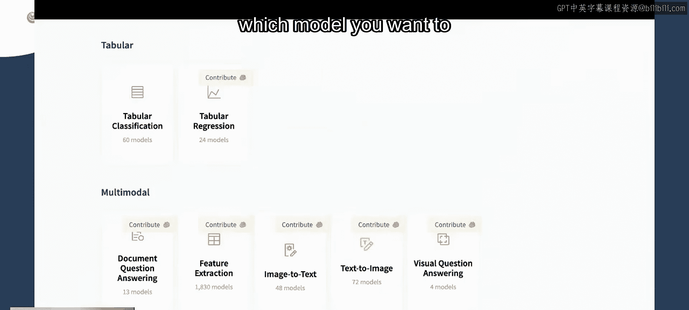

Now， in the open source， the notion of task is implemented within a Transformerss or the diffusers library as a class called Pi。

And what the pipeline does is it encapsulates the whole logic around machine learning tasks so you don't have to worry about tokenization。

 how to break words into pieces， you don't have to worry about preprocessing and postpros you send for instance text in you get text out and the whole process is just a couple lines of code so here in this example we're targeting the task zero shot classification。

 meaning we're going to send some text and say does this correspond to these classes without the model being ever trained on those classes or being given example about those classes。

And we're going to use the Facebook bar large MLNLI model checkpoints to run that prediction。

So you import a pipeline， you instantiate the pipeline， you send the input。

 you provide the candidate labels or classes， and you get a result in just one line of code that tells you that this sentence was in fact。

 about finance 68% confidence。

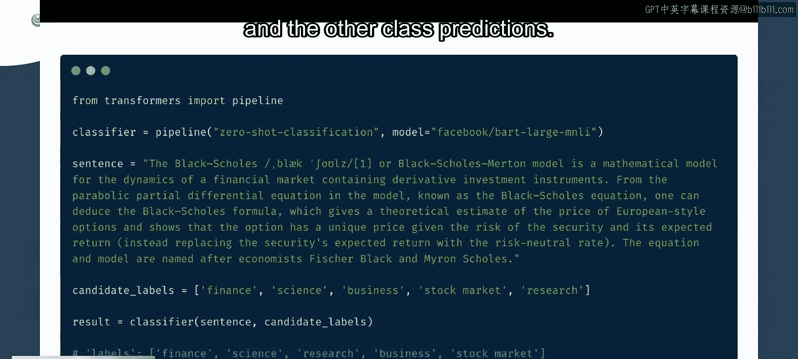

And the other class predictions。So that tasks and that's how they are implemented in the open source。

Now now that you find a task and that you found a model that sort of works great for your business case。

 the next step is to train or fine tuneune and the great news here is that we wanted to make this super super easy for people to do that and we built a new experience called Autotrainin so that you can finetune models or you can create new models just with a small training data set。

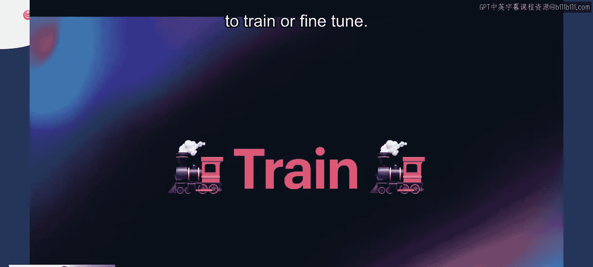

To see how it works， I have a quick little video。The whole process can take up to an hour if you're training 15 or more models。

 so I'm not going to walk you through the whole flow， but this is how it works。🎼The first step。🎼Yes。

You said like the task。And then you can just drag and drop your CSD。🎼Triing that。Set up the colors。

And just ask whattrain to start training。If you didn't start from one model checkpoints。

 you will select the best possible checkpoints to start from for that task。🎼And create menu models。

It's all going to be automatically evaluated。For the task that you chose。

And the best part about it is that every single model that's created by auto trainees automatically deployed。

 so once it's available， you can send a request via the inference API。

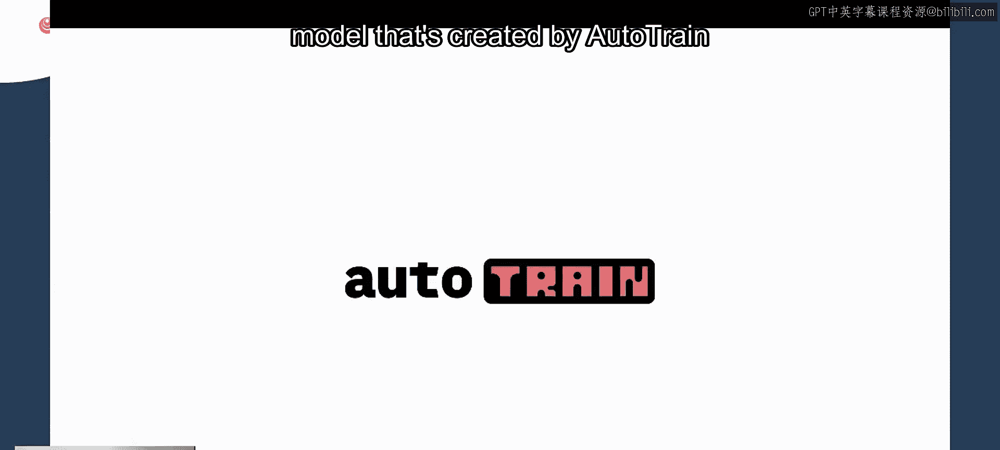

All right， so that was auto train。Now the next thing I want to tell you is how you are able to not just build models。

 but then demow them in hosted machine learning apps and that's what spaces hiking face spaces is all about spaces allows you to easily create machine learning applications with a single simple Python file leveraging streamlit and radio libraries to。

Publish any kind of machine learning app and here I have a fun app from HugggingFse called Huggggy which is a reinforcement learning app where you can interact with an agent here。

 Huggggy， the dog that's going to be retrieving the stick Huggy has been trained using Huging F reinforcement learning tools。

So and yeah every week， there are amazing experiences that are created by the community。

 I invite you to check out the training spaces of the week as you go to visit spaces。

And to tell you about it， I want to bring up Nate that's going to walk you through the process of creating a new space。

The team here at Huging Face is super excited to announce the public release of spaces。

 the quickest and easiest way to build， deploy and share machine learning demo apps。

Machine learning projects come in all sorts of different flavors we build spaces because we wanted to provide a more flexible solution for folks to share their projects with spaces you can take any existing code you might have。

 build an app around it in minutes and share it instantly on our site all for free。

Let's see just how easy it is。To create a new space， first。

 make sure you're logged into your Huging face account。

 then simply click your user icon in the top corner and click new space。

 Here's where we can name our project and choose one of the supported open source libraries we'd like to build our app with。

 Right now， you can select either streamlit or radio。

We'll name our app demo app and choose streamlit for the sake of this demo。 Once we're ready。

 we can click create space to create a new project。 Now， this project is actually a git repo。

 so we could clone it locally to edit the files if we wanted to。

 We also have the option to just add and edit the files in the browser。

 So that's what we'll do for now。 Let's add a requirement that TXT file to our repo。

 which is how we can define our apps pipe dependencies。😊，To do that。

 we'll navigate to the files and versions tab and create a new file using the drop down on the right。

We' name the file requirements do T XT and add a couple dependencies。 In this case。

 Ptorrch and hug and faces transformers。 When we're done。

 we'll hit commit new file to add to spaces repo to create the app itself。

 we'll add another new file named apptop Pi。In this file。

 we'll quickly define a simple streamla app that uses the default sentiment analysis pipeline from transformers to predict how positive or negative a given input text is。

Just like before when we're done， we'll hit commit new file to add that application file to our repo in just a few lines of code were finished and we can view our running app from the app tab if we choose to make our space public。

 we can easily share our app with anyone around the world by sharing the link to this space。

In this video， we saw just how easy it is to build。

 deploy and share machine learning demo apps with hugging face to faces now it's time for you to get out there and share your own awesome demo with the world。

For more information on hugging face spaces， you can check out the docs or explore spaces shared by the community。

Until next time， thanks for watching。Thanks Nate and since Nate recorded that video I think we went from 200 spaces to over 20。

000 spaces so definitely check it out a new feature we also released recently is the ability to upgrade the infrastructure。

 the hardware that powers your space from the default free CPU option to accelerators various kindss of GPUs。

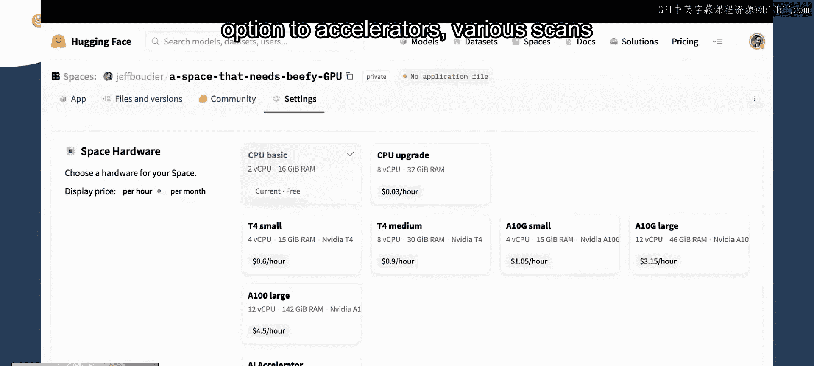

So check that out so now I told you how you can explore the hub find a model。

 how you can manage your own models， how you can not worry about models and just go to tasks how you can finetune models how you can build demo apps with spaces the next thing is probably my favorite which is how you deploy models into production to power applications at scale and that's what were really here for right so when you go out to try and do that yourself what people quickly tend find out is that it's a little more complicated than you want it to be like all of a sudden you have to deal with like GPUs and memories and Docker containers and setting up the right environment and scaling that thing up and that's quite a headache that a few people have experienced in。

And so to solve all that and abstract all of that away。

 we created an experience called Huging face inference endpoints that work right from the hub。

 and you can use it a very easy way。And what that does is that essentially we made all of those models。

 those 150，000 models that are pretri and available on the hub。

 all those private models that companies and teams use the Huging Face hub to work and collaborate on。

 we made all those models plug and play for applications。And how work is really really simple。

 you start from the model repository， you pick the cloud， you want to deploy and the region。

 you want to deploy and you can select the right compute instance。

 you want to use the auto scaling with two simple parameters and security setting and you're basically off to the races once your model is up。

 you have unique your eye for you to hit to integrate it within your app。

 it's a production service so you have access to all of the logs for the container to see exactly what's going on and access to analytics to see how much usage you're getting on that endpoint。

And that makes it super easy for you to manage like any number of moral deployments with various settings of security all the way to like a fully lock down setting。

 leveraging NWS private link so thats the data never leaves your VPC as you make requests and get responses。

And to talk about it， I want to bring up Garreeth， Garreeth is on the product team at Pcon。

 Pine cone is a vector database company and inference endpoints was really useful for them to sort of。

Solve the whole infrastructure and deployment part of the model deployments。

Greeth shares that they were able to choose an off the shelflf model it's very common for customers to get started with and set it so that it can be configured handle over 100 requests per second with just a few button clicks and to hear more from Gareth。

 have a quick conversation with him。嗯。Hi I'm Gareth。

 I'm a product manager at Pine cone a fully managed vector database company a vector database is a tool used by teams to build all sorts of applications like question answering。

 semantic search， image search and recommendation engines。Yeah。

Huggging F is probably the most popular framework our customers use to create embeddings that are stored in P cone customers are using hugging face in their very first MVPs all the way into their production systems an embedding that comes from a hugging face model is used to create kind of a learned encoding a representation of every single piece of data that's then used in a vector similarity engine like P cone。

Okay。Most teams who are working on building vector search or a vector application is their first time actually building this solution and it can be quite challenging to move as a small team that is maybe more expert in building and training models than actually deploying or managing infrastructure。

 many of the same reasons that the huggingface inference inpoint is so valuable is that teams don't need to think about that infrastructure。

 the same reason customers use P cone， they don't have to worry about computers running or scaling things out。

 happens for them and that allows them to really focus their energy on the things that matter most of them their models。

嗯。When we first started evaluating the hugging face inference endpoint。

 we were amazed by how simple it was to create a horizontally scalable model。

 we were able to choose an off- the shelflf model that's very common for our customers to get started with and set it so that it can be configured to handle over 100 QPS just for the few button clicks。

 we were doing this evaluation to understand just how well huggingface solution would work for customers who were looking to build either their first MVP or move to a hosted solution for the models and we were quite impressed by just how easy it was to kind of meet the kind of typical throughput demand that an in production application would see。

응。

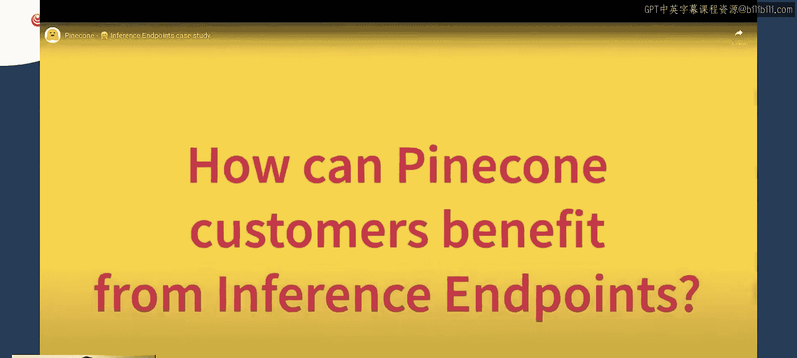

With the release of the hugging face inference end point。

 we believe there's kind of a new standard for how easy it can be to go build your first vector embedding based solution。

 whether it be semantic search or a question answering system。

 we don't think it's ever been easier to get started and also move those solutions into production these same principles are the same principles that Pine cone has。

 which is why we're so excited to be working with hugging face to launch this feature。Awesome。

 thank you so much Gareth， so yeah， hopefully we demystified in the last 10。

15 minutes how you can take advantage of everything that we have available on the Hi F hub from all the models。

 the data sets to create your own models manage your own models to build great machine learning apps around your models and deploy those models in production so you can have great features for your users and that's machine learning ops with Higing phase。

So I talked to bunch no I think it's time for for the fun stuff。

 which is to go play with all this Okay， let me try to get that set up for you。

If you have any questions out there and Greg， if you need stop me， go ahead。

 otherwise I'll just go to the demo。C。All right。Let me share my browser。

So I talked about the HigggenF hub and here it is so there are 159。

000 models today contributed to by the community if you're already a user and you use the hub every day。

 maybe something that you want to check out is the new full text search experience what that does is going to be looking through all the repositories within models and data sets and spaces if you're looking for something in particular so that you can very easily surface the thing that are most relevant to you so yeah very cool power feature for existing users。

 if you are a new user。

Then probably the thing that you want to do is to quickly narrow down to the most used models that correspond to your problem。

 so say that you want to translate text into German。

 so I will first look within the tasks here on the left hand side， click translation。

 and then I will look for language tag here and click German and here I will find some of the best models to translate into or from from German。

嗯。Now， if I want to。If I want I talk to you about Blooms Z， I'm going to go over there。

 but first I want to show you how to deploy a model using inference endpoints。

 the whole process is automated so it can take about 10 minutes and get started with that process now。

So here and let me switch my tab Okay cool so now you are seeing the inference endpoint management experience and what I want to do is to deploy stable diffusion model the latest from stability AI which is stable diffusion。

2。1。And if you want to step by step for this， I invite you to check out Philip Schmidt's blog which has examples for many different types of models how to deploy them easily using inference endpoints or using SageMaker so now I found my model checkpoint and all I need to do is to select the cloud here atWS I'm going to deploy it in US East1 it's suggesting a type of instance because it has a pretty good idea of how large and what the memory requirement for that particular model is going to be and now all I have to do is click create。

Now everything is happening in the background right and it's a production service so I can actually see what's going on if I go to logs is going to be showing me the build logs so I can see exactly what is happening under the hood many。

 many many， many things are going to be happening under the hood including downloading the model weights which is a huge checkpoint so this whole process can take between I's say five to 20 minutes depending on how large your model is and you can follow that along。

 but I'm not going to have you wait 20 minutes， I'm going to switch back to the model hub。

Where I want to show you Bloom Z。So again， you're probably familiar or maybe you're familiar with a big science G。

 176 billion parameter， large language model that is exceptionally good at multilingual tasks。

But you may not know Blo Z。And in a lot of respects。

 BloomZ is the more useful cousin of Bloom why because it has been trained and again in the model card you can see exactly how it has been trained on what data it has been trained and all the information that you may want to know about the model but this model is B fine tuned on instruction data set and what this instruction data set allows the model to do is to understand when you ask it to do something like here in this example the task will be write a code snippet with。

II even try to say that computational complexity and it will write the actual code snippet。

 but let's use this on content that's more relevant to you so if you're registered for this event you probably went on this page where we tell you about the talk there is nice little talk。

😊，Abstract here summary， so I'm going to copy that and then come back to B Z。

And I'm going to ask it to write。A sessionession title。For the following。Park abstract。

And I'm going to paste what I just copied。And now I'm going to be。Asking for prediction。

And here it is， hiking face， build ML features with ease。I think that's a pretty good title。

 Maybe we should have changed the title and maybe I should have used Bom Z but maybe let's try something a little bit different to sort of illustrate the ability of those large language models to quickly adapt to whatever task you throw at them so translate。

The following paragraph。For text。Into French。All right。And let's compute。Okay。

 it's right here and it's scroll down， there we go。Roswani Nuunali interactive Amazon。

 a director of the Purgue Jeff Buier。 I'm going to on keep on generating the eing face。

Sorry for this scroll A face Monstra they functionality okay that's actually pretty good I think it's probably better than what I would have attempted so that's Bloszy if you're interested to large language models consider Bszy as an open source alternative to a GT for or chat GT you can do very cool things and the cool thing with open source that you can actually deploy it in your own environment and you can control its versions and you can find tune it yourself。

😊，Cool so that was Bom Z the next thing I want to do is illustrate sort of what I talked about earlier about how you use the hub on Bom Z I showed you the model card I showed you the inference widget now I want to show you the content of the repository so I switch to the files tab and here again you can see every single file from for the Bom Z model and you can see the full history on all of those files if I click on the model card that's the readme markdown file we have access to。

To its history and the latest pull request we see the difference for each pull request so everything is traceable everything is transparent and you can easily collaborate with authors another cool trick for you if you're an existing advanced user of the Hi F hub is Tensor board metrics。

And what this does is because there is a tensor board traces file within the repository。

 Higg phase will automatically populate a tensor board instance so you can visualize and interact with all of the traces you can see well I'm not going to walk you through everything but everything that is tracked within the tensor board is Exporable。

 you can filter it， you can。Play with it so very very good way to learn from all your training experiments and build in the open。

 whether with community or within your team。And last for the model experience I want to show you the community so I told you that through the community tab you can either interact with the model authors and the community you can also suggest changes directly through pull requests so here you can see the history of both pull requests and discussions I can filter on pull request the last one was an update of the model card。

With。Actually that pull request was not merged， but super super important feature if you have a request or questions about particular model。

 often users ask us Hiface questions about a model the best way to do this is to ask directly the model author who contributed the model for questions or to update the model card or to add a new checkpoint。

All right， so that is the model experience， how you can explore， how you can use。

 how you can manage your models and how you can collaborate around models。

And because we only have five more minutes to go I want to maybe set up an experiment with a space and as a bonus hopefully by the end of the talk will'll be able to see the result so you know about stable diffusion so you know about text to image you send some text as a prompt you get an image as a result but the very cool model that just popped out on the hub is model scope and what modelcope does is the same but for video so that's super super fun so here we're going to type a prompt。

Say las are very popular right now。 so lama eating carrots。On the moon， right？That sounds like that。

soundsunds like a video I want to watch all right so it's going to generate a video that's going to take a couple minutes while this happens I wanted to show you the stable diffusion 2。

1 space since we created an inference endpoint to integrate that within our apps。嗯。So， let me。

While this happens， I'm going to。Switch tabs。To to find a stable diffusion space。 So very。

Convenient way to browse through everything， go through search。

Here I'm going to select stable diffusion 2。1 and then for the model。

 we have a list of all the different。Spaces。And you probably have played with stable diffusion before。

 so maybe instead of looking at。Instead of looking at stable diffusion。

 we're going to look at control net。So let me go to the control net space。

And tellll you a little bit about it so control net is a way to guide the image generation of in various ways。

 so with canny the canny mode you supply an image and whats the control net is going to do is to sort of infer the edges from that image and fill it dennos it based on your prompt and as an experiment what I want to do is to go get。

deepep learning AI logo。 So let's go to Google image。Keep learning a logo。Okay， so I'm gonna。

Save this image。Can you imagine a new tab。Thank you deep learning AI for licensing your logo for the use of this demo I'm going to save it on my computer okay that's done and now back to control net。

Now you can see control nets， I'm going to upload that image。It's right there。

 And I'm going to give it a prompt。 What do we want to do， I'm feeling like。A birthday cake。

chocolate cake。 Yeah， that's notmy。 It's almost lunch。 All right， and I'm gonna run this。

 so we're gonna see how with control net， you can guide the generation of the image。

 There are multiple other modes that are available to you You can doodle you doodle sort of a contour and that will help stable diffusion to create an image that corresponds to those contours。

 You can use a human pose。 So if you take a photo of me like this。 and you submit it with a prompt。

 It's gonna create a composition with somebody in the same pose。

 You can use the depth segmentation of an image so that the composition of the resulting image respects that depth composition。

 So many different modes that are super cool。 to create new images。嗯。And of course。

 while I was doing that， the model scope had an error so I'm not seeing my lamma eating a carrot on the moon。

嗯。😊，All right。And then maybe while a controlNe is working。

 I want to show you the endpoint that we created just a few minutes earlier。

So let's go back sorry for the back and forth here。

 but I want to keep showing you things as things are built so now our stable diffusion endpoint is running it is available at this URL。

You have its actual revision so you can build your app targeting specific revisions and if you send requests to that endpoint you're going to be to get。

To get the image responses。And of course， like anything at Hi phase will make it easy for you to testing things。

 so if you want to have an image of Yamma on Mars。You can add。

Get that using your endpoint right from here。All right， I get my chocolate cake。So what do you think？

This is a chocolate cake that is sort of guided by the deep learning AI logo。

 I think for the next birthday of deep learning AI you should definitely make this and it's going to be super awesome and to finish this talk I want to go back to my my Laau。

And I have now video of a lama eating a carrot on the moon。And that took， actually， less。

Then a minute to create this two seconds video。So that was Hi face inference endpoint spaces。

 how you can use that to build great machine learning apps to integrate machine learning models into your own apps and now yeah if you have any questions。

 just shoot them at me。

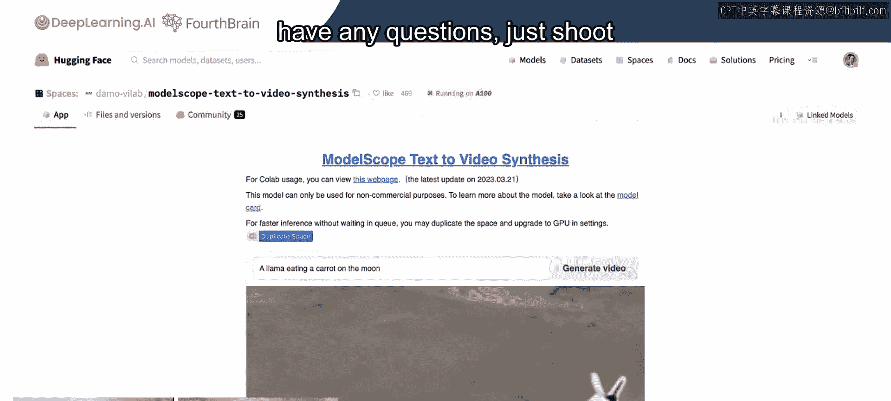

Jeff， that was awesome man the demo gods really smiled down on you in the last few minutes there great work I want to go ahead and just at least get to a couple of the most upvoted questions today number one is one of the most popular things anybody is trying to do or build right now what is the best approach to feed your own data a large set of files to an LLM and have it behave like a chatbot what do you think？

😊，Really great question and very current right there are many teams currently working to build open source alternatives to closed models like chatdGPT or bard I think what's important to understand is that when we talk about large language models there's really three types of models there is the base large language model and that would be for instance a B or an OBT model then there is the instruction tuned model and that's what I showed you with Bloom Z right you can ask it zero shot questions instructions and it will respond and those are the instruction tuneed version so it's the B Z of Bom it's the instruction GT or of GT etc and in that category can put GT3 and then the next category our models that have been tuned via。

Reinforcement learning from human feedback and that's what the chat GT is that's what。

And so today there is no really， I mean we have the first open source versions of models that have been fine tuned from reinforcement learning it's an active subject and we have great open source replications of instruct model so I talked about Blooms Z but there's a new model by together computer together that XYz that is available and a Hi andface hub a 20 billion parameter model part of the open chat kit。

 there is open assistant from Ly that is being developed right now with some artifacts already available so super exciting to follow this step this these developments and to the question okay so I have a large cors of data。

So these large language models have a context window which represents like how much information can you fit it as input to one single query and depending on the context window you can feed it like larger documents。

 etc， if you need to fine tune if you need the model to learn from an actual corpus of data。

 that's really the experience of fine tuning， which is computationally pretty expensive for very large models。

 but something that we enable and that we enable through open source and through our partners。Yeah。

 great， I love the nuance sort of going into the different models。

 the idea of the different sized inputs and then also the fine tuning with model size versus data coming in so there's a lot going on I think best practices are still sort of TBD and a lot of interesting stuff happening in the human feedback space as well so a lot to look at really exciting times we're living in with these customized chatbots in the second most upvoted question。

 Jeff your perspective。We've actually got a new second most outvoted question。

 which is how to make how can we make improved models similar to AlPAca out of various open source LLMs out there。

 what do you think？Alpaka was really really cool right and it's an announcement from Stanford。

 a release from Stanford fully open source that came out at the same time that openAI announced GT4 and Google made a whole bunch of announcements like closed models so it was really cool to see that the exciting piece is that by using an open source model as the base model。

 so in that case Lama and adapting it on instruction data assets that had been a synthetically generated Alpaka was able to be built on very small amount of compute and so that's really really cool and there are many initiatives out there to do the same on various instruction data assets and so I think we're going to see a Cambririan explosion of open。

Soce outback I like models in the weeks to come Wow that's such a keen insight You know Jeff we're gonna to go ahead and close up the questions there I mean we are kind of coming up to time here but thank you everybody so much for all of the great questions in the chat thank you Jeff so much for that really like that was that was an amazing breadth and depth that we saw today on hugging face and really deep deep dive on LLMs in general so I think this was useful in a lot of different dimensions and thank you everybody for contributing out there in the chat with your questions and with your comments this brings us to the end of today's event which has been brought to you by deep learning AI and fourth brain and also hugging face fourth brain is excited to announce our upcoming one day workshop on building generative AI applications like we saw today in just six。

Hours on April 5 from 9am to 3 pm Pacific， individuals and teams can create data sets。

 fine tune an open source LLM or diffusion model， deploy a working application to Huging face just like we saw today using many of the same tools and finally prompt engineer your way into a final awesome output for judging winners of the workshop will be announced at the next live fourth brain and deep learning event。

 so if you're looking to build ship and share generative AI applications from end to end。

 definitely check it out and stay tuned for more upcoming LLM and generative AI programs coming soon。

Deep learning AI is also going to send out a follow-up email with a survey for all of you that attended today。

 we would love to hear about how we can make these events even better for you a selected 100 of you will receive 50% off of a onemon subscription to deep learning AI courses coming out on courseursera and look for new ones of those coming soon as well Another big thank you to Jeff thank you to everybody for joining us today。

We'll see you all next time until then keep learning Thank you so much thanks for G。

 thanks deep learning AI。Bye， everyone。