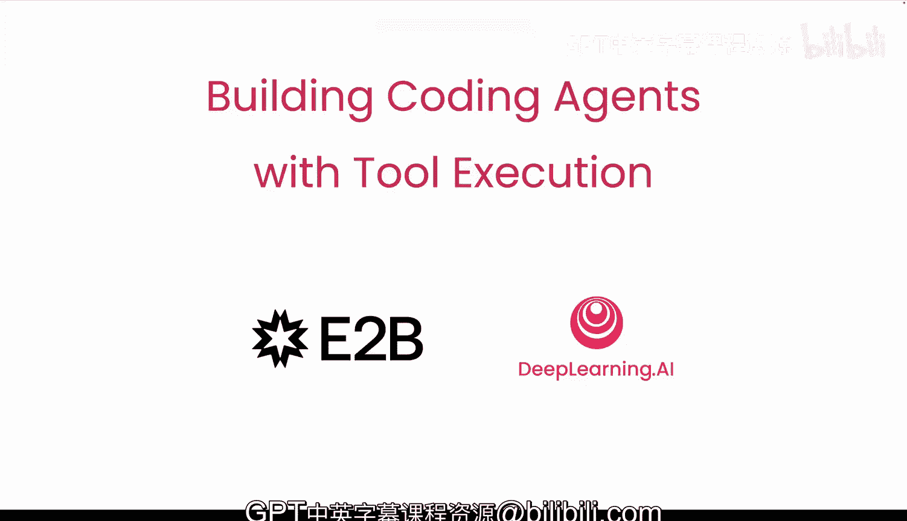
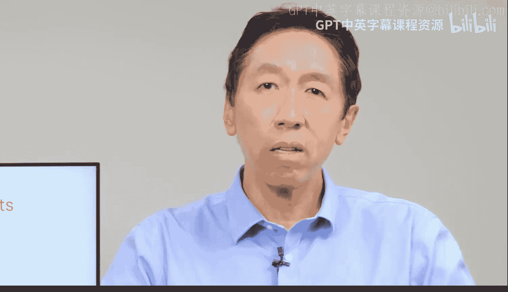
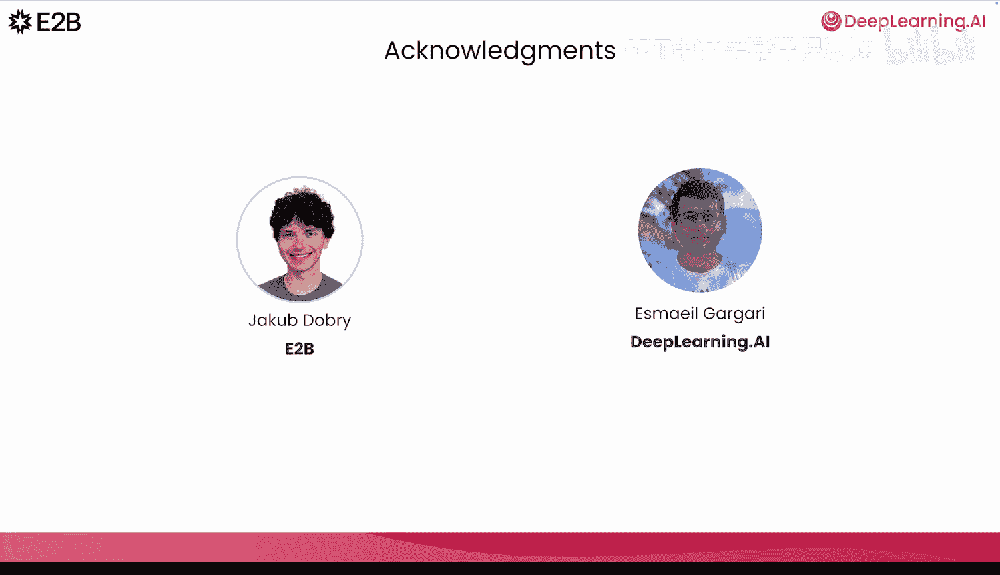

# 吴恩达《构建具备工具执行能力的代码智能体｜Building Coding Agents with Tool Execution》中英字幕 - P1：1.intro.zh_en - GPT中英字幕课程资源 - BV1582yBeExt

Welcome toBuilding coding Age with two execution， built in partnership with EDB and taught by Teresa Tshkover and Francesco Zubucchini。

😊。

In this course， you learn how to build agents that can generate an execute code as part of how they get the work done。

 Many of us will predeefine some set of functions they give to say andL to call。

But rather than using only a predefined small set of functions。

 if you instead let OM or your agent write and execute arbitrary Python code。

 then has access to every builtin Python function or can even also install common Python packages and call functions from that。

 This really opens up the space of which your agent can now do Also instead of sequentially making function calls one at time。

 which is common in OM to use for slightly more complex tasks。

 your agent can now also just write huge chunk of code。

 and efficiently execute a long sequence of operations and this too makes it more capable。😊。

But running code generated by an O on your local machine can be unsafe。

Whether the coat does something it isn't supposed to。

Once a highly agentic coding tool deleted one of my team members' important project files。

And another did a flawed database migration that deleted production data， thankfully we had backups。

 but to run generated code safely， a good practice is to run that coat inside the sandbox environment so that the code execution is isolated from the system。

😊，Thanks Andrew in this course， we will start by breaking down what an AI coding agent really is。

 now it differs from other AI agents。 You will learn how an LM can reason step by step decide which tool to call execute code and use the result to plan in next section。

 and then you build your own agent capable of running Python code gradient vettting files and it through task until it reaches a final elsewhere we will discuss how to manage the contests window underarrows every tries。

😊，Once you understand how an agent thinks and acts。

 youll explore different environments like local execution containers and secure sandboxed microVms and you will learn how to choose the1 depending on your use case You learn how to create a managed sendboxes run code remotely in different languages and itra with the sandbox file system so your agent will be able to use uploaded data。

 save outputs and even create and host small web application you build that data analyst agent that is CSv files with pandas and generates clear visualization and in a final lesson will create a full stack agent that adds multiple files and build a working next yes web app inside the sandbox to keep your agent focused even across large multi file projects It also discuss managing long context through runtime symbolization many people have worked to create this course Id like to thank Jacob Dbri from EB and from D AI I Gagari also。

course。The first lesson will introduce you to the inner workings of coding agents。

 as well as some challenges in building them。So let's go into the next video and get started。😊。

