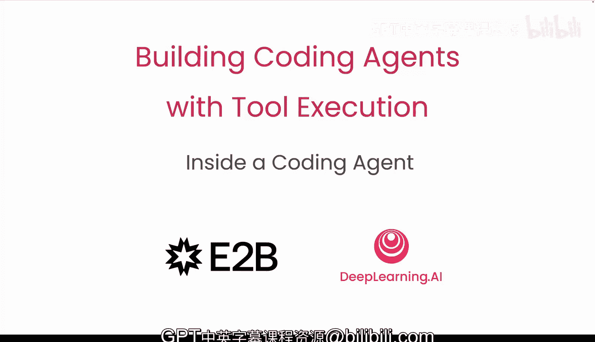
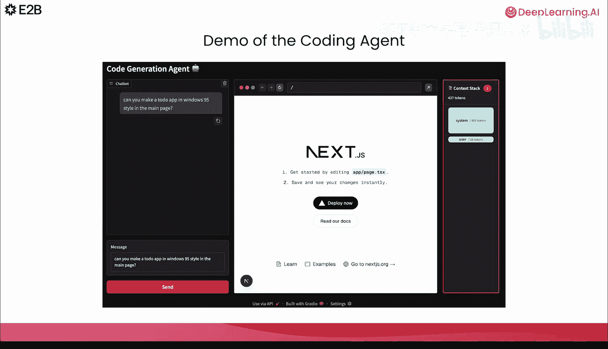
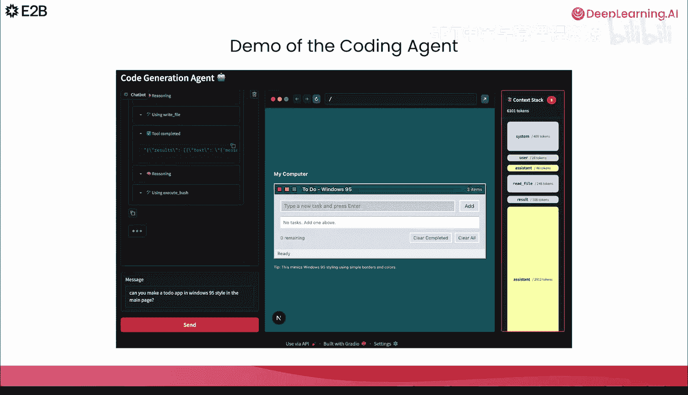
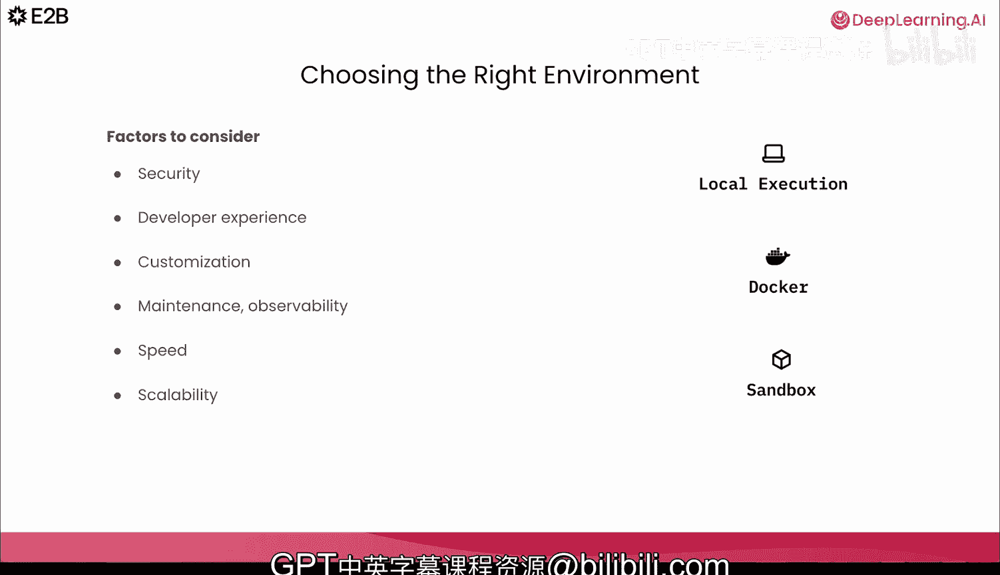

# 吴恩达《构建具备工具执行能力的代码智能体｜Building Coding Agents with Tool Execution》中英字幕 - P2：2.inside-a-coding-agent.zh_en - GPT中英字幕课程资源 - BV1582yBeExt

In this lesson， you will learn what a coding agent is。

 how it reasons through tasks and how it uses tools like code execution and file system to complete them。

 Let's dive in。😊。

This is an example of a coding agent that we will build in this course here。

 The agent turns your request into a working application to achieve that it writes code files。

 executes them， and instantly serves a web app all in its own in a cloud an AI agent can simply be defined as an LLM calling tools in a loop with context tools can be code that to the agent runs or external services that it can call。

 For example， working with files， searching the web or visualizing data insights。

The context is any input for the LLM。 It can be system instructions， tool definitions。

 user messages or more the LLM based on the context decides if and which tool to call the agent calls and runs the tool Appends the results to the context and repeats the loop until the task is completed。

 an AI agent might just reason for a while browse its resources and written and answer。

 you can ask the agents to do tasks like booking flight for you or doing research on a subject and writing a summary on it。

 but then there are agents like Gemini CI clothcode or cursor。

 These are coding agents the write and run code and related tasks like generating a long script debugging it or editing dozens of files in a project。

Let requires code execution in a controlled environment to iterate on the code over and over。

Coding agents also need file system access。 and because coding is complex。

 most tasks need the longer running sessions to install dependencies， compile Ram tests。

 pledge errors and retry。 Finally， these agents needs stronger security untrused code must be handled such that experiments Don't break your machine or Maurishious actors don't gain access to your system Like any other agent。

 Your coding agent will have an LLM edit core。 The question is， how do we pick the right one。First。

 the model should support function coding。 That means that the LM is provided with a set of tools and it can decide when and how to use them。

 Second， the context size matters。 research shows that around3 tokens of context is the first point where agents can reliably handle real large taskss。

 It corresponds to about 40 to 50 pages of text， which is like a medium sized Github repo。

 This is needed because working with larger projects like Janjango or Pythtorarch will require a model to read and edit many files easily using tens of thousands of tokens。

 Third for the right decision， we can evaluateva the LMs。 Ily with coding specific benchmarks。

 One of the most widely used is Swbench It tests whether a model can take a real Github issue generate a patch and pass the reos unit tests Here is the leaderboard from October 2025。

 but remember that this is just one possible metric。

 you can evaluate models depending on your use case。 Con is everything the LM Cs。 coding agents。

Context can be the system prompt the external input like a P or a database search result。

 the user prompts tools and tool execution results and other things like current branch commit filery summaries previous pageaginals dependency versions or short memory effects from earlier runs context engineering is the art of keeping the context small while providing the most relevant information to the model to complete the current task。

 we need to manage context length， because especially for coding agents， it can grow very quickly。

 Every edit run debu cycle adds more text to the conversation。

 tool outputs can be massive especially when they return big Jsons or logs Then you can get repeated error stack on top of that。

 The result is what we call context dropped。 as the token count grows。

 the model starts paying less attention toward matters and quality drops。

 We just saw how context can explode in coding agents。 one common source of tokens is raw outputs。

The first way you can mitigate that problem is by keeping tool outputs small。

 consistent and structure。 For example， we have a tool called getdu error that will think an API to get the results。

 If we just return the responses data， we might overwhelm the context with information that's not needed。

 So you can passse the output and return only the data the LLm actually needs。

 This doesn't apply only to Json responses。 logs can grow huge tool。

 so we clip them to the last few lines and drop repeated messages to keep the context small coding agents need to scan the file system quite often。

 For example， listing files based on some pattern。 but if you work on a large project。

 a directory may contain hundreds of files and returning all of them can really flood the context。

 One common strategy is to paginated the results and give the model the ability to request the next page if needed。

 We can also filter the listing first。 For example， only python files or only certain directories。

 So the model see just all matters。 your coding agent will need specific tools to。

Accomplish its coding tasks， at least running code and accessing the file system to run the code。

 we should follow some rules。Any code generated by an LM should be treated as untrusted。

 We should try to avoid running the code actions directly on the host。 Ily。

 we should go for a safer environment isolated from the rest of the system。

 we can also enforce strict limits on the CPU memory and execution time So a runaway process can't bring things down。

 We can also log and work and file system access unless the task explicitly needs it。

 And finally we keep the model on track by pointing it to our chosen textt。 otherwise。

 it can start hostinating library's names or using tools you don't want coding tasks require reading。

 editing and writing files。 So the agent needs accessing the file system。

 One good practice is to have strict permissions and allowing the agent to work only inside a specific working directory to search files。

 we can equip the agent with a rejectbased file search to search inside a specific file。

 we can use fuzzy matching。 that way the agent can look for relevant content or patterns even when。

There isn't an exact match to the search query， So an AI agent can be defined as an LLM using tools to perform actions in the loop and to accomplish a given task。

The loop is just whatever is going on between two user messages。

 Most tasks need multiple rounds of reasoning。 So the model calls tools again and again。

 Sometimes it can call the same tool repeatedly。But we need to know when to stop。

 There must be an exit condition。 Ages are not perfect。

 They can fail or might spin out of control while trying to recover errors。

 They can require evaluation of the results either by a human in the group or an LM。

The longer and more complex task you assign to your agent， more prone it will be to do errors。

Treracking errors systematically is critical because your agent might with stuck trying to fix an error forever to prevent it。

 we can keep track of errors。 For example， having a maximum military counter。

 we can ask the user to provide input and help with the errors。

 we can also help model by clustering errors together。

 removing the old ones while still keeping the context clear。

 you also need to choose the environment where coding agents operate the best Crur uses local execution。

 some agents use Docker and some like glvable manners perplexity use and boxes。

 when deciding about the right environments， we should think of security like attack surface and whether we are exposing our operating system。

Then there is developer experience。 We want to avoid code workarounds and make users happy。

 We also want our agent to have customized environment to use variety of languages。

 toolsol and printin style packages。 There needs to be a good maintenance tool to reduce any downtimes of the infrastructure the agent is running on to provide reliability and good support for end users。

 And finally， we want the environment to start fast and we need to do all this at scale and be ready for our agent to serve even millions of end users In the next lesson with Franceco。

 you will apply all this concept to build your first simple coding agent。😊，All right。 See you there。

