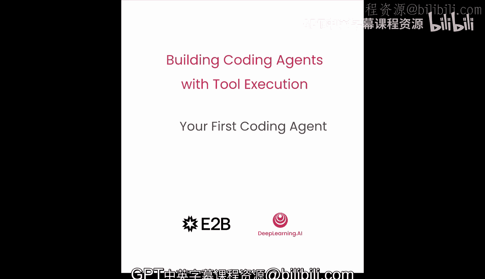
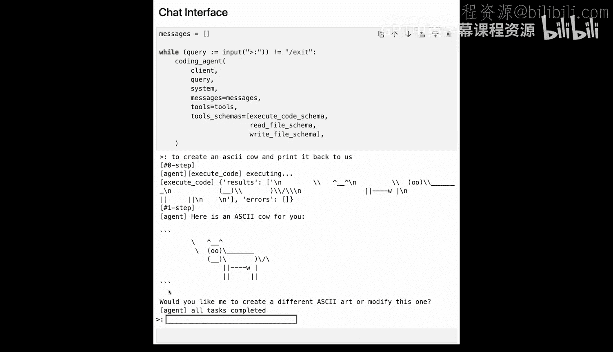

# 吴恩达《构建具备工具执行能力的代码智能体｜Building Coding Agents with Tool Execution》中英字幕 - P3：3.your-first-coding-agent.zh_en - GPT中英字幕课程资源 - BV1582yBeExt

In this lesson， you will be your first coordination from scratch。

 you'll give it real tools to execute code， read and write files and carry out multi step reason loops。

 Allright， let's get coding。

Let's start by ignoring warnings with these choices of code。

All of the keys are set up for you on a deep learning AI environment and you don't need to worry about before we build our fourth agent。

 let's have a look at a more complex data analysis agent that you will build in the next lessons based on what you will be learning in this lesson。

This agent is capable of running and executing code。

 So let's briefly just try one prompt to give you an idea of what we will be building。 So let's ask。

 can you create me a function that draw。And a more she。I run it。On the right side。

 we see our contacts。Growing and we are using the same core scheme as in the slides and the height is proportional to the token size here the agent runs south Hong code de generated code I run it it looks like it's yeah it's making some Python code with Macproly functions but its not really it's not making a smiling machine but for some reason Asad one which is kind of interesting and feel free to prompt it more and play with data world All right back to our first conent the first thing we need is a language model for all of our lessons we'll be used in the Opia and GptT models well call the models by using a handya at random function。

Taking an open eye clients， a list of messages， a prompt， and printing back the reply from the model。

Next we need to give our agent tools actual function it can call to run things here we are defining a type dig that stores the results and errors if any。

 then the functional execute code runs whatever Python code is passed as a swing。

It's using the exactec built in Python function to do so。

 and we also ready read standard output so we can capture it and return to us。

Let's test it by printing Hallowwork， and we can see we have hellello Word in our results key in the execution dictionary。

In order for the agent to run this function， we need to describe it as a JSO schema。

 note the name is execute code and a parameter exp to one property code at a string we can register the tool by adding to the tools dictionary every tool will create later will go here as well。

Next， we define a function called execute tool。It takes the tools name。

 finding the tools in a dictionary， pass the arguments。And rettle the result。

 we also added some arrowhand in the case the agent eitherarrow by parsing the arguments or a tool that does not exist。

Now we can create our Azure function， this is where the agent is going to live。

We are passing the Open client， a user query system prompt。

 the tools registry and the toolches similar to what we did at the beginning。

 we are creating the message array， we are calling the LM function with all the parameters and we are iterating through the response if the type is message means that the model want to speak back to us so we are just printing the content if the typing function call we are getting the function name。

 do some printing and use our execute tool function to gap the result from the tool。

We can test it by making the agent Engine Python code iron here we have a task specific assistant prompt where we are telling the agent that is a serial python programmer and we are also explaineding how to use the tools so here we are saying you must always use the execute code tool to run code Finally we are telling how to collect user inputs just reus the input Python function our task is straightforward we want to make a program that ask us how many caps of coffee we had today and then convert back to lensup code。

So to today I had a lot of coffee actually， so let's go with five and it looks like I brought 215 lines of gold ris。

Caffeine， equal productivity。This is a full round trip， the agent receive the user's query。

 reason about it， and decide which tool to call。According agents needs to use the file system to read。

 write and edit files Let's implement two tools to read and write files。

 First we need the read file schema the name is three file is taking a file path as a string of course limit and offset so how many characterss and from where the agent is allowed to it far from the file This is very important because we can have very big files and giving the model the ability to pick up how much carters you want to read can keep the context clean。

The right file schema it's very similar， we are passing a content string and a file path as well。

 then we need to implement the actual function will be running when the agent wants to call these tools Let's go ahead and implement the red file function notice we are creating a custom exemption This is helpful because we can avoid passing long arrow stack traces and just create a specific con。

Arrow feedback back to the model， for example。If the file is not there。

 we are going to raise a new tool error telling the model exactly that the file does not exist。

 Next we implement the right file function。Similar。

 we are also doing error and in the same way as before。Finally。

 we can update our tools registry by adding this two new tools。

 let's give it the test by creating a working De。Having a new user query in which we task the agent to create a blank text or X file and telling where the working here is supposed to be Not that we are passing our。

New true schemas to the coordination function。We can see the agent used their right file tools and it has written0 bytes to that file let's now test our error handling。

We can task the agent to read a file that is not there and see what happens。

 We can see it use the read file tools again， but this time we got an error as a dictionary。

And this time we got an error as a structural dictionary， this will help the agent recover。

And try again。 So let's try to test the agent with something slightly more complicated。

 here we want the agent to create a file with file one inside it and then read it back to us。

As we were expectinging， the agent is calling the right file tool。

Writing5 bytes to file one and then the read file tool。

 then we can see that the content is actually file1 so far our agent can just do one term。

 but a real agent should iterately perform task and stop when complete。

We to create a loop and exit conditions， the simplest way to decide when to stop is when the agent doesn't call new functions or reaches the maximum step limit let's go over the implementation we are handing a new loop。

In the coding a function。Til。A parameter max steps is rich defaults to 5。

And if the agent doesn't want to do a new function call。

 it means that it doesn't think we need to use the available tools。

 so we are going to label the task as completed。We are also keeping a list of messages and we are app with the initial user message。

 every message part。And the result from the tool。Let's。T it out here。

 we want the model to create a Cesar cipher function。

 then we wanted to ask me for a message for the shift， then we want to run it。

 print the cipher message and save it to a secret of TXD file so quite a lot of step the agent will left you。

Super， I'm going to put my name so Francesco。And I'm going shift it by three letters， the alphabet。

 the message is this set of carter and the model is telling me that it has written it to secret or K file。

 I don't see any right file tools so probably use Python to write the file so let's craftft this file and see if it's really there。

And we can see actually， the agent wrote the right encrypted message。2 hours folder。

Let's create a simple interface to interact with our coding agent。

We can test it out by asking the agent to create an ask cow and bring it back to us。

It worked and we can see our cow Haskiar， feel free to continue the conversation with your re。

 the agent we just built this lab is running called locally on the notebook in the next lesson you learn more about code execution environment。

😊，And which one is the best depending on the use case。

