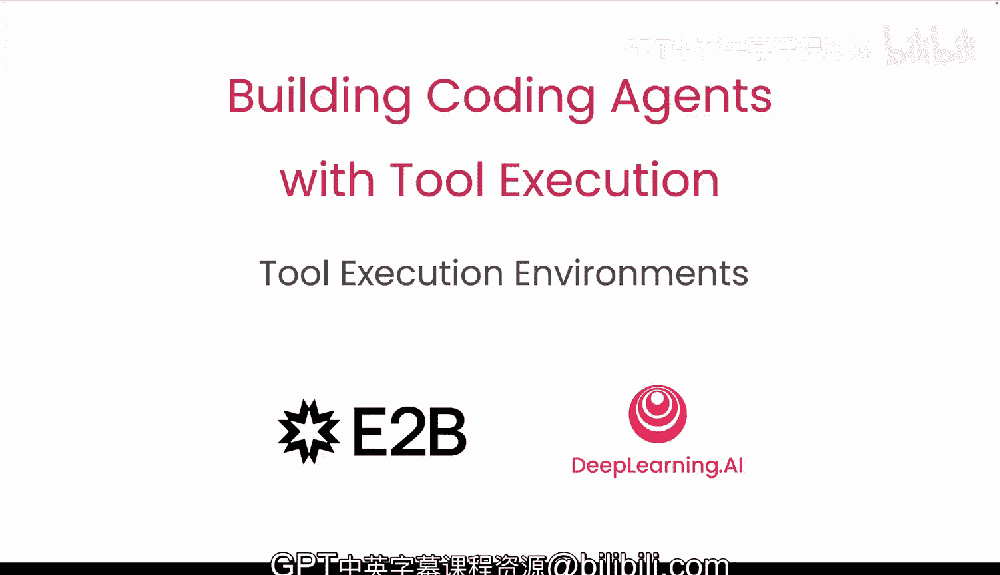
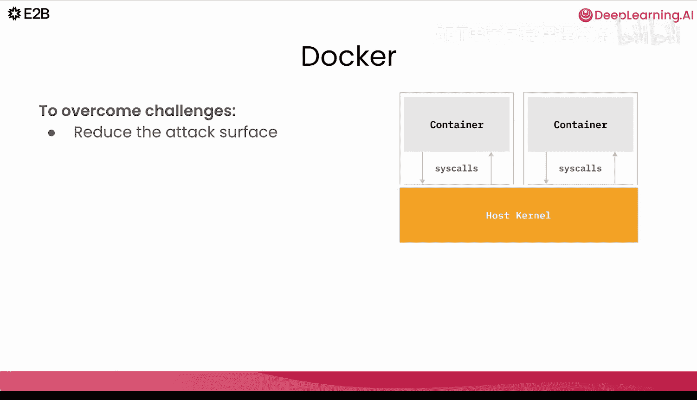
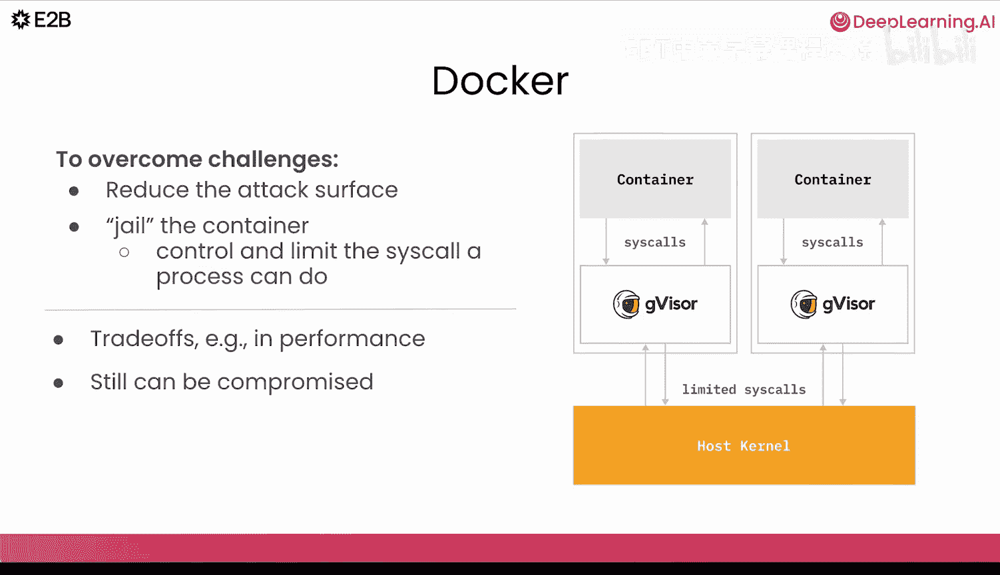
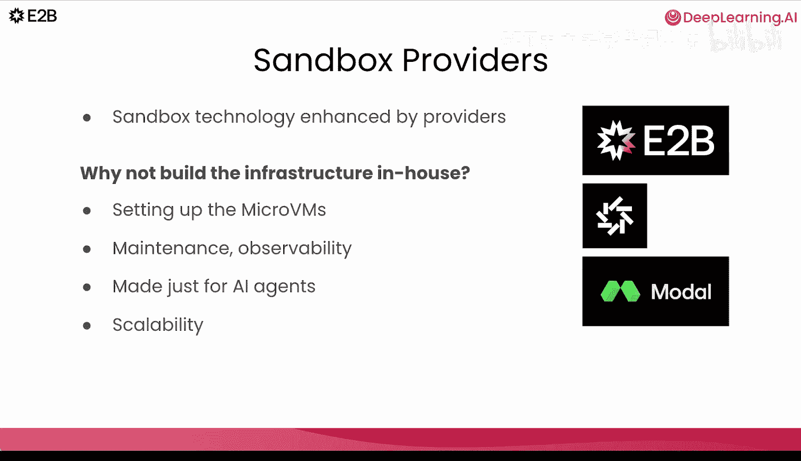
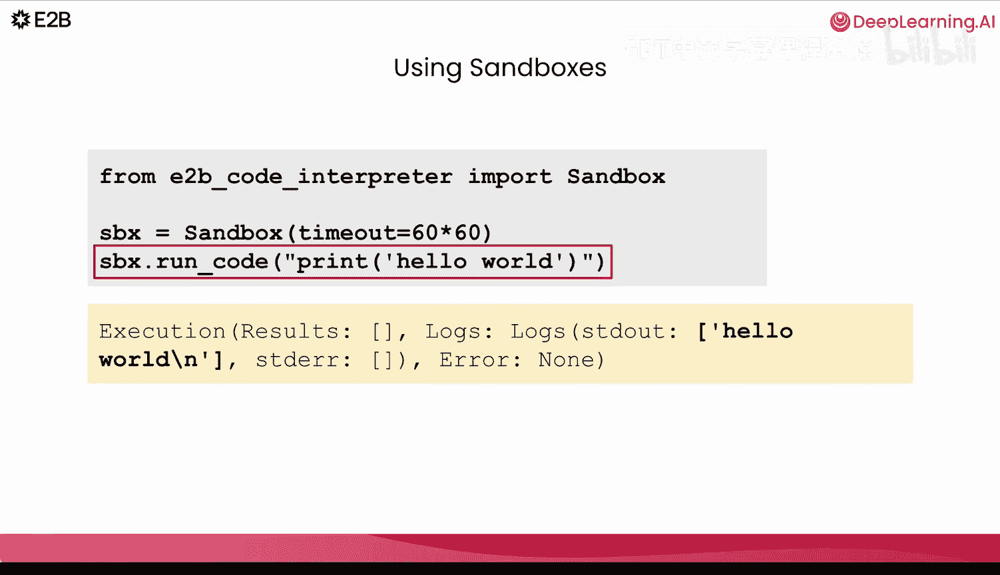

# 吴恩达《构建具备工具执行能力的代码智能体｜Building Coding Agents with Tool Execution》中英字幕 - P4：4.tool-execution-environments.zh_en - GPT中英字幕课程资源 - BV1582yBeExt

In this lesson， you will learn about different environments for running code。

 Local execution containers and sendboxes like microbes。

 And you will learn how to choose the right one for your use case。 All right， let's go。

 Executing LM generated code can be done in different environments。

 You can run the code locally or use docker containers。 Another option is to use sendbox environment。

 You might ask， what are the criteria for choosing one approach over another。😊。

It comes down to a lot of factors you need to consider for your agents。

 One of the challenges is security。 Why， Because if we just run Lm generated actions directly。

 what can go wrong an edit or might read sensitive data from the system or even inject Maurishious code。

 The LM can accidentally expose your API keys or a Maurishious code could crash the entire app。

 And there are also although scaling issues and countless other vulnerabilities。

 If you are using cloud code or cursor， you're familiar with the approach of running Lm generated code locally。

 When using coding assistance， you expect the agent to run code and edit files on your machine。

 but local execution has important limitations， and it doesn't provide strong security。

 The problem is that there is not a full isolation。 If the model generates unwanted code。

 It can then run and read or modify anything on your machine。 and even be on security， it has limits。

 Your laptops resources run out quickly， environments might get messy if conflicting packages。

And you can't easily let other users Use your agent at scale。

 Local execution can quickly run into limits if you want to build something in production。

 Lavable York or many other popular agent takes up to from deep research to coding agents。

 All utilize synboxing solutions to scale to thousands of users。

 One option for agent environments is Docker or containers in general。

 Docker provides operating system level isolation by running code in separate processes using namespaces。

 that makes it more isolated than local code execution。 However。

 all containers still share the same host kernelnel。 This means if even one of them is compromised。

 there's a potential path for an attacker to escalate and reach the host。

 This risk becomes more relevant when running multiple instances of untrusted code and multiple containers simultaneously By default container cisco go straight to the host kernelnel。

 which means bigger attack surface。 One option to make Docker safer is to therefore reduce the attack surface。

 For that， we can use for example divvisor and。

user space kernel from Google Gvisor jails the container。

 meaning we add restrictions on what it can access。

 It implements much of the Linux Cisco interface itself， practically intercepting Ciscos。

 It is a middleman。 The container talks to gvisor first， not directly to the host kernel。

 There are tradeoffs of gvisor。 Some performance overhead。

 O compatibility gaps and different debugging or tracing tools。

 and even Gvisor is still not hundred% safe。 It can still be compromised because Gvisor still depends on the host kernel。

 Its complex implementation， vulnerabilities in inlay still can be exploited。

 So we have a clear goal here。 El generated code should never be able to compromise the host system。

 The good solution is sendboxes。 Sbox is a restricted isolated environment for running and code。

 Sendboxes minimize an impact on the host machine。

Compared to containers， sendboxes provide real process isolation。

 making them a common foundation for anic untrused or LM generated workloads safely。

 Is of sendboxes include OS level isolation， web assembly or lightweight microbems such as firecracker。

 Gumo or Cloud hypervisor。One type of implementation of Svo solution that is very suitable for coding agents are microbes。

These are kernel based lightweight virtual machines stripped of unnecessary hardware emulation designed to start quickly and run efficiently。

Each microVm runs its own guest kernel， which provides stronger isolation while maintaining near native performance。

 AWs Farcracker is a widely used example of microbem implementation。

 It powers services like AWs Lada or Fargate。 So if microbems provides stronger isolation。

 Why don't we just use them everywhere。 The answer is that there are important traders。 First。

 microbems are harder to set up。 Unlike Docker， you can't just run a single command。

 They require more engineering knowledge and manual configuration。

 The community and ecosystem are also smaller。 You don't get the same tooling support or a public image registry like Docker Hub scalability is another challenge。

 You need to manage the infrastructure yourself， including updates。

 orchestration and addressing security vulnerabilities in your stack Mivems can be a great solution but running them directly create some operational overhead that makes adoption harder for most teams。

 So yes， there are benefits of sendbooks as a technology but with the emerge。Of AI agents。

 we can also use benefits of Svos providers companies like E2B Daytona or model provide Svox environments with benefits on top of the Svox technology instead of setting up microbems yourself or maintaining your own observability and infrastructure providersvi give you productionary sendvoes built specifically for AI agents。

 they can offer things like prebu synboxs in place for different use cases。

 longrun sessions or secrets and API management and when you need to serve thousands or even millions of users。

 Svox providers can offer the scalability that you need。

 they already manage the underlying orchestration so you can focus on the agents。

 not on the infrastructure， using Svoes to run your code will be as easy as creating the synvos instance and passing your code to it to run。

In the next lesson with France Francisco， you will use Ey sendboxes in action to rendercode your agent generates。

