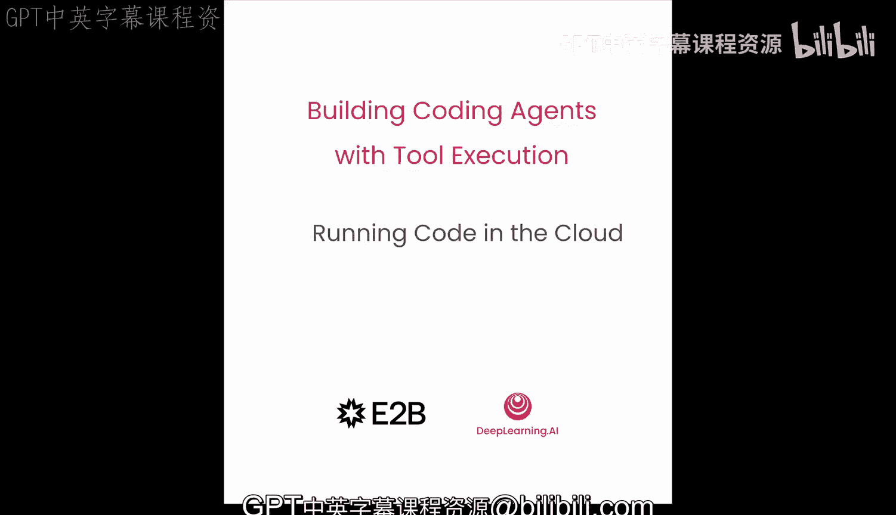
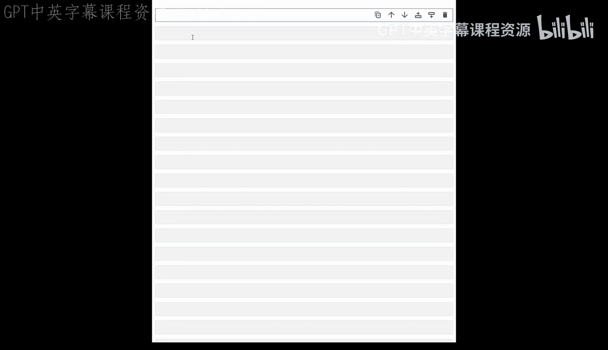
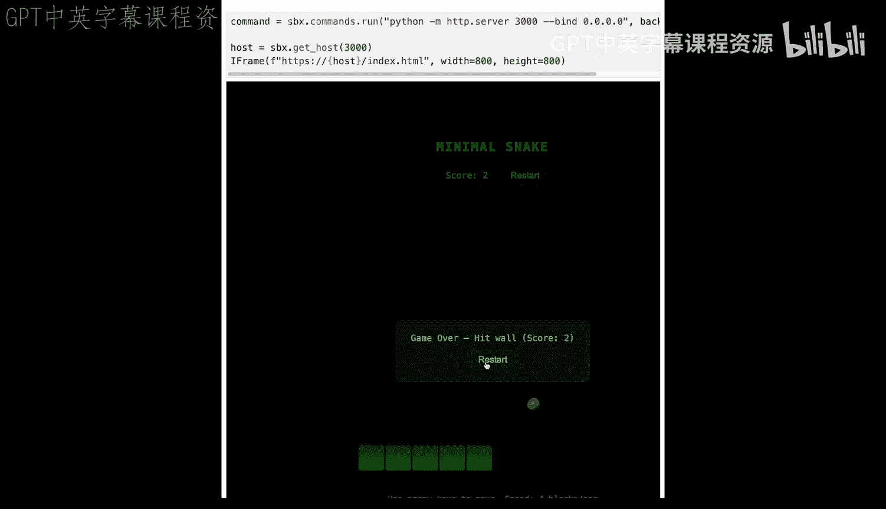
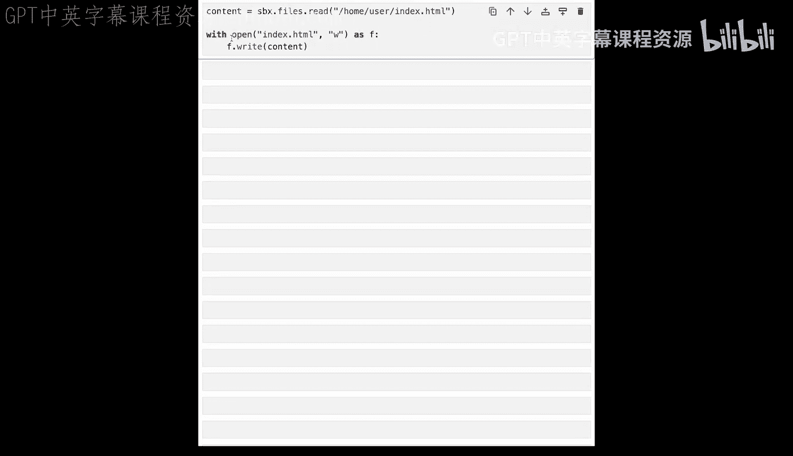
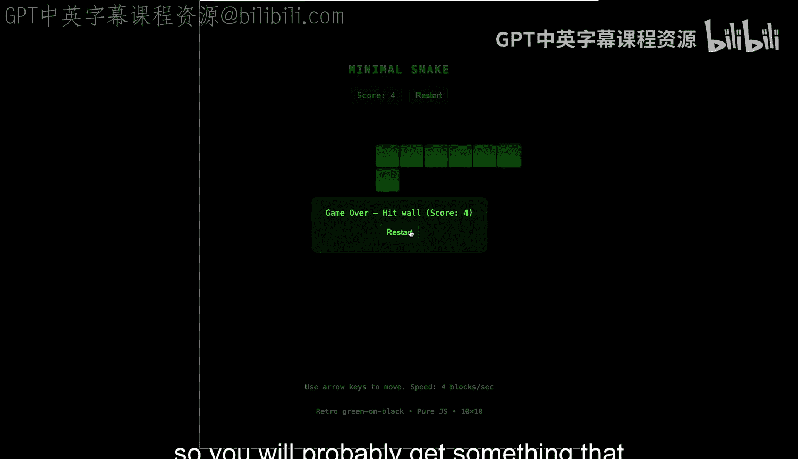
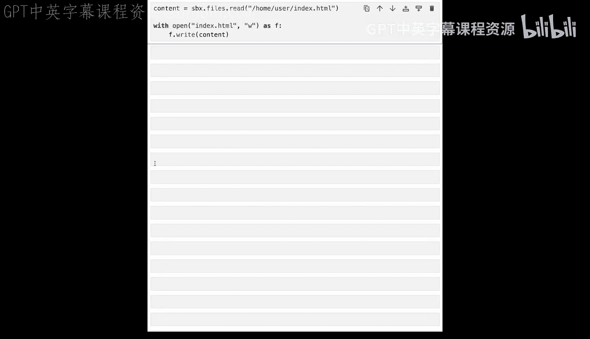

# 吴恩达《构建具备工具执行能力的代码智能体｜Building Coding Agents with Tool Execution》中英字幕 - P5：5.running-code-in-the-cloud.zh_en - GPT中英字幕课程资源 - BV1582yBeExt

In this lesson， you will learn how to run your agent code safely in the cloud using the HubB Sandbox environment。

You'll create， manage and interact with a remote environment that execute code securely al right。

 let's go this lab will equip our region to write code safely and scalably inside a sandbox using HMB。

😊。

HruB provides a very simple issue APIs to manage sandboxes。

 You can create a sandbox by importing the sandbox glass from the HB Python package。

 you can set timeout in second so in this case the sandbox will be alive for one hour and week run code bypa as a string to the run code method we're getting back an execute object and you can think about it as a notebook cell output In this case。

 the code is just printing hello word and you can see it inside the logs object inside the execution that we're getting from the sandbox。

If you were to return a variable， the results will be inside the results array in the execution object HB supports multiple languages in default force Python。

 but you can always change it in this case to JavaScriptscript and we can run the same all word printing that we did previously and we have it in thes as well we can also create a plot by running Py code that use Macly to create the plot and we get it back in the execution in order to see our plot we can import the Jupyter function and displayed。

In the cell， sometimes it's useful to list all the sandboxes you are using in order to do so you call the list method on the sandbox class and you get the next page。

Here we can see all the ideas of the sendboxes that are alive。

 we can also print some useful fields about the sendbox like the meta。

 it a when it was created and an empire that it was created from。

You can query sendboxes by attaching some metata upon creation in this case we are accept the name to be fine。

 and when we list them we are passing a sandbox query import from the HB Python package with the same name and also getting only the running ones。

And here we have found what one sandbox with attending。HUB sandboxes have a file system。

We can create a directory by calling the files not make their matter here we are creating a date directory under the main user folder in the sandbox。

We can write some content to a file。In this case， we are writing hello from the sandbox inside a hellello。

s file in the director we just created。We can read back the content by using the electric method。

Here we have it， and finally we can remove this file。😊，C sandboxes can dye or thma during the labs。

 we have created alQ's function called Great sandbox。

That it will create a sandbox if it doesn't exist and while you call it again。

 it will reconnect to it if has's not died。Send boxes on general compute， we can， for example。

 run a website in them。 It's straightforward。 we just need to create an index do hml file。

And spunded the server to serve that file， so first we re the sandbox。

 we write to index do HTML inside it and a very simple HTML file。

Then we can use the HP do server Python model to spin a server on port 3000。

And get the host of the sandlocks from the same part。To visualize the website。

 we can use the iframe class in the iPython with function notebook passing toast and here we can see the website we just created from within the sendbox in the cell。

We now know how to use HB sendbox， so it's time to whip our agent with the ability of running code in the cloud。

 we are modifying the execute code function that we created in the previous lab and this time we are passing to the sendbox run code De generated by the language model and we are recreating our tool registry。

So let's import the execute schema， the agent。Open eye and create the client and the sandbox in order to run our agent with the ability of creating code in the cloud we change a little bit the coding agent function private nice cell output using the log function and this is why we are importing it and using it。

In the cell。 So let's try to run it and see the agent。Connecting to a sandbox。

executing code on it and giving us that the reply here。

 our task was to make run a function to roll as a six phases dies and the agent is say I a function called roll die we can actually see the code that you created and run on the sandbox and also is simulated rolling and the results was true let's task our agent to work a little bit with the file system and remember we still don't have file system tools for this agent here but by executing Py to code it can actually create a files as well So let's task to create a files that theteem with hello word inside it read it and bring it back to assets its content。

We can see the agent running code。Creating the file and then printing back to us。

 we can actually see the code here with the open Pyon function is right in the file to the file system。

By just having the ability to execute Python code in the sandbox。

 the agent is already quite powerful。 It can create adding remove files。

 Let's test its abilities by task it to create a simple snake game as a web page so we can play here。

 we are giving the agent a more specific query in which we tell all officials we run the game to have。

 We are telling you that he has to be just。😊，GS and no other thing such as chater we want the1 1 grid and arrow keys for movement and some other the features。

So the agent has created the file， we can now reopen it using the iframe notebook class。

 we can now see it by running the Py20T server。

Okay， let me try to play so I can move my snake witharrow keys， I can eat the fruit。

 and I can grow when I do so and if I double I die and I can restart my game。

By pressing the is important super， since the agent create an HTML file， we can read it， store it。

 and then open it in our browser here I'm opening the HTML file in a browser in my computer and I can just play to the game in the same way we did on the sandbox。

Since if we are using G5 to generate this game， every game will be slightly different。

 so you will probably get some it and look similar to what I'm playing here。 Great。

 so our agent can now execute coding a sendbox secure and scalliber environment in the next lab we'll create a data analyst agent to analyze uploaded CSV file All right。

 see you there。😊。

