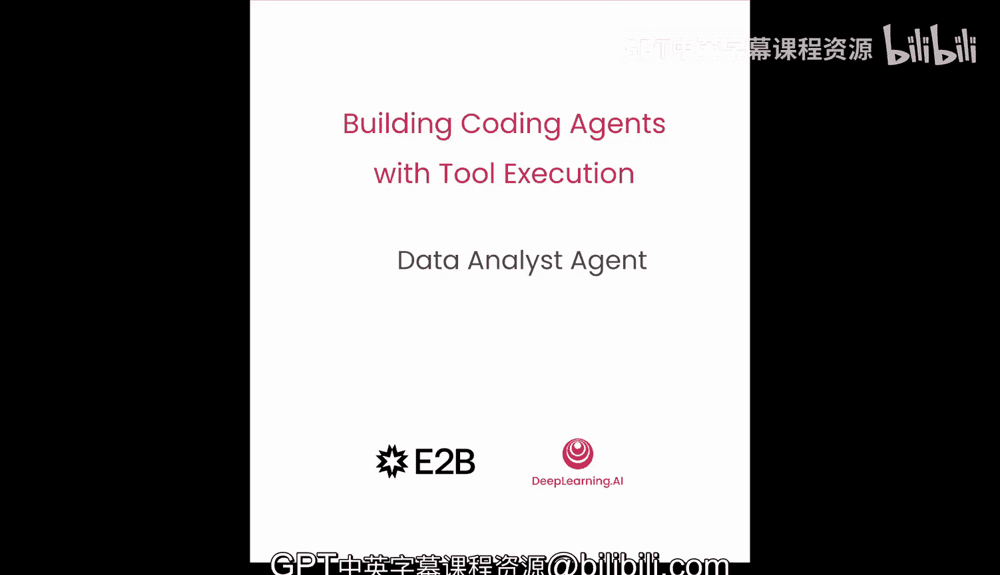
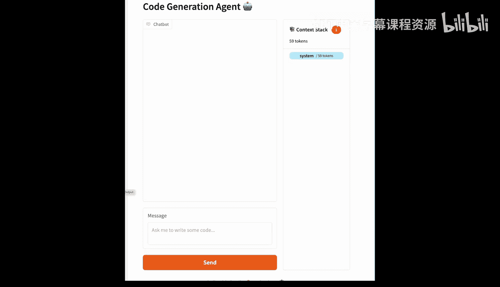

# 吴恩达《构建具备工具执行能力的代码智能体｜Building Coding Agents with Tool Execution》中英字幕 - P6：6.data-analyst-agent.zh_en - GPT中英字幕课程资源 - BV1582yBeExt

Now you will turn your agent into a data analyst that can explore data。

 answer questions and create visualization all inside a sandbox environment， Let code。

 so let's start building our agent very quickly before we get started so let's just in your song warning with disr code and set up our environment then we can load the Pomon of CSV dataset which is right here in the notebook folder and write it to the sandbox。

Now we can use our coding agent to ask some question about it。

 we are importing all the function we need and we are changing slightly the system prop in this case we are telling to the agent where the user has updated its file and also that it should help us understanding the data and creating interesting plot。

So let's start by asking， what is this data about？The agent will create some pandas code。

 run it in python and probably get in the head， for example。

 looking at all the columns and then doing a summary for us so the model let's say that this is appears to be set Pocommonons and it has a lot of fats like I can see weight high back speed and cea so let's go a little deeper and ask the agent to run an aggregation so let's see the Pocommons by type we are keeping the array of messages so we are passing the previous history to the situation as well and the agent creates some markon table and we can see we have a bag dark drag electricity fairly。

And so on and this is a summary let's find more insight about the Pokemon dataset sets。

 but before we made a nice radio user interface for you to play with and to just you know speak in a more natural way with the agent we can run it by importing from the leave dot Ui module and just run it and passing the argument we usually pass to the code function on the left we have。

The chat history with an input to write to the model on the right part， we have the content stack。

In which we can visualize our current context， the height of each message is proportional to the number of token while the color is the same color we are used so far in tele so blue for system prompts。

 green for users， violet for tools calling and results and yellow or a system message。

Let's continue our analysis and let's ask the agent which one is the heaviest Pokemon you can see on the right side。

 we got a new user message， it's calling。Asec code tool。 and it's giving us a reply。

 and it looks like the heavyaviest Pokemons are cosmos andestta， and they weigh almost one ton。

 We can also ask each to generate plots。 Here is's actually give me a hint。 Sal me。

 if I would like to see teaching information as a plot。 Okay。

 so let's go ahead and ask it to create a bar plot of the top10 a Pokemon。Okay， we can see。

Here we can see the agent run against some panndas code and generated a barload with the top 10 earliest os。

So in this folder we actually have another CSP file， it's called unknownknown dot CSP file。

And we don't know anything about it。 we can load it in the sendbox and use the interface at the agent to find out more。

You are free to explore it and use the interface to chat it and ask information about it。

In the next lesson， we are going to build a full star agent capable of generating complex well applications。

