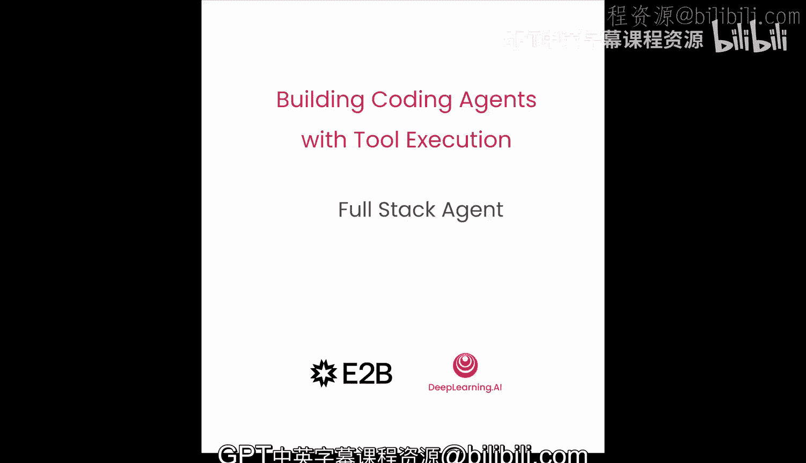
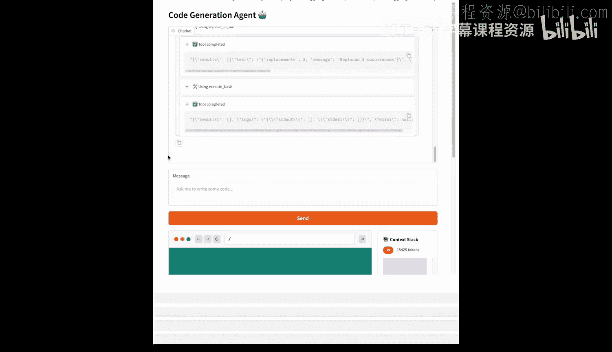

# 吴恩达《构建具备工具执行能力的代码智能体｜Building Coding Agents with Tool Execution》中英字幕 - P7：7.full-stack-agent.zh_en - GPT中英字幕课程资源 - BV1582yBeExt

As the final step， you will build a full stack coordinator that can edit multiple files and generate a complete web app。

 You will also learn how to manage long context efficiently with runtime summarization。

 let's thinknova it creating web appss is a complex task It involves a lot of file editing Gene code and many more Thus our agent to read ten of loops to complete it。

This will inevitably fill up our context very quickly。

 and we need a strategy to compress context at runtime while the user is interacted with the agent to compress context there are many strategies we use a runtime summary first we need to define a fixed amount of tokens we want in the context window at any time。

 for example 40000 tokens then we'll compress a percentage of the tokens we will follow GeeseI in this cage which compresses 70% of the messages starting from the oldest one keeping last interactions unchanged。

Then we send the tokens to be summarized to a language model and inject back the summary into the context and replace the old messages。

 If our agent's context is full， we take 70% of the messages starting from the oldest。And。

Compcomppresslished them。Then we replace the old messages with the summary and continue to compress the messages。

 we will use an alarm with a specific system prompt design for creating a snapshot of the conversation。

 then we craft a synthetic user message containing the snapshot and an assistant message to acknowledge it。

 These two messages are inserted into the context substituting the initial ones。

 So let's jump into the lab and put all of these into building a full stack agent。

 Let's start by ignoring some warnings and set up our environment similar to what we did in a previous vessel Since we want to create a full stack agent and calling web appss is a complex task we need to add more tools to the agent。

 specifically tools to work with a file system for this agent we had the following tools They are all inside the live folder and we're going to see how to use them。

 so we give the agent the ability to list the directory。Read files， write files， search file content。

 replacing file and which is a more generic search all the tools are inside our Li and inside the Xb tools file these tools will be copy on the sendbox and they will run by the directly within the sendbox environment。

 Let's try by using search file content we need to pass a pattern this case we just looking for file containing word Sx which we use in the code and which is one the first four results is going to give us paginated Jm we can say we have 65 total accuracy of XBX4 elements and we can see for example。

 right here in itself cell we have it This is just one of the tool the agent will be using in order to generate web box we will not going into the implementation detail of each one of these tools。

 but they are here in the Lib file and。Encourage you to go there and take a look We are very close。

 We just need to give a system prompt to our agent Comx task。

 they need complex a system prompt Dpro is inside our leave do prompts files and is's called system prompt web app we can print it you can see it's way more complicated here we are telling the agent how to think how the project was created the text stack it's using it our should call the tools cea et cea This system prompt is heavily inspired by Geminize system prompt okay so let's fire up our new agent we need to import all the agent function or the new toolchemas and create a sendbox now we are passing and template a D because we went to use a sendbox we developed with the next yes runtime already installed。

And we are using the grad UI to develop the web app。This time。

 you create sandbox function will also install some packages inside it。

And we copy the tools we have locally here to the sandbox so the agent can use them。

 Now our grannu interface is running。 We add a new element， the browser element here。

 we can see the website alive in the sandbox and we were able to see it live the changes at the model made to web app because of the limited width of our recording。

You cannot see the element side by side， you will if you run the notebook in a bigger screen。

 so the app that is running on the sandbox is an Xs template one。It just contains one page。

We can task the agent to change it in something a little bit more interesting。

 Let's create a dual list。But in the windows。95 style。In the main page。

The agent will list the folder files， read the current file and create Daniel code it takes a couple of minutes because it needs to generate probably a couple of thousand dokens to create this up while the agent is generated you will always see the context growing we can see the agent used read file tools。

Probably to read the current of Yes， so we we can see the agent just wrote some code to a file。

 So now it's executing some confiding to be sure did everything correct and we can see the okay it's using quite a lot of tokens。

 but it makes sense and we are our application here let's quickly test it out everything seems to work。

 I don't quite like the icons。 then the color systems that it's hard to see it right so。Let's see。

 So the agent gave us a summary of what indeed， and let's ask it。

 can you make the to do up topnob icons more visible。They are currently white ands are to see。

And probably the agent will re again the file and will change the color of the icons。

So the agent completed the task， you can see used the replacing file tools。

And now the icons are of a better color， it's easier to see。

So let's actually take a look at all the tools the model use。For this specific task。

 use the replacing file tool。That takes a file path and then basically it's going to replace a string with another one it's also using the execute bar tool as well。

 the reading file， etc cetera， etc for the sake of time we implement all tools one by one and they are available in the Li modules under the SBX tools file。

This is the tools file and you can see here were also using our Q error section we did in the first lab。

 we have a function to budget the results。And we are all the function that the model is able to run is the record function。

 the root file， the white file， and so on。Feel free to check。 tea stool。

And add new ones to make the agent more powerful so you can implement one tool here and add it to the registry。

And the agent will be able to use it。Also， I encourage you to try the agent with a prompt of your own and see what you can build。

