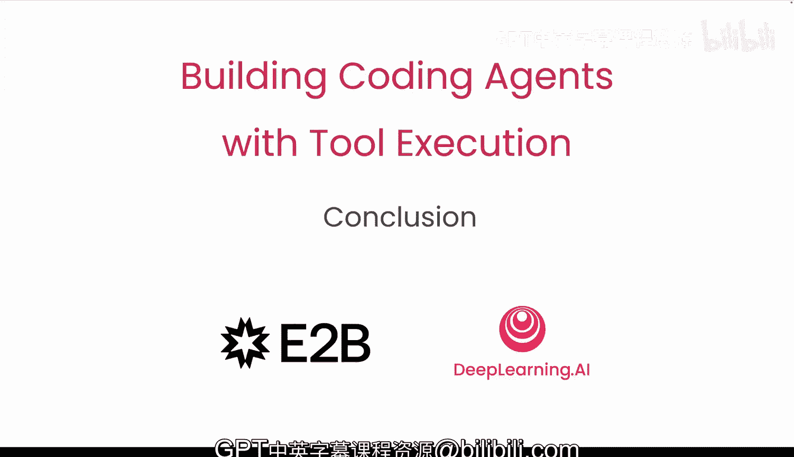

# 吴恩达《构建具备工具执行能力的代码智能体｜Building Coding Agents with Tool Execution》中英字幕 - P8：8.conclusion.zh_en - GPT中英字幕课程资源 - BV1582yBeExt

In this course， you learn how code and think， act and execute code safely inbox environments from a single sniper to a full web application。

 We can't wait to see what you build next。😊。

