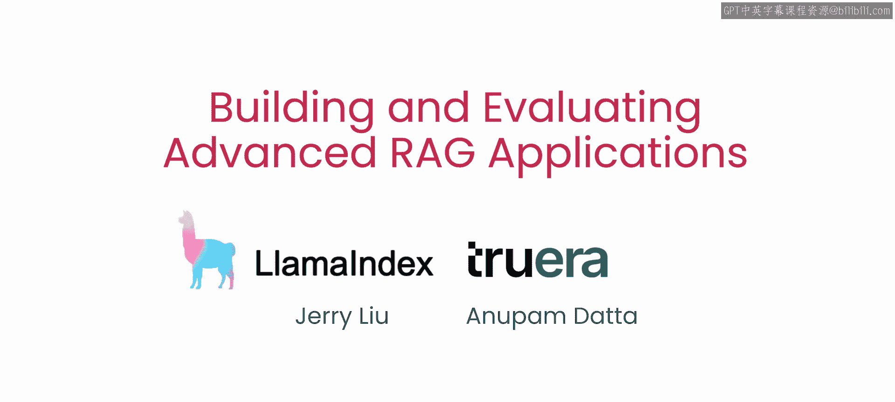

# 吴恩达《构建和评估高级的RAG模型应用》｜Building and Evaluating Advanced RAG Applications（中英字幕） - P1：Lesson 0 intro.zh - GPT中英字幕课程资源 - BV1494y1E7H9

Retrieval augmentmented generation or RAG has become a key method for getting OMs answered questions over a user's own data。

But to actually build and productionize a high quality rag system。

 it helps a lot to have effective retrieval techniques to give the LM highly relevant context the generator's answer and also to have an effective evaluation framework to help you efficiently iterate and improve your rag system。

 both three initial development and during post deployment maintenance。

 This course covers to advanced retrieval methods sentence window retrieval and autoem retrieval that deliver a significantly better context of the LM than simple methods。

 It also covers how to evaluate your LM question answering system with three evaluation metrics。

 contact relevance， droughtiness and answer relevance。😊，I'm excited to introduce Jerry Li。

 cofounder and CEO of La Redex， and And Palm datata， cofounder and chief Sc of Truera。

For a long time， I've enjoyed following Jerry and Lama Ind on social media and getting tips on evolving rap practices。

 so looking forward to him， teaching this body of knowledge will systematically here at a new pumpump has been a professor at CMU and has done research for over a decade on trustworthy AI and how to monitor。

 evaluate and optimize AI app effectiveness。😊，Thanks， Andrew， it's great to be here。

Great to be with you Andrew。Sentence window retrieval gives an LLN better context by retrieving not just the most relevant sentence。

 but the window of sentences that occur before and after it in the document。

Autoerging retrieval organizes the document into a trilike structure where each parent node's text is divided among its child notes when child notess are identified as relevant to a user's question。

 then the entire text of the parent node is provided as context for the LN。

I know this sounds like a lot of steps， but don't worry， we'll go over it in detail on code later。

 but the main takeaway is that this provides a way to dynamically retrieve more coherent chunks of text than simpler methods to evaluate ragg based LLM apps。

 the Rag triad， a triad of metrics for the three main steps of a rags execution is quite effective。

For example， we'll cover in detail how to compute context relevance。

 which measures how relevant the retrieved chanceants of text are to the user's question。

This helps you identify and debug possible issues with how your system is retrieving context for the LLM in the QA system。

But that's only part of the overall QA system will also cover additional evaluation metrics such as groundedness and answer relevance that let you systematically analyze what parts of your system are or are not yet working well。

So that you can go in in a targeted way to improve whatever part needs the most work。

If you are familiar with the concept of error analysis and machine learning， this has similarities。

 and Ive found that taking this sort of systematic approach helps you be much more efficient in building a reliable QA system。

The goal of this course is to help you build production ready Writebase OEMM apps。

And important parts of getting production ready is to iterate in a systematic way on the system。

In the later half of this course， you gain hands on practice。

 iterating using these retrieval methods and evaluation methods。

 And you also see how to use systematic experiment tracking to establish a baseline。

 and they quickly improve on that。 will also share some suggestions for tuning these two retrieval methods based on our experience assisting partners who are building rag ups。

 Many people have worked to create this course。 I'd like to thank on the La In side。 Logan Maowch。

 and on the Tura side， Shiek Senen， Joshua Rayy and Barbara Lewis from Di AI Ed Shu and Dila Ezein also contributed to this course。

 The next lesson will give you an overview of what you'll see in the rest of the course。

 You'll try out question answering systems that use sentence window retrieval or automer retrieval and compare their performance on the ragg triad。

 Contact relevance， groundedness and answer relevance。 Sounds great。 Let's get started and。😊。

I think people able to really clean up with this rag stuff。😀Laughed on it。

