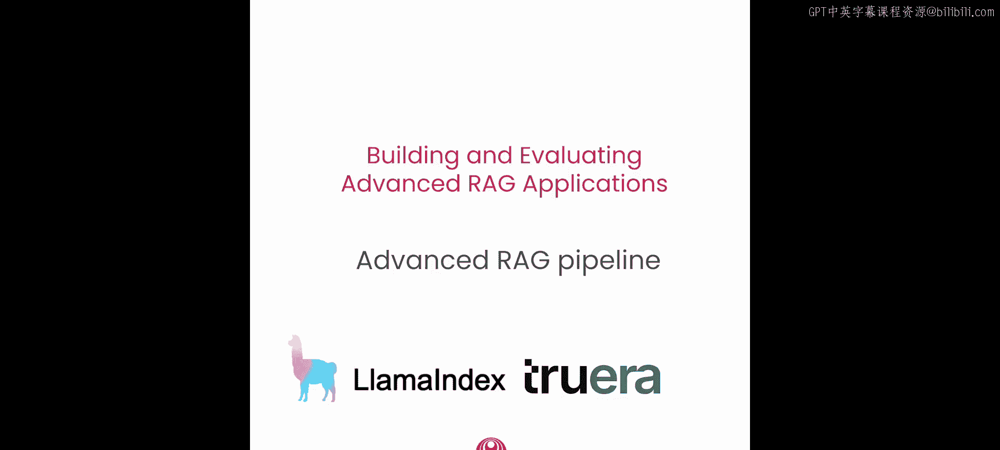
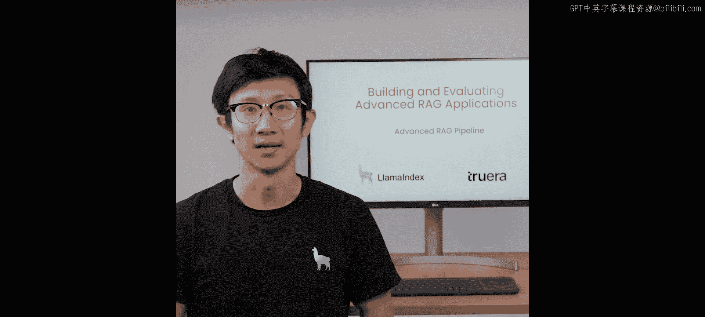
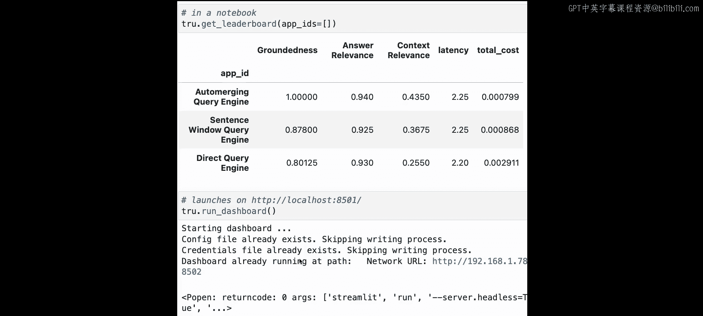

# 吴恩达《构建和评估高级的RAG模型应用》｜Building and Evaluating Advanced RAG Applications（中英字幕） - P2：Lesson 1 Advanced RAG Pipeline.zh - GPT中英字幕课程资源 - BV1494y1E7H9

In this lesson， you'll get a full overview of how to set up both a basic and advanced RaG pipeline with Lama index。

 we'll load in an evaluation benchmark and use true lens to define a set of metrics so that we can benchmark advanced RaG techniques against the base or basic pipeline。

In the next few lessons we'll explore each lesson a little bit more in depth。

Let's first walk through how a basic retrieval augmented generation pipeline works or a rag pipeline。

 it consists of three different components， ingestion， retrieval and synthesis。

Going through the injectiontion phase， we first load in a set of documents。For each document。

 we split it into a set of tax trunks using a tax splittter。Then for each chunk。

 we generate an embedding for that chunk using an embedding model。

And then for each chunk with embedding， we offload it to an index。

 which is a view of a storage system such as a Mac database。Once the data is stored within an index。

 we then perform retrieval against that index。First， we launch a user query against the index。

 and that we fetch the top K of similar chunks to the user query。Afterwards。

 we take these relevant chunks， combine it with the user query。

 and put it into the prompt window of the LLM in the synthesis phase。

 and this allows us to generate a final response。This new book will walk you through how to set up a basic and advanced F pipelinePot with Lama index。

We will also use Tra to help set up an evaluation benchmark so that we can measure improvements against the baseline。

For this quick SAt， you will need an open API key。Note that for this lesson we'll use a set of helper functions to get used up and running quickly and we'll do a deep dive into some of these sections in the future lessons。

Next， we'll create a simple LLM application using Lama Index， which internally uses an open AI LLM。

In terms of the data source， we'll use the how to build a career in AI A PDF written by Android White。

Note that you can also upload your own PDF file if you wish， and for this lesson。

 we encourage you to do so。Let's do some basic sanity trucking of what the document consists of as well as the length of the document。

We see that we have a list of documents， there's 41 elements in there。

 each item in that list is a document object， and we'll also show a snippet of the text for a given document。

Next， we'll merge these into a single document because it helps with overall text planninging accuracy when using more advanced retrieval methods such as the sentence window retrieval as well as automer retrieval the next step here is to index these documents and we can do this with the vector store index within Lama index。

Next， we define a service context object which contains both the LLM we're going to use as well as the embedding model we're going to use The LLM we're going to use is GBT 3。

5 Trbo from Open AI， and then the embedding model that we're going to use is the huggingface BG small model。

These few steps show this in process right here， we've loaded in documents。

 and then in one line vector sort inn off from documents， we're doing the chunking。

 embedding and indexing under the hood with the embedding mode that you specified。Next。

 we obtain a query engine from this index that allows us to send user queries that do retrieval and synthesis against this data。

Let's try out our first request。And the query is， what are steps to take when finding projects to build your experience？

That's fine。Star small and gradually increase the scope and complexity of your projects。Great。

 so it's working。So now you've set up the basic rag pipeline。

 the next step is to set up some evaluations against this pipeline to understand how well it performs。

 and this will also provide the basis for defining our advanced retrieval methods a sentence window retriever as well as a auto me retriever。

In this section， we use true lines to initialize feedback functions。We initialize a helper function。

 gap feedbacks to return a list of feedback functions to evaluate our app。

Here we have created a RAg evaluation triad which consists of para comparisons between the query。

 response and context。And so this really creates three different evaluation models， answer relevance。

 context relevance， and groundedness。Answer relevance is the response relevant to the query？

Context relevance is the retrieve context relevant to the query？

And ground in this is the response supported by the context。

But walk through how to set us up yourself in the next few notebooks。

The first thing we need to do is to create a set of questions on which to test our application。

Here we've pre written the first 10， and we encourage you to add us。

And now we have some evaluation questions。 What are the keys to building a career in AI。

 How can teamwork contribute to success in AI， etc。

The first thing we need to do is to create a set of questions on which to test our application。

Here we've prewritten the first 10， but we encourage you to also add to this list。

Here we specify a fun new question what is the right AI job for me and we add it to the Eval questions list now we can initialize the true lens modules to begin our evaluation process。

We've initialized a Tru lens module and now we've resap in database。

We can now initialize our evaluation models。ANs are growing as a standard mechanism for evaluating generative AI applications at scale。

 rather than relying on expensive human evaluation or set benchmarks。

 Alls allow us to evaluate our applications in a way that is custommed to the domain in which we operate and dynamic to the changing demands for our application。

Here we've pre builtt a Sch lenss recorder to use for this example in the recorder。

 we've included the standard triad of evaluations for evaluating rags。Growedness， context relevance。

 and answer relevance。We'll also specify an ID so that we can track this version of our app。

As we experiment， we can track new versions by simply changing the app I。

 Now we can run the query engine again with the true lines context。

So what's happening here is that we're sending each query to our query engine。

 and in the background the true lines recorder is evaluating each far queries against these three metrics。

If you see some morning messages， don't worry about it， some of it is system about it。

Here we can see a list of queries as well as their associated responses。You can see the input。

 output， the record ID， tags， and more。You can also see the answer relevance。

 context relevance and groundedness for each row in this dashboard。

 you can see your evaluation metrics like context relevance answer relevance and groundedness。

 as well as average laency total cost and more in a UI。

Here we see that the answer relevance and groundedness。A decently high。

 but cloud tax relevance is pretty low。 Now， let's see if we can improve these metrics with more advanced retrieval techniques like sentence window retrieval。

 as well as on emerging retrieval。The first advanced technique we'll talk about is sentence window retrieval。

This works by embedding and retrieving single sentences， so more granular the chunks。

But after retrieval， the sentences are replaced with a larger window of sentences around the original retrieve sentence。

The intuition is that this allows for the AllL lab to have more context for the information retrieved in order to better answer queries while still retrieving a more granular pieces of information。

 so ideally improving both retrieval as well as synthesis performance。

Now let's take a look at how it says out it up。First， we'll use OpenIGT 3。5 Trbo。Next。

 we'll construct our sentence Win index over the div document。

Just a reminder that we have a helper function for constructing the sentence windowow index。

 and we'll do a deep dive in how this works under the hood in the next wheel。Similar to before。

 we'll get a query engine from the sentence window index。And now that we've set this up。

 we can try running an example query。Here the question is。

 how do I get started on a personal project in AI？And we get back response。

get started on a personal project in AI， it is first important to identify scope the project。Great。

Similarly to before， let's try getting the true lens evaluation context and try benchmarking the results。

So here。We import the true recorder sentence window。

 which is a pre builtt true lines recorder for the sentence window index。

And now we'll run the sentence by no retriever on top of these evaluation questions and then compare performance on the RaG Triad of evaluation modules。

Here we can see the responses come in as they're being run。Some examples of questions or responses。

 how can teamwork contribute to success in AI？Teamwork can contribute to success in AI by allowing individuals to leverage the expertise and insights of their colleagues。

What's the importance of networking in AI？Networking is important at am because it allows individuals to connect with others who have experience and knowledge in the field。

Great。Now that we've run evaluations for two techniques。

 the basic RaG pipeline as well as the sentence window retrieval pipeline。

 but let's get a leader reward of the results and see what's going on。

Here we see that generally groundedness is。8ight percentage points better than the baseline drag by point。

Answer relevance is more or less the same。Cont relevance is also better for the sentence window queryie entered。

Latency is more or less the same， and the total cost is lower。

Since the groundedness and context relevance are higher， but the total cost is lower。

 we can intuit that the sentence window retriever is actually giving us more relevant contexts and more efficiently as well。

When we go back into the UI， we can see that we now have a comparison between the direct query engine and the baseline。

 as well as the sentence window， and we can see。The metrics that we just saw in the notebook displayed don' U why as well。

The next advanced retrieval technique we'll talk about is the auto me Retrier。

Here we construct a hierarchy of larger parent nodes with smaller child notes that reference the parent node。

So for instance， we might have a parent node of chunk size 512 tokens。And underneath。

 there are four child nodes of chunk size 128 tokens that link to this parent node。

The A meging retrievetr works by mergging retrieve nodes into larger parent nodes。

 which means that during retrieval， if a parent actually has the majority of its children nodes retrieved。

 then will' replace the children nodes with the parent node。

So this allows us to hierically merge our retrieve notes。

 the combination of all the child notes is the same text as the parentn。

Similarly to the sentence window retriever and the next few lessons。

 we'll do a bit more of a deep dive on how it works。

Here it will show you how to set it up with our helper functions。

Here we've built the auto meing index， again using GT of 3。5 Trbo for the LLM。

 as well as the BGE model for the emdding model。We got the query engine from the autoerging retriever。

And let's try running an example query。How do I build a portfolio of AI projects in the logs here you actually see the merging process at one or merging nodes into a parent node to basically retrieve the parent node as opposed to the child node。

To build a portfolio of AI projects， it is important to start with simple undertakings and gradually progress some more complex ones。

Great， so we see that it's working。Now let's benchmark results with true ones。

We got a prebuilt Tru lines recorder。On top of our autoberg retriever。

We then run the autoverging retriever with Tru lens on top of our evaluation questions。

Here for each question， you actually see the merging process going on。

Such as merging three nodes into the parent node。For the first question。

As we scroll down just a little bit， we see that for some of these other questions。

 we're also performing the merging process， merging three nodes into a parent node。

 merging one node into a parent node， an example question response pair is what is the importance of networking in AI。

Networking is important in AI because as it helps in building a strong professional networking community。

Now that we've run all three retrieval techniques， the basic Ra pipeline。

 as well as the two advanced retrieval methods， we can view a comprehensive leaderboard to see how all three techniques stack up。

We got pretty nice results for the Auto Virgin query engine。On top of the evaluation questions。

 we get 100% in terms of groundedness。94% in terms of answer relevance。

43% in terms of context relevance， which is higher than both the sentence window and the baseline rack pipeline。

And we get roughly equivalent total costs to the sentencement prior engine。

 implying that the retrieval here is more efficient with equivalent latency。And at the end。

 you can view this in the dashboard as well。This lesson gives you a comprehensive overview of how to set up a basic and advanced drag pipeline and also how to set up evaluation modules to measure performance。

In the next lesson， AudP will do a deep dive into these evaluation modules。

 specifically the RaG triad of Grness， answer relevance and context relevance。

 and you'll learn a bit more about how to use these modules and what each module needs。

