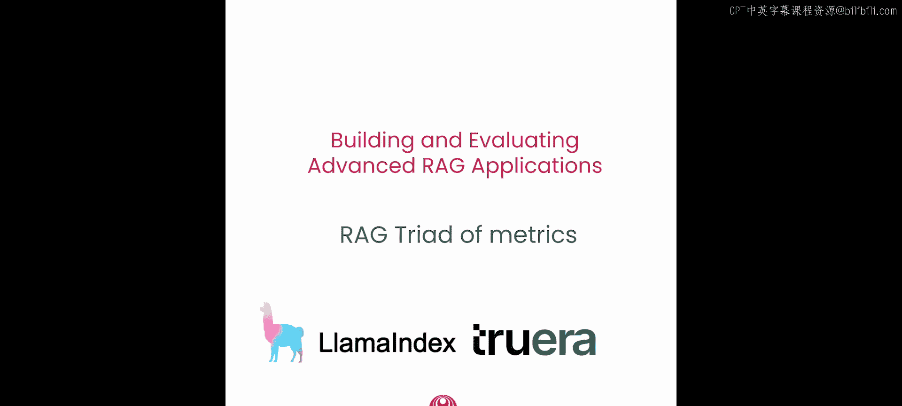
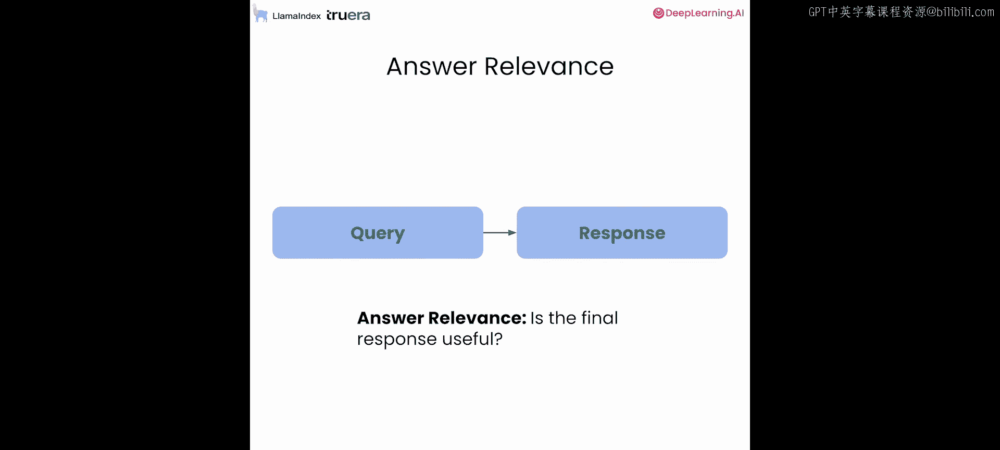
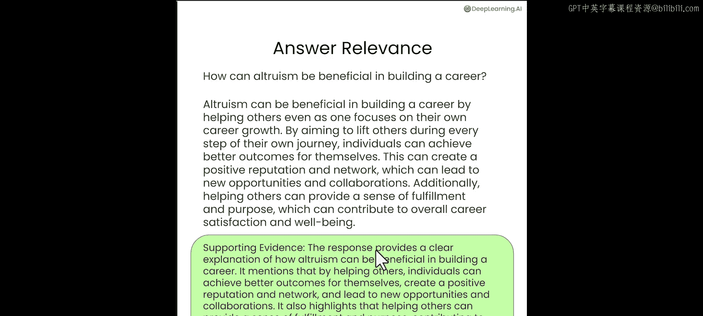
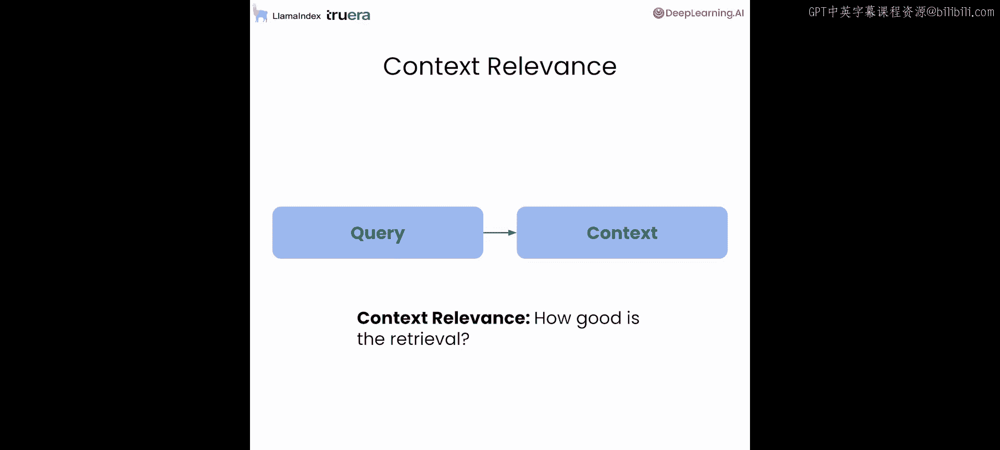
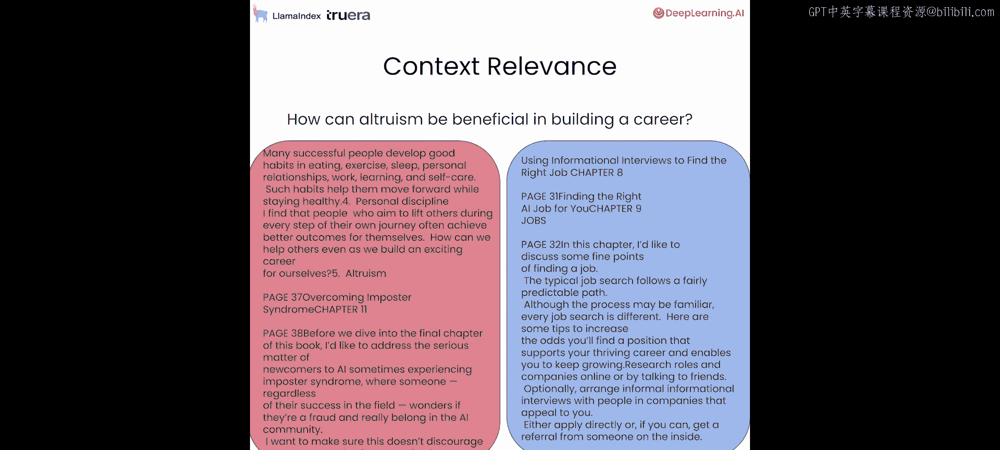
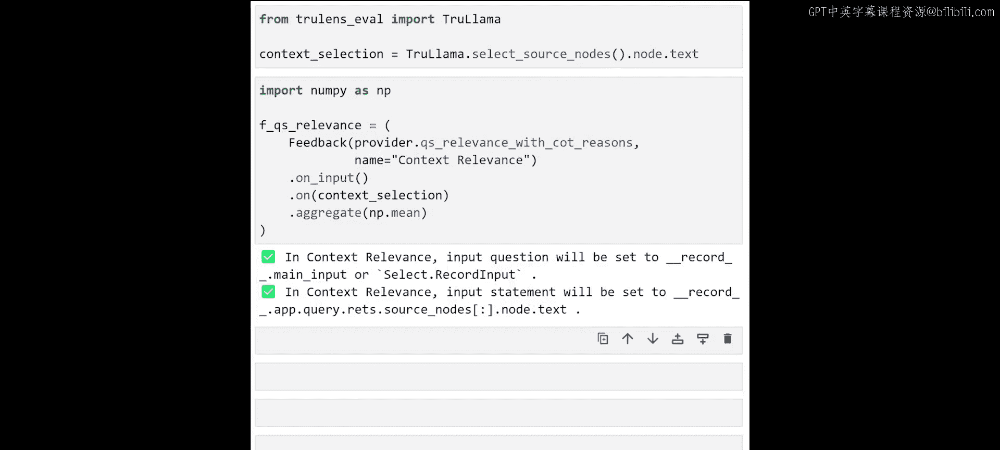
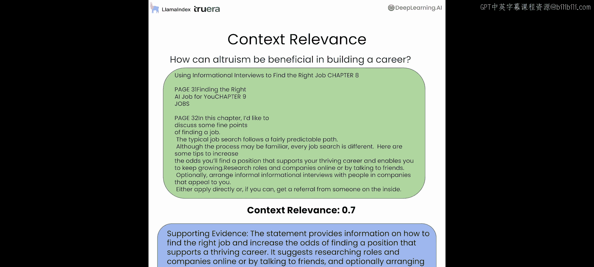
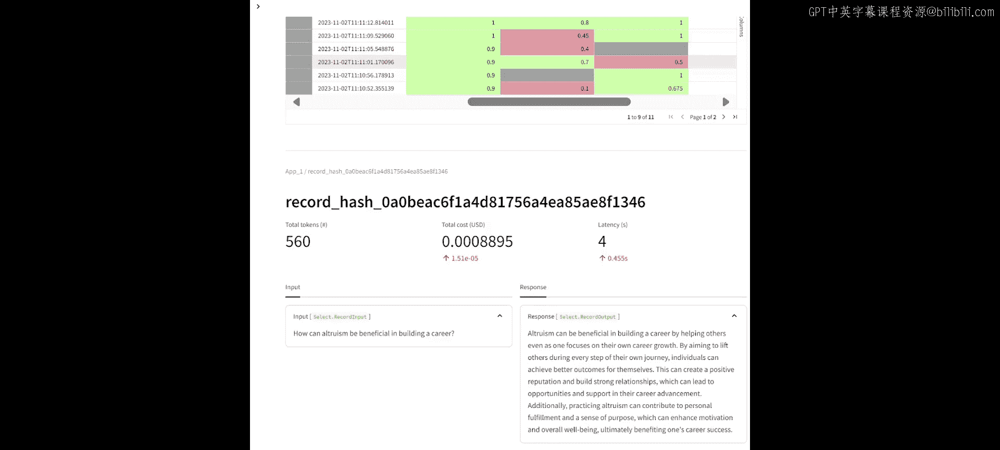

# 吴恩达《构建和评估高级的RAG模型应用》｜Building and Evaluating Advanced RAG Applications（中英字幕） - P3：Lesson 2 RAG Triad of metrics.zh - GPT中英字幕课程资源 - BV1494y1E7H9

In this method， we do a deep dive into evaluation。We'll walk you through some core concepts on how to evaluate rag systems。

Specifically， we will introduce the Rag triad， a triad of metrics for the three main steps of a rag's execution。

Context relevance， groundedness and answer relevance。

 These are examples of an extensible framework of feedback back functions。

 programmatic evaluations of LLM apps。 We then show you how to synthetically generate an evaluation data set。

 Given any unstructured corpus。 Let's get started。

Now， I'll use a notebook to walk you through the rag triad， answer relevance。

 context relevance and groundedness to understand how each can be used with true length to detect hallucinations。

 At this point， you have alreadyep installed trueleniveval and Lama indexed。

So I'll not show you that step。 The first step for you will be to set up。An open AI API key。

The Open AI key is used for the completion step of the RA and to implement the evaluations with Dr lens。

So here's a gold snippet that does exactly that。And we are now all set up with the Open AI key。

The next section， I will quickly recap the query engine construction。With Lama Index。

 Jerry has already walked you through that in lesson1 in some detail we will largely build on that lesson。

The first step now is to set up a true object。From true lands。Yval。

We are going to import the true class。Then we'll set up a true object and instance of this class。

And then， this object。Will be used to reset。The database。

This database will be used later on to record the prompts， responses。

 intermediate results of the Lama index app， as well as the results of the various evaluations we will be setting up with Dr length。

Now let's set up the Lama index reader。So this snippet of God。

Reads this PDF document from a directory。On how to build a career in AI written by Andrew Eng and then loads this data into this document object。

 The next step is to merge。All of this content into a single large document。

 rather than having one document bar page， which is the default setup。Next。

 we set up the sentence index， leveraging some of the Lama index utilities。

So you can see here that we are using Open AI GP 3。5 Trbo。Set at a temperature of 0。1。

As the LLM that will be used for completion。Of the rag。The embedding model is set to。B G smalled。

N version 1。5。And all of this content is being indexed with the sentence index object。

Next we set up the sentence window engine and this is the query engine that will be used later on to do retrieval effectively from this advanced ragG application。

Now that we have set up the query engine for sentence window based drag。

Let's see it in action by actually asking a specific question。How do you create your AI portfolio。

 This will return a full object with。The final response from the Llum。

The intermediate pieces of retrieved context， as well as some additional metadata。

Let's take a look at。What the final response。Looks like。

So here you can see the final response that came out of this sentence window based drag。

It provides a pretty good answer。On the surface。To this question of how do you create your AI portfolio later on。

 we will see。How to evaluate answers of this form？Against the ragg triad。To build confidence。

And identify failure modes for rags of this form。Now that we have an example of a response to this question。

That looks。Quite good on the surface。We will see how to make use of feedback functions。

Such as the ragg Triad。To evaluate this kind of response more deeply， identify failure modes。

 as well as build confidence or iterate to improve the LLM application。Now that we have set up the。

Sentence window based drag application。Let's see how we can evaluate it with the rag triad。

We'll do a little bit of housekeeping in the beginning first step is this hisofcode snippet that lets us launch a streamlit dashboard from inside the notebook you'll see later that will make use of that dashboard to see the results of the evaluation and to run experiments。

 to look at different choices of apps and to see which one is doing better。Next up。

 we initialize Open AI and GP 3。5。Durbo。As the default provider for our evaluations。

And this provider will be used too。Implement the different feedback functions or evaluations such as context relevance。

 answer relevance， and groundedness。Now。Let's go deeper into each of the evaluations of the Rag triad and we'll go back and forth a bit between slides and the notebook to give you the full context。

First up， we'll discuss answer relevance。Recall that answer relevance is checking whether the final response。

Is relevant to the query that was asked by the user。

To give you a concrete example of what the output of answer relevance might look like。

Here's an example。The user asked the question， how can altruism be beneficial in building a career？

This was the response that came out of the RAG application。

And the answer relevance evaluation produces two pieces of output。

 one is a score on a scale of 0 to 1， the answer was assessed to be highly relevant so it got a score of 0。

9 the second piece is the supporting evidence。Or the rationale or the chain of thought reasoning behind why？

The evaluation produced this score。So here you can see。

That supporting evidence found in the answer itself， which indicates。

To the LLam evaluation that it is a meaningful and relevant answer。

I also want to use this opportunity to introduce the abstraction of a feedback function。

Answer relevance is a concrete example of a feedback function。More generally。

 a feedback function provides a score。On a scale of 0 to 1， after reviewing an LLM app's inputs。

 outputs and intermediate results。Let's now look at the structure of feedback functions using the answer relevance feedback function as a concrete example。

The first component is a provider。And in this case。We can see that we are using an LLM。From Open AI。

To implement these feedback functions。Note that feedback functions don't have to be implemented necessarily using LLMs。

 we can also use。BurRT models and other kinds of mechanisms to implement feedback functions that I'll talk about in some more detail later in the lesson。

The second component is。That leveraging that provider。We will implement a feedback function。

 in this case that's the relevance feedback function。We give it a name。

 a human readable name that' will be shown later in our evaluation dashboard。

 and for this particular feedback function， we run it on the user input， the user query。

 and it also takes as input。The final output or response from the app。

 So given the user question and the final answer from the rag。

 this feedback function will make use of an LLM provider。Such as Open AI and GP 3。

5 do come up with a score for how relevant the responses to the question that was asked。

And in addition， itll also provide supporting evidence or chain of thought reasoning。

For the justification of that school。Let's now switch back to the notebook and look at the code。

In some more detail。Now let's see how to define。The question answer relevance feedback function in code。

From Tru Ly valve， we will import the feedback class。Then。We set up the different pieces。

Of the question answer relevance function。That we were just discussing。First up。

 we have the provider that is Open AI。GPT 3。5。 and they set up this particular。Feedback function。

 where the relevant score will also be augmented with the chain of thought reasoning。

 much like I showed in the slides。We give this feedback function a human understandable name。

 we call it answer relevance， this will be show up later in the dashboard。

 making it easy for users to understand。What the feedback function is setting up。

Then we also will give the feedback function access to the input， that is the prompt and the output。

 which is the final response coming out of the ragG application。

With this setup later on in the notebook， we will see how to apply this feedback function。

On a set of records。Get the evaluation scores for answer relevant。

 as well as the chain of thought reasons for why for that particular answer。

That was the judged score to be appropriate for。As part of the evaluation。

The next feedback function that we will。Go deep into is context relevance。

Recall that context relevance is checking how good。The retrieval processes that is given a query。

We will look at each piece of retrieved context from the vector database。And assess。

How relevant that piece of context is to the question that was asked。

Let's look at a simple example。The question here or the prompt from the user is how can altruism be beneficial in building a career？

These are the two pieces of retrieve context。And after the evaluation with context relevance。

Each of these pieces of retrieve context gets a score between zero and 1。

You can see here the left context got a relevant score of 0。5。

 the right context got a relevant score of 0。7， so it was assessed to be more relevant to this particular query。

And then the mean。Context relevant score is the average of the relevant scores of each of these retrieved pieces of context。

That gets also reported out。Let's now look at the structure of the feedback function for context relevance。

Various pieces of this structure are similar to the structure for answer elements。

 which we reviewed a few minutes ago。There is a provider that's open AI。And the feedback function is。

Make use of that provider to implement the context relevance feedback function。

The differences are in。The inputs to this particular feedback function。

 in addition to the user input or prompt， we also share with this feedback function a pointer。

To the retrieve context， that is the intermediate results in the execution of the RAG application。

We get back a score for each of the retrieved pieces of context。

 assessing how relevant or good that context is。With respect to the query that was asked。 and then。

We aggregate。And average those scores across all the retrieve pieces of context to get the final score。

 Now， you will notice that in the answer relevance feedback function。

 we had only made use of the original input， the prompt and the final response from the rag。

In this feedback function， we are making use of the input or prompt from the user。

As well as intermediate results， the set of retrieve contexts to assess。

The quality of the retrieval between these two examples。

 the full power of feedback functions is leveraged by making use of inputs。

 outputs and intermediate results of a rag application to assess its quality。Now that we have the。

Context selection set up。 We are in a position to define the。

Context relevance feedback function in code。 You'll see that it's pretty much the code segment that I walked through on the slide。

 We are still using open AI as the provider GPT 3。5 as the evaluation LLM。

 We are calling the question statement or context relevance feedback function。

 It gets the input prompt， the set of retrieved pieces of context。

 It runs the evaluation function on each of those retrieve pieces of context separately。

Gets a score for each of them and then averages them to report a final aggregate score。Now。

 one additional variant。That you can also use， if you like。

 is in addition to reporting a context relevance score for each piece of retrieve context。

You can also augment it。With chain of thought reasoning so that the evaluation LLM provides not only a score。

 but also。A justification or explanation。For its assessment score。

 and that can be done with Qs relevance with chain of thought reasoning method。And if I。

Give you a concrete example of this in action， you can see here's the question。

 or the user prompt how can altruism be beneficial in building a career？

This is an example of a retrieved piece of context。

That takes out a chunk from Andrew's article on this topic。

 you can see the context relevance feedback function gives a score of 0。

7 on a scale of 0 to 1 to this piece of retrieved context。And because we have also。

Invoked the chain of thought reasoning on the evaluation LLM。

 it provides this justification for why the score is 0。7。

Let me now show you the code snippet to set up the groundedness feedback function。

 we kick it off in much the same way as the previous feedback functions leveraging LLM provider for evaluation。

 which is if you recall Open AI GP 3。5。Then we define the grounded massfe back function。

This definition is structurally very similar to the definition for。Context relevance。

The groundedness measure comes with chain of thought reasons justifying the scores。

 much like I discussed on the slides。We gave it the name grounded us， which is easy to understand。

And。Itit gets access to。The set of retrieved contexts。In the Ra application。

 much like for context relevance， as well as the final output or response from the rag。

 and then each sentence in the final response gets a grounded a score， and those are aggregated。

 averaged to produce the final ground at test score for the full response。The context selection here。

Is the same context selection that was used for setting up the context relevance feedback function？

So if you recall， that just gets the set of retrieved pieces of context。From the retrieval step。

Of the rag。And then can access each node within that list。

Recover the text of the context from that node and proceed to work with that to do the context relevance。

 as well as the groundedness evaluation。With that， we are now。In a position。To start executing。

The evaluation。Of the Ra application， we have set up all three feedback functions。Answer relevance。

 context relevance and groundedness， and all we need。Is an evaluation set on which。

We can run the application and the evaluations。And see how they' are doing and if there are opportunities to iterate and improve them further。

Let's now look at the workflow。To evaluate and iterate， to improve。LLM applications， we will start。

With the basic Lama index rag that we introduced in the previous lesson。

And which we have already evaluated with the true lens rag Triad。

Willll focus a bit on the failure modes related to the context size。Then。

We will iterate on that basic rag。With an advanced drag technique。The Lama index sentence window rag。

Next， we will reevaluate。This new advanced rag with the true lens rag triedad。

Focusing on these kinds of questions， do we see improvements specifically in context relevance。

What about the other metrics， the reason we focus on context relevance is that often failure modes arise because the context is too small。

Once you increase the context up to a certain point， you might see improvements in context relevance。

 In addition， when context relevance goes up。Often， we find improvements in groundedness as well。

 because the L L M in the completion step has enough relevant context to produce the summary when it does not have enough relevant context。

 It tends to leverage its own internal knowledge。From the pretraining data set to try to fill those gaps。

 which results in a loss of groundedness。Finally， we will experiment with different window sizes。

To figure out what window size results in the best evaluation metrics。Recall that。

If the window size is too small。There may not be enough relevant context。

To get a good score on context relevance and groundedness。 If the window size becomes too big。

 on the other hand。Irrelevant context can creep into the final response。

 resulting in not such great scores in groundedness or answer relevance。

We walked through three examples of evaluations or feedback functions。Context relevance。

 answer relevance and groundedness。In our notebook。All three were implemented with。LLM evaluations。

I do want to point out that feedback functions can be implemented in different ways。

Often we see practitioners starting out with ground truth thes。Which can be。Expensive to collect。

But nevertheless， a good starting point。We also see people。Leverage humans to do evaluations。

That's also helpful and meaningful。But hard to scale in practice。

Ground truth eves just to give you a concrete example。

Think of a summarization use case where there is a large passage and then the LLM produces a summary。

A human expert would then give that summary a score。Indicating how good it is。

This can be used for other kinds of use cases as well such as。

Chad bought like use cases or even classification use cases。Human events are。

Similar in some ways to ground through the wells in that。

 as the LL M produces an output or a rag application produces an output。

 the human users of that application are going to provide a rating for that output。 How good it is。

 The difference with ground through the wells is that these human users may not be。

As much of an expert in the topic as the ones who produced a curated ground through devs。

It's nevertheless a very meaningful evaluation， it'll scale a bit better。

Then the ground through the wells。But our degree of confidence than it is lower。

One very interesting result from the research literature is that。If you ask a set of humans to。

Rer question， there's about 80% agreement。And interestingly enough， when you use aary evaluation。

The agreement between the Lm evaluation and the human evaluation is also about the 80 to 25% mark。

So that suggests that LLM evaluations are quite comparable to human evaluations。For the benchmark。

 there are data sets to which they have been applied。So feedback functions。

Provide us a way to scale up evaluations in a programmatic manner。In addition to their laammivals。

That you have seen。Feedback functions also can implement traditional NLP metrics such as Rouge scores and blue scores。

They can be helpful in certain scenarios， but one weakness that they have is that they are quite syntactic。

 They look for overlap between words。In two in two pieces of text， so for example。

 if you have one piece of text that's referring to a river bank and the other to a financial bank。

 syntactically they might be viewed as similar and these references might end up being viewed as similar references by a traditional NLP evaluation。

Whereas the surrounding context will get used to provide a more meaningful evaluation when you are using either large language models such as GPD4 or medium sized language models。

 such as Bt models， and to perform your evaluation。While in the course。

 we have given you three examples of feedback functions and evaluations。Answer relevance。

 context relevance and groundedness。True lens provides a much broader set of evaluations to ensure that the apps that you're building are honest。

 harmless and helpful。These are all available in the open source library， and we encourage you to。

Lay with them as you are working through the course and building your LLM applications。

Now that we have set up all the feedback functions， we can set up an object to start recording。

 which will be used to record the execution of the。Application on various records。

So you'll see here that。We are importing。The true Lama class。

Creating an object true recorder of this true Lama class。

 This is our integration of true lens with Lama index。

 It takes in the sentence window engine from Lama index that we had created earlier。Sas the app I D。

And。Makes use of the three feedback functions of the ragg triad that we created earlier。

This true recorder object will be used in a little bit，2。Randdi。Lma index application。

As well as the evaluation of these feedback functions and to record it all。In a local database。

Let us now load some evaluation questions。In the setup。The evaluation questions are。

Set up already in this text file。 And then we just execute this code Stet。To load them in。

Let's take a quick look at these questions that we will use for evaluation。

Can see what are the keys to building a career in AI。And so on。And this。

 you can edit yourself and add your own questions that you might want to get answers from Andrew。Od。

You can also append directly。To the Eval questions list。In this way。

Now let's take a look at the Val Que list， and you can see that this question has been added at the end。

Go ahead and add your own questions。And now we have everything set up to get to the most exciting step。

In this notebook， with this called sppet。We can execute the sentence window engine on each question in the list of Eval questions that we just looked at。

And then with true recorder， we are going to run each record against the ragG Triad。

 we will record the prompts， responses， intermediate results。

 and the evaluation results in the true database。And you can see here as each as the execution of the steps are happening for each record。

There is a hash that's an identifier for the record。As the record gets added。

We have an indicator here that。That step has executed effectively。In addition。

 the feedback results for answer relevance is done。And so on for context relevance and so on。

Now that we have the。Recording done。We can see the logs in the notebook by executing。

By getting the records and feedback and executing this code snippet。

And I don't want you to necessarily read through all of the information here。

The main point I want to make is that you can see the depth of instrumentation in the application。

 A lot of information gets logged through the true recorder。And this information around prompts。

 responses， evaluation results and so forth can be quite valuable to identify failure modes in the apps and to inform iteration and improvement of the apps。

 All of this information is available in a flexible Json format。

So they can be exported and consumed by downstream processes。Next up。

 let's look at some more human readable format for prompts responses。

And the feedback function evaluations。With this gold sted。You can see that。

For each input prompt or question， we see the output and their respective scores for context relevance。

 groundedness and answer relevance。 And this is run。

For each and every entry in the list of questions in evaluation， underscore questions dot text。

And you can see here， the last question is， how can I be successful in AI？

Was the question that I manually apped。To that list and the end。Sometimes in running the evaluations。

 you might see a Nn that likely happens because of API call failures， you'll just want to rerun it。

To ensure that。The execution successfully completes。I just showed you a record level view。

Of the evaluations， the prompts， responses and evaluations。

Let's now get an aggregate view in the leader board。

Which aggregates across all of these individual records and produces an average score across the 10 records in that database。

 So you can see here in the leader board， the aggregate view across all the 10 records。

We had said that I D to F 1 the average context relevance is 0。56， Similarlyly。

 their average scores for groundedness， answer relevance and latency。

 across all the 10 records of questions that were asked of the Rag application。

 and then the cost is the total cost。In dollars across these 10 records。

 it's useful to get this aggregate view。To see how well your app is performing and at what level of latency and cost。

In addition to the notebook interface， Tru lens also provides a local streamlit app dashboard with which you can。

Examine the applications that you're building， look at the evaluation results。

 drill down into record level views。To both get aggregate and detailed evaluation views into the performance of your app。

So we can get the dashboard going with the true Do on dashboard methodth it。

 and this sets up a local database at a certain URL。Now， once I click on this。

 this might show up in some window which is not within this frame。

Let's take a few minutes to walk through this dashboard。You can see here， the。

Agreggate view of the app's performance，11 records were processed by the app and evaluated。

 The average latency is 3。55 seconds。We have the total cost。

 the total number of tokens that were processed by the LMs。

 and then scores for the ragg triad for context relevance， it's 0。56 for groundedness 。

86 and answer relevant is 0。92。We can select the app here to get a more detailed record level view of the evaluations。

For each of the records， you can see that the user input， the prompt， the response。There's metadata。

The timet and then scores for answer relevance， context relevance and groundedness that have been recorded。

 along with latency， total number of tokens and total cost。

Let me pick a row in which the LLM indicates evaluation indicates。That de Laem。

The rag application has done well。 speak this row。Once we click Hano。

We can scroll down and get a more detailed view。Of the different components of that rule from the table。

 So the question here， the prompt was what is the first step to becoming good at AI。

 The final response from the rag was is to learn foundational technical skills。Down here。

 you can see。That the answer relevance。Was viewed to be one on a scale of zero to1。Relevant。

 quite irrelevant answer to the question that was asked。

Up here you can see that context relevance the average context relevance score is 0。

8 for the two pieces of context that were retrieved， both of them individually got scores of 0。8。

We can see the chain of thought reason for why the LLM evaluation gave a score of 0。

8 to this particular。AResponse from the rag。And in the retrieval step。And then down here。

 you can see the groundedness evaluations。 So this was one of the clauses in the final answer。

 It got a score。Off one。And over here is the reason for that score。 you can see， this was this。

Statement sentence and the supporting evidence。Backs it up。

 And so it got a full score of one on a scale of。0 to 1 or full score of 10 on a scale of0 to 10。

So previously the kind of reasoning and information we were talking about through slides and in the notebook。

 now you can see that quite neatly in this streamlit local app。That runs on your machine。

You can also get a detailed view of the timeline。As well as get access to the full JO object。

Now let's look at an example where the rag did not do so well。Sa as I look through the evaluations。

 I see this row with a low ground at the score of 0。5。

 so let's click on that that brings up this example。The question is。

 how can altruism be beneficial in building a career。

 There's a response is if I scroll down to the groundedness evaluation。

Then both of the sentences in the final response have low grounded this score。

 Let's pick one of these。And look at。Why the ground at the score is low。So you can see this。

 the overall response got broken down into four statements。And the top two were good。

 but the bottom two did not have good supporting evidence in the retrieve pieces of context。

 in particular， if you look at this last one。The final output from the Lam says additionally。

 practicingracising altruism can contribute to personal fulment and a sense of purpose。

 which can enhance motivation and overall well being， ultimately benefiting one's career success。

While that might very well be the case， there was no supporting evidence found in the retrieved pieces of context。

To ground that statement。 And that's why our evaluation。Gives this a low score。

You can play around with the dashboard and explore some of these other。Examples where there a lamb。

The final rag output。It does not do so well to get a feeling for the kinds of failure modes that are quite common when you are using ragG applications。

And some of these will get addressed as we go into the sessions on more advanced drag techniques。

Which can do better in terms of addressing these failure modes。

Lesson 2 is a wrap with that in the next lesson。We will walk through。

The mechanism for sentence window based retrieval， and advanced rack technique。And。

Also show you how to evaluate。That advanced technique， leveraging the rag triad and true length。

