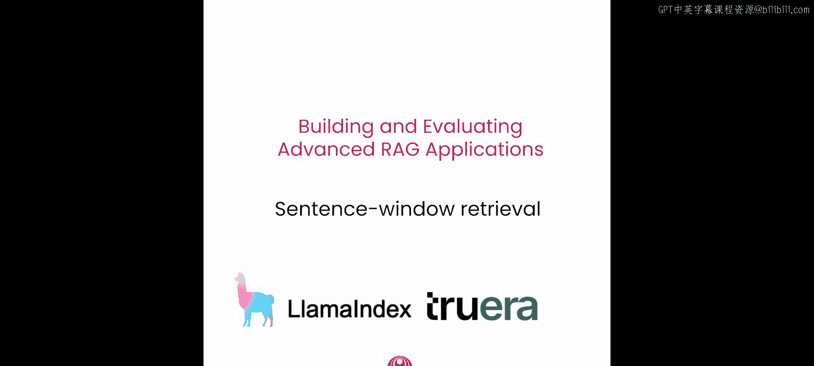
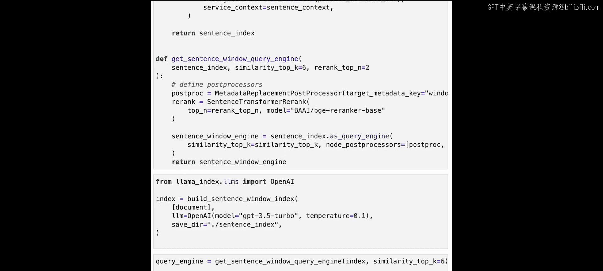
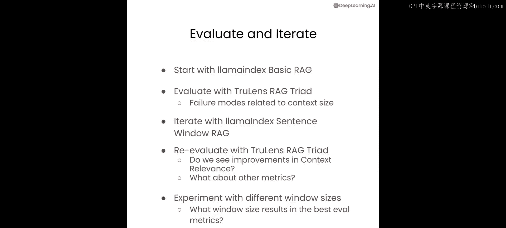

# 吴恩达《构建和评估高级的RAG模型应用》｜Building and Evaluating Advanced RAG Applications（中英字幕） - P4：Lesson 3 Sentence Window Retrieval.zh - GPT中英字幕课程资源 - BV1494y1E7H9

In this lesson， we will do a deep dive into an advanced rag technique or sentence window retrieval method。

 In this method， we retrieve based on smaller sentences to better match the relevant context and then synthesize based on an expanded context window around the sentence。

 Let's check out how to set it up for some context。

The standard drag pipelinepe uses the same tax trunk for both embedding and synthesis。

The issue is that embedding base recrieval typically works well with smaller chunks。

 whereas the LLM needs more context and bigger chunks to synthesize a good answer。

What sentence Win retrieval does is decouple the two a bit。

We first embed smaller chunks or sentences and store them in a vector database。

We also add context of the sentences that occur before and after to each chunk。During retrieval。

 we retrieve the sentences that are most relevant to the question with a similarity search。

 and then replace the sentence with a full surrounding context。

This allows us to expand the context that's actually fed to the LL1 in order to answer the question。

This notebook will introduce the various components needed to construct a sentence window retriever with la index。

 The various components will be covered in detail。At the end。

 Anion will show you how to experiment with parameters in evaluation with true error。

This is the same setup that you've used in the previous lessons。

 so make sure to install the relevant packages such as Lama index and Trulines E。

For this quick start， you'll need an open IK similar to previous lessons。

This open AI key is used for embeddings， LNs， and also the em piece。

Now we have set up and inspect our documents to use for iteration and experimentation。

Similar to the first lesson， we encourage you to upload your own PDF file as well。As with before。

 we'll load in the how to build a career in AI ebook。It's same document as before。

So we see that it's a list of documents， there are 41 pages。The object schemas are document object。

And here is some sample text from the first page。The next pieces will merge these into a single document because it helps with overall text blending accuracy when using more advanced retrievers。

Now let's set up the sentence window retrieal method。

 and we'll go through how to set this up more in depth。We'll start with a window size of three。

And a top K value of6。First， we'll import what be called a sentence window node parser。

The sentence window node parsor is an object that will split a document into individual sentences and then augment each sentence chunk with the surrounding context around that sentence。

Here we demonstrate how the node parcel works with a small example。We see that our text。

 which has three sentences， gets split into three nodes。

Each node contains a single sentence with the metadata containing a larger window around the sentence。

We'll show what that metadata looks like for the second notebreaker。

You see that this metadata contains the original sentence。

 but also the sentence that occurred before and after it。

 We encourage you to try out your own text to。 For instance， let's try something like this。

For this sample text， let's take a look at the surrounding metadata for the first out。

Since the window size is three， we have two additional adjacent nodes that occur in front and of course。

 none behind it because it's the first node。So we see that we have the originalinal sentence where hello。

 but also fubar and Td Talk。The next step is actually buildby index。

And the first thing we'll do is a setup and L1。In this case， we'll use open AI， specifically atGT 3。

5 Tbo with the temperature of 0。1。The next step is a setup a service contact object。

 which as a reminder， is a wrapper object that contains all the contacts needed for indexing。

 including the LLN embedding model and the nodede parser。

Note that the embedding model that we specify is the BGE small model。

 and we actually download and run it locally from Huging face。This is a compact。

 fast and accurate for its size and badding model。We can also use other embedding models。

 for instance， a related model is BGA large。Which we have in the commented out code below。

The next step is the setup of extratroso In with a source document。

Because we've defined the node parser as part of the service context。

 what this will do is it will take the source document， transform it into a series of sentences。

 augmented with surrounding context， and embed it and load it into the vector store。

We can save the index to disk so that they can load it later without reddoing it。

If you've already built the index， saved it and you don't want to rebuild it。

 here is a handy block of code that allows you to load the index from the existing file if it exists。

 otherwise it'll build it。The index is now built， the next step is to setup and run the query Android。

First， what we'll do is we'll define what we call a metadata replacement post processor。

This takes a value stored in the metadata and replaces a node text with that value。

And so this is done after retrieving the nodes and before sending the notes to the outline。

We'll first walk through how this works。Using the nodes we created with the sentence window node parsor。

 we can test this post processoror。Note that weve made a backup of the original notes。

Let's take a look at the second node again。Great。Now let's apply the post processoror on top of these nodes。

If we now take a look at the text of the second node。

We see that it's been replaced with a full context。

 including the sentences that occurred before and after the current note。

The next step is add the sentence transformformer rerank model。

This takes the query and retrieve nodes and reorders the nodes in order of relevance using a specialized model for the task。

Generally， you would make the initial similarity top K larger。

And then the reraker will rescore the nose and return a smaller top end， so filter out a smaller set。

 an example of a reraker is BGA reraker base。This is a reraer based on the BTD embeddings。

 this string represents the models named from Hugingfaceace and you can find more details on the model from Huging face。

Let's take a look at how this re record works。We'll input some toy data and then see how the reraker can actually rerank the initial set of nodes to a new set of nodes。

 Let's assume the original query is I want a dog。And the initial set of score of nodes is this is a cat with a score of 0。

6， and then this is a dog with a score of 0。4。Intuitively。

 you would expect that the second node actually has a higher score， so it matches the query more。

And so that's where the rera can come in。Here we see the reraer properly surfaces the known about dogs and gave it a high score of irrelevant。

Now let's apply this to our actual query entry。As mentioned earlier。

 we want a larger similar already top K than the top end value we chose for the reraker in order to give the reraker a fair chance at surfacing the proper information。

We set the top k equal to 6 and top n equals to2。Which means that we first fetch the six most similar chunks using the sentence window to retrieval。

 and then we filter for the top two most relevant chunks using the sentence reranker。

Now that we have the full query entrance setup， let's run through a basic example。

Let's ask a question over this data set， what are the keys to building a career in AI？

And we get back in response。We see that the final response is that the keys to building a career in AI are learning foundational technical skills。

 working on projects， and finding a job。Now that we have the sentence window queryandron in place。

 let's put everything together。We'll put a lot of code into this notebook cell。

 but note that this is essentially the same as the function in the U Zpi file。

We have functions for building the sentence window index， as we showed earlier in this notebook。

It consists of being able to use the sentence bundle node parser to extract out sentences from the documents and augment it with surrounding context。

It contains setting up the sentence context or using the service context object。

It also consists of setting up a vector sort index。

Using the source documents and the service contacts containing with L1 and Batting model and node parser。

The second part of this is actually getting the sentence when query entered。

Which we showed consists of getting the sentence window retriever。

Using the metadata replace my post processoror to actually replace a node with the surrounding context。

And then finally， using a rewriting module to filter for the top add results。

We combine all of this using the AS query Atro module。

What's first called build sentence window index。With a source document。The LM。

 as well as the save directory。And then let's call the second function to get the sentenceus wow query entered Great。

 now you're ready to experiment with sentence window retrieval in the next section。

 audioudiocom will show you how to actually run evaluations using the sentence windowow retrievetr so that you can evaluate the results and actually play around the parameters and see how that affects the performance of your engine。

After running through these examples， we encourage you to add your own questions and then even define find your own evaluation benchmarks。

 just to play around with this and get a sense of how everything works。 Thanks， Jerry。

 now that you have set up the sentence window retriever。

 Let's see how we can evaluate it with the rag triad and compare its performance to the basic rag with experiment tracking。

 let us now see how we can evaluate an it rate。

On the sentence window， size parameter。To make the right trade offs between。

The evaluation metrics are the quality of the app。And the cost。

Of running the application and evaluation。We will gradually increase the sentence window size。

Starting with one， evaluate these successive ad versions with true lens and the rag triad track experiments to pick the best sentence window size。

And as we go through this exercise。We will want to note the tradeoffs between token usage or cost as we increase the window size。

 the token usage and cost will go up， as in many cases， will context relevance。 at the same time。

 increasing the window size in the beginning， we expect will improve context relevance and therefore will also indirectly improve groundedness。

 One of the reasons for that is when the retrieval step does not produce sufficiently relevant context。

 the LLM in the completion step will tend to fill in those gaps by leveraging its preexisting knowledge from the pretraining stage rather than explicitly relying on the retrieved pieces of context and this choice can result in lower groundedness course because recall groundedness means components of the final response should be traceable back to the retrieved pieces of。

ContextConsequently， what we expect is that as you keep increasing your sentence window size。

 context relevance will increase up to a certain point。

 as will groundedness and then beyond that point we will see context relevance either flatten out or decrease and groundedness is likely going to follow a similar pattern as well In addition。

 there is also a very interesting relationship between context relevance and groundedness that you can see in practice。

 when context relevance is low， groundedness tends to be low as well。

 this is because the LLM will usually try to fill in the gaps in the retrieved pieces of context by leveraging its knowledge from the pretraining stage this results in a reduction in groundedness。

 even if the answers actually happen to be quite relevant。 as context relevance increase。

Gundedness also tends to increase up to a certain point， but if the context size becomes too big。

 even if the context relevance is high， there could be a drop in the groundedness because the LLM can get overwhelmed with contexts that are too large and fall back on its preexisting knowledge base from the training phase。

 let us now experiment with the sentence window size。I will walk you through a notebook to。

Ld a few questions for evaluation。And then gradually increase the sentence window size。

And observe the impact of that on the rag triad evaluation metrics。 First， we load a set of。

Pregenerated evaluation questions。 And you can see here， some of these questions。From this list。Next。

We run the evaluations。For each question in that reloaded set of evaluation questions。And then。

 with the。True recorder object， we record the prompts， the responses， the intermediate results。

Of the application， as well as the evaluation results。In the true database。

Let's now adjust the sentence window size parameter。

And look at the impact of that on the different ragtriad evaluation metrics。 We will first reset the。

True database。With this gold snippet。We set the sentence window size to one。

 You'll notice that in this instruction。Everything else is。The same as before。

Then we set the sentence window engine。With the get sentence window query engine。Assoiate with this。

Index。And next up。We are ready to set up the Dr recorder。With the sentence window size。Said to water。

This sets up the definition of all the feedback functions with the rag triad。

 including answer relevance， context relevance and groundedness。

And now we have everything set up to run the evaluations。For set up with the sentence window size。

 said to one。And all the relevant prompts， responses。

 intermediate results and the results of the evaluation of these feedback functions。

Will get logged into the true database。Okay， that ran beautifully now。Let's look at it。

 in the dashboard。You'll see that this。Instruction。Brings up。Locally hosted Stlit app。

 and you can click on the。Length to get to them。Stremli up。

So the app leader board shows us the aggregate metrics。For all the 21 records that we ran through。

And evaluated with true landance。The average latency here is 4。57 seconds。

The total cost is about 2 cents。Total number of tokens processed is about 9000。

And you can see the evaluation metrics。 The application does reasonably well in answer relevance and groundedness。

 but on context relevance， it's quite poor。Let's now drill down and look at the individual records。

That were processed by the application。And。Evaluated。If I scroll to the right。

 I can see some examples where。The application is not doing so well on。These metrics。

 so let me pick this row。And then， we can。Go deeper and examine。How it's doing。

So the question here is， in the context of project selection and execution。

 Explain the difference between ready aim fire and ready fire aim approaches。

 provide examples where each approach might be more beneficial。

 You can see the overall response here in detail from the rag。And then if it scroll down。

 we can see the。Overall， scores for groundedness， context relevance and answer relevance。

Two pieces of context were retrieved in this example。And for one of the pieces of retrieved context。

 context relevance is quite low。Let's drill down into that example and take a closer look。

 what you'll see here with this example。Is that。The piece of context is quite small。

Remember that we are using a sentence window of size one。

 which means we have only added one sentence extra in the beginning and one sentence extra at the end。

Around the retrieve piece of context。And that produces a fairly small piece of context。

That is missing out on important information that would make it relevant to the question that was asked。

 Similarlyly， if you look at groundedness。We will see that。

Both of these pieces have retrieved the sentences in the final summary。

 the groundedness scores are quite low。 Let's pick the one with the higher groundedness score。

Which has a bit more justification。And if we look at this example。

What we will see is there are a few sentences here in the beginning。For which。

There is good supporting evidence in the retrieved piece of context。And so the score here is high。

 It's a score of 10 on a scale of 0 to 10。 But then for these sentences down here。

 there wasn't supporting evidence。And therefore， the groundedness score is 0。

Let's take a concrete example。Maybe this one， let'd say it's often used in situations where the cost of execution is relatively low and where the ability to iterate and adapt quickly is more important than upfront planning。

This does feel like a plausible piece of text that could be useful as part of the response to the question。

However， it wasn't there in the retrieved piece of context that's not backed up by any supporting evidence in the retrieved context。

 This could possibly have been part of what the model had learned during its training phase。

 where either from the same document。Andrew's document here on career advice for AI or some other source talking about the same topic。

 The model may have learned similar information， but it's not grounded in that。It is not。

 The sentence is not supported by the retrieved piece of context in this particular instance。

So this is a general issue when the sentence window is too small that context relevance tends to be low and as a consequence。

Drowundedness also becomes slow because the LLM starts making use of its pre existinging knowledge from its training phase to start answering questions instead of just relying on the supplied context。

Now that I have shown you a failure mode with sentence windows set to one。

I want to walk through a few more steps to see how the metrics improve as we change the sentence window size。

For the purpose of。Going through the notebook。Quickly。

I'm going to reload the evaluation for questions。But in this instance， just set it to。

One question where the model had problem， this particular question。

 which we just walked through with the sentence window size set。At one。

And then I want to run this through with the sentence in sentence window size set23。

Dis called snippet。Is going to。Set up the。The rag with sentence window size set up 3。

And also set up the。True recorder for it。We now。Have the definition of the。Feedback functions set up。

 in addition， too。The rag with the sentence window set。At size 3。Next up。

 we are going to run the evaluations。When that。You for that particular evaluation question。

That we have looked through。In some detail， with the sentence window set through one where we observed the failure mode that has run successfully。

 Let's now look at the results with sentence window engine set to 3 in the truelen dashboard。

You can see the results here。 I ran it on the one record。

 That was the problematic record when we looked at sentence window size1。

And you can see a huge increase in the context relevance。 It went up from 0。57 to 0。9。 Now。

 if I select the app and look at this example in some more detail。

 Let's now look at the same question that we looked at with sentence window。Seid at one。

 Now we are at3。 Here's the full final response。Now， if you look at the retrieved pieces of context。

 you'll notice that。This particular piece of retrieve context。

Is similar to the one that we had reviewed earlier with sentence window set at size 1。

But now it has the expansion because of the bigger。Sentence window size。

 And if you look at the score for。For this section。

 we'll see that this context got a context relevant score of 0。9。Which is higher than the score of 0。

8 that the smaller context had gotten earlier。And this example shows that。

With an expansion in the sentence window size。Even。Reasonably good pieces of retrieved context。

Can get even better Once the completion step is done with these significantly better pieces of context。

 the groundedness score goes up quite a bit。You see that。By finding。

 supporting evidence across these two pieces of highly relevant context。

The groundedness score actually goes up all the way to one。

So increasing the sentence window size from one to3 led to a substantial improvement in the evaluation metrics。

Of the rag triad， both groundedness and context relevance went up significantly。

As did answer relevance。 And now we can look at sentence window set to 5。

 If you look at the metrics here。A couple of things to observe。One is the total tokens has gone up。

And this could have an impact on the cost if we were to increase the number of records。

So that's one of the trade offs that I mentioned earlier。 As you increase the sentence window size。

 it gets more expensive because more tokens are being。Processed。By the L lamps， during evaluation。

The other thing to observe is that。While context relevance and answer relevance have remained flat。

Groundedness has actually dropped with the increase in the sentence window size。

And this can happen after a certain point， because。As the context size increases。

The LLam can get overwhelmed in the completion step with too much information。

And in the process of summarization。It can start introducing its own preexisting knowledge。

 instead of。Just the information in the。Retrieeved pieces of context。So to wrap things up here。

It turns out that。As we gradually increase the sentence window size from 1 to 3 to 5。3。

 the size of three is the best choice for us for this particular evaluation。And。

We see the increase in context relevance and answer relevance and groundedness as we go from one to 3。

 and then a reduction。Our degradation in the grounded Ne step with a further increase。

To a size of five， as you are playing with the notebook book。

 we encourage you to rerun it with more records in these two steps。Examine the individual records。

Which are causing。Problems。😮，For specific metrics like context relevance or groundedness and get some intuition and build some intuition around。

Why the failure modes are happening。And what to do to address them。And in the next section。

 we will look at another advanced rack technique。Oto， merging。To address some of those failure modes。

Irrelevant context can creep into the final response， resulting in。

Not such great scores in groundedness or answer elements。

