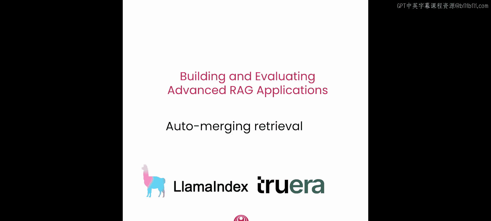
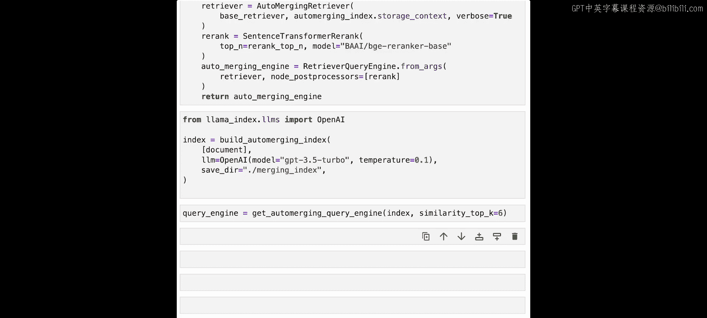
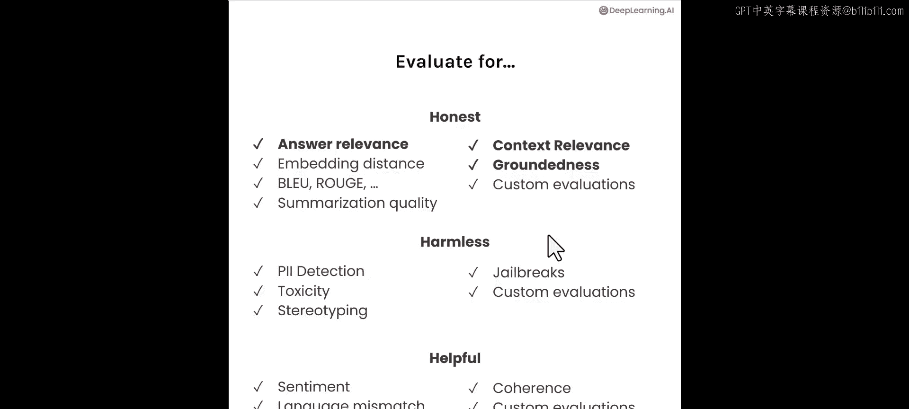

# 吴恩达《构建和评估高级的RAG模型应用》｜Building and Evaluating Advanced RAG Applications（中英字幕） - P5：Lesson 4 Auto-merging Retrieval.zh - GPT中英字幕课程资源 - BV1494y1E7H9

In this lesson， we'll do a deep dive into another advanced rag technique， autoerrant。

 an issue with the naive approach is that you're retrieving a bunch of fragmented context chunks to put into the LLM context byo。

 and the fragmentation is worse， the smaller your chunk size。

Here we use an auto version heuristic to merge smaller chunks into a bigger parent chunk to help ensure more coherent context。

 Let's check out how to set it up。

In this section， we'll talk about automer retrieval。

An issue with the standard drag pipeline is that you're retrieving a bunch of fragment of contact trunks put into the Alllum contact window。

And the fragmentation is worse， the smaller your trunk size。For instance。

 you might get back two or more retrieved contacts trunks in roughly the same section。

 but there's actually no guarantees on the ordering of these trunks。

This can potentially hamper the album's ability to asynthesize over this retrieved context within its context window。

So what automer Retrieval does is the following。First。

 define a hierarchy of smaller chunks linking to bigger parent trunks。

 where each parent trunk can have some number of children。Second， during retrieval。

 if the set of smaller chunks linking to a parent chunk exceeds some percentage threshold。

 then we merge smaller chunks into the bigger parent chunk。

 so we retrieve the bigger parent chunk instead to help ensure more coherent contact。

Now let's check out how to set this up。This notebook will introduce the various components needed to construct an automer retriever with Lama indexd。

The various components will be covered in detail。And similar to the previous section， at the end。

 Aupon will show you how to experiment with parameters and evaluation with true error。

Similar to before， we'll load in the Open AI API key。

 and we'll load this using a convenience helper function in ourut file。As with the previous lessons。

 we'll also use the how to build a career in AI PDF。And as before。

 we also encourage you to try out your own PDF files as well。

We load in 41 document objects and we'll merge them into a single large document。

 which makes us more amenable for text blending with our advanced retrieval methods。

Now we're ready to set up our auto me retriever。This will consist them of a few different components and the first step is to define what we call a hierarchical known parser。

In order to use an autover retriever， we need to parse our nodes in a hierarchical fashion。

This means that nodes are parsed in decreasing sizes and contained relationships in their parent node。

Here we demonstrate how the node parsel works with a small example。

We create a toy parser with small chunk sizes to demonstrate。

Note that the chunk sizes we use are 2048， 512 and 128。

You can change the chunk sizes to any sort of decreasing order that you'd like here we do a bi afactor of four。

Now let's get the side of notes from the document。What this does is this actually returns all node。

 this returns。All leaf nodes， intermediate nodes as well as parent nodes so there's going to be a decent amount of overlap of information and content between the leaf intermediate and parent nodes。

If we only want to retrieve the leaf nodes。We can call a a function within Lama index called G leafaf nodes。

 and we can take a look at what that looks like。In this example。

 we call gat leaf nodes on the original set of nodes。

 and we take a look at the 31st node to look at the text。

We see that the text trunk is actually fairly small。

 and this is an example of a leaf node because a leaf node is the smallest chunk size of 128 tokens。

Here's how you might go about strengthening your math background to figure out what's important to note。

 etc。Now that we've shown what a leaf node looks like， we can also explore the relationships。

We can print the parent of the above node and observe that it's a larger chunk containing the text of the leaf node。

 but also more。More concretely， the parent node contains 512 tokens while having four leaf nodes that contain 128 tokens。

There's four leaf notes because the chunklk sizes are divided by a factor or fourage sh。

This is an example of what the parent node of the 31st leaf node looks like。

Now that we've shown you what the node hierarchy looks like。We can now construct our index。

We'll use the Open AI LN and specifically GPT 3。5 Tbo。

We'll also define a service context object containing the L1 embedding model and the hierarchical node parer。

As with the previous notebooks， we'll use the BG small N embedding model。

 The next step is to construct our index。The way that index works is that we actually construct a vector index on specifically the leaf nodes。

All other intermediate impairment parent nodes are stored in a dock store and are retrieved dynamically during retrieval。

But what we actually fetch during the initial top K embedding lookup is specifically the leaf nodes。

 And that's what we embed。 You see in this code that we define a storage contact object。

 which by default is initialized with an inmemory document store。

 and we call storage contact a dock store add documents， add all nodes to this inmemory doc store。

 However， when we create our vectorstore index。Called automering index right here。

 we only pass in the leaf nodes for vector indexing。

This means that specifically the leaf nodes are embedded using the embedding model and also indexed。

 but we also pass in the storage context， as well as the service context。

And so the vector index does have knowledge of the underlying doc store that contains all the notes。

 and finally we persist this index if you've already built this index and you want to load it from storage。

 you can just copy and paste this block of code which will rebuild the index if it doesn't exist or loader from storage。

The last step now that we've defined the automerrging index is to set up the retriever and run the query engine。

 The automerrging retriever is what controls emerging logic。

 If a majority of children nodes are retrieved for a given parent。

 They are swapped out for the parent instead， in order for this merging to work well。

 we set a large top K for the leaf nodes。 and remember。

 the leaf nodes also have a smaller chunk size of 128。 in order to reduce token usage。

 we apply a reraker after the merging has taken place。 For example， we might retrieve the top 12。

Merge and have a top 10 and then rera into a top 6。 The top end for the reraer may seem larger。

 But remember that the base chunk size is only 128 tokens。

 And then the next parent above that is 512 tokens。We import a class called auto versionion Reever。

And then we define a sentence transformer rewrite module。

 we combine both the auto versioning retriever and the rewr module into our retriever query engine。

 which handles both retrieval and synthesis。Now that we've set this whole thing up andd。

Let's actually test what is the importance of networking and AI as an example question。

 we get back our response。We see that it says networking is important in AI because it allows individuals to develop a strong professional network and more the next step is to put it all together。

And we'll create two high level functions， build automererging In。

 as well as Gt automerer query engine。And this basically captures all the steps that we just showed you。

And the first function，Build auto Emer indexex will use the hierarchicalal node parser to parse out the hierarchy of child to parent nodes。

Will defy the service context。It will create a vector store index from the leaf nodes。

 but also linking to the document store of all the nodes。The second function。

 Gat auto Emer query engine。Leverage is our automer Rer。

 which is able to dynamically merge leaf nodes into parent nodes and also use our Rayrerack module and then combine it with the overall retriever query and。

So we build the index using the build auto Emer index function using the originalinal source document。

The LLM set to TputT 3。5 turbo。As well as the me index as a save directory。

And then for the query engine， we call G auto Virgin query engine。Based on the index。

 as well as we set a similarity top K of equal to 6 as a next step。

 onU problem will show you how to evaluate automer retriever and also iterate on parameters using T。

We encourage you to try out your own questions as well and also iterate on the parameters of auto retrieval。

 for instance， what happens when you change the trunk sizes or the top K or the top end for the reri。

Play around with it and tell us what the results are。

That was awesome， Jerry， Now that you have set up the auto merging retriever。

 let's see how we can evaluate it with the rag triad and compare its performance to the basic rag with experiment tracking。

😊。

Let's set up this auto merg new index。You'll notice that it's two layers。The lowest layer chunk。

 the leaf nodes will have a chunk size of 512。And the next layer up。

In the hierarchy is a chunk size of 2，0，4，8， meaning that each parent will have four leaf nodes of 512 tokens each。

The other pieces of setting this up are exactly the same as what Jerry has shown you earlier。

One reason you may want to experiment with the two layer auto merg。Structure is that it's simpler。

Less work is needed to create the index。As well as。In the retrieval step， there is less work needed。

Because all the third layer checks go away。If it performs comparably well。Then ideally。

 we want to work with a simpler。Structure。Now that we have created the index with this two layer auto me structure。

Let's set up the auto me engine for this setup。I'm keeping the top K at the same value。As before。

 which is 12。And the reran step will also have the same n equal 6。

This will let us do a more direct head to head comparison。Between this application set up。

And the three layerir。On emerging hierarchy app that Jerry had set up earlier。

Now let's set up the true recorder。With this auto merg engine。

And we will give this an app ID of app 0。Let's now load some questions for evaluation。

Fromund the generated questions text file that we have set up earlier。

Now we can define the running of these evaluation questions。For each question in about questions。

We are going to set things up so that the true recorder object， when invoked。With the Rani elses。

 we'll record the prompts responses。And the evaluation results。Leveragingda。Qury engine。

Now that our evaluations have completed， let's take a look。At the leader board。We can see that Ab 0。

Mattris here， context relevance seems slow。The other two metrics are better。

 This is with our two level hierarchy with 512 as the leaf note chunk size and the parent being 2048 tokens。

 so for。Leaf notes spur errant note。Now we can run the true dashboard。And take a look at。

The evaluation results at the record level at the next layer of detail Let's examine the app leader board。

You can see here that after processing 24 records， the context relevance at an aggregate level is quite low。

Although the app is doing better on answer relevance and groundedness。I can select the app。

Let's now look at the individual records of App0 and see how the evaluation scores are for the various records。

You can scroll to the right here。And look at the scores for answer relevance。

 context relevance and ground business。And let's pick one that has low context relevance。

So here is one。If you click on it。You'll see the more detailed view down below。

 The question is discuss the importance of budgeting for resources and the successful execution of AI projects。

 on the right here is the response。 And if you scroll down further。

 you can see a more detailed view for context relevance。 There were six pieces of retrieve context。

 Each of them has。Is scored to be particularly low。In their evaluation scores， it's between 0 and 。2。

 And if you pick any of them and click on it， you can see that。The responses。

Not particularly relevant to the question that was asked。 You can also scroll back up， and。

Explore some of the other records。You can pick ones， for example， where the scores are good。

 like this one here。And he explore。How。How the how the application is doing。No。

Various questions and where its strengths are， where its failure modes are。

To build some intuition around what's working and what's not。Let's now compare。😔，The previous app。

To the auto me setup that Jerry introduced earlier， we will have three layers now in the hierarchy。

Starting with 128 tokens。At the leaf node level。5121 layer up。And 2048 at the highest s。

So at each layer， each parent has。Or children。Now， let's set up the query in June。

But this app set up。The true recorder。All identical steps。As the one for the previous app。And。

 finally。We are in aposition。To run their valuations。Now that we have app 1 set up。

 we can take a quick look here in the leader board， you can see that relative to F 0。

The number of tokens processed in app1 for the same number of records is about half。

And the total cost is also about half。And that's because。

Recall this has three layers in the hierarchy， and the chunk size is 128 tokens instead of。The 512。

 which is the smallest leaf node token size for a 0。 So that results in a cost reduction。

Notice also that context relevance has increased。By about 20%。And。

Part of the reason that's happening is that。Marging。

Is likely happening a lot better with this new app setup。We can also drill down and look at app 1。

In greater detail， like before。We can look at individual records。

 Let's pick the same one that we looked at earlier。The tab 0。

It's the question about the importance of budgeting。

And now you can see context relevance is doing better。Groundedness is also considerably higher。

And if you pick a sample example。Responds here。You'll see that， in fact。

 it is talking very specifically about budgeting for resources。

So there is improvement in this particular instance and also at an aggregate level。

Let me now summarize some of the key takeaways from lesson4。

We walked you through an approach to evaluate and idate。

With the auto retrieval advancedance drag technique。And， in particular。

We showed you how to iterate with different hierarchical structures， the number of levels。

The number of child nodes and chunk sizes。And for these different ad versions。

 you could evaluate them with the rag triad。And track experiments to pick the best structure。

For your use， case。One thing to notice is that not only are you getting the metrics associated with the ragg triad as part of the evaluation。

 but the drill down into the record level， can help you gain intuition about hyperpara that work best with certain do types。

 For example， depending on the nature of the documents such as employment contracts versus。Invoices。

You might find that different chunk sizes and hierarchical structures。Word best。Finally。😊。

One other thing to note is that auto merging is complementary to sentence window retrieval。

And one way to think about that is， let's say you have four child nodes of a parent with auto merging。

 you might find that。Child number  one and child number 4 are very relevant to the query that that was asked。

 and these then get merged under the auto merging paradigm。 In contrast。

 sentence windowing may not result in this kind of merging because they are not in a contiguous section of the text。

That brings us to the end of lesson 4。We have observed that with advanced rack techniques such as sentence windowing and auto me retrieval。

 augmented with the power of evaluation， experiment tracking and iteration。

 you can significantly improve your Ag applications。In addition。While the course has focused on。

These two techniques and the associated drag Triad for evaluation。

There are a number of other evaluations。That you can play with。

In order to ensure that your LLM applications are honest， harmless and healthful。

This slide has a list of some of the ones that are available out of the box in true lands。

 we encourage you to go play with true lands， explore the notebooks。

 and take your learning to the next level。

