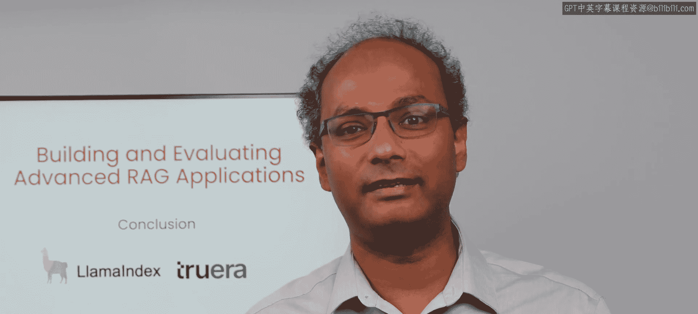
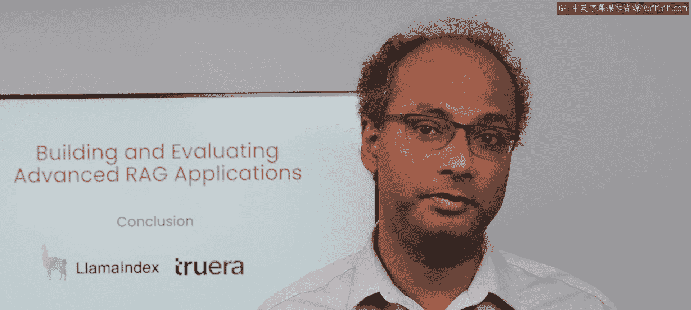
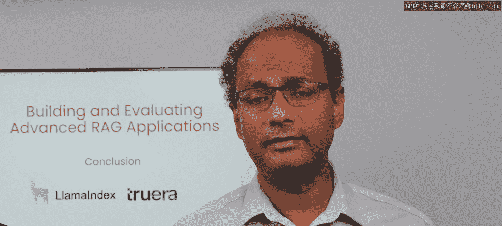
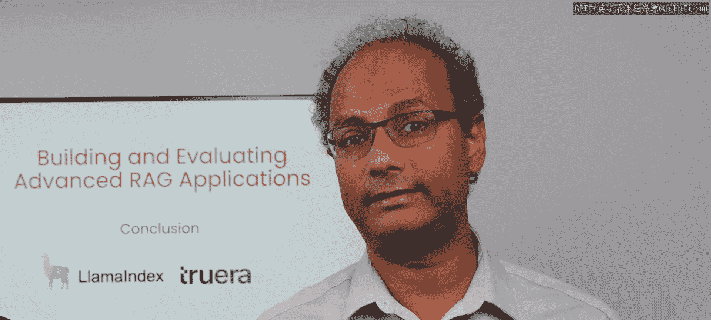
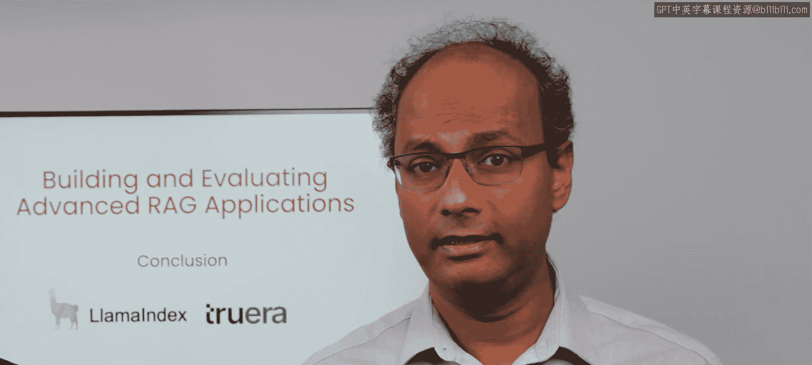
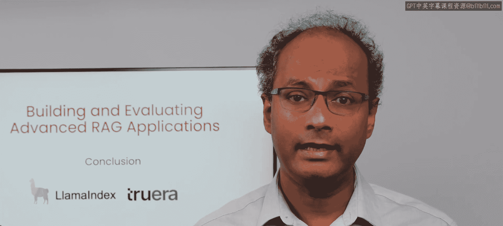
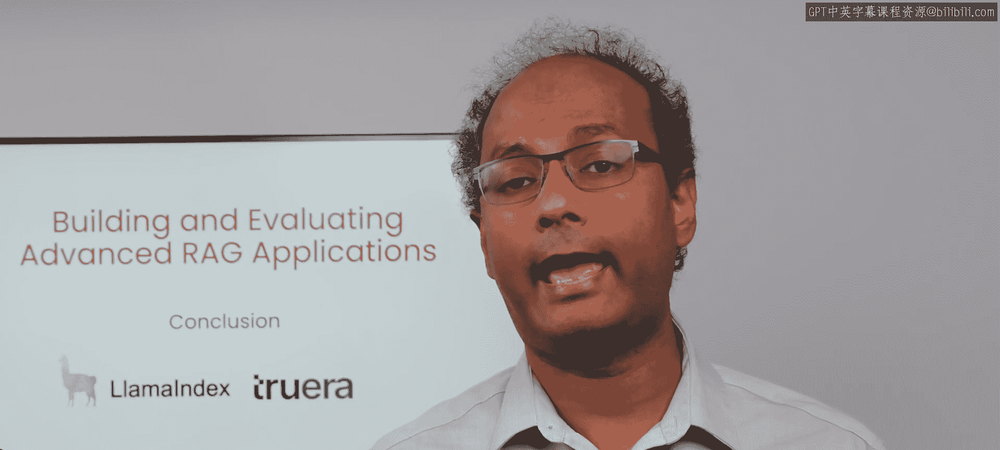

# 吴恩达《构建和评估高级的RAG模型应用》｜Building and Evaluating Advanced RAG Applications（中英字幕） - P6：LITE_Conclusion.zh_en - GPT中英字幕课程资源 - BV1494y1E7H9

Congrats on finishing the course。 Hopefully， you have picked up some skills on how to build。

 evaluate and iterate on your RaG application to make it more production ready。

Regardless of whether you come from a data science machine learning background or traditional software background。

 You'll need to learn some of these core development principles so that it can be a rockstar AI engineer we can build robust LM software systems。

 Red LLM hallucination is going to be the top priority for every developer as the field evolves。

 We are excited to see the basees models get better and larger scale evaluations become cheaper and more accessible for everyone to set out and run as a next step。

 I recommend looking more deeply into understanding your data pipeline retrieval strategy and LM prompts to help improve Rag performance。

 These two techniques we showed for just the tip of the iceberg。

 You shall look into everything from chunk sizes to retrieval techniques like hybrid search to LM based reasoning。

 like Chaa thoughtt。😊。

The RA Triad is an excellent place to start with evaluating your rank based LLM apps as a next step。

 I encourage you to dig deeper into the area of evaluating LLMs and the apps that they power。

This includes topics such as assessing model confidence， calibration， uncertainty， explainability。

 privacy， fairness and toxicity in both benign and adversarial settings。

 We look forward to seeing what you'll build next。😊。

