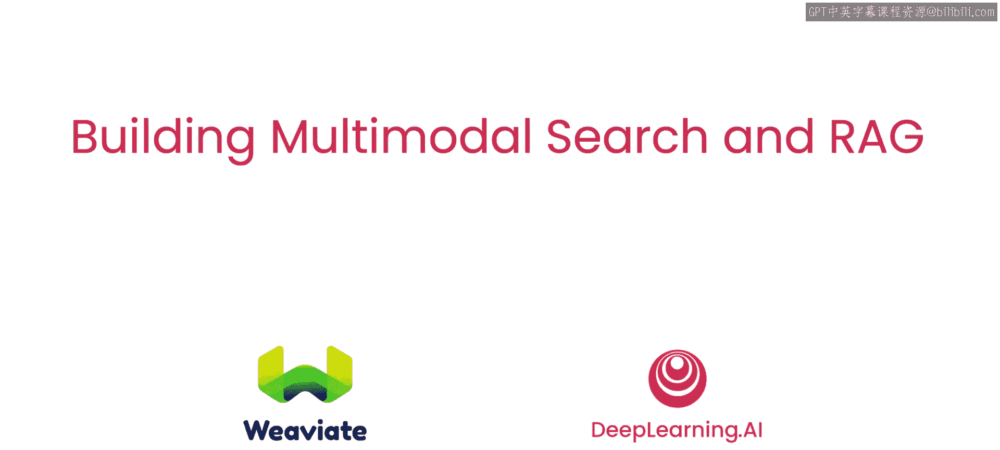
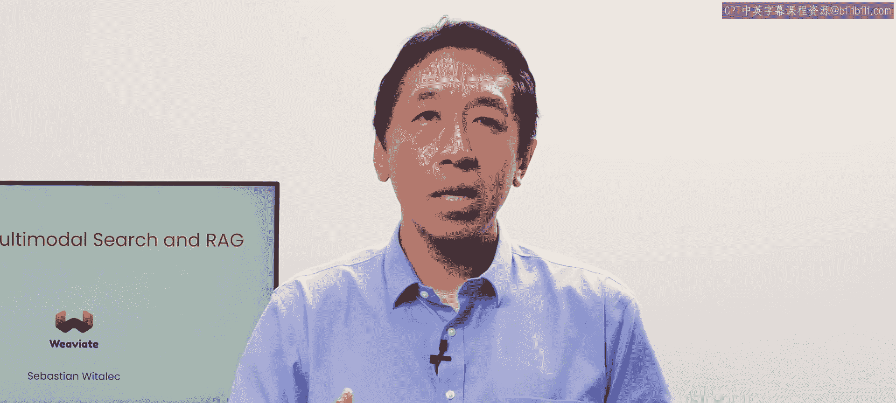
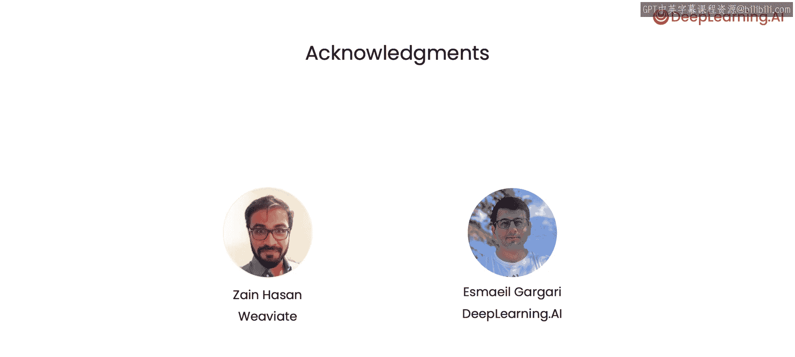

# 吴恩达《构建多模态搜索和 RAG｜Building Multimodal Search and RAG》中英字幕【短课均可关英文字幕】 - P1：1.introduction.zh - GPT中英字幕课程资源 - BV1sx4y1W7uV

Welcome to this short course，Building multimodal search and RAG。

 both in partnership with weviiate RAG or retrieval augmented generation systems provide an OM with context that includes information about your proprietary data and askCLM to use that context when generating this response。

A common way to build rack applications is to use a vector database to store your text document embeddings。

 then given a query， you retrieve relevant information from the vector database and add that as text context to your prompt。

😊，But whether the context you want includes an image of a presentation or is an audio clip or maybe even a video。

This course teaches you the technical details behind implementing RAG with such multimodal data a first keyet is to find a way to compute embeddings so that data on related topics are embedded similarly independently of modality for example。

 a text about a lion and an image that shows a lion and a video or an audio of a line roaring should be embedded close each other so that the query about lines can retrieve all of this data In other words。

 we want the embedding of concepts to be modality independent。

You learn how this is done through a process called Conive learning in the next video after you have such a multimodal retrieval model。

 youre going use it to retrieve the context related to a user' query so you can now build a multimodal search app where an image of a lion can be used to retrieve video。

 audio and text related to that image。Now， if you have agenerative model that supports multimodal inputs。

 you can use the retrieve results as a context and provide it to the model to ask you to respond to the query based on the relevant multimodal contextual information I'm thrilled Darren Schter for this course。

 Sebastian is here to explain how multimodal apps work under the hood。

 Sebastian is head of developed relations at weiate and he is an expert in vector databases whose work on developed relations for over a decade In fact his full-time job is a hope developers like you built successfully with vector databases。

😊。

Thanks Andrew， I'm really excited to work with you on this course so in this course you first learn how to teach a computer the concept of understanding multimodal data。

 then you build a text to any as well as any to any search and in the next step youll learn how to combine language and multimodal models into language visual models that understand images as well as text Next you focus on multimodal rack by mixing multimodal search together with multimodal generation and reasoning。

And as the final step， you will learn how multimodality is used in industry by implementing different real life examples that include analyzing invoices and flowchars。

 Many people have worked to create this course。 I'd like to thank Zen Hasan from Weviiate as well as Emael Gegari from Deep learning or AI whove contributed to this course So with that lots of exciting topics let's go on the next video to get started。

😊。

