# 吴恩达《构建多模态搜索和 RAG｜Building Multimodal Search and RAG》中英字幕【短课均可关英文字幕】 - P2：2.L1 Overview of Multimodality.zh - GPT中英字幕课程资源 - BV1sx4y1W7uV

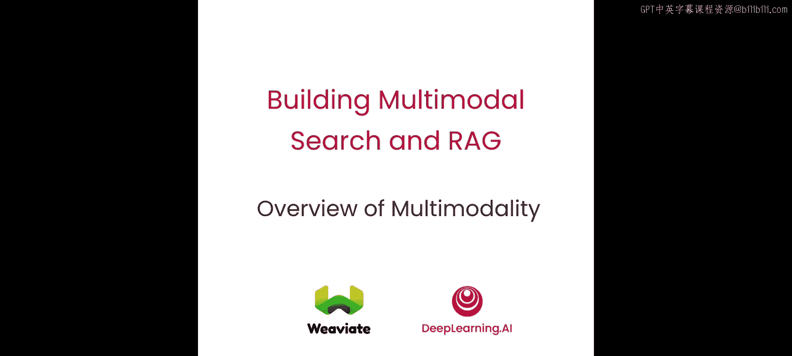

In is lesson you learn about multimodality， what multimodal models are。

 and more specifically how to teach a computer the concept of understanding multimodal data through the process of contrastive representation learning。

 Alright， let's dive in。

To stir your imagination， let's tap a live multimodal search demo to see how you can search across different types of content here you can see that I can provide a text input so I can search for a bunch of lions and I can get back images。

 audio and video files。 And in this course will go over how this actually works。

 our expanded technology that powers this app and you learn hands on how to build similar functionality。

 We won't necessarily build this up。 but by the end of this course。

 you should know enough to build apps like this one and more。😊。

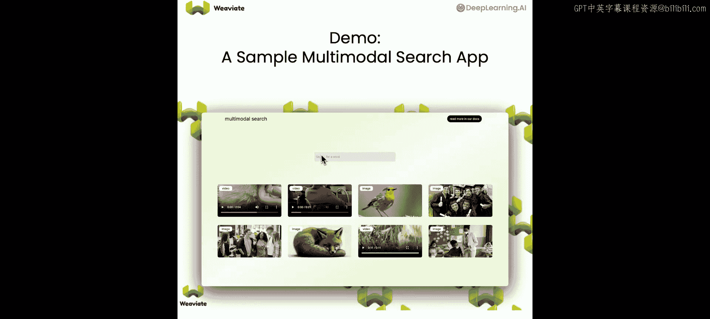

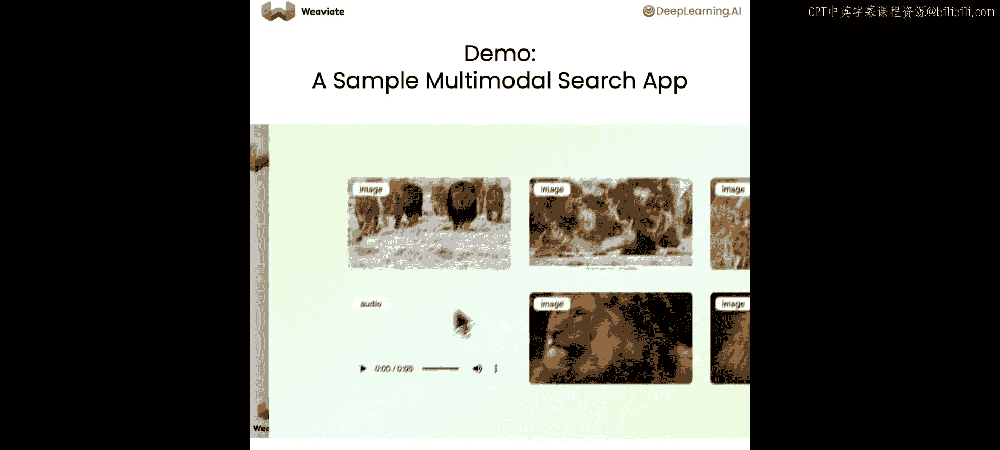

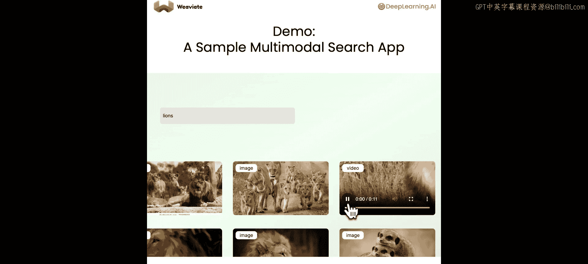

So why should you learn about multimodality？ Multimedia content is all around us。

 whether we are searching through our favorite songs， looking for movies to watch。

 browsing for things to buy or looking for a Wikipedia article。

 Everything that we do start with search。 but we don't want to just search through text。

 We want to search through songs， movie trailers， product images。

 we want to search through multimodal data。 But what is multimodal data anyway。

 Multimodal data is data that comes from different sources。 It can include text， images。

 audio and video and much more。 and each of those modalities often describe similar concepts。

 we could have a picture of a lion， a paragraph describing the king of the jungle。

 a video of running lions or even the sound of a raw。

 Each modality comes with a different kind of information。 And by combining the information。

 we gain better understanding of the concepts they represent。😊。

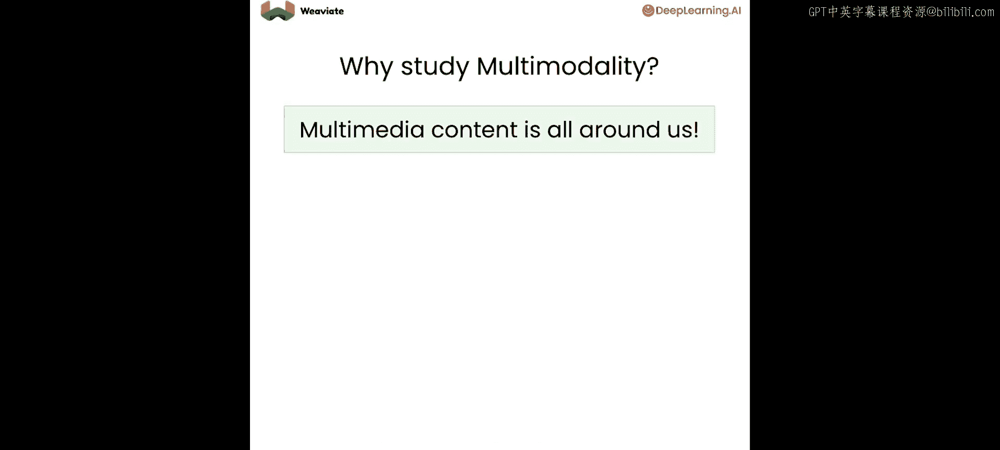

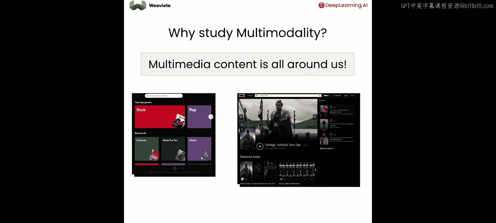

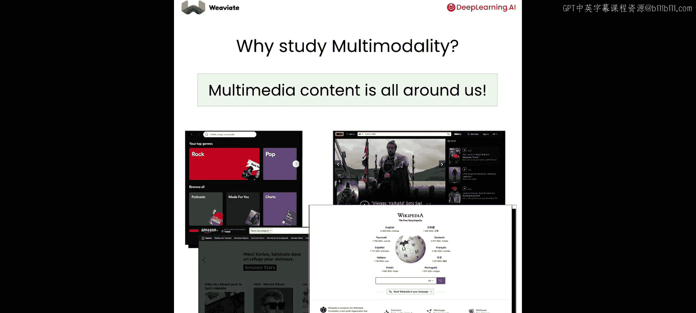

Think of it。 It is more impressive or even scary to see and hear a lion roar than just watching him quietly。

 After all， it is only when you see the lion and hear him。

 you understand why he is the king of the jungle。

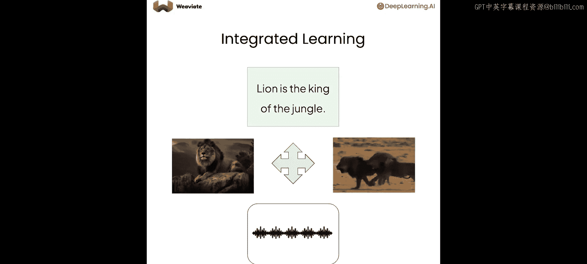

Another motivation behind why we'd want to learn from multimodal data is to think about how humans learn。

 Think of a child in their first year of life before they learn to speak。

 a lot of their learning is done to interactions with objects they touch， smell。

 feel the texture up or even tastes， even if it's soap。

 but also by watching and listening to everything around them。

 So this foundation knowledge is built using multimodal interactions with the world and not by using a language。

 Now， if you want to build a smarter and more capable AI。

 It also needs to learn and think about different modality of information。 just like humans do。😊。

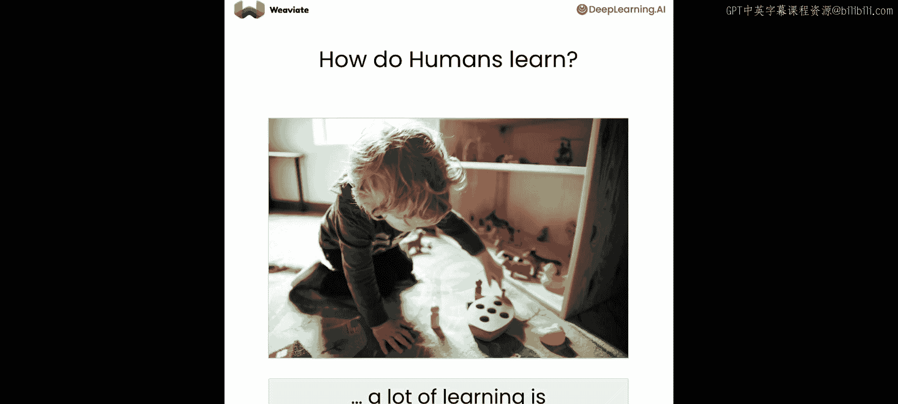

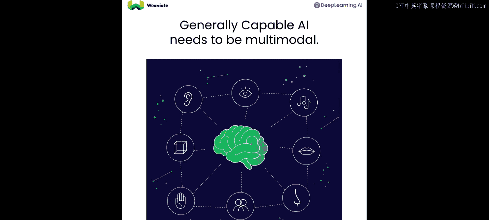

To get computers to work with multimodal data we need to first learn about multimodal embeddings multimodal embeddings allow us to represent multimodral data on the same vector space so that a picture of a lion will be placed close to a text describing lions and also a lion row or a video of running lions will be there and we can generate these embeddings from many different sources。

Mudymod embedding models produce a joint embedding space that understand all of your modalities。

 You can understand emails。 You can understand images， audio files and much more。

 The key concept here is that this model preserves semantic similarity within and across modalities。

 That means if you have objects that are similar， regardless of the modality。

 their vectors will be close together。 like a picture of a lion and related description。😊。

While different concepts like lions and trumpet are far from each other in the multimodal space。

In order to start training multiplemore embedding models。

 you need to start with a model that understands one modality at a time。

These individual models are specialized at understanding text。

 Another separate model might capture representation of images and other models specializing in audio and video。

 The next task is to unify these models so that regardless of modality。

 similar concepts should result in close vectors。So on the left hand side。

 all of these concepts are similar and therefore the vectors that they generate on the right hand side are also similar to each other。

The task of unifying multiple models into one embedding space is done using a process called contrastive representation learning。

 Contrasive representation learning is a general purposepo process that can be used to train any embedding model。

 not just multimodal embedding models。 specifically here， though。

 it can also be used to unify multiple models into one multimod embedding model。 with the main idea。

 where we want to create one unified vector space representation for multiple modalities。

 We do it by providing our models with positive and negative examples of similar and different concepts。

 Then we train our models to pull closer vectors for similar examples and push further vectors for different concepts。

 So let's work to a text example to understand how this works。 First， we need an anchor point。

 This can be any data point。 For example， he could smell the roses。 Then we need a positive example。

 an example that is similar to the anchor， like a field of fragment flowers。 And finally。

 we need a negative example， one that is。😊，Similar to the anchor， like the lion rod majestically。

 Now， we can get the vector embedding for each data point。

 and we want to push away the negative vector from the anchor and pull the positive vector closer to the anchor。

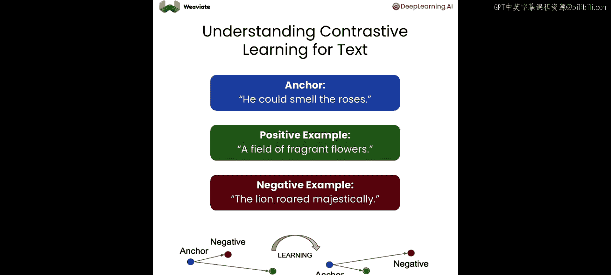

We could use the same method to train an image model where the anchor could be a picture of a German shepherd。

 The positive example could be a gra version of the anchor。

 while the negative example could be a picture of an app。 And again。

 the task is to push away the negative example。And pull close at a positive example。

The pushing pulling process is achieved with the contrastive loss function。 First。

 we need to encode the anchor and the examples into vector embeddings。

 then we calculate the distance between the anchor and the examples and during the training process we want to minimize the distance between the anchor vector and positive example vectors while at the same time maximizing the distance to the negative example vectors。

Now let's expand the con contrastive learning to multimodal data。

 we can provide positive and negative examples in different modalities。

 So given our anchor is a video of Ryan liness， we can provide contrastive examples as images and text。

 then we can apply pushing and pulling across modalities and as a result。

 align the model to work in the same vector space across all modalities。😊。

One tricky part can be finding enough of anchors and contrastive examples in a clip paper from 2021。

 they took images as their corresponding captions each representing a different modality。

 the picture in its caption represented an anchor and a positive example as represented on the diagonal of this matrix while any other random pairing of a picture and a caption is likely to be a negative example。

 and with that they were able to apply contrastive loss function to train that text and image multimodal model。

Now， let's see how a contrastive function looks like。 First。

 you need encoding functions that can convert the anchor and contrastive examples into vectors of the same dimension。

Here we've got a function F that takes an image and returns a vector Q。

And here we've got a function G， which takes a video and generates vector K。

 Now you take those vector representations。 and the numerator。

 you've got a similarity between positive examples。

 So this could be the image of a lion and the video of writing lines。

 you want the similarity to be as high as possible。 in the denominator。

 here've got a negative example。 say the image of a lion and a couple of cas on the bicycle。 This。

 in fact， is one of many negative examples that you need to sum up。

 You want this formula to return a probability。 So in the denominator。

 you normalize by providing the positive example from the numerator again。 And upfront。

 you have a negative on this loss function， which means that you actually want to minimize it。

 And by minimizing this， the positive video embeddings will be pulled closer to the anchor image embedding and the negative video will be pushed away from the anchor image。

 You can do this for all the modalities one by one for audio for text。😊，Video and many more。

 And this is what they did in the image bind paper。Let's now see all of this in practice in the lab。

 you train an embedding model using drasticive loss， then visualize the learn vector space。 Alright。

 let's code。In this lab， you train a neural network to learn embeddings for the Mmunist image data set。

But let's start by running this code， which is simply ignore any warnings that are not necessarily important for us to analyze。

So first thing you are going to do is import the required libraries。

 you' are going to use Pytorch for training the model and a set of supporting libraries and the most important ones are libraries for visualization like plotly and UU and the last thing that you need to import is the Ms data class which you use to get positive and negative examples to train and test on。

The N dataset is based on images of digits from0 to 9 and each image of a digit is labeled with the value that it corresponds to so that we know whether it represents0 or a 5 or a9 and the dataset class provides you with an anchor which is a digit and a positive and negative example which are also digit examples just like we talk about in a slides For example。

 if the anchor is a5 then a positive example would be another image for a5 while a negative example would be an image of let's say6 or a7。

And if you're curious about the EMs dataset code， feel free to review the Ms dataset。t P file。

And in here there are two key parts that you should pay attention to this bit of code over here takes care of labeling positive and negative examples so that when the label from the anchor matches the I。

 that automatically means that this is a positive example。

 this is when you have a7 and a 7 while if these values is differ so maybe the anchor is7 while the example is5。

 then this is assigned to the negative labels list。

And the second key part is the code over here which takes care of allocating the ideal distance metric that you will use during trading and since you will use coine similarity。

 the ideal similarity between positive examples and anchor is set to1 while for negative examples this is set to zero and in a nuts these are the two key parts that allow you to find the positive and negative examples and allocate ideal distances to each example。

All right， let's get back to the training notebook。So now let's load the data from the Ms data set。

And here the training data and the validation data that you need to load。

 and then let's execute this and this will load the data for you。Okay， great。

 And once the data is loaded， you need to set up Pythtorarch data loaders。

 and that will feed the neural network to train on。

 So feel free to modify this batch size over here if you want to see how that changes the convergence of the training。

 So yeah， let's run this。😊，Now let's use the above data loaders to visualize the anchor points and corresponding positive and negative examples。

 first add a helper function that will display provided images。

 and then you need to look through the batch of the data sets from the trained data loader。

 and from here what you be grabbing the anchor images， the contrasted images。

 their ideal distances and the labels。And if you run this。

 you should get examples of like four images of each。

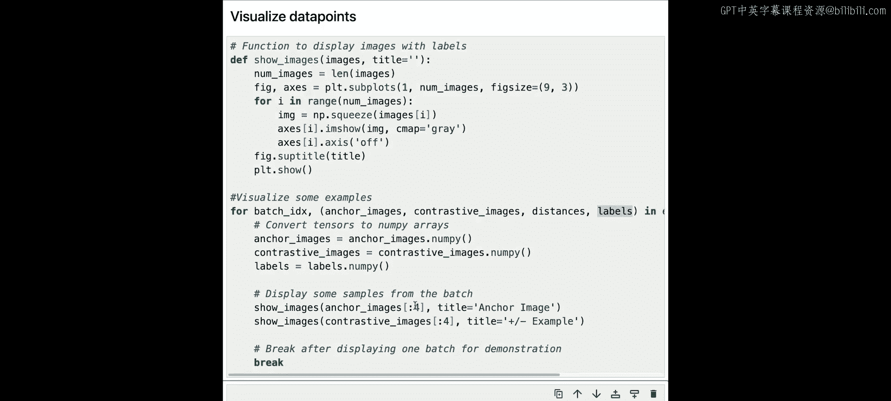

And here you can see one anchor which is a9 and a positive example， which is another9。

 there is an8 and a6， so this is a negative example。

 another positive example and a4 and a 7 which should be used as a negative example and that's basically what we use for pushing and pulling to train this neural network。

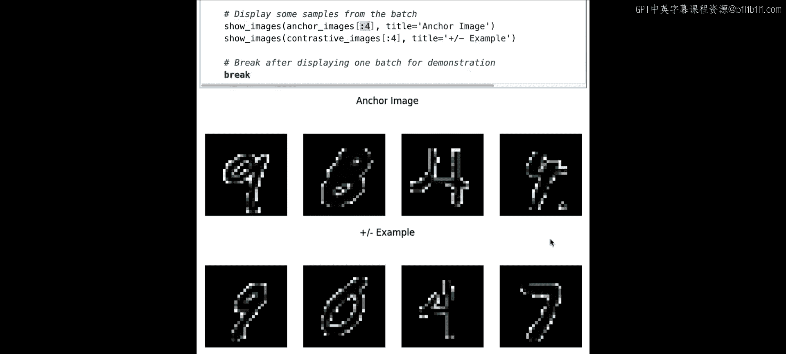

Alright， you're doing great。 Now let's define a neural network architecture that would take the M images and output them as 64 dimensional vectors。

 so this is a simple architecture where we have two convolutional layers and the point of these convolutional layers is to extract the visual features of a digit。

Then you have two feet forward linear layers here， and their job is to make visual features learned by the convol layer and learn how to turn them into 64 dimensional representations。

And all of this is combined in this forward function， so in summary you pass an image at the top。

 then you run through the two convolutional layers。

 flatten the output from that and then finally pass it through a linear function。

 and at the end you get a 64 dimensional vector。And that's basically how your neural network architecture looks like。

Now to train the neural network， you use the contrastive loss function which will take the 64 dimensional vector representations for both the anchor and then either a positive or negative example。

 and then you make sure that the ideal distances are met。 So like discussed earlier。

 the ideal cosine distance for a positive sample is one and a negative is0。

 This is probably the most important part of this code along So let's dive into it。

 So here you define the contrastive loss as calculating a cosine similarity between two points and the forward function you have the anchor and a contrastive example which could be either a positive or a negative one together with the ideal distance。

So the forward function is implemented as a two step thing。

 so first we calculate this core cosi similarity between the anchor and the contrastive images。

And in the second step， this score is compared to the ideal distance that you expect。

And here's a key information， lower distance between these two scores mean lower loss。

 and you want to eventually minimize this loss， so by the time this neural network is strained。

 the calculated score should be very close to the expected ideal distance。

And here you use CPU for training as the default option， however， if the GPU or code are available。

 then in this case that will be used instead of the CPU and you also need to add in the configuration parameters for the neural network training。

So this is your optimizer， this is actually what does the gradient descent。

 then you need to set up contrastive loss function， and here is your training scheduler。😊。

And now you are getting to the fun part， the code that executes the training of this model。

 so for us to help us set it all up， we need a checkpoints folder where the results of the training will be saved into that you could actually use later on to reload all the training back。

And now let's have a look at the training loop， you can set to run over any number of epochs and a training loops goes through and trains the model which go through forward propagation and backwards propagation until it converges and one of the key parts to see in here is the loss function which takes the anchor and the contrastive vectors together with their expected distances and calculates the loss for each data point。

The loss is then added up， which at the end of the epoC is used to calculate the average loss for each epoC。

 which is how you know whether the model training is improving or not。

And also as each epog is completed， the loop saves the results into the checkpoint folder。

And finding what the function returns back is the train model together with an array of the losses epoch by epoch。

 and this is in a nuts how the training works。Please note though that the training process is rather slow。

 so it can take2 to3 minutes per epoch， so it can take quite a while to run across you know10。

20 or even 100 of them， but don't worry we have a backup plan and we already pretrain this model over 100 epochs and in the interest of time。

 I suggest just loading the pretrain model from the provided checkpoint instead of training the model from scratch。

Now run the following code to get your model and by default this will try and load the model from the checkpoint。

 however， if you'd like to run the full training yourself。

 you can change this train flag to true remember this is a lengthy process so you need to be very patient when you do run this and let's run this and you should straight away get the ready model。

If you did choose to train the model yourself， then you can plot out how the loss was changing over the epochs and you can see that in our case the training was pretty much settled around the 20 epochs。

 so most of the learning was done in the first 5 to 10 and then around 20 were already settled and then there was only minute changes and improvements over time。

Great， so this part is done。 And now that you have a train neural network。

 you can visualize the vector space and see what was actually learned。😊。

To visualize the vector space， you need to take the training data set and then encode it all with the model。

And as a result， you get 64 dimensional vector representation of the data。

You also need the labels for each item so that you could display each digit in a different color。

Now let's run it to get our encoded data together with the labels and this shouldn't take too long to just bear with it。

And because we don't see the world in 64 dimensions。

 you need to do another further dimensionality reduction step。

 so here you're going to use a concept called principle component analysis and this will take you from 64 dimensions to three dimensions。

 which we should be able to see。And now that you have the 3D vectors。

 you can actually visualize this data in an interactive scatter plot。

So here take the three dimensional data that you reduce in the previous step across X， Y and z axis。

And then use it to create a properly graph object layout。

 which you then can call to show and then display it like this。And when you plot this out。

 you see the vectors plot on this graph where each color represents a different point for a different digit。

 So in here we have sevens， we have treess and twos and sixes， etc。

And because you use cosine distance metric for the training。

 the embeddings for similar digits in a spoke or let's say line shape rather than a cluster like this six digits here。

 and this is because cosine distances depend on angles between embeddings unlike Euclidean distance which minimizes proximity。

And you can move around this so if you hold the left mouse button you can see the space from different angles with the right mouse。

 you can move left and right and then you can also scroll in zooming a bit closer what we see on the graph one note though because we compress the vectors from 64 dimensions to three dimensions。

 it still may look like maybe some of the embeddings are kind of like still very close to each other like this two and4 it kind of depends on which angle you are looking at at this but also reducing from 64 dimension to three dimensions can do it like that。

 but the overall thing is that for most of the digits you can very visibly see how each of them is pointing in a different direction as you would expect from a cosine based training。

And next you can use this technique called UMU to visualize the train embeddings on a 2D space notice that the metric provided here is set to cosine this is really important to know because UMap defaults to Euclidean distance which wouldn't give you an accurate view of the vector embedding space so let's run this and please know this can take half a minute up to a minute to complete so be patient and eventually the 2D plot will show。

And in this chart each digit is represented by a different color just like before and you can see how digits are clustered in a jellyfishlike pattern。

 I guess is where deep learning crosses over with a deep sea， you never know。

 but overall this demonstrates that a contrastive training was successful and each digit representation is clustered in a separate part of this vector space。

And out of curiosity， if you run the same code without specifying the distance metric。

 YM will use Euclidean distance and you get a bunch of strengths like this one。

 and you can still see that those strings are close together and they like sort of follow each other and who knows maybe this is the answer to the string theory I'm just kidding Don or Sheldon Cooper。

😊，And finally， you have this video that you can play yourself to see the training process of the contrastive learning over 100 epochs。

😊，And you can see how at the beginning the data points are all clustered together。

 but over time similar embeddings get aligned while different numbers spread out in other directions。

And this is the effect of pulling similar examples closer together and pushing different examples further apart。

 and in a natural that's how contrastive training works。

In this lesson you've learned how to implement contrastive learning to train a neural network on an image data。

You learn also how pushing and pool of negative and positive examples help train the model and finally you use PCA and UMap to plot reduced emotionalality vector embeddings to analyze results of the training of a vector space in the next lesson you will learn how to use a vector database with a multimodal model to vectorize images and videos and in search with text image and video input Great I'll see it there。

😊。

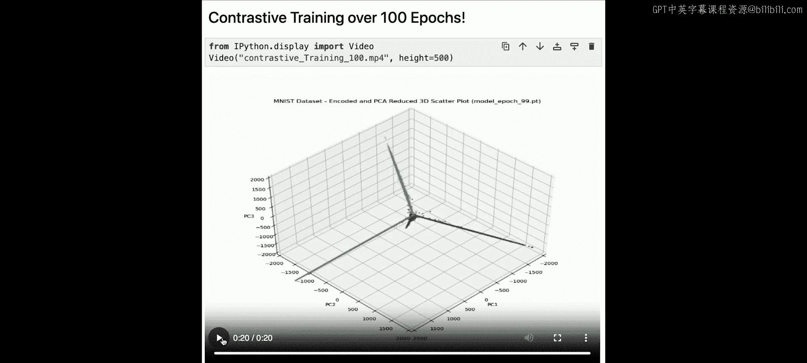