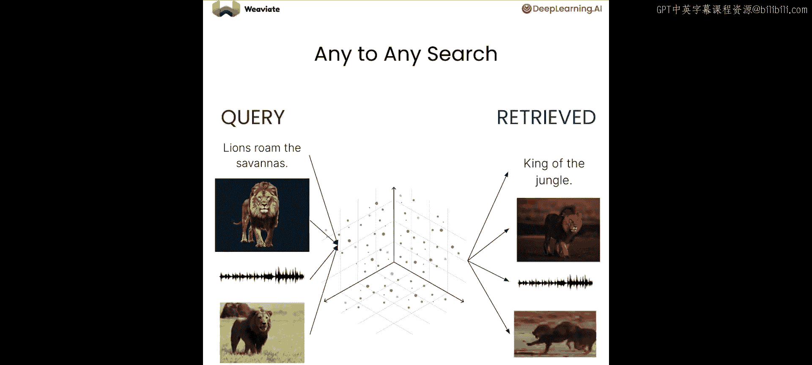
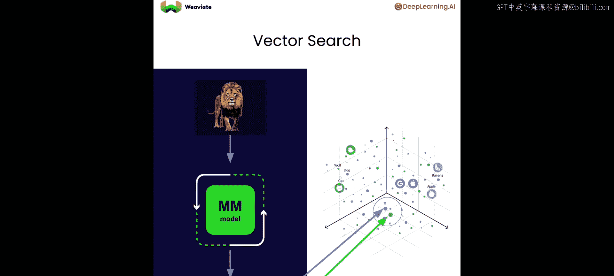
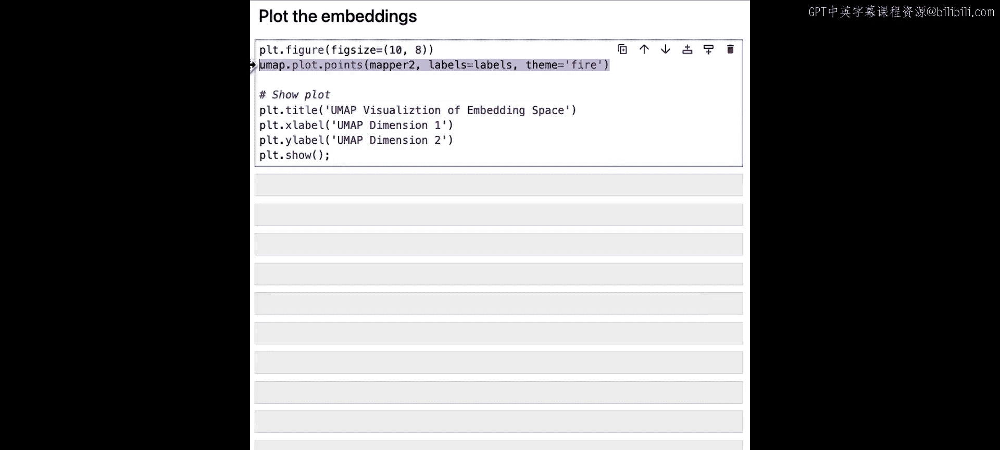
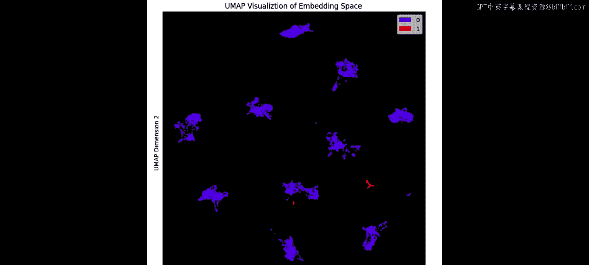
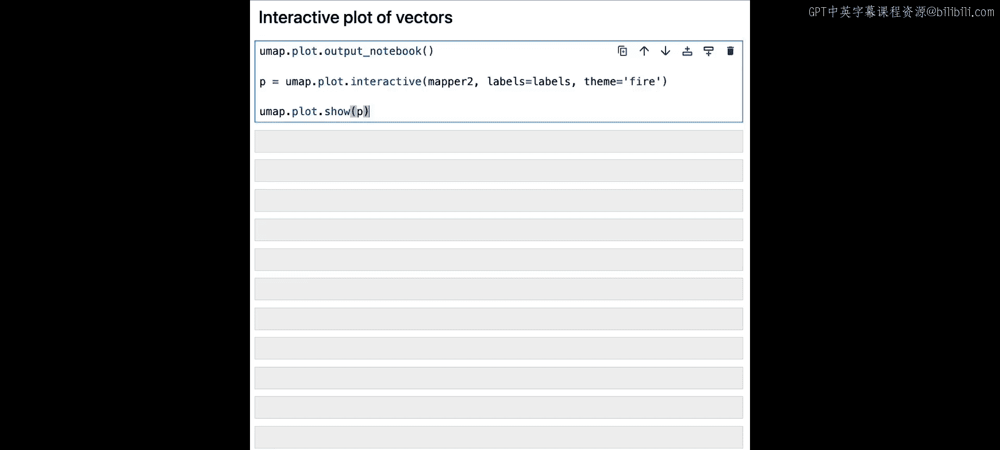
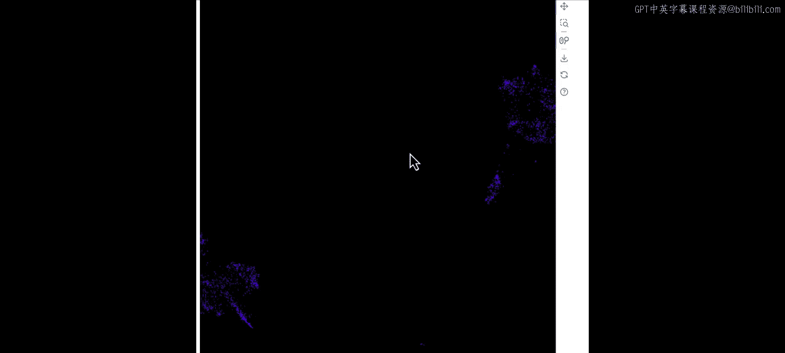
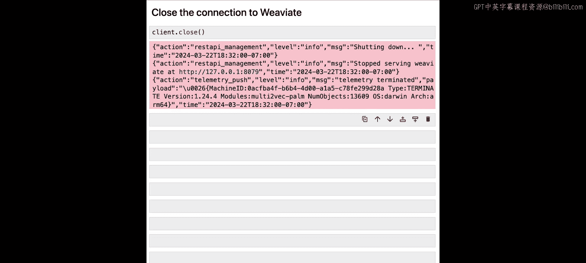

# 吴恩达《构建多模态搜索和 RAG｜Building Multimodal Search and RAG》中英字幕【短课均可关英文字幕】 - P3：3.L2 Multimodal Search.zh - GPT中英字幕课程资源 - BV1sx4y1W7uV

In this lesson， you learn how a concept is understood across multiple modalities。

 and then you implement a multimod retrieval using Vivi， an open source vector database。

 You build a text to any search as well as any to any search。All right， let's have some fun。

Even though you can't hear this video， you can probably hear the lion roaring in your mind's ear。

 This is because humans are very good at inferring information across modalities。 so good in fact。

 that we can even do it in the absence of the other modality here being the missing sound。

Or in the case of this video of a train passing by。

 you can probably imagine the tutu sound or even feel the wind or the ground shaking。

 This is because we are very good at understanding information from all of our senses。

 whether we see hear， feel or smell， and we can understand the very same data point using multiple senses from multiple modalities。

😊，And the same goes when you hear the sound like this one。

You know straight away that this is a cash register。

 this is because your multimod reasoning works in all directions。

And the way a machine can gain a similar understanding of multimodal data is by creating a shared multimodal vector space where similar data points。

 regardless of their modalities， are placed close to each other。

And with the unified multimodal embedding space， you can perform text to any modality search。

 for example， you can search for Lions ro de Savannas and in response。

 get back multimodal data that represents the most similar content， whether this is text， images。

 audio or even videos。You can even perform any to any search where your query can be in any modality and your retrieved objects in all available modalities as well。

 For example， you could use an image of a lion or a video a to match all those matching objects。

Now， let's go over step by step how multimo searcharch works。First， if we take a king of the jungle。

 run it through an MM model， well get a vector embedding back。 then we could also take a video。

 pass it through the MM model， and we get another vector embedding back。

 and you could already see that this vector embedding are pretty similar to each other。 And as we go。

 we could be loading millions of objects， if not billions and eventually create a whole vector embedding space of all our vectors And for example。

 we could take a picture of a lion and pass it through an MM model which will give us a new vector embedding。

 We can then use that vector embedding to point into our vector space which will show us where all the similar objects are in response。

 get another object like this bunch of lions running。😊。

Let's now see all of this in practice in this lab， you add multimod data to a vector database then perform any to any search。

 Allright， let's code。So here again， let's have the function to ignore all the unnecessary warnings。

 So now let's load the necessary API keys to run our large multimodal model embeddings。Like this。

And now let's connect to Vivi8 and for this we are going to use the embedded version of Vivit which allows us to run them the database in memory。

 and we need to think we need our multi toV module that does the multimodel vectorization and also helps us with search and then in here we need to pass in the necessary key for that model to work。

So let's run the connection。And we are connected。And don't worry about these messages that you see here。

 Those are just information messages。 as we are connecting to the database and about everything that is happening underneath。

And now let's create the collection that we use for storing our vector embeddings in all our images。

 etca， and we colic animals。And what we need to add next is a vectorizer。

 so this is a multituV vectorizer so that can work with both text and all different modalities。

 and we are telling wevi that for images， we will use the image property and for vectorizing video fields。

 we use video property。And then finally we need to add additional information like where the project is and the most important one is what the model that we are using So for this lesson we'll be using the multimodal embeddings 001 and we want to get all our embeddings of 1400 dimensions and then before we run it I'm going to add this little conditional function so that if you ever need to rerun it basically we will check if the collection animals exist so we can delete it and then recreate the whole thing the only thing is that be careful because if you delete a collection you lose all the data in that collection but let's run it now。

And now we have an empty collection。And now let's add the helper function， which we've given part。

 will give us a base 64 representation of the file there。

And we need this function because that's how we pass any image or video file into an embedding for vectorization。

 So now that we have an empty collection and a function to convert images to base 64。

 we can go and start inserting the images so we need to first grab our animals collection and then these animals now is going to be our way of communicating with this specific collection。

Next that we want to do is find all the images inside the source image folder。

And then we are going to open a batch process that will limit importing the data to 100 per minute。

 and we are going to iterate through all the files inside that folder。

And then finally what we can do is basically as we go through every file， we can print a message。

 grab a path to this file and what we are doing is calling batch doar object。

 which is basically a way of telling to to weviiate say hey here's a new object and here's the name of the file。

 here's a path but the most important part is this when we converting that image into basic 64 representation which would then end up as a vector embedding and then there's a little label that we call media type this is what we use later for displaying the images。

 this how we know whether it is an image or a video and if I run this this is going live import all the data so we actually import this objects as Jason but together with this we generate vector embeddings which will be attached to every single object which later allow us to actually search to this collection。

And finally， let's run this code， which basically goes and checks for any failed objects if and if everything was fine。

 we should just see no errors， which is great。 We're good to go。So now that we have the images in。

 it's time to start importing videos， just a little warning with the model that we are using all videos should be at least four seconds long。

 Otherwise the vector embeddings that we will get back are not going to be quite great So the code is pretty much the same this time we're just going through the video folder and then basically instead of passing it as an image property this time we are passing to the video property and the label is also video this should be a little bit slower than vectorizing images but it's still not too bad So just give it a moment and you should be good to go。

And one more time， let's check if there are any errors， no errors， so everything is good。

And just to summarize， we should be able to see how many objects we have and of what type and we can see that we have nine images and six videos。

 so that's exactly what I expected。So now that we have all the data inside the database。

 we can start looking at search， but before we get to that， we need a few helper function。

 So this helper function allows us to actually print our results in a nice matter。

 especially this one display media。 So given an object， depending on the label。

 whether we labeled it as an image one or a video one we displayed in an image or a video cell。

 let's run this。And the other set of helper functions are those that allow us to convert an image from URL。

 or again， the same one for converting to base 64。And now this is the moment you are waiting for and where the fun begins querying。

 So if we grab our animals collection， what we can do is run a query of type near text。

 which basically means that we can use text to search through our multimodal collection。

 So we are looking for dog plane with a stick。 and were to get back name path and media type and we want just get the best three results and run it。

😊，That runs pretty fast， and we can then display all the results and want to iterate over the objects in there。

 and we use our help and functions from before， like the display media。

 so we should get some results。And you can see straight away that the first result is a video of a dog running with a stick。

W is school。But also， we have a picture of a dog and another video of a dog giving a high5。

 How cool is that， I want to adopt this dog。Alright。

 so now we've done text search and I think you've done it before probably。

 so let's try something harder。 How about we use this image as an input for a query。

An query for this is actually very similar， except this time we are calling near image and we are converting this file to basic4 format。

 So we are using the test cut and again return the same properties and iterate over all the objects。

 and let's execute it。And in response， we get this cut。And two more。

 which basically shows that the search worked really well。

And now let's try to search for an image that is somewhere on the internet。

 so we have this image of Amercat， which you probably have guessed is my spirit animal and we are going to run a very similar query except this time we call URL to base 64。

 but the rest of the query is pretty much the same。And if we execute this。

We'll get these pictures of one immigrantra that looks kind of angry， but he's all right。

 Don't worry about him。 And we have another one chilling。

But the fun thing is that we also were able to match a video of a me cut。😊，So with that。

 we were able to actually do a multimodal search that we used images to find both other images and videos。

 and this is very powerful。😊，And now for something that is probably the hardest task for an LMM is to make a video search。

 So let's try to run the search with this video of these two mecas just chilling。

And this time what we're going to call is a near media function。

 and we again converting that video to a basic for representation will tell the collection that this time this is a video that we're searching for。

 and if we execute that。In response， we get two videos。And a picture of a me cut。And just like that。

 we're able to actually perform any to any from text to images to video and getting all kind of modalities in response。

😊，And in this part， what you want to see is actually how this vector space looks like when we are loading both video and image embeddings and how they actually live on the same space and for concepts that are similar。

 they should be next to each other。So let's start by loading some of the necessary libraries and probably the most important one here is the UM map。

 which allows us to reduce the dimensionality of the vectors so well go from 1400 to two dimensions。

 which will allow us to actually plot it as an image as a two dimension image。

And now what we want to do is load the vector embeddings in the media type from with it。

 and we are using this iterator function， which basically would go to all the objects that we have in our collection and then give us back vector embeddings。

 but also we can access all the properties like the media type。

And you can see here that we are not calling the An collection anymore。

 we have for your benefit because if we just try to visualize a vector space of 15 objects that's not going to be very exciting。

 so we preloaded this database with 14000 images and videos so that we can actually get some better results so let's run this and then quickly pull all the vector embeddings together with some of the properties that we need。

Now what we are going to do is set up a data frame with our embeddings together with the labels。

 which will act as a series。And this line is what does the conversion from the 1400 dimensions to two dimensions。

 And don't worry， this actually should take a little while， could be up to half a minute。

 but after that， we should be good to go。And now that we have all the embeddings precalculated and drop down to two dimensions。

 we can actually plot them So this is the function that performs the plotting。 and if we run this。

 we get a nice vector space and something that I haven' mentioned earlier。

 the data set that we prevectorized for this exercise actually came from 10 different categories So you can see how and like we said。

 similar vector embeddings always stored very close to each other。

 you can see 10 groups of vector embeddings that are close to each other。

We can also use the Uabb library to plot an interactive map to see all our vector embeddings。

And this is the interactive plot。 and if you don't see there is on the right hand side。

 there are special buttons that if you click on them allow you to do to perform different functions。

 If I choose this one， I can， for example， highlight this area and can zoom in in here and we can actually see different types of vectors that will start together。

 You can go have fun and review whatever we have on our vector embedding space。

And then the final step that we have to do。 and that's something that you always need to remember when you're done with this vivid instance。

 where we have to do is just close it so you can open it from another notebook。In this lesson。

 you learn how you could use a vector database with multimodal models。

 how you can vectorize them and store metadata together with the vector embeddings and then use text and image and video search across all the modalities。

 but also we run a nice test and plotted 14000 different vector embeddings to show how similar vectors are grouped together。

 even if they come from different modalities。😊，And in the next lesson。

 you will learn about large mo model models and how they work and how they get trained。

 so I'll see you there。

