# 吴恩达《构建多模态搜索和 RAG｜Building Multimodal Search and RAG》中英字幕【短课均可关英文字幕】 - P4：4.L3.LMMs.zh - GPT中英字幕课程资源 - BV1sx4y1W7uV

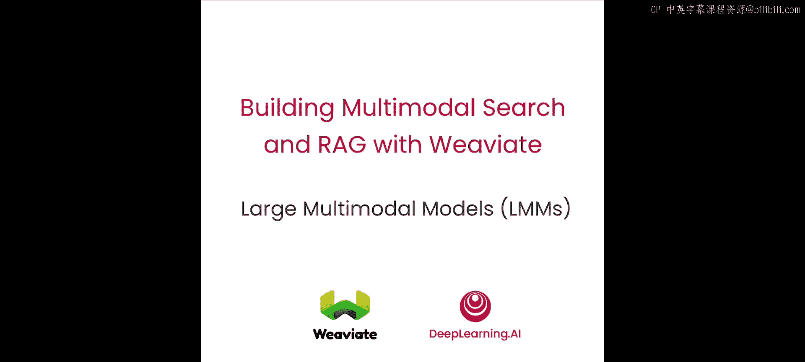

In this lesson you will learn how large language models work and how they understand text。

 then you will learn how to combine LLMs and multimodal models into language visual models using a process called visual instruction tuning and finally you use all these models in practice。

 Alright， let's go。

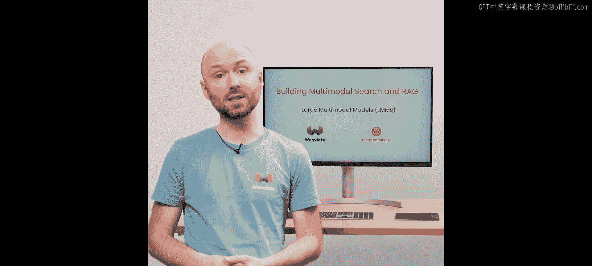

Current LLMs are all generative pretraining transformers。 For example， Lama 2， ChagPT or Miral。

 This class of models are auto regressive because they generate one token or one world piece at a time。

Further tokens that are generated only depend on previously provided or generated tokens。

And then these models have been trained in an supervised manner by predicting their next work on trillions of tokens。

 In this training process， they output a probability over all possible next tokens。

 and we train them to get this correct。😊，Let's take a look at an example。

 Jack and Jill went up the blank， which outputs a score for every token。

 where more pro tokens like mountain and Hill will have higher scores while less pro tokens like Apple and Lama will have lower scores。

You can think of these scores as abnormal normalizedized probabilities。

 These scores are then normalized to percentage points like this。Given a prompt the rock。

 we want to see how the model completes this。We use one hot vectors to represent each word and then look up the embedding for each token。

 Once we get the embedding for a token， the transformer model will try to generate the next word by paying attention to the first word。

 It always starts off with beginning of the sentence token。

 And because we know the first two words are the rock。 We can force the model to output them。

 And in fact， this is actually how the model is trained。And once the model outputs rock。

 we input this word representation as one hot vector back in。Now。

 the mo looks up the embedding for rock and also pays attention to previous words in the same sentence。

 and it outputs a probability over the next possible tokens that we can sample from。

 And here we can see that we sample the word rolls。 We pass this forward and generate the next word。

 which is along。This can keep going until we hit the token limit or the end of the sentence token。

 and this completes the generation。 And because the output is probabilistic， each time we generate。

 we could actually get different results。 So let's look at another possible completion。

Let's say we get the word skips， and we pass this word forward。

 And the next word that we get is fast。 If we keep something。

 we can get a completely different generated response。😊。

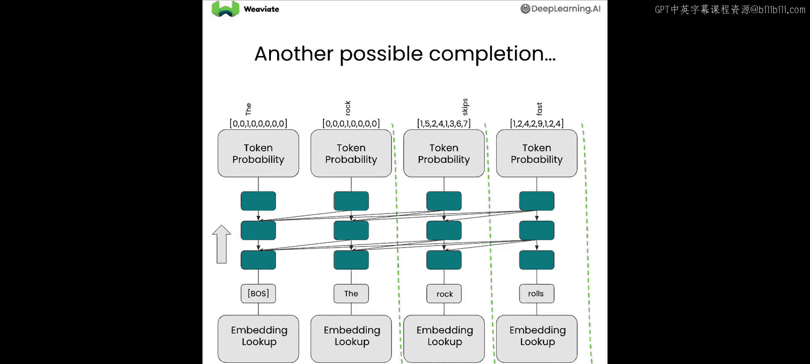

Here's a simple example of an image classification model。

 which takes in an image and outputs a class label。

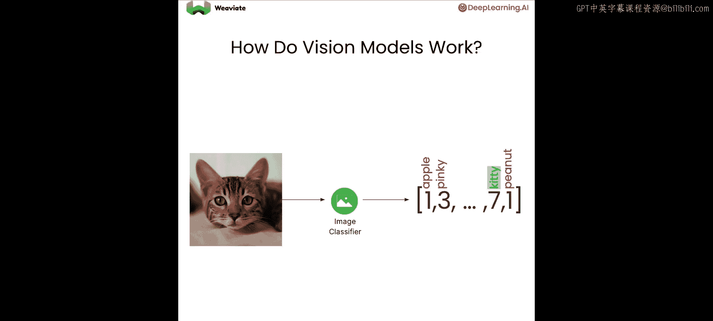

A vision transformer works quite well for this classification task。

 It processes an image as patches instead of individual pixels。

 which makes the analysis much more efficient。 So let's look at this in more detail。

 Each patch of the image gets vectorized and passed into the transformer model。

 The transformer can choose to pay attention to any patch and is optimized to output the correct label。

 Now， let's see how you can use visual instruction tuning to train an LM to process images along with text。

 given an image and a text instruction。 And in this case， it is the starry night。

 And the question is who drew this painting， you can train the model to output the correct answer in text。

 which is， of course， Vincent Vang。😊。

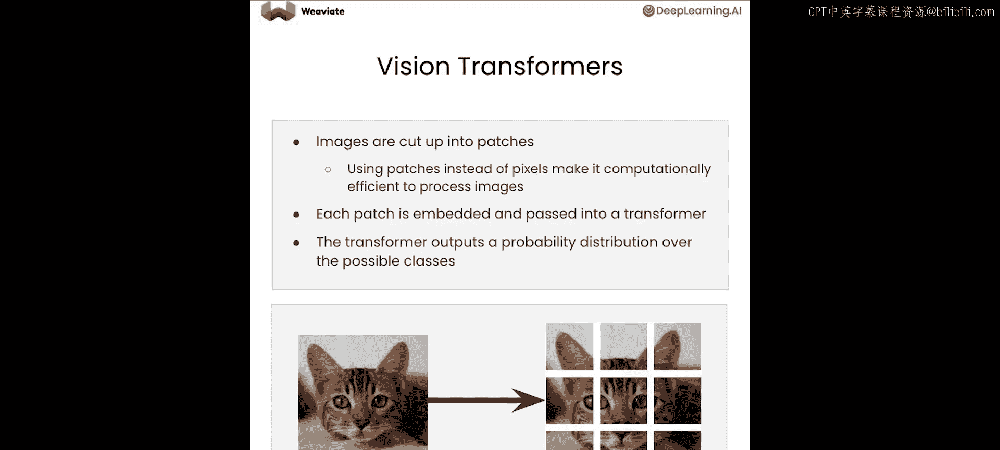

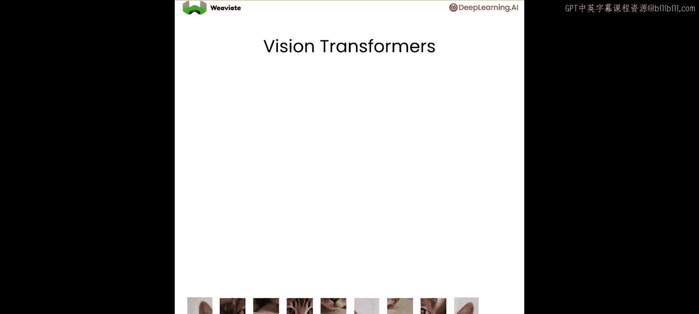

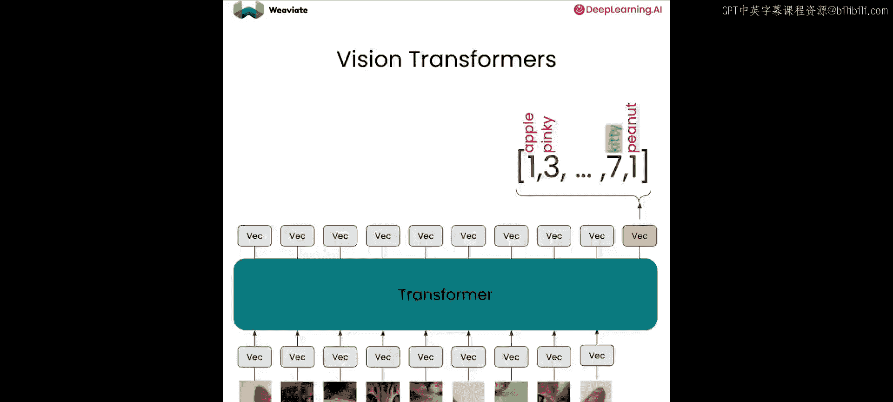

Now let's look at an example of visual instruction tuning。

 You are going to start off with your image， the St night painting。

 and then you're going to cut it up into patches， and you also have a text instruction who through this painting。

 So you are going to take the patches of our image and embed them into vectors as seen in here。

 and you are going to take your tokens from our sentence into the instruction and you're going to embed that into vectors as well。

 Now the language model is going to be trained to understand and pay attention to both the image patch tokens as well as language tokens and it has to output the correct tokens for the answer Vinncecent Van Gog。

 This is known as visual instruction tuning because you are given a visual as well as an instruction and you know what the right answer is。

 you can optimize the probability that the model generates the right output token in the process it learns to understand images。

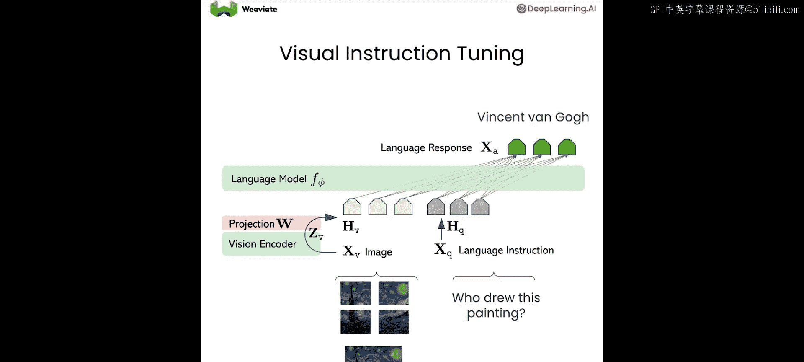

After an LM is train using the visual instruction tuning， you can now process images as well as text。

 You can now think of the model as a large multimodal model and LMM。

 You can also ask questions about objects in the images。 For example。

 ask for detailed structure description of the image content like this。 De a picture for me。

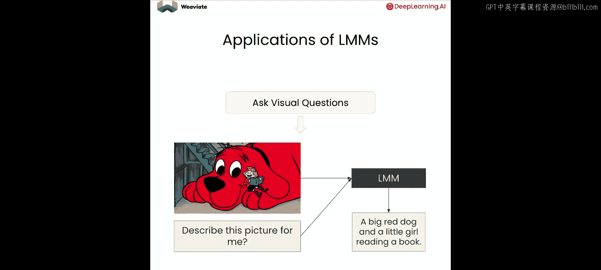

Let now see all of this in practice in this lab， you use images and text as input。

 Then you get LM Ms to reason over it。 Alright， let's code。Alright。

 so let's start by adding a command that will ignore all the unnecessary warnings。

 Now let's do a bit of a setup。 So in this lesson we'll be using Gemini Pro So what we need to do is load our API keys and then also as part of this what we have is a GenI library where we need to pass in the key。

So let's load some helper functions so now what we need is a function that will take a piece of text and we extract it and turn into readable markdown。

And now let's construct a function that allows us to call LMms。

 so that function will take an image path and a prompt and the first thing we need to do is load that image and the next thing that we need to do is call the generative model for Gemini Pro with the prompt and the loaded image。

And then finally， we need to return the result and that's where we're going to use that two markdown function。

 which will take this text from the response and then parse into something nice and readable。

So now we can start analyzing some images and we are going to start with this beautiful index historical chart。

So now let's call our LMM function and give the file and and a prompt。

 which says explain what you see in this image， will try to get LM to analyze this chart and usually that takes a couple of seconds。

And now we see a nice description which basically says that the image shows historical charts from S&P 500 and gives us a pretty nice analysis of what we really seen here。

 and this could be quite helpful。And now let's try to analyze something harder。

 so we're going to use the graphic that we use in our slides and we ask the LMM to give us a hand in explaining what this figure is actually used for。

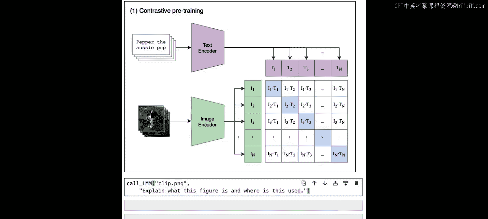

So this is the result and in here you can see that the model recognized that this was an image that was used for contrastive pretraining framework。

 which is actually pretty accurate and then actually explains about like different types of encodes for text and image and so on and so on。

 so maybe I should have used it for preparing this lesson。

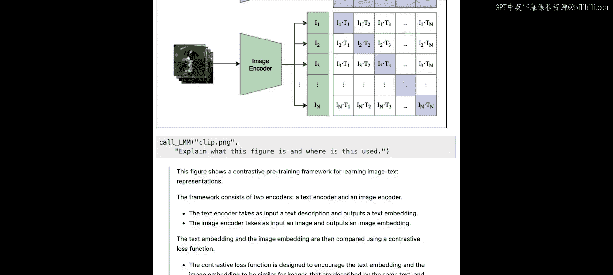

So here's a fun example that I want to go over so if you look at this， this is just a green block。

 there's nothing special about it， so I'm kind of curious what this LMM can come up with when you's trying to analyze this so let's ask that LMM to see if can see something special about this image。

😊，Let's execute it。We can see that L M M recognized that there is a hidden message that says you can vectorize the whole world with weiate。

 So let's try to run this function that will show us。

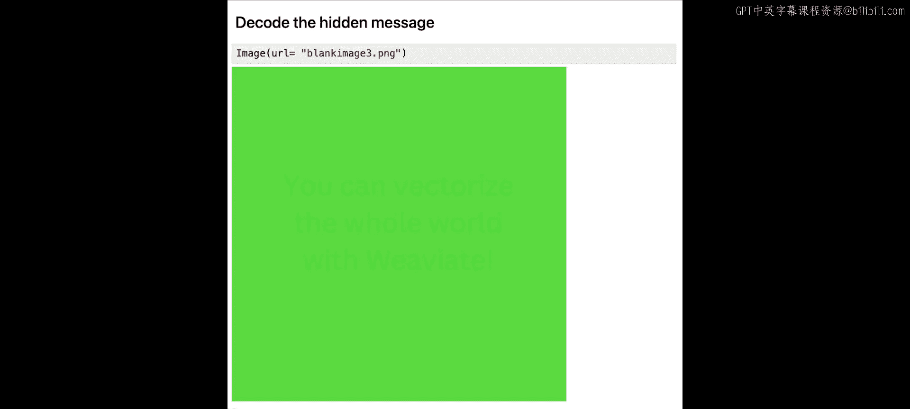

Where this message was he。 And then in here， what we are actually doing is we're looking for anything that was in the first channel where the value was over 120。

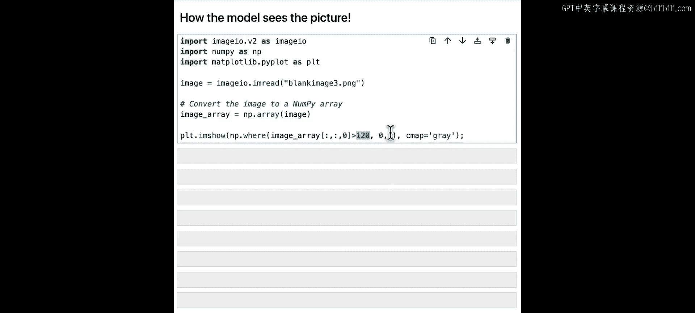

And by running this， we can see that this is the message that was really hidden there。

 so anything that was over 120 became white， anything under is black。

 and that's how the LMM was able to decode the message and tell us about it。

So LMMs actually don't see the way we see， they can actually see a lot more and be more inquisitive about some of the images that they're looking to and that's how they can decode this kind of stuff。

 I'll include a function in a resources for this notebook so if you want to create an image with a hidden message like this one you'll be able to do it just like that and send it to your friends。

😊，Alright， so in this lesson， you learn how to use image vision models and how to actually analyze images together with text prompts。

 And then in the next lesson， you will build a multimod rack up， See in the next lesson。

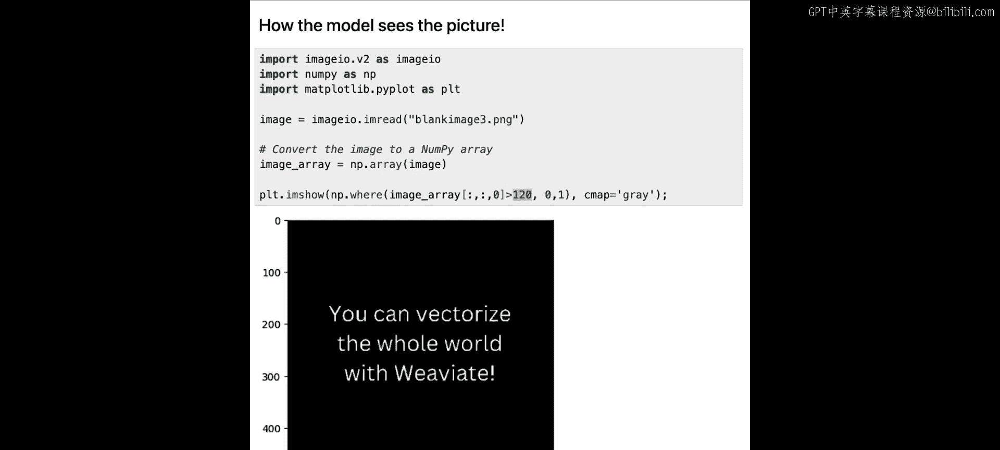