# 吴恩达《构建多模态搜索和 RAG｜Building Multimodal Search and RAG》中英字幕【短课均可关英文字幕】 - P5：5.L4 Multimodal Retrieval Augmented Generation (MM-RAG).zh - GPT中英字幕课程资源 - BV1sx4y1W7uV

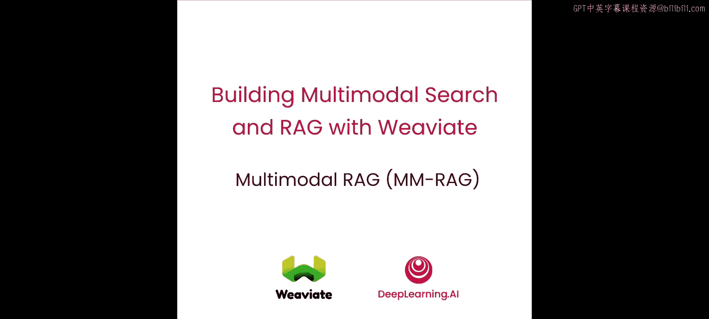

In this lesson you learn the concept of multimodal retrieval augmented generation by mixing multimodal search together with language vision models。

 then you implement the full multimodal rack process using WiI and a large multimodal model Allright。

 let's get coding Even if all the geneive knowledge the problem of large language models is that they have no information about data that wasn't presented to them during training。

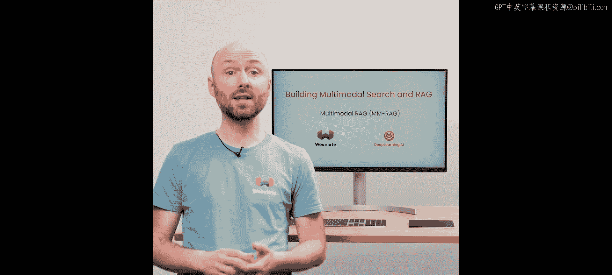

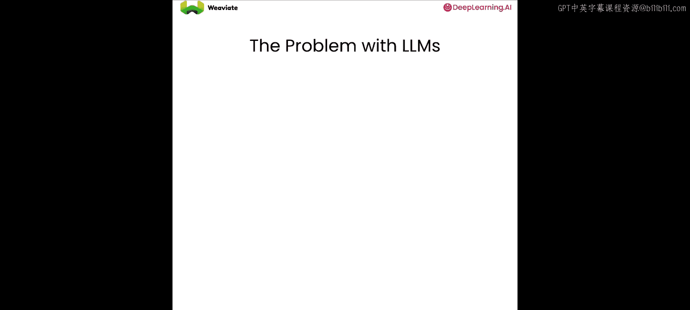

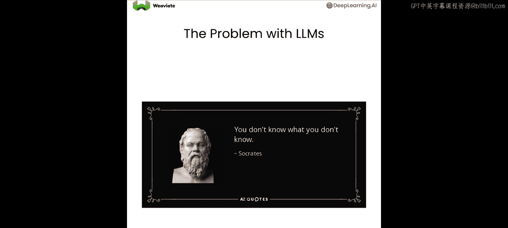

So if you try to prompt them for information that they don't have。

 they will either say that they don't know or what is even more likely they would just hallucinate and make up an answer。

 which is probably even worse。

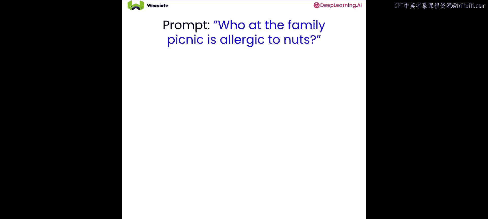

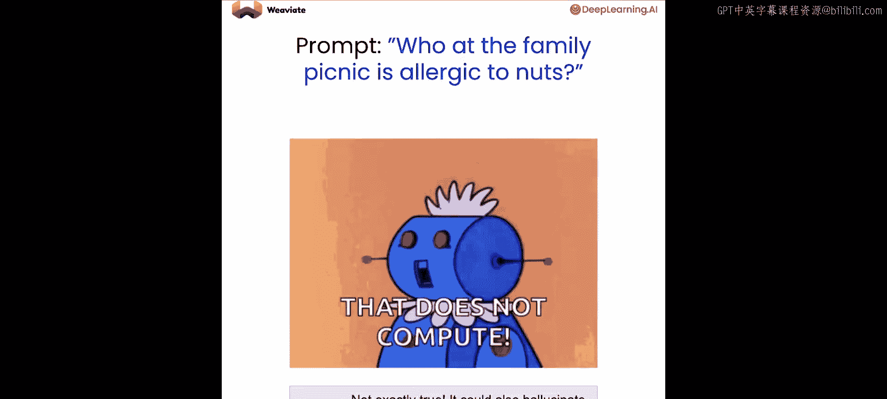

A potential solution to this is retrieval augmented generation or rock。 here。

 what you do is instead of just providing the language model with a question in the form of a prompt。

 you give it a question along with retrieve relevant information。

 Now the model can perform this read， then generate operation where you can read relevant information before you has to answer your question And now the output is customized to the information that you provide it。

Typically， if you want to scale up your rack solution。

 you want to put all your documents into a vector database like Wvi8。

Then you can retrieve the most relevant documents from the vector database using the prompt。

And pass those relevant documents into the context window of the large language model together with the prompt。

 This way， you help your language model to generate a response based on the provided context。

 But as you already saw that a vector database is capable of retrieving a lot more than just text。

So let's take advantage of the multimodal knowledge base with Viviiate to store and search through images。

 video and text in this diagram， here you can see retrieval of an image from our multimodal vector database Pass that image along with text instruction to a large multimodal model。

 you get a response that is grounded in the multimodal understanding of the world。

 This process is known as multimodal retrieval augmented generation because you are augmented the generation with retrieval of multimodal data。

😊，Let's now see all of this in practice。 In this lab， you use images and text as input。

 Then you get L M Ms to reason over it。 Thus completed the full rack workflow。 Go。

 let's go and count。So like in the previous lessons。

 let's start with a little command that will ignore all the unnecessary warnings and we're good to go。

And now what we need to do is just load the necessary API keys and we're actually going to use the combination of the two keys that we used in the previous lesson。

 so well have the embedding API key and the key that we use for our vision model。

And now that you have the required API key， it's time to connect to the WiI instance and this time what we're going to do is use this special backup system and that's because we created a data set with 30。

000 images prevectorized so that you can import them really fast without actually having to wait for that。

And in order to restore those images that we promised。

 we basically have to run this little command here where we specify the resource where we want to go。

 but the most important thing is that the collection name where we will load the new data set is called resources so we can execute this and this would take around5 to10 seconds and we should be ready to go。

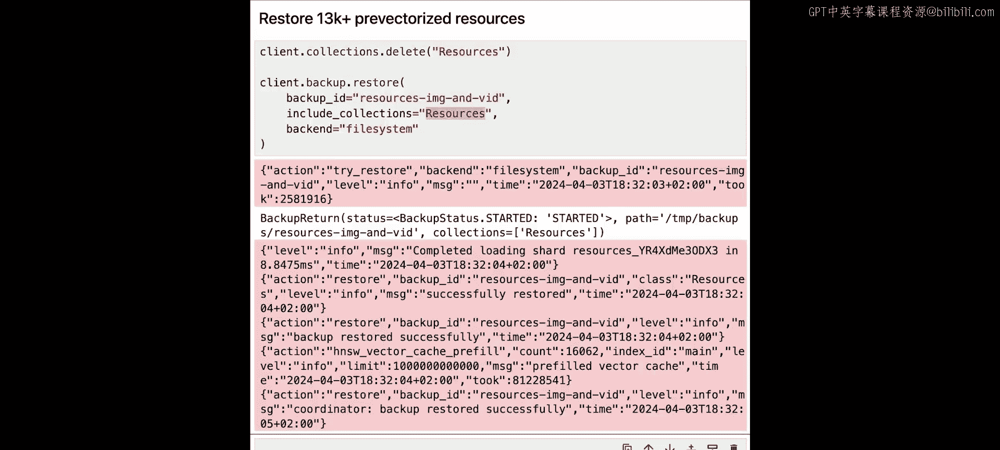

And now what we can do is very quickly preview the number of objects that we have in the collection。

 so we are getting the collections object running an aggregate function that basically counts all the objects inside and grouping them by media type and then now we can go basically printed based on what we get per group and running this we can see that we have over 13000 images and then 200 videos We won't necessarily use the videos in this lesson but you can try to query them later if you want。

And now we're getting to the fun part of running the full multimodlar rack in two steps。

 So the first step will be to send a query and retrieve content from the database base and a query。

 So we will do it as a function called retrieve image。 So given a query we want to get an image。

 So in the first part we basically have to grab our resources collection。

And now that we have our resources collection， basically we're calling a near text query。

 so given the query from the function， we are also providing a filter because in this case we only want to get images that will pass into the vision model later and really we are only interested in a path to the image and we return just one object。

And then once we get the result back， we'll grab the first object。

 grab the properties and we'll return from this function just the path to the image that we're able to find with the near textex query。

 So in summary， if we run this given a query， we should get back an image URL that matched to our query。

And now you can test the retrieve image function。 So how about trying query like fish with my buddies。

 and then if you run this， you should get something like this like you see here we have a man holding a fish and probably the dog was recognized as the body of the man on the picture。

 So if you run a different query and your query is not exactly represented in a data set as the query。

 you may get surprising results but don't get discouraged by this that's part of the game。😊。

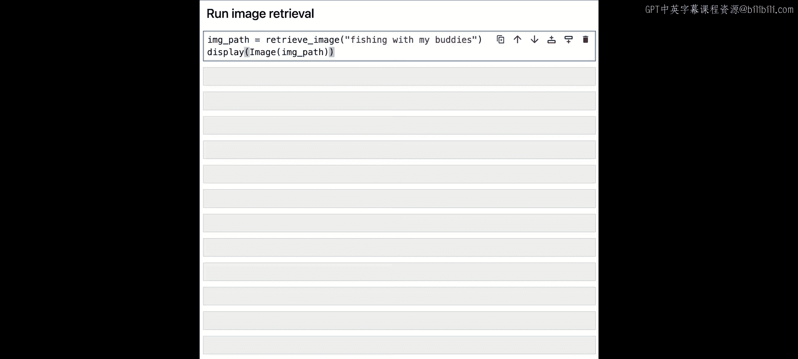

So feel free to play with different types of queries， just a little caveat。

 the kind of things that you will get back depend on what's already in the data so if you're searching for something that's not in there or not exactly represent you might get some surprising results so now you're done with the retrieval part and we can move on to the generative part。

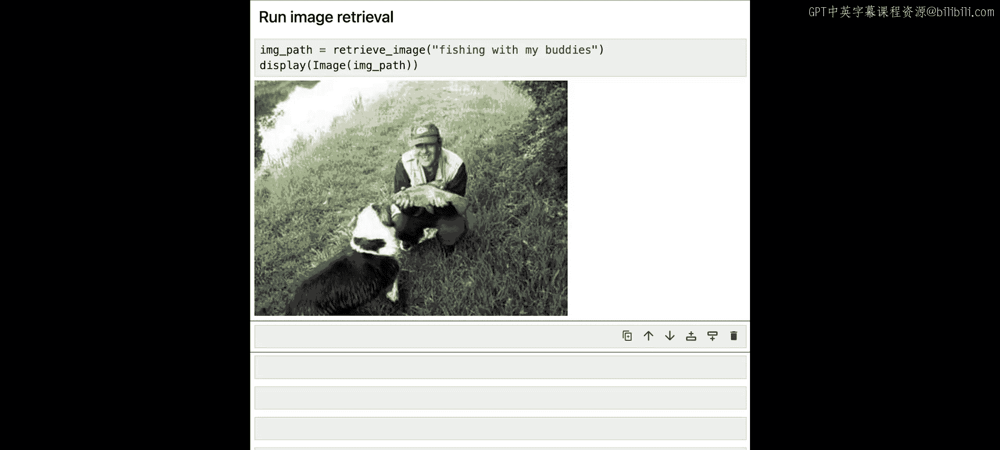

And now for the generative part， you are going to follow the same steps as you did in the previous lesson。

 so you need to set up the API key for the generative model。

And also like you did it in the previous lesson in to set up the helper function to convert output to markdown and the call LLM function。

 which given an image path and a prompt can generate a nice description of the image。

And finally to complete the loop， you're going to call the LLM function given the image path from the retrieval segment。

 so that was from step1 and the description， you should be able to execute this which takes about a few seconds and you should get back a description of the image of a man holding a fish with a do next to him。

And you can see in here the description I got it talks about a man with a green h and a khaki vest holding a large fish in his hand。

 etc cea， et cetera， and even talks about the dog standing next to the man。

 you probably will get a different description than I did。

 but that's part of how the LLMs generate responses token by token。

And now you can combine all of it together， so let's create an MMR function where the first step will be to call the retrieve image function。

 and then the output will be saved inside the source image variable。

And a second step will be to call LLM with the source image from the previous step and the prompt。

 and that should return the description。So， let's execute this。And finally。

 you can call a full MMR functions so you can search for something like paragliding through the mountains and that should both grab an image and also at the end。

 provide a description of the image just like this andvoa that worked pretty nicely so you have a nice picture of someone paragliding and there is a description of someone paragliding over lush green mountain I'm sure you get a very similar result。

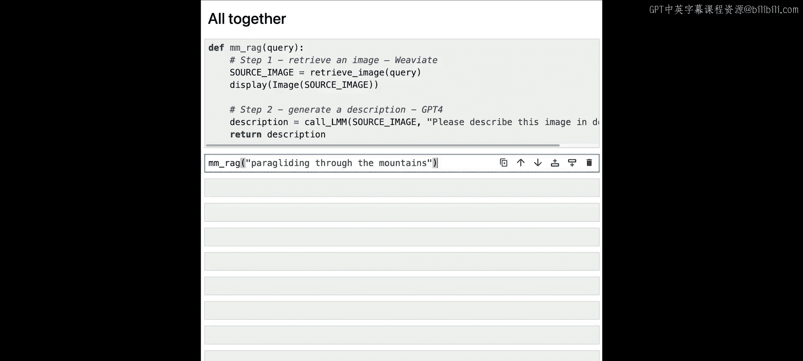

And just like this， you are able to combine two different parts from lesson two and three。

 the retrieval and the generative part in order to actually get a multimodal rock function。

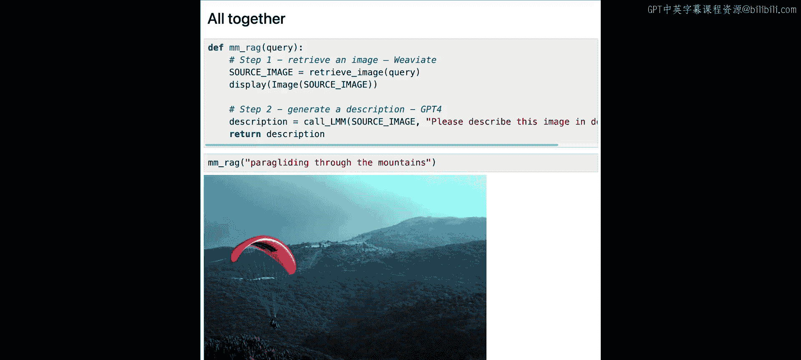

And now， the vivid instance is closed。Co so in this lesson you learned how to combine the retrieval together with generative models。

 even though these two were two completely different models you were able to actually build something that combines into one big functionality which gives you a lot of power and in the next lesson you learn how to take this into industry applications and try this on many different real life use cases see you there。

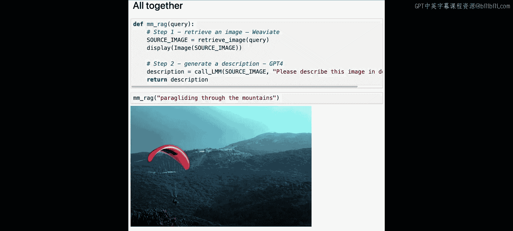