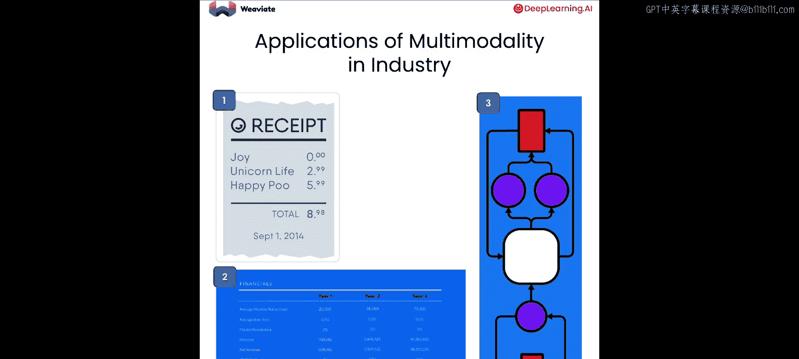
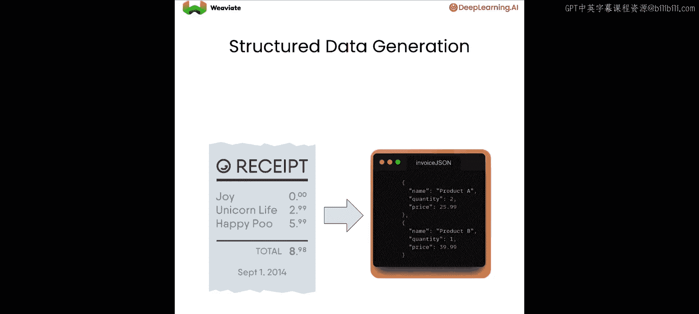
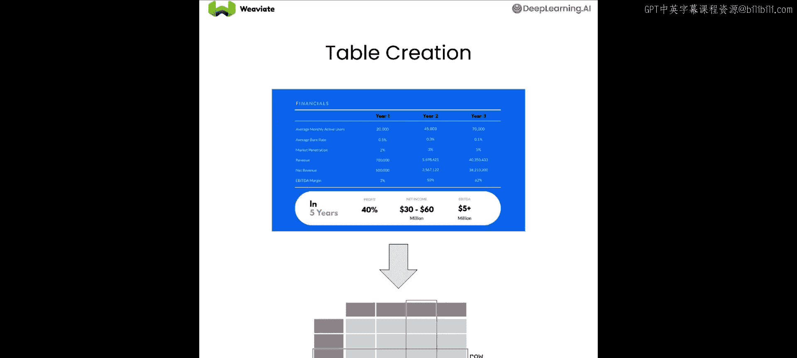
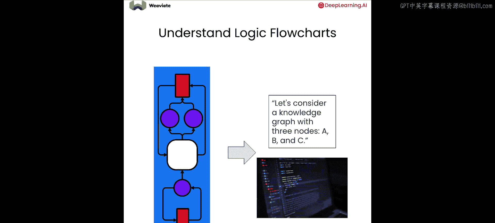
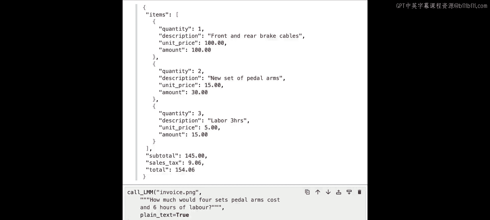
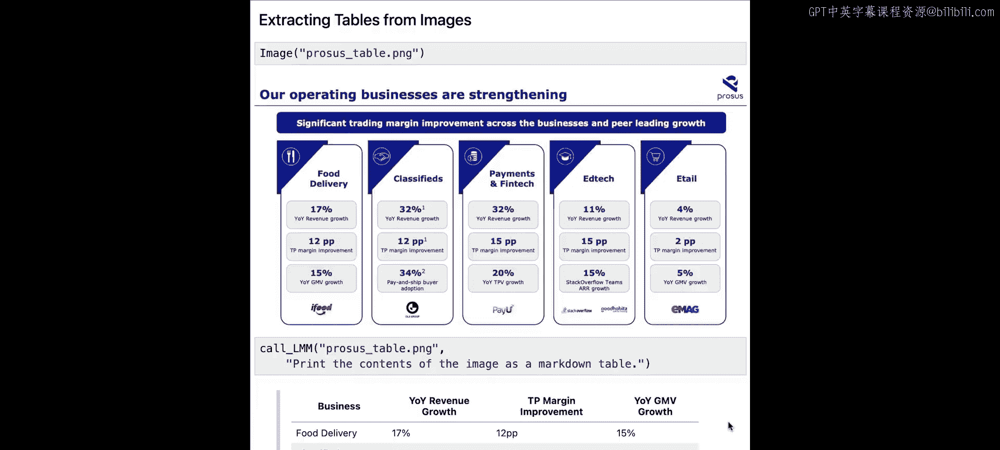
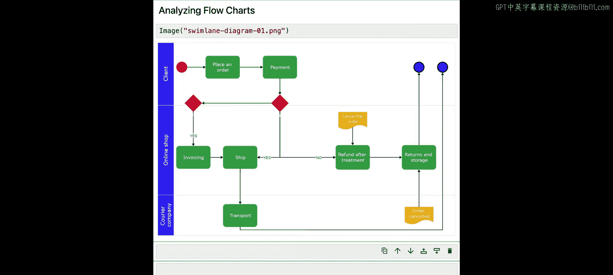
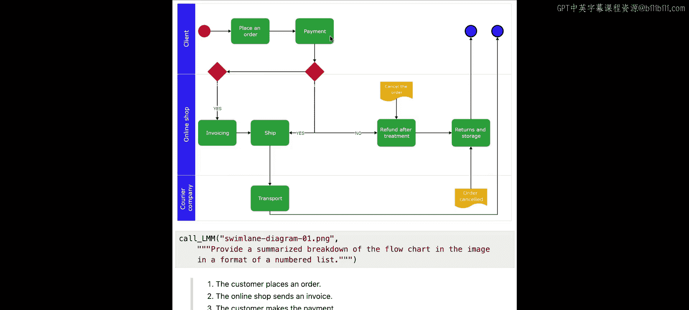
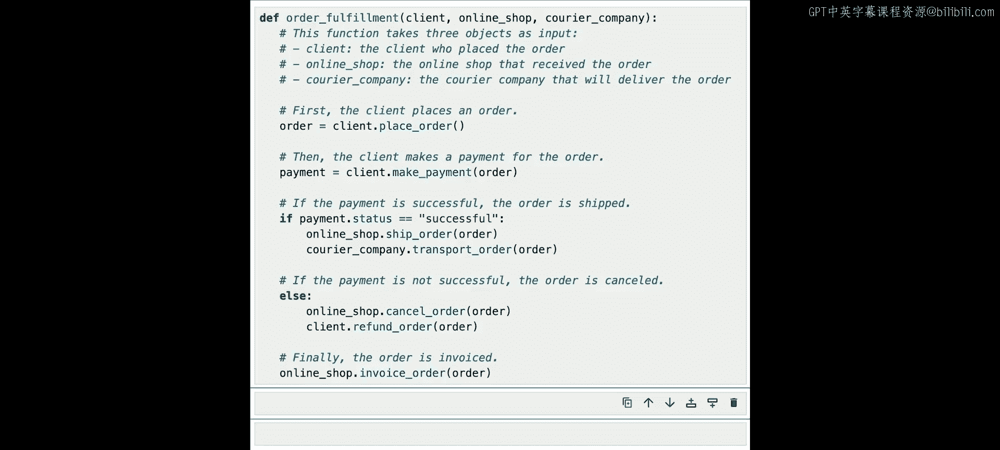

# 吴恩达《构建多模态搜索和 RAG｜Building Multimodal Search and RAG》中英字幕【短课均可关英文字幕】 - P6：6.L5 Industry Applications.zh - GPT中英字幕课程资源 - BV1sx4y1W7uV

In this lesson you will learn how multimodality is used in industry by implementing real life examples。

 you analyze image content like invoices and flow charts to generate structured output in different formats and styles Allright let's good building。

In this lesson， you are going to work on three different applications of multimodality in industry。

In the first example， the input is an image of structured data like a receipt or an invoice。

 and then you extract structured fields and values from this image into adjacent format。

In the second example， you start off with a table from a company's investorss deck and will extract out a markdown tabular representation that then can be processed and used In a third example。

 you get a language vision model to reason over logical flowchars and get it to output text or even Python code that implements that logical flow。

All right， let's code。And here you will start with pretty much the same setup as you did in the previous lessons。

 so we need to ignore the warnings and also load the Vi API keys and then set up the GenI library and that's good and again you're going to use pretty much the same helper functions so one that converts an output to markdown。

 but there is a slide modification to the call LMM function where you have plain text Boolean so the purpose of this is that depending of what we want。

 we may want to return the output as just plain text or output it as markdown which will come handy later on。

As the first example youre going to use the vision model to analyze this invoice so let's now ask a question so given the invoice file let's try to identify the items on the invoice and then output the results as Jason and we're looking for quantity description unit price and amount so let's run this and let's see what the vision model can extract from this。

Now wow， okay， we see for them the second item a new set of pedal arms at a unit price of 15 and a total amount for 30。

 which matches exactly what we have on the table and it's pretty accurate so yeah。

 this is pretty awesome。😊，How would you ask now a reasoning question based on the input So maybe you could check how much would it cost for four sets of pal arms and although six hours of labor。

 which is actually quite interesting because the vision model needs to extract it from the description and then calculate the price on it。

 So let's run this and see how well it can perform on calculation like this。 And oh well。

 like look at this it actually was able to deduct the price for both the pedal arms。

 but probably the thing I thought would be the trickiest。 the 6 hours of labor at $5 per hour。

 it was able to actually correctly calculate it as a total 3 and then the full thing would cost us 90 Pre awesome。

For the second example， you're going to analyze this table which has financial information about different units and then you can see that theres some info around revenue margins and year on year growth so let's give it a prompt and the first task is to print the contents of what you see in here as a markdown table and then so that should be able to analyze every single part that we see but also formatted in a nice structure。

So if you look at just the first item， food delivery matches to 17%， 12 p and 15%。

 so this was pretty accurate。

And now let's try something more。 So let's run similar query as before。

 but this time add a reasoning message。 So we want to find which of the business units has the highest revenue growth。

 and then this should take just a moment。And now that we see the results。

 we can see that the classifieds with 32% is the one that was recognized by the model。

 and if we scan it very quickly， we can see that this is in fact the correct answer。

 it's actually on par with payments and Fintech， but this is still the right answer。

 so two thumbs up for me。And as the final example， you're going to use the vision model to analyze this flow chart。

 so let's try to ask it some questions。

And so to analyze this flowchar， let's provide a prompt like this one where you can ask the visual model to provide a summarized breakdown of the flowchart in the image in the format of a numbered list and in here we get one by one each of the items that we can see going from the start to the big to the end So if we look at this we're starting with the customer that places an order and then it goes into a payment which is part of the invoice and so on and so on。

And you can push the video model even further， so you can ask it to analyze the flow chart in the image and even output the code that would implement this as a single function。

And the thing is that because the visual models， there's some randomness to it。

 if we rerun the same function， we should be able to get a different function each time we run this。

And on my second attempt I got a very different code and this one looks that is a lot more detailed。

 and if I scroll down， we can see that the function was implemented in the full entirety So technically we shouldt be able to even execute it in a separate cell。

 So let's see if this function even executes I could run this and this worked it would probably break because it expects like the client and some other things。

 but at the very least this is a good start for us that we could take it as the basis to implement our own code and this is actually quite powerful it could be quite helpful for many of us。

😊，In summary， in this lesson you learned how to use vision model on different types of images and asking it to provide different explanation and extracting various different information。

 but also adding additional reasoning commands to see if you could push those vision models to further like calculating new values based on the original one。

 which is very powerful and I encourage you to play by yourself and try other things and in the next lesson you learn about a multimod recommender system in which you'll be able to use two different models side by side to perform search across different modalities Great。

 I'll see there。

