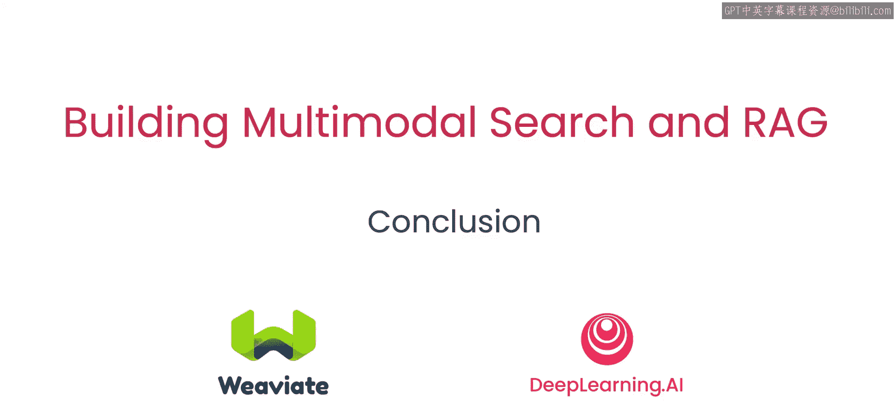

# 吴恩达《构建多模态搜索和 RAG｜Building Multimodal Search and RAG》中英字幕【短课均可关英文字幕】 - P8：8.conclusion.zh - GPT中英字幕课程资源 - BV1sx4y1W7uV

Congratulations on completing this course you are now an expert in multimodal search and rockC。

 you started off by learning the concepts of multimodality。

 you then use these concepts to build a multimodal search and then learn the foundations of large multimodal models and how they work。

You put all this together to build a multimodal rack and extended it even further to more practical industry applications。

 I'm really looking forward to see what kind of things you build with this。😊。

