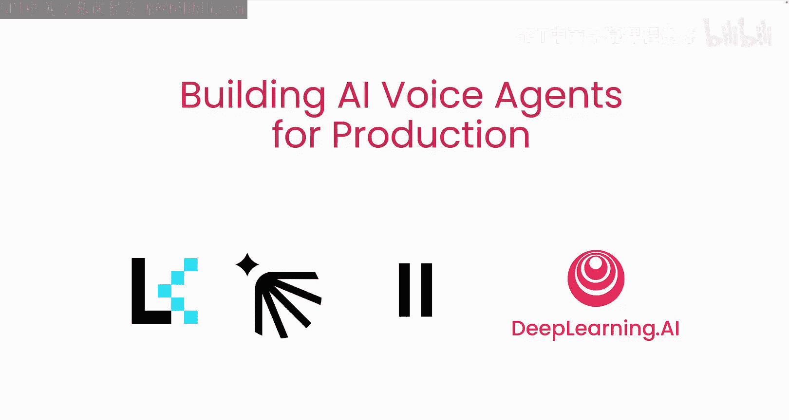
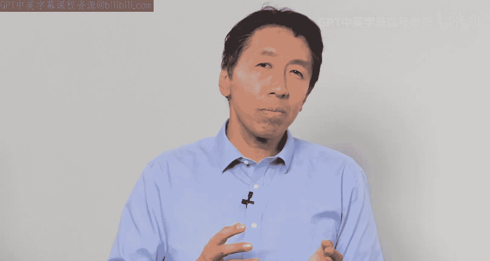
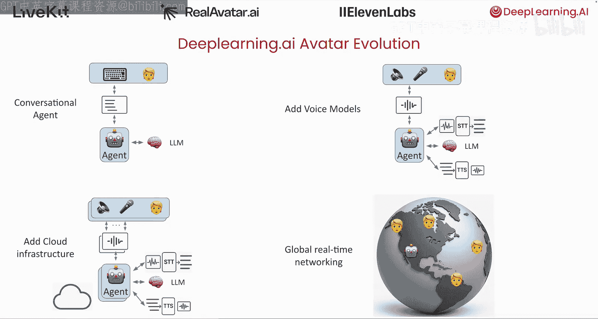
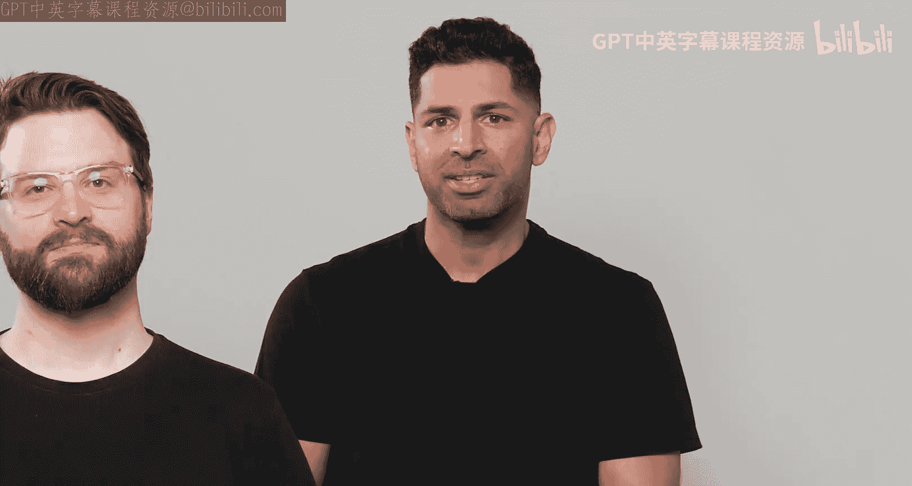
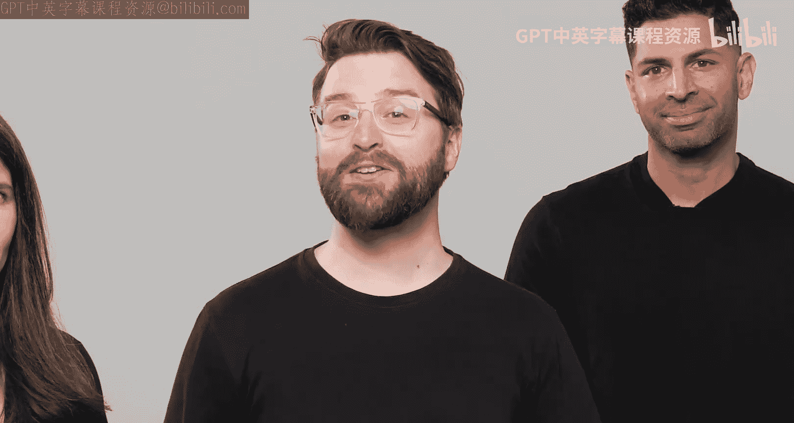
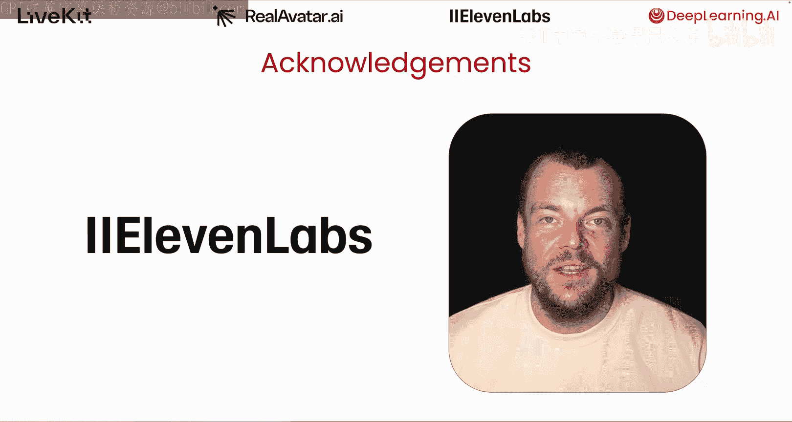

# 吴恩达《构建生产级AI语音助手｜Building AI Voice Agents for Production》中英字幕（deepseek） - P1：0.introduction.zh_en - GPT中英字幕课程资源 - BV1A25LzMEkQ

Welcome toBuilding AI voiceice Age for production taught by Rusar， Shane Emily and Naina Tlliveva。

Rus is the cofounder and CEOo and Shane， a developer advocate at Liveki。

 and Neina is head of AI at Ro Avatar and developed a conversational avatar together with the Deep learning AI team。

 Ro Avatar is also a portfoliocomp of AI Ts， which I lead Army sites about agents that can converse with users。

 This is turning out to be an important way for people to interact with AI agents。

 Deep Learn AI and R avatars teams， including Neelina had a great experience building a conversational avatar using Liveki。

 I personally also really enjoyed using live kit for various other projects。😊，In this course。

 we want to share with you some best practices for building voice agents。Let me describe our project。

 which were used as a running example。 We started with a conversational agent similar to many of the projects you may have seen or built in previous holess。

 we developed an agent workflow to get a system to try to choose words each other to say things similar to what I would say in different circumstances We added on the input a speech to text model to convert a user's audio speech to text for the agent workflow process and on the opposite added a text2 speech model to take the text output and turn that into speech that can then be read to the user using a model from 11 labs for the audio generation The model was trained to sound like me and I think the audio turned out pretty decent you hear later and you can decide we wanted this to scale to a large number of users and so we moved to a cloud infrastructure that could support many simultaneous users Finally users of the service can be anywhere in the world disintroduced rose。

Neworking concerns and audio integration issues。 Our solution use cloud resources to support the front end of the avatar with an agent workflow on the back end。

 and we integrated to a live kit to provide communication infrastructure。

 Naalina Shane Russ will tell you more about this in a course In the first lesson you'll learn the components of a voice pipeline。

 including speech to text and text to speech models as well as voice activity and end of turn detection。

You'll also learn how important latency is and some strategies for keeping latency low。

Then we'll try out a voice agent you'll learn how voice agents are really different from other applications voice agents have state and to be effective must have a presence。

Just as if there was another person on the other end of the conversation in lesson 4 and 5。

 you'll build a voice agent that you can use in the course or download to your own machine。

 Youll learn to measure latency in a voice pipeline to achieve natural conversation。

 Many people have worked to create this course。 I like to thank from Liveki。

 Theo Manom and from Gi Bla A I， Jeff Ladwayig。 Additionally。

 I like to thank4 Shave from 11 labs who created the speech to text model you be using in this course。

 and who arrange the support for this course。 Thank you， Andrew。

 It's great to be a part of this course。 I hope you will find conversational AI agents as compelling as we do。

 and will take the time to not just explore text to speech with 11 Las。

 but also our fully flatched conversational AI platform。

 which allows you to add voice to your agents within minutes。😊。

We can't wait to see what you will build。 That sounds great。 Let's get started with the next lesson。

 an overview of voice agents。😊。

