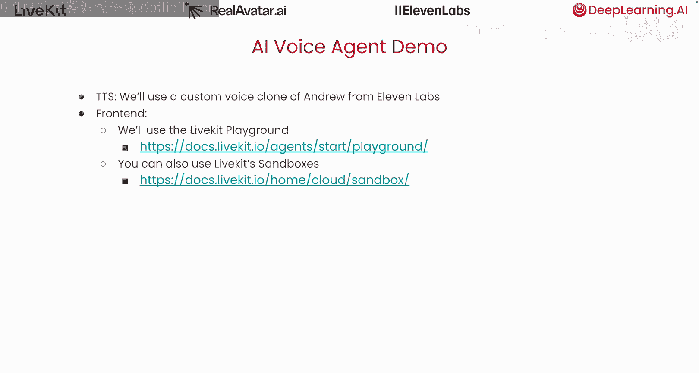
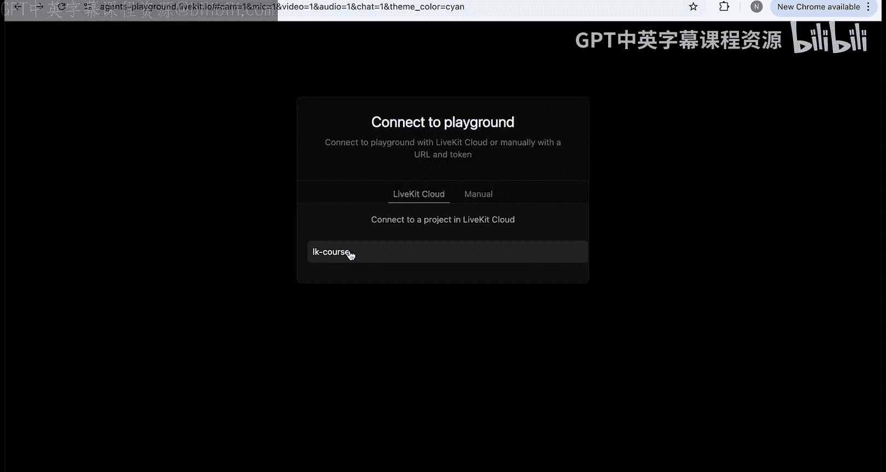
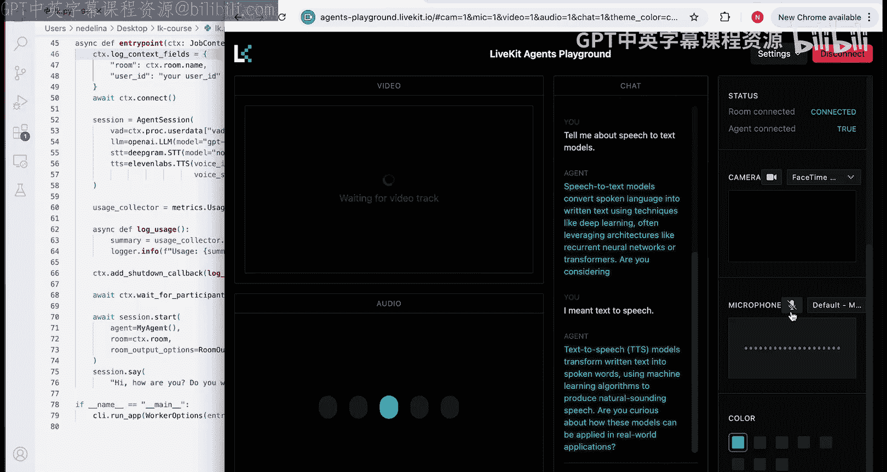

# 吴恩达《构建生产级AI语音助手｜Building AI Voice Agents for Production》中英字幕（deepseek） - P2：1.voice-agent-overview.zh_en - GPT中英字幕课程资源 - BV1A25LzMEkQ

In this lesson you'll dive into the fundamentals of AI voice agents and there are key components such as speech to text。

 text to speech and large language models while analyzing the latency introduced that each layer of the voice agent stack。

 you explore how platforms like life kit mitigate these latency challenges by providing optimized network infrastructure and implementing low latency communication protocols Finally。

 you walk through a minimal example of building a voice agent in Python In touch on practical approaches for evaluating and improving voice agent performance。

 Let's get started before we dive in， you might be wondering what exactly is an AI voice agent simply put an AI voice agent brings together speech capabilities and the reasoning power of foundation models to enable real-time human-like conversations voiceag are useful in a wide range of scenarios in education they can guide personalized skill development or conduct mock interviews in business they can help handle customers。

Service calls while booking a table at a restaurant or assisting with a sale。

 And because voice agent interactions are handsfr。 they can also enhance accessibility。

 Think of a patient using a voice agent to lock symptoms or practice talk therapy at home。 Now。

 let's break down the anatomy of a voice agent stack。

 The system takes as input the user's voice like a user question or request and produces a voice response In some cases。

 that audio output might also be synchronized with video such as a talking head avatar。

 but for this course will focus on audioon interactions。

 when designing the internals of a voice agent we have two main options。

 The first is to use a speech tope or realtime API。

 This option is simpler to implement but it offers less flexibility and control over the agent's behavior。

 The second and the approach will primarily focus on in this course。 is the pipeline approach。

 The voice agent pipeline is made up of three components。A speechee to text model or API。

 an LOM or agentic framework and a text to speech model or API that generates the final audio output Let's take a more detailed look。

 a each component of the voice agent pipeline。 The first component is automatic speech recognition or ASR also referred to as speech to text or STt。

 This involves transcribing a given audio signal， typically a waveform into text。

 The input is raw audio and the output is the corresponding transcription。

 The second component is the large language model or a broader agentic workflow。

 which generates a response based on the trand text。

 This layer may involve one or more LOm agents often enhanced with tool use memory or planning abilities。

 As an aside a voice agent can also produce transcripts enriched with supporting materials such as images or length As a pipeproduct of its functionality。

 This pipeline can be generalized to support such。Multtimodal L1 responses。

 enabling the display of both spoken output and visual context when needed。

 The third component is text to speech or TtS。 Also known as speech synthesis。

 This is the task of converting the generated text back into natural sounding intelligible speech。

 The input here is text and the output is audio In a demo you'll see shortly。

 the synthesized voice is that of Andrew。 Beyond these three main components it is important to highlight two additional tasks that are essential for correctly processing human speech and occur before the ASr step。

 The first is voice activity detection or V which determines whether human speeches present in the audio signal。

 For example， a lack of detected speech may correspond to natural pause or to sections dominated by background noise。

 The second task is end of turn detection which identifies when a speaker has completed their turn in the conversation。

 This is a nontrivial challenge。Speech often includes pauses of varying lengths。

 depending on the speaker's language， habits and expressive style。

 Now that we've reviewed the core components of the two voice agent architectures。

 the next question is， how do we actually build these components。 Fortunately。

 we don't need to star from scratch。 Instead， we can focus on the parts of the stack that matter most for our specific use case。

 For instance， depending on the application and components may require more attention than others。

 if you're developing a voice agent for a clinical setting， for example。

 the AsR component becomes critical， you'll need to accurately recognize specialized medical vocabulary and meet strict precision requirements。

 On the other hand， if you're working on a restaurant booking agent。

 the LM or agented workflow becomes more important。

 as you'll need robust reasoning and reliable tool use to avoid issues like overbooking tables。

 unless your use case requires a specialized or device model， you can choose from a wide。

of providers for TtS， STt and LLM As On this slide。

 we've listed some of those options in the gray boxes。 and as you can see。

 many providers are available and worth exploring in the demo。

 a DNA of the lesson we use open AI for STt and 11 labs for Tts for a text to speech output we trained an 11 labs custom voice model using a recording of Andrew's voice to create a consistent and personalized AI voice clone for speech synthesis Finally。

 for the LLm component a flow latency is a key requirement。

 you may want to explore open source Lama models served by a fast inference provider such as Grog Crebras or togetherge AI If you choose to build your voice agent using the speech to speech or realtime API approach there are also several providers available to support that workflow these As abstract away much of the underlying pipeline in our ideal for use cases where rapid deployment is more important than fine。

Control regardless of which agent architecture you choose。

 you'll face one major challenge timing humans expect responses within a narrow window。

 And if the system lags the interactions quickly feel unnatural to maintain a smooth conversational flow your infrastructure must support load latency audio streaming and efficiently manage input and output streams in the pipeline approach。

 for example， you'll need to orchestrate real-time interactions across multiple users while ensuring seamless transitions between components like VaD St。

 the Lm and TtS。 without introducing noticeable delays at any stage。 When considering latency。

 it is helpful to start with a baseline。 how quickly do humans expect a response in natural conversation Use studies have shown that on average。

 people anticipate a response within 236 milliseconds after their conversation partner finishes speaking However。

 the standard deviation is quite high around5。In 20 milliseconds。

 which reflects the natural variability in human speech。

 It's also important to note that these numbers are based on English speakers。

 Other languages can exhibit significantly faster or slower response times Now。

 if you look at the table on the slide we can see the latency introduced by each step in the voice agent pipeline In the best case scenario with efficient input output stream handling the lower bound for full voice agent response is approximately 540 milliseconds this places it just within one standard deviation of human expectations。

 However， depending on the service level agreements of the provider you use the latency can increase over a second and a half which users with almost certainly notice So how can we approach the lower bounds of latency that align with natural human conversation the key lies in real time peerto peer communication。

 which enables direct data exchange between devices bypassing intermediary servers and significantly reduced。

DesIn this setup， your client， such as a web browser or mobile device acts as one peer while your voice agent backend functions as the other Lifekit's infrastructure is designed to support this with a globally distributed mesh network for media forwarding at the core of the system are several technologist First。

 web RtC， a web realtime communication is an open source project that provides web and mobile applications where realtime communication capabilities through standardized APIs。

 Second， web socket is used to establish a client server handshake enabling efficient signaling and session management。

 Finally， livekit's open source implementation relies on a synchronous processing and careful management of input output streams and streaming APIs。

 particularly for the STt TtS and LLm components This ensures smooth low latency performance throughout the voice agent pipeline While the underlying peer。

Your infrastructure is complex and something Rus will walk you through later in the course。

 Lifekit abstracts much of that complexity and makes it remarkably simple to define an AI voice agents with just a few lines of code on this slide you can see a minimal example of how to set up a voice agent backend there three main components to focus on first defining the agent itself including any prompts second the agent session which links together your chosen speech to text LoOm and text to speech providers into a functional pipeline and third the entry point function which is executed as the main function for each new peertope communication you'll dive deeper into the code and configurations later in the course For now note that in the demo end of this lesson we said the TtS voice id variable in the code to reference a custom11 labs voice clone with trained at real avatar to wrap up this section I want to highlight a few unique challenges that come with building voicebased。

Applications first， speech diss such as filler words likem or long pauses can introduce artifacts in transcription and affect end of turn detection。

 These issues then propagate into the input given to the LLM。 potentially reducing output quality。

 Second， if you're working on multilingual voice agents。

 keep in mind that multilingual ASR models generally underperform compared to English ASR。 Now。

 let's turn briefly to latency optimization。Accurately measuring latency in practice is challenging。

 especially when trying to separate clan side delays from server-side delays to help minimize those delays by design。

 Lifekiit provides a low latency network infrastructure in STt LLm TtS pipelines the LLm component is often the main source of latency to reduce it you can use smaller or quantized models when self-hosting or opts for faster inference providers if you are relying on LLM APIpis you can also prompt the LLM to generate shorter of stage replies to reduce perceived latency response time。

 Now let's see this in action I'm going to show you a brief demonstration of the voice agent we use in our Andrew avatar the voice agent backend is running locally on my laptop for the frontend will use the livekit playground。

 which is a versatile web frontend that makes it easy to test your multimodal AI agent without having to worry about the UI until you're happy with your backend。

And。Here on the left hand side， you can see the voice agent code。

 which is very similar to the minimal example code I showed you earlier You'll learn more about voice pipeline agents later in the course in the back end on the right hand side。

 you see the code running locally on my computer in the command line。

 Here's the left kit playground running on my browser， I've created a project for the course。

 Left kit course。

And now I'm going to connect。Hi， how are you， Do you want to learn more about machine learning？

Tell me about AI voice agents。AI voice agents are systems that use natural language processing and machine learning to understand and respond to human speech。

 providing information or performing tasks。 Are you interested in building one or learning how they work in more detail。

Wow， I think it turned out really well。 It sounds a lot like Andrew， don't you think？Okay。

 let's try voice activity detection if this works， we should be able to interrupt and the avatar should stop speaking。

Tell me about speech to text models。Speech to text models convert spoken language into written text using techniques like deep learning。

 often leveraging architectures like recurrent neural networks or text to speech。Text to speech。

 TTS models transform written text into spoken words using machine learning algorithm to produce natural sounding speech。

 are you curious about how these models can be applied in real world applications？Okay。

 the voice activity detection allowed us to interrupt， this is great。

Let's go on the next lesson where you'll learn more about the details of the end to end architecture of a voice agent。

